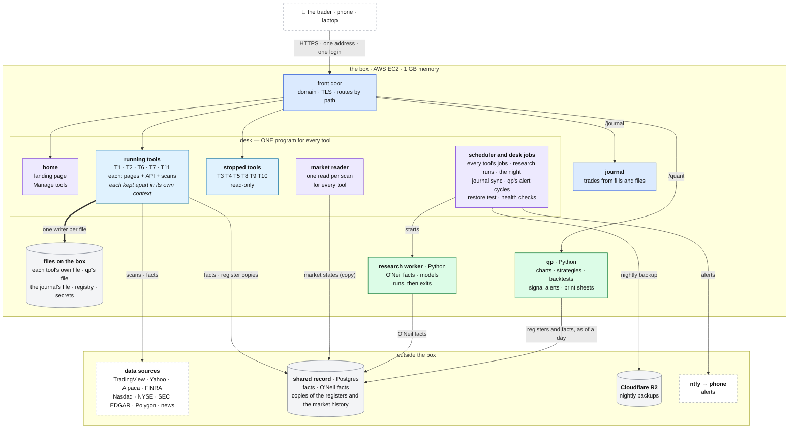
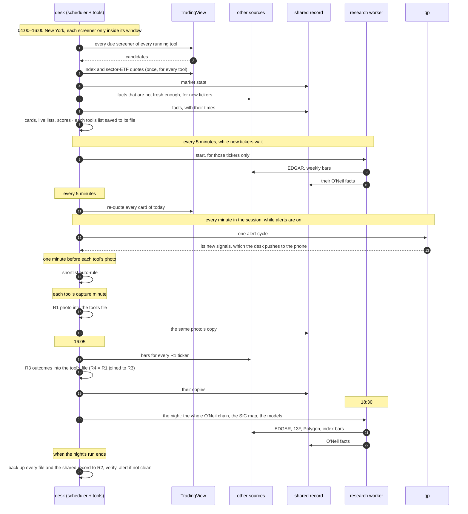

# Trade Desk: the architecture

This is the top of the design. It shows the whole desk in one diagram
([§2](#2-the-whole-desk-in-one-picture)) and explains every block in it.

**How the design is laid out.** It is a tree.
- Every block in the diagram has its own document one level down, with its own
  diagram of what is inside it.
- Where a block has parts, each part has its own document below that, and so on
  down to the level where the detail ends.
- Each document starts by naming the document above it.
- Read this one first, then go down only into the branch you need. The way
  back up is always the first line.

**Decided on 2026-10-08:** the desk runs as **one program for every tool**
([§2.3](#23-why-one-program)). This replaces an earlier plan for two programs,
one for the pages (desk-web) and one for the jobs (desk-worker). §2.3 says why,
and [§8](#8-decisions) records it.

**What it is built on.** The design is built on the desk that runs today,
which is documented in full under [legacy/](legacy/). The old desk holds what
the new one must keep: every card field and its source, every calculation, the
research method, the O'Neil method and the journal's design. Where the old desk
failed, the document for that block names the failure and says what prevents it.

---

## Contents

1. [What the desk is for](#1-what-the-desk-is-for)
2. [The whole desk, in one picture](#2-the-whole-desk-in-one-picture)
3. [How the blocks share data](#3-how-the-blocks-share-data)
4. [A trading day, end to end](#4-a-trading-day-end-to-end)
5. [Rules that apply everywhere](#5-rules-that-apply-everywhere)
6. [Running it on the box](#6-running-it-on-the-box)
7. [Where the build stands, and the way there](#7-where-the-build-stands-and-the-way-there)
8. [Decisions](#8-decisions)
9. [Risks, and what contains them](#9-risks-and-what-contains-them)
10. [The document tree](#10-the-document-tree)
11. [Words used here](#11-words-used-here)

---

## 1. What the desk is for

One trader, one small server, a phone and a laptop. The desk does six jobs:

| # | Job | The question it answers |
|---|---|---|
| 1 | **Find** | which stocks are worth looking at right now, by each of my methods? |
| 2 | **Know** | everything about each of those stocks, on one card: price structure, volume, float, short interest, borrow, news and catalyst, market and sector context, industry group, the full CANSLIM reading |
| 3 | **Read the market** | should I be trading at all today, which way, and where is the leadership? |
| 4 | **Learn** | which methods find stocks that move, and which cards are likeliest to move? |
| 5 | **Test** | if I traded this rule on the stocks my methods found, on the days they found them, what would have happened? |
| 6 | **Review** | what did I actually trade, and how did it go? |

Job 2, **the card**, is by far the largest part of the desk.
- It draws on ten external sources.
- Today it takes twelve processing stages in every scan, and a six-step chain
  every night.

### The research method (kept exactly)

The desk is a research instrument before it is a trading screen. Its method was
learned on the live desk and is documented in
[legacy/screeners/METHODOLOGY.md](legacy/screeners/METHODOLOGY.md). It does not
change:

- **A tool is one method.** Each tool has its own screeners, its own photo
  time, its own history and its own model. Tools never learn from each other.
- **One photo a day per tool (R1).** At the tool's capture minute, every card
  is frozen exactly as it is known then. Only photographed cards are training
  data.
- **Success is movement, measured in ATR.** It is measured from the entry
  minute to the close:
  - `upR = (highest high − entry) ÷ ATR14`;
  - `downR = (entry − lowest low) ÷ ATR14`.

  A good move is 1.3 ATR or more. There is no stop, target or exit in this
  measure: it judges what a screener finds, not a trade.
- **Two entries, A and B**, a few minutes apart, always kept separate.
- **A benchmark** (Stocks in Play) that every screener must beat.
- **A mirror** for every screener, to test whether its direction is real.
- **Shared facts are labels, never filters.** Market and sector context, O'Neil
  data and the cross-tool shortlist inform a card, but they never change which
  cards a tool finds.

### What the desk does not do

It places no orders. An earlier live trading engine was removed from the code.
Its leftovers in the journal are recorded in
[legacy/journal/](legacy/journal/README.md) and are not part of this design.

### What the design must respect

| Constraint | What follows from it |
|---|---|
| **One trader** | one login, no accounts or roles; simple beats scalable |
| **One small box**: an AWS EC2 t3.micro, 912 MiB of memory, with swap | every program has a memory budget ([§6](#6-running-it-on-the-box)); a tool must cost a few megabytes inside the desk, not a program of its own |
| **Free data** | public and free-tier sources. Two of them are unofficial: TradingView's scanner and Yahoo's quote API. Each source has limits and can change without notice ([§9](#9-risks-and-what-contains-them)) |
| **New York hours** | the desk works 04:00–16:00 New York time on trading days. The morning photos (09:36 to 10:16 today) are the minutes that matter most |
| **No orders** | the desk finds, explains, measures and records; it never trades |

### What it must achieve, in order

When two goals pull against each other, the higher one wins.

1. **A true research record.** Every photo holds exactly what was known at its
   minute: nothing later leaks in, and nothing missing is guessed.
2. **No silent failure.** These all show on one page and reach the phone:
   - a failed or missed job;
   - a stale fact family;
   - a sick source.
3. **Ready every morning.** Discovery, cards and photos run on every trading
   day. A crashed program restarts in seconds and loses nothing.
4. **Fits the box.** Every program stays inside its memory budget.
5. **One person can run it.** One command to deploy, one to restore, one
   health page.
6. **Every number explains itself.** Its source, its time and its definition
   are one tap away.

---

## 2. The whole desk, in one picture



Not every line is drawn, so that the picture stays readable:
- The scheduler also starts each of qp's alert cycles and each of the
  journal's syncs.
- qp and the journal each write their own file.
- The research worker, qp and the journal call data sources of their own:
  EDGAR, 13F filings and bars; bars; Alpaca fills and bars.
- The nightly backup copies every file on the box as well as the shared record.
- The tools shown running and stopped are today's. The benchmark, T9, runs
  again once the move into the desk frees the memory
  ([MIGRATION.md](design/MIGRATION.md) step B).

The table maps every block to its document. The sections after it walk through
each block.

| Block | What it is | Its document |
|---|---|---|
| the box | the one server: its memory, the supervisor, the deploy, the secrets | [design/box/BOX.md](design/box/BOX.md) |
| front door | the one address the trader uses: domain, TLS, one login, routing by path | [design/front-door/FRONT-DOOR.md](design/front-door/FRONT-DOOR.md) |
| **desk** | one Node program that runs every tool: its pages, its API and its scans | [design/desk/DESK.md](design/desk/DESK.md) |
| · home | the landing page, the cross-tool lists and Manage tools | [design/desk/HOME.md](design/desk/HOME.md) |
| · running tools | each tool's screeners, cards, registers, score and pages, inside its own context | [design/desk/TOOL.md](design/desk/TOOL.md) |
| · stopped tools | a stopped tool's history, served read-only | [design/desk/STOPPED-TOOLS.md](design/desk/STOPPED-TOOLS.md) |
| · market reader | the market read, once per scan for every tool | [design/desk/MARKET.md](design/desk/MARKET.md) |
| · scheduler and desk jobs | the only scheduler: every timed job of the desk, its history and its alerts | [design/desk/JOBS.md](design/desk/JOBS.md) |
| files on the box | each program's own files, with one writer each | [design/files/FILES.md](design/files/FILES.md) |
| qp | charts, strategies, backtests, live signal alerts, print sheets | [design/quant/QUANT.md](design/quant/QUANT.md) |
| research worker | the O'Neil chain and the models: runs as a job, then exits | [design/research/RESEARCH-WORKER.md](design/research/RESEARCH-WORKER.md) |
| journal | every real trade, from broker fills and files | [design/journal/JOURNAL.md](design/journal/JOURNAL.md) |
| data sources | every outside source, each behind an adapter | [design/outside/SOURCES.md](design/outside/SOURCES.md) |
| shared record | Postgres: the facts with their times, the O'Neil facts, copies of the registers and of the market history | [design/outside/SHARED-RECORD.md](design/outside/SHARED-RECORD.md) |
| backups | the nightly copy to R2, and the one-command restore | [design/outside/BACKUPS.md](design/outside/BACKUPS.md) |
| alerts | what reaches the phone, and the health page | [design/outside/ALERTS.md](design/outside/ALERTS.md) |

The way from today's desk to this one:
[design/MIGRATION.md](design/MIGRATION.md).

### 2.1 The trader and the front door

**What it is.** The trader uses one address on a phone or a laptop. One program
answers it: the front door.
- **TLS and the address:** Caddy terminates TLS on a free DuckDNS name.
- **Routing by path:**
  - `/` and `/tools/T<n>/` go to the desk;
  - `/quant/` goes to qp;
  - `/journal/` goes to the journal.
- **Login:** one login for the whole desk. One cookie works in every program,
  and every program checks it.
- **Ports:** every other port is closed to the outside.

**What it never does.** It holds no state and computes nothing. If it stops,
the desk keeps scanning; only the pages are out of reach until it restarts.

**Detail:** [design/front-door/FRONT-DOOR.md](design/front-door/FRONT-DOOR.md).

### 2.2 The desk

**What it is.** One Node program. It holds every tool, running or stopped, and
does for each one what a tool's own program does today:
- serves its pages and its API;
- runs its screeners on schedule;
- builds and refreshes its cards;
- takes its photo and measures the outcomes;
- keeps its shortlist and its score.

**How the tools are kept apart.** Each tool runs inside its own **context**. A
context holds the tool's identity, its file, its live list, its scan status and
its jobs. Code always works for the tool whose context it runs in, so two tools
in one program can never read or write each other's data. A tool is therefore a
row in the registry and a context in the desk, not a program: adding a tool
costs a few megabytes, not a process.

**Its five parts:**
- **Home:** the landing page, the lists across all tools, and Manage tools
  (add, start, stop, pause, edit, delete, restore). These belong to the desk
  itself, not to any tool, so every tool, T1 included, can be stopped.
- **Running tools:** each one's screeners, discovery, cards, live list,
  shortlist, photo, outcomes, score and pages.
- **Stopped tools:** each one's history, served read-only on its own address,
  so charts and backtests of everything it collected keep working.
- **The market reader:** the indexes, regime, sectors and hot sectors, read once
  per scan for every tool, stamped on every card, and kept with its history in
  the desk's own file.
- **The scheduler and the desk jobs:** the only scheduler on the box.
  - It runs every tool's jobs, and the jobs that run once for the whole desk:
    - the research runs;
    - the night (the O'Neil chain, then the backup);
    - the monthly restore test;
    - tool schedule changes;
    - the journal's sync;
    - qp's alert cycles;
    - the health checks and the heartbeat.
  - Every run is recorded, and a failed, missed or hung run reaches the phone.

**How a request reaches its tool.** Every page and API call goes through the
desk's **web layer**:
- one port per tool, so today's addresses keep working;
- the login check;
- the page shell.

It runs each request as its tool.

**What it never does.**
- It never computes O'Neil data: that is the research worker's job.
- It never evaluates trading strategies: that is qp's job.
- It never trades.

**Detail:** [design/desk/DESK.md](design/desk/DESK.md), and below it one
document per part.

### 2.3 Why one program

**What the earlier design wanted, and why.** It split the desk into two
programs, desk-web for pages and desk-worker for jobs, for three reasons:
1. **Memory.** Six programs on a 1 GB box.
2. **Speed and safety.** A slow scan must never freeze the pages, and the
   scheduler must never run twice.
3. **Tools as rows.** Adding or stopping a tool should not mean a program, and a
   restart should lose nothing.

**What building it showed.**
- **The split was the hardest part.** Two programs share no memory. Everything
  a page shows from the scans would have to be copied into the database all day:
  - the live lists;
  - the scan status;
  - the market read;
  - the jobs.

  And every button on a page would have to become a message to the other
  program: scan now, a star, a bias, a job switched off. That copying is the
  largest and riskiest part of the whole plan.
- **It broke one-writer-per-file.** Both programs would write each tool's file,
  against the design's own rule of one writer per file.
- **The speed reason hardly applies here.** A scan mostly waits on the network,
  not on the processor. Each tool already serves its pages while it scans,
  without trouble.
- **Two programs save less memory than one.** The memory saving comes from
  loading the code once. Two programs load it twice.

**What one program does instead.** It keeps every one of those reasons:
- **Memory:** one copy of the code for every tool.
- **One scheduler:** one program, so it can never run twice.
- **Tools as rows:** a context, not a process.
- **Nothing lost on a restart:** each tool's live list is saved to its file
  after every change.

It also drops the copying and keeps one writer per file.

**Its risks, and what contains them.**
- **A crash stops every tool for a few seconds.** The supervisor restarts the
  desk, and every tool's list comes back from its file. A photo whose minute
  passed while the desk was down is recorded as missed, and the phone is told.
- **A heavy page could slow a scan.** This is contained by keeping heavy work
  out of page requests. If it ever shows, the same code can still be split into
  two programs later, because the contexts make that possible.

### 2.4 Files on the box

**What it is.** Each program keeps its own files on the box, and each file has
exactly one writer:

| File | Holds | Its only writer |
|---|---|---|
| each tool's own file | the tool's screeners, settings and saved live list; its registers (R1, R2, R3, the shortlist); its jobs and their runs | the desk |
| the desk's own file | the desk jobs, their runs, the desk's alert state | the desk |
| qp's file | strategies, backtests, alert history | qp |
| the journal's file | accounts, fills, trades, notes | the journal |
| the tool registry, the secrets | which tools exist and how they are set up; the keys | Manage tools; the trader |

**Each tool's own file is the record of that tool's results.** It works without
the network, and it keeps each tool's results apart by construction.

**Detail:** [design/files/FILES.md](design/files/FILES.md).

### 2.5 qp

**What it is.** The chart and backtest program, in Python, kept as it is
because it is the best-built part of the desk:
- the verified indicator library;
- the chart;
- the strategy builder;
- the backtest of a rule on the stocks the tools found, on the days they found
  them;
- live signal alerts on today's lists, on its page and, through the desk, on
  the phone;
- print sheets.

**What changes.**
- **Where it reads from.** It reads registers and facts **as of a day** from
  the shared record, instead of asking each tool's port.
- **One evaluator and one fill model.** Preview, backtest and alerts use the
  same ones.
- **No timer of its own.** Each alert cycle is started by the desk's scheduler,
  which pushes the cycle's new signals to the phone.
- **No O'Neil chain.** It no longer hosts the chain; the research worker does.

**Detail:** [design/quant/QUANT.md](design/quant/QUANT.md).

### 2.6 The research worker

**What it is.** A Python job that the desk's scheduler starts. It writes the
slow, heavy facts into the shared record, with their dates, and then exits:
- the whole O'Neil chain;
- the SIC industry map;
- when a model is chosen, the tools' models.

**When it runs.**
- **Every night**, the full chain.
- **Every 5 minutes in the session**, but only for tickers carded for the first
  time.
- **Every 30 minutes in the session**, a provisional M.

It is the only writer of those facts. No page ever waits for it.

**Detail:**
[design/research/RESEARCH-WORKER.md](design/research/RESEARCH-WORKER.md).

### 2.7 The journal

**What it is.** Every real trade, after the fact:
- **Where trades come from:** Alpaca fills synced on a schedule, broker files
  uploaded by the trader, and hand entry.
- **One pairing engine** turns them into round trips, measures them and keeps
  the notes.
- **Its own program and file,** because it shares nothing live with the tools.
- **No timer of its own:** its sync is started by the desk's scheduler.
- **Each trade's snapshot** reads the facts as known at its entry, from the
  shared record.

**Detail:** [design/journal/JOURNAL.md](design/journal/JOURNAL.md).

### 2.8 Outside the box

| Block | What it is | Detail |
|---|---|---|
| **data sources** | TradingView's scanner and news; Yahoo; Alpaca; FINRA, Nasdaq and NYSE; SEC EDGAR; Polygon; Finnhub; Google News. Each is called only through its **adapter**, which states its facts, freshness, limits, fallbacks and health, and says "unavailable, because …" rather than guessing | [design/outside/SOURCES.md](design/outside/SOURCES.md) |
| **shared record** | Postgres. It holds what more than one program or tool needs (below) | [design/outside/SHARED-RECORD.md](design/outside/SHARED-RECORD.md) |
| **backups** | every night, after the night's research run, and before every deploy, every file on the box and a dump of the shared record go to Cloudflare R2, and the dump is verified by restoring it. One command puts a night back; a monthly rehearsal proves it | [design/outside/BACKUPS.md](design/outside/BACKUPS.md) |
| **alerts** | ntfy delivers to the phone: a failed, missed or hung job; a sick source; a backup that did not verify; a recovery. One alert per cause, never repeated while it stands. qp's signals go to their own topic. The desk sends every alert, and an outside heartbeat check alerts when the desk itself stops. One health page shows every signal with its fix | [design/outside/ALERTS.md](design/outside/ALERTS.md) |

**What the shared record holds:**
- facts about the world, each with its time and source;
- a copy of the market history, written at the same moment as the desk's own;
- the O'Neil facts;
- a copy of every register, written at the same moment as the tool's own file
  and compared every day.

That copy keeps the research record safe if the box is lost between two
nightly backups, and it lets qp read any tool's history as of any day.

---

## 3. How the blocks share data

### 3.1 Three kinds of data

| Kind | Example | Rule |
|---|---|---|
| **Facts about the world** | AAPL's short interest; SPY's close; NVDA's quarterly EPS | shared by every tool; stored once, with the time it became known and its source |
| **Results of a method** | T2 found AAPL at 09:41; T2's photo; T2's model | belong to one tool; never shared, never mixed |
| **Records of the trader** | strategies, backtests, trades, notes, settings | belong to the trader; edited only by the trader |

### 3.2 Where each lives, and its only writer

| Data | Lives in | Only writer | Read by |
|---|---|---|---|
| tools, screeners (versioned), windows, capture times | the tool registry; each tool's file; screener versions copied to the shared record | the desk (Manage tools, the builder), checked on save | the desk; qp |
| a tool's settings: its floor override, its shortlist rule, its name and pause | each tool's file | the desk (the tool's Settings), checked on save, versioned | the desk |
| the desk's settings: the tradability floor, the market thresholds | the desk's own file | the desk (home's Settings), checked on save, versioned | the desk |
| the switches: the shared record's address, the area modes, the alert topics | `data/keys.json`, mode 0600 | the trader (`scripts/set-setting.js`) | every program |
| the live list (R0) | the desk's memory, saved to the tool's file after every change | the desk | the desk's pages |
| facts: quote, short interest, borrow, Reg SHO, news, catalyst | the shared record (history and latest); the desk's memory for the day | the desk, each family through its adapter | the desk, qp, the journal |
| the market history: market states, hot sectors | the desk's own file, with a copy in the shared record | the desk's market reader | the desk, qp |
| O'Neil facts, SIC map | the shared record | the research worker | the desk, qp, the journal |
| registers: R1, R3, shortlist (R2 is the market history at fixed minutes; R4 is R1 joined to R3) | each tool's file, with a copy in the shared record | the desk (only its jobs write them) | the desk, qp, the research worker |
| models, scorecards | the shared record (models); computed on request (scorecards) | the research worker | the desk |
| strategies, backtests, alert history | qp's file | qp | qp |
| accounts, fills, trades, notes | the journal's file | the journal | the journal |
| job definitions and runs, alert state | each tool's file (tool jobs); the desk's own file (desk jobs) | the desk's scheduler | the desk's pages |
| secrets | one secret store, mode 0600 | the trader | every program |

**One writer per file, one writer per fact family.** Two sources for one fact
are both stored, each with its source, in a stated priority. One never
overwrites the other.

### 3.3 Facts, with their time

Every fact the desk knows about a ticker or the market is one row of the
shared record's fact store:

| Field | Meaning |
|---|---|
| subject | the ticker, index or market it describes |
| family | `quote`, `short_interest`, `borrow`, `news`, `oneil_c`, `rs_rating`, … |
| value | its fields |
| status and reason | `ok`, `none` (the source answered: nothing) or `unavailable` (could not ask), with the reason |
| source | which adapter produced it |
| known_at | when the desk learned it |
| as_of | what date or instant it describes |

Everything else is read from this table:
- **The card:** for each family, the latest fact known at that instant.
- **A photo:** the card at the capture minute, frozen.
- **A backtest:** the facts known before its decision bar, so nothing looks
  ahead.
- **A journal snapshot:** the facts known at the trade's entry.

How a family is fetched, how fresh it must be and what a card does without it:
[design/desk/tool/CARD.md](design/desk/tool/CARD.md). The tables:
[design/outside/SHARED-RECORD.md](design/outside/SHARED-RECORD.md).

### 3.4 Time

- **Instants, days, clocks.** Every instant is stored in UTC. Every trading day
  is a New York date. Every clock time shown is New York time.
- **One trading calendar** serves every block: sessions, holidays and half
  days. On it:
  - jobs run only on trading days;
  - a half day ends the session at its early close;
  - staleness, look-backs and outcomes are counted in sessions, not hours.

---

## 4. A trading day, end to end



| Time (New York, trading days) | Job | Block |
|---|---|---|
| 04:00–09:00 every 30 min; 09:00–10:00 every 5; 10:00–16:00 every 15; 16:00 | discovery scans (each screener only inside its run window) | running tools, market reader |
| 04:00–16:00 every 5 min | re-quote every card of today; re-score | running tools |
| 04:00–16:00 every 5 min, while any wait | research run for tickers carded for the first time | desk jobs → research worker |
| 09:30–16:00 every 30 min | provisional M | desk jobs → research worker |
| 09:25–16:05 every minute, while alerts are on | qp's alert cycle | desk jobs → qp |
| 09:26, 09:31 … 10:01 | R2: the market history at these minutes, a view that no job writes | market reader |
| each tool's capture minute − 1 | shortlist auto-rule | running tools |
| each tool's capture minute (09:36 … 10:16 today) | R1 photo | running tools |
| 16:05 (half days: 15 minutes after the close) | R3 outcomes | running tools |
| 16:20 | training and scorecards (when a model is chosen) | desk jobs → research worker |
| 16:50 | tool schedule changes made during the session take effect | desk jobs |
| 18:30 | the night: the O'Neil chain, the SIC map | desk jobs → research worker |
| when the night's run ends | backup and its verification | desk jobs |
| on each account's schedule | journal sync | desk jobs → journal |
| the 1st of each month, 09:10 | restore rehearsal | desk jobs |
| 00:00 | each tool's live list starts a new day | running tools |

### 4.1 When something goes wrong

| Event | What the desk does |
|---|---|
| a source fails or answers nonsense | its families show `unavailable` with the reason, and the cards still build. Health turns amber or red, and an alert names the source and the fix |
| TradingView changes or drops a column | the alignment check refuses the batch, and the scan report says why. Health goes red. No card gets shifted values |
| the desk crashes | the supervisor restarts it in seconds. Every tool's list comes back from its file, and every job's history is in its file. A slot that passed while it was down is recorded as missed, with an alert. If it does not come back, the outside heartbeat check alerts within 15 minutes |
| a photo's minute passes with the desk down | the photo is recorded as missed. It is never taken later as if on time |
| a scan outlasts its slot | the next slot is skipped and recorded; two scans of one tool never run at once |
| the research worker fails or does not run | each step reports on its own. Facts keep their dates, so cards say "last run DATE". An alert is sent |
| the shared record is down | each tool keeps working from its own file and fetches its facts itself. The copies and the shared facts wait, and the gap is said on the health page |
| qp or the journal is down | the desk is unaffected. The scheduler records the failed cycle or sync, and alerts |
| the box is lost | the outside heartbeat check alerts within 15 minutes. A new box: install, restore the secrets, then `desk restore <date>`. The shared record still holds the copy of every photo taken since the last backup |

---

## 5. Rules that apply everywhere

These rules come from faults found on the live desk. They extend the fifteen
rules recorded in the legacy screener documents
([legacy/screeners/README.md](legacy/screeners/README.md#rules-a-rebuild-must-keep)).
Every document applies them to its own block.

| Rule | Means | Learned from |
|---|---|---|
| **Honest null** | a missing value is `unavailable` or `none` with a reason; never 0, never bearish, never "no" | D-S2, F-14 |
| **No look-ahead** | every computed value uses only what was known at its instant; bars after an entry never reach that entry's snapshot | F-20, D-J13 |
| **A label, never a filter** | shared facts never change which cards a tool finds | the research method |
| **One writer per fact, one writer per file** | every file, table and fact family names its single writer, and a writer touches only its own. Two sources are both stored, with a priority | F-21, D-S1 |
| **Isolate results, share facts** | a tool's results, model and history never reach another tool; in the desk, its context keeps them apart | the research method |
| **One definition per number** | each formula is written once, in one place, and named in its document | D-J17, Q-N9 |
| **Versioned definitions** | a screener, a check or a model that changes gets a new version, and history records which one ran | screener mixing, the check library |
| **Checked on save** | configuration that cannot work is refused when saved, with the reason | D-S9 |
| **Failures are loud** | a job that fails or does not run sends an alert; a silent no-op is a bug | Q-N5, J-4 |
| **One photo, at its minute** | a photo is taken only by the scheduler at its minute. A late one is marked late and kept out of training. A photo is never replaced | D-S9, D-D8 |
| **No overlap** | a job never runs twice at once; an overrun skips the next slot and says so | the legacy scan guard |
| **Sessions, not hours** | staleness, look-backs and outcomes are counted in trading sessions on the calendar | weekday arithmetic; the 36-hour stale-file check |
| **Proven before it ships** | every change runs the tests in CI; every source and file format has fixtures; a move is compared with what it replaces before the old part stops | the untested journal importer |
| **Secrets stay put** | keys live in one secret store, mode 0600, never in a reply, a log, git or a backup | S-2 (keys pushed to GitHub) |
| **Real instants** | UTC stored, New York shown, one trading calendar | D-J8, D-J10, D-J12 |

---

## 6. Running it on the box

**The box.** An AWS EC2 t3.micro: 912 MiB of memory and a swap file, which the
deploy requires.

On 2026-10-06 the desk's programs used about 724 MB beside the operating
system:

| Program | Memory |
|---|---|
| five tool programs | 89–91 MB each |
| qp | 129 MB |
| the archive | 78 MB |
| the journal | 66 MB |

| Program | Supervised as | Memory |
|---|---|---|
| desk (every tool) | a pm2 process | about 150–250 MB (estimate, measured as tools move in) |
| qp | a pm2 process | 70–150 MB (129 MB measured) |
| journal | a pm2 process | about 66 MB (measured) |
| front door (gateway and Caddy) | pm2 processes | 40–80 MB |
| research worker | a job started by the desk; exits when done | 100–150 MB for a run of new tickers; 200–400 MB for the night's run |
| shared record | off the box (Railway) | 0 on the box; 60–100 MB if it moves onto the box ([§8](#8-decisions)) |
| operating system | — | about 150 MB |

That is about 500–650 MB of programs and system, against about 724 MB of
programs alone today, before the gateway (deployed since) added its share. The
box has almost nothing to spare, and that sets the order of the move
([MIGRATION.md](design/MIGRATION.md) §3.2).
- **The night's run** happens at 18:30, when no scan is due. It may lean on swap.
- **A 2 GB box** removes the squeeze.

**One supervisor.** pm2 supervises every program, with a memory limit for each.
Nothing runs under systemd as well. The nightly timer of the old chain is
retired when the desk's night job takes over.

**Deploy.** One command, `./deploy-tools.sh`:
- pulls and checks, then backs up every file and the shared record (to
  build), because a restart is when migrations run;
- restarts in order: the desk, qp, the journal, the front door;
- checks each program's health page;
- stops at the first failure and says why;
- refuses to run within 15 minutes of a tool's photo unless forced (to
  build: today's deploy does not check this yet).

CI runs every test on every pull request, and red blocks the merge.

**Backup and restore.**
- **Backup:** every night, after the night's run, and before every deploy:
  - every file on the box;
  - a dump of the shared record;
  - the register exports.

  They go to Cloudflare R2. The dump is verified by restoring it into a scratch
  schema and counting rows.
- **Restore:** `node scripts/desk.js restore <date>` puts a night back. It
  stops the programs, sets the live files aside, restores, and checks health.
- **Rehearsal:** a monthly rehearsal proves the restore.

Keys are restored from the trader's own copy, never from the backup.

**Detail:**
- the box, the supervisor, the deploy and the secrets:
  [design/box/BOX.md](design/box/BOX.md);
- backup and restore:
  [design/outside/BACKUPS.md](design/outside/BACKUPS.md).

---

## 7. Where the build stands, and the way there

**Status on 2026-10-08.**
- Migration steps 1–14 are merged and deployed.
- The first two parts of the desk are merged:
  - **the tool context** (one program can hold several tools, each kept
    apart);
  - **the comparison copy** (the desk runs a copy of a tool beside the tool's
    own program and compares their photos every day).

| Block | Status | What exists today |
|---|---|---|
| front door | **built, not live** | `desk-gateway` serves every program on one port by path, and the one login works everywhere. The domain and TLS script is ready but not run, and the other ports are still open |
| desk | **being built** | the tool context and the comparison copy are merged; the comparison is not yet started on the box. The tools still run as five programs (T1, T2, T6, T7, T11) |
| · home | **in T1** | the landing page and Manage tools are served by T1, so T1 cannot be stopped |
| · stopped tools | **the archive program** | one read-only program serves the six stopped tools' registers on their ports |
| · market reader | **in shadow** | one market read per scan is stored with its history in the shared record, and hot sectors survive restarts; each tool still reads its own. Not built: the history in the desk's own file; R2 as its view |
| · scheduler and desk jobs | **partly** | every run recorded, alerts on failed, missed or hung runs. But: one scheduler per tool; the desk jobs run in T1; the journal and qp keep their own timers |
| files on the box | **built** | one SQLite file per tool; qp's and the journal's files |
| qp | **partly** | alerts use each strategy's own fill model, and their history survives restarts. Reading registers from the shared record is built but off. Facts "as of a day" are not built |
| research worker | **built, in shadow** | the O'Neil facts are written with their dates, but the cards still read qp's. The nightly chain still runs from qp's own timer |
| journal | **partly** | one pairing engine for every source. Stops and the entry snapshot from the shared record are not built |
| data sources | **partly** | short interest, borrow and news go through the fact store, in shadow; the other sources are called from inside the pipeline's stages |
| shared record | **built, in shadow** | Postgres on Railway: facts, market states, all eleven tools' registers (imported, 0 differences), discovery scans, research runs |
| backups | **built** | a nightly backup with a verified dump, a one-command restore and a monthly rehearsal. Not built: the backup before every deploy; the analysis files as Parquet |
| alerts | **partly** | ntfy reaches the phone (tested on 2026-10-08) for the photo, the outcomes, the night and the rehearsal. Not built: the other jobs' alerts, the source and freshness checks, the health page, the heartbeat, signals on the phone |

**The way there.** Each step ships on its own, keeps the desk working, is
compared with what it replaces, and can be undone. The desk starts with the
stopped tools because the box has no memory to spare: the desk replaces the
archive, each comparison copy is then a context of tens of megabytes rather
than a program, and each tool that moves frees its own program.

| Step | What | Undo |
|---|---|---|
| A | **The desk program starts, with the stopped tools.** It serves every stopped tool's history read-only, each route compared with the archive's answer; then the archive program stops | start the archive again |
| B | **The desk takes the running tools, one at a time.** Each first runs in the desk as a comparison copy, which must take the same photo as the tool's own program for a week. Then that tool's own program stops and the desk runs it: pages, API and scans. T1 moves last, with home and the desk jobs. Then the benchmark, T9, stopped for lack of memory, runs again | start the tool's own program again |
| C | **One scheduler.** qp's alert cycles (with their signals pushed to the phone) and the journal's sync are started by the desk; the old nightly timer and backup cron are retired; every job alerts; the deploy backs up first | each program's own timer again |
| D | **Shared facts and the market read are switched on,** each family when its comparison is clean; qp reads registers and facts as of a day | back to shadow |
| E | **Pages and checks that use it:** the health page with its checks (sources, fact freshness, programs, the box, sign-ins) and the outside heartbeat; scorecards; live updates; phone first; ⓘ on every label | additive |
| F | **The model,** when the trader chooses one | the empty slot again |

Detail, with each step's check:
[design/MIGRATION.md](design/MIGRATION.md).

---

## 8. Decisions

| Decision | Options | Decided |
|---|---|---|
| How the desk runs its tools | one program per tool (today); two programs, desk-web and desk-worker (the earlier design); one program for every tool | **one program for every tool** (2026-10-08, by the trader). Why: [§2.3](#23-why-one-program) |
| Where a tool's results are kept | in its own file, with a copy in the shared record; or only in the shared record | **in its own file, with a compared copy in the shared record**. Here, with one program, no second program needs them. A remote-only record would make every page and every scan depend on the network. The copy protects the research record between nightly backups |
| The database | Postgres; SQLite | Postgres, for the shared record |
| Where the shared record lives | Railway; on the box; AWS RDS | **open**: Railway for now, to be decided by the trader. Moving is one restore. On the box it costs 60–100 MB of memory |
| Where it runs | the t3.micro; a 2 GB instance | the t3.micro; one program frees most of the memory |
| A domain name | needed for one HTTPS address | a free DuckDNS name with Caddy; the script is ready, not yet run |
| Push alerts | ntfy, Pushover, Telegram | ntfy, working. Faults and qp's signals on two topics |
| Who watches the desk itself | nothing; a script on the box; an outside heartbeat check | **an outside heartbeat check** (healthchecks.io, free): only a watcher off the box sees the box itself stop |
| The language | JavaScript; a rewrite in TypeScript | JavaScript, with the shared definitions in one module. A rewrite adds risk without a trading gain |
| The discovery engine | merge identical scans across tools | **off, and retired with the move**: with every tool's screeners different, it saves no request |
| T6's photo (D-S9) | move it after 11:30 with its entries; or open the window earlier | **open**: it decides what T6 measures |
| The model | build one now; prepare only | prepared only; the trader may choose one later |

---

## 9. Risks, and what contains them

| Risk | Likelihood · impact | What contains it |
|---|---|---|
| TradingView's scanner is an unofficial endpoint: it can change columns, add limits or refuse the desk | medium · high: no discovery, no quotes | one adapter; the alignment check refuses shifted answers; fixtures in CI; a health check before the day's first scan; the scan report names the cause. No free replacement exists, so the desk says plainly when it is blind |
| Yahoo's quote and chart endpoints are unofficial (cookie and crumb) | medium · medium | short interest falls back to Nasdaq (FINRA comes first anyway); outcome bars fall back to Alpaca; index bars for M have no fallback, so M says "not built today" |
| free tiers: Polygon end of day only, Alpaca's IEX feed (thin volume, short history), EDGAR ten requests a second | certain · bounded | each adapter states its limits; the hybrid feed's volume seam is named on the chart; the research worker has a time budget per night |
| one program for every tool: a crash stops them all | low · medium | the supervisor restarts in seconds; every list and job history is in its file; a missed photo is recorded and alerted; every job is wrapped so one tool's error cannot reach another |
| one box, no redundancy | low · high | verified nightly backups; one-command restore, rehearsed monthly; the shared record's copy of the registers |
| the photo window: a crash or a deploy at a capture minute costs a tool a day of research | low · medium | the restart takes seconds; deploys are refused near capture minutes; a missed photo is recorded, never faked |
| memory on a 912 MiB box | medium · medium | a budget per program, limits in the supervisor, swap, the night's run when no scan is due; a 2 GB box removes it |
| the shared record is remote (Railway) | medium · low | each tool works from its own file without it; the gap is shown and caught up; moving it is one restore |
| a confidently wrong source: plausible numbers that are wrong | low · high | the cross-source agreement check on bars; sanity checks in every adapter; every fact keeps its source |

---

## 10. The document tree

Read from the top. Each document names the one above it in its first line,
and has its own diagram.

```
ARCHITECTURE.md ........................ the whole desk (this document)
│
├── design/box/BOX.md ................... the box: memory, supervisor, deploy, secrets
├── design/front-door/FRONT-DOOR.md ..... the address, TLS, routing, the one login
├── design/desk/DESK.md ................. the desk: one program, a context per tool
│   ├── design/desk/WEB.md .............. how a page or an API call reaches its tool
│   ├── design/desk/HOME.md ............. landing page, cross-tool lists, Manage tools
│   ├── design/desk/TOOL.md ............. one running tool, end to end
│   │   ├── design/desk/tool/SCREENERS.md   screeners, windows, versions, discovery
│   │   ├── design/desk/tool/CARD.md ....... the card: fact families, fields, the pipeline
│   │   ├── design/desk/tool/REGISTERS.md .. R0–R4, the shortlist, the photo
│   │   ├── design/desk/tool/LEARNING.md ... the score and the scorecard
│   │   └── design/desk/tool/PAGES.md ...... the tool's pages and its API
│   ├── design/desk/STOPPED-TOOLS.md .... a stopped tool's history, read-only
│   ├── design/desk/MARKET.md ........... the market read: regime, sectors, hot sectors
│   └── design/desk/JOBS.md ............. the scheduler and the desk jobs
├── design/files/FILES.md ............... every file on the box, its tables, its writer
├── design/quant/QUANT.md ............... qp
│   ├── design/quant/CHART.md ........... the page and the print sheets
│   ├── design/quant/LIBRARY.md ......... the verified indicators
│   ├── design/quant/STRATEGIES.md ...... the strategy engine: rules, fills, the order
│   ├── design/quant/BACKTEST.md ........ the backtest: universes, honesty, the report
│   ├── design/quant/SIGNAL-ALERTS.md ... live signal alerts
│   └── design/quant/FEEDS.md ........... bars: feeds, warm-up, the cache
├── design/research/RESEARCH-WORKER.md .. the research worker
│   └── design/research/ONEIL.md ........ the O'Neil method, letter by letter
├── design/journal/JOURNAL.md ........... the journal
│   ├── design/journal/IMPORT.md ........ fills, files, the pairing engine
│   └── design/journal/REVIEW.md ........ the page, the analysis, the entry snapshot
├── design/outside/SOURCES.md ........... every outside source and its adapter
├── design/outside/SHARED-RECORD.md ..... the shared record: every table
├── design/outside/BACKUPS.md ........... backup, restore, rehearsal
├── design/outside/ALERTS.md ............ alerts and the health page
└── design/MIGRATION.md ................. from today's desk to this one
```

The legacy documents are the evidence the design is built on. Each document
in the tree lists the ones it uses:
- [screener tools](legacy/screeners/README.md);
- [qp](legacy/qp/README.md);
- [journal](legacy/journal/README.md);
- [today's architecture](legacy/architecture/ARCHITECTURE.md).

The open findings of the old desk:
[screeners](legacy/screeners/KNOWN-ISSUES.md), [qp](legacy/qp/KNOWN-ISSUES.md),
[journal](legacy/journal/KNOWN-ISSUES.md).

**Every document in the tree has the same parts, in the same order:**
1. **Its place:** the document above it, and the blocks it talks to.
2. **What it is:** its job, what it owns, and what it never does.
3. **Its diagram:** what is inside it, and how it connects.
4. **Its parts:** each one explained, with the document below it where there
   is one.
5. **Its contracts:** the files, tables, fact families and routes it owns or
   reads.
6. **When it fails:** what happens, and what contains it.
7. **Built on:** what the old desk did and what failed there, by fault ID,
   with the legacy documents.
8. **Status:** what is built, and the migration step that builds the rest.

---

## 11. Words used here

| Word | Meaning |
|---|---|
| **desk** | the one Node program that runs every tool: pages, API and scans |
| **context** | the part of the desk that belongs to one tool: its identity, file, live list, scan status and jobs. Code always runs as one tool's context |
| **tool** | one screening method (T1 … T11), with its own screeners, photo, history and model |
| **screener** | a set of TradingView scanner rules, with a window, an order and a mirror |
| **card** | everything known about one ticker on one day |
| **tool card** | what one tool adds to a card: its screeners, first seen, star, score |
| **fact** | one known thing about a ticker or the market, with its source and time |
| **fact family** | a group of facts fetched and refreshed together (quote, short interest, news, …) |
| **adapter** | the only code that talks to one outside source |
| **shared record** | the Postgres database: facts, O'Neil facts, copies of the registers and of the market history |
| **R0 … R4** | the registers: the live list, the photo, market snapshots, outcomes, training rows |
| **photo (R1)** | every card of a tool, frozen at its capture minute |
| **entry A / B** | the two entry minutes after the photo at which outcomes are measured |
| **upR / downR** | how far a stock ran up or down, in ATR, from the entry to the close |
| **good move** | at least 1.3 ATR in the direction being judged |
| **benchmark** | Stocks in Play: the screener every other must beat |
| **mirror** | the same screener facing the other way |
| **tradability floor** | price ≥ $1, average volume ≥ 1M, ATR ≥ $1, ATR ≥ 3 % of price, added to every screener (two named exceptions); the desk's default, which a tool may override |
| **honest null** | "unavailable, because …" instead of a made-up 0 or "no" |
| **as of** | the facts known at a given instant, and nothing later |
| **trading session** | one New York trading day on the calendar |
| **provisional** | computed during the session from a day not yet closed, and replaced at the close |
| **missed / late photo** | a photo that could not be taken at its minute (recorded, never faked) / one taken later by hand (marked, kept out of training) |
| **research worker** | the Python job that writes the O'Neil facts and trains the models, then exits |
| **comparison copy** | the desk running a copy of a tool beside the tool's own program, to prove they take the same photo before the tool moves |
| **in shadow** | built and running beside the old way, compared with it, but nothing depends on it yet |
