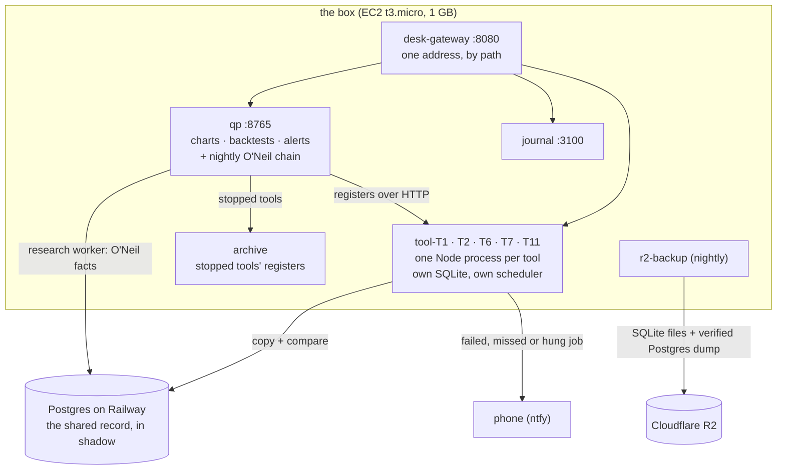
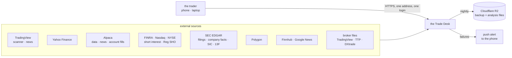
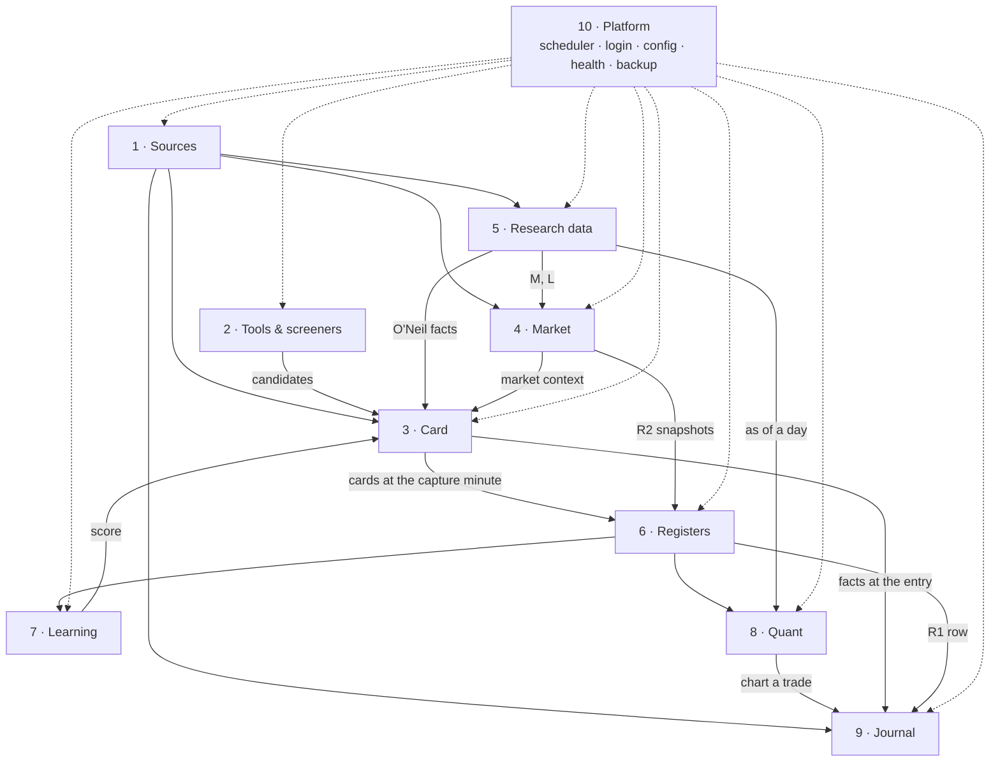
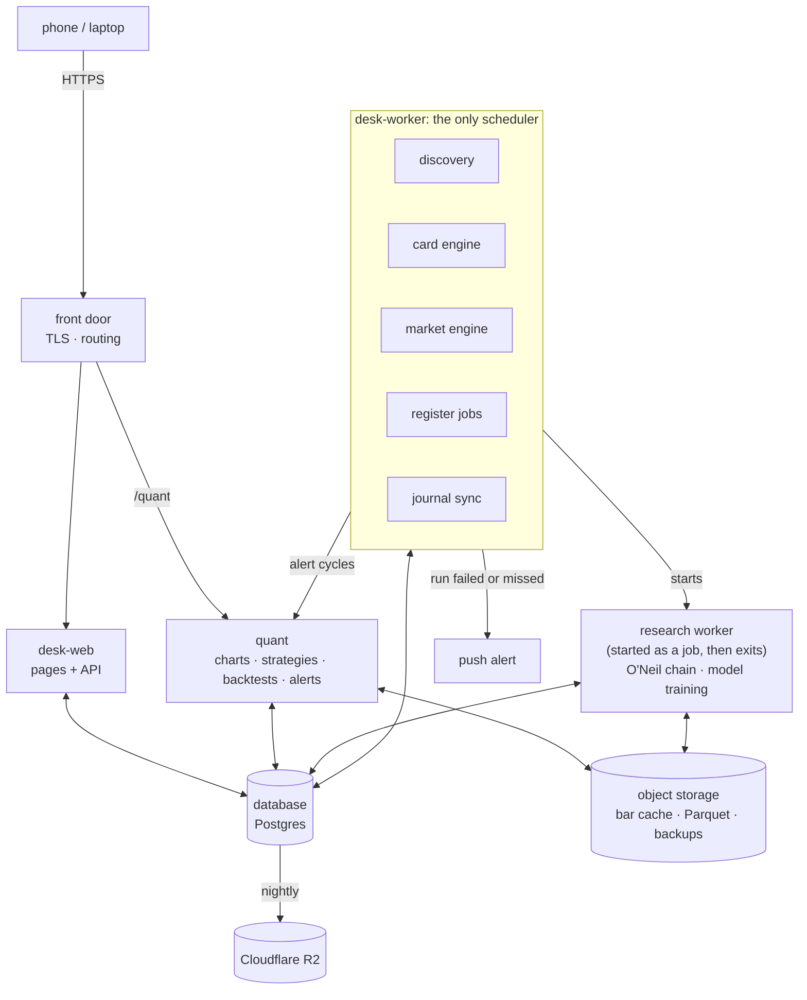
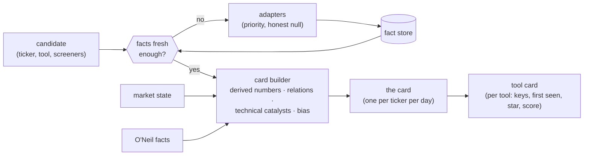
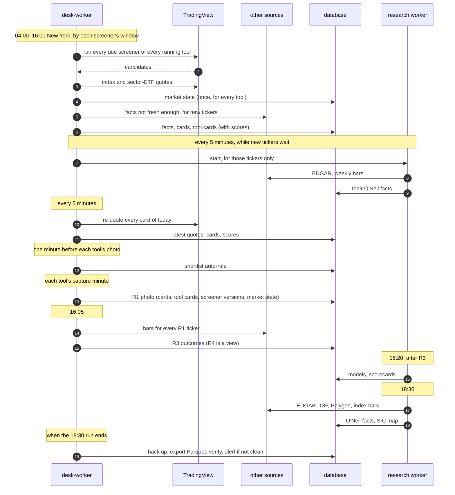

# Trade Desk: the architecture

This is the trunk. It describes the whole desk as it should be built. Every
other document is a leaf of one of its sections, and every leaf starts by
naming the section it belongs to.

The design is not invented from nothing. It is built on the desk that runs
today, which is documented in full under [legacy/](legacy/). The old desk
holds what the new one must keep: every card field and its source, every
calculation, the research method, the O'Neil method, the journal's design.
Where the old desk failed, the failure is named, and the new design says what
prevents it.

**How to read it.** Sections 1 to 5 give the whole picture in one pass:
purpose, constraints and quality goals, the outside world, the parts, the
data. Section 6 takes each domain in turn, always in the same shape. Sections
7 to 12 cover the day as it runs and what happens when something breaks, the
rules that apply everywhere, deployment, the migration, the decisions left to
you, and the risks.

---

## Contents

0. [Where the build stands (2026-10-08)](#0-where-the-build-stands-2026-10-08)
1. [What the desk is for](#1-what-the-desk-is-for)
2. [The desk and the outside world](#2-the-desk-and-the-outside-world)
3. [The ten domains](#3-the-ten-domains)
4. [The running parts](#4-the-running-parts)
5. [The data architecture](#5-the-data-architecture)
6. [Each domain](#6-each-domain)
7. [A trading day, end to end](#7-a-trading-day-end-to-end)
8. [Rules that apply everywhere](#8-rules-that-apply-everywhere)
9. [Deployment, backup and restore](#9-deployment-backup-and-restore)
10. [From today's desk to this one](#10-from-todays-desk-to-this-one)
11. [Decisions that are yours](#11-decisions-that-are-yours)
12. [Risks, and what contains them](#12-risks-and-what-contains-them)
13. [The document map](#13-the-document-map)
14. [Words used here](#14-words-used-here)

---

## 0. Where the build stands (2026-10-08)

Migration steps 1–14 ([design/MIGRATION.md](design/MIGRATION.md)) are merged
into the server repository and deployed to the box. They built **the data half**
of this design: one shared record, its backup, and the jobs and alerts around
it. They did not build **the program half**: one program serving every tool,
one scheduler, and the new pages. The trader asked for that half on 2026-10-08;
it is planned as steps 15–20 in [MIGRATION.md §6](design/MIGRATION.md).

### What runs today

**In shadow** means each tool keeps doing its own work from its own SQLite file,
and the shared answer is written beside it and compared. Nothing depends on the
shared record yet. Each area has a switch: off, shadow or on.

### Each running part of §4, against the design

| Part (§4) | Status | Where it stands |
|---|---|---|
| front door | **built, not live** | `desk-gateway` serves every program on one port by path; `scripts/setup-domain.sh` adds a DuckDNS name with Caddy's HTTPS. Not live until the domain is set up and the other ports are closed |
| desk-web | **not built** | still one Node process per running tool (five), plus the archive for the six stopped tools |
| desk-worker | **not built** | each tool still runs its own scheduler and pipeline. T1 hosts the desk-wide jobs: the research triggers, The Night, the discovery engine and the restore rehearsal |
| research worker | **built, in shadow** | `quant-platform/research/worker.py` writes the O'Neil readings as dated facts; the cards still read qp's |
| quant | **partly built** | alerts use each strategy's own fill model, and their history survives restarts (live). Reading registers from the database is built but switched off. Facts "as of a day" are not built |
| database | **built, in shadow** | Postgres on Railway: facts, market states, the research record of all eleven tools (imported, 0 differences), discovery scans, research runs |
| object storage | **partly built** | nightly backup to R2 with a verified Postgres dump, one-command restore, a monthly rehearsal. Parquet exports are not built (the registers still go up as CSV) |

### What building it taught, and what changes

1. **The discovery engine saves nothing on this desk.** It merges requests only
   when they are byte-identical: same filters, same floor, same minute. Every
   tool here has its own screeners, so there is nothing to merge. Its value is
   only consolidation, and that comes with desk-worker (step 15). Until then it
   should stay off (`discoveryMode off`); it doubles the scan requests while it
   compares.
2. **Sharing facts pays only when tools hold the same tickers.** The store
   counts the requests against the real source calls (`source_calls`). The
   switch for each family is decided on those numbers, not assumed.
3. **The market read is the same for every tool,** so sharing it is a clear
   saving. It is switched on after its parity weeks.
4. **The real gain of the program half is memory and simplicity.** Five tool
   processes and the archive (about 70–95 MB each) become two programs on a
   1 GB box, and a stopped tool becomes a row.
5. **TypeScript is not worth a rewrite.** §4 asked for TypeScript in desk-web
   and desk-worker. For one person's desk, rewriting working JavaScript in
   another language is risk without a trading gain. The program half is built
   in JavaScript, with the shared definitions in one module (§11).
6. **Where the database lives is still open.** Railway was chosen to keep it off
   the 1 GB box; the box and RDS are the alternatives (§11). Moving is one
   restore.

---

## 1. What the desk is for

One trader, one small server, a phone and a laptop. The desk does six jobs:

| # | Job | The question it answers |
|---|---|---|
| 1 | **Find** | which stocks are worth looking at right now, by each of my methods? |
| 2 | **Know** | everything about each of those stocks, on one card: price structure, volume, float, short interest, borrow, news and catalyst, market and sector context, industry group, the full CANSLIM reading |
| 3 | **Read the market** | should I be trading at all today, which way, and where is the leadership? |
| 4 | **Learn** | which methods find stocks that move, and which cards are likeliest to move? |
| 5 | **Test** | if I traded this rule on the stocks my methods found, on the days they found them, what would have happened? |
| 6 | **Review** | what did I actually trade, and how did it go? |

Job 2, **the card**, is the largest part of the desk by far. It draws on ten
external sources; today it takes twelve processing stages in every scan and a
six-step chain every night. The architecture is built around it.

### The research method (kept exactly)

The desk is a research instrument before it is a trading screen. Its method,
learned on the live desk and documented in
[legacy/screeners/METHODOLOGY.md](legacy/screeners/METHODOLOGY.md), does not change:

- **A tool is one method.** Each tool has its own screeners, its own photo
  time, its own history and its own model. Tools never learn from each other.
- **One photo a day per tool (R1).** At the tool's capture minute, every card
  is frozen exactly as known then. Only photographed cards are training data.
- **Success is movement, measured in ATR.** From the entry minute to the
  close: `upR = (highest high − entry) ÷ ATR14`, `downR = (entry − lowest low)
  ÷ ATR14`. A good move is 1.3 ATR or more. There is no stop, target or exit in
  this measure: it judges what a screener finds, not a trade.
- **Two entries, A and B**, a few minutes apart, always kept separate.
- **A benchmark** (Stocks in Play) that every screener must beat, and a
  **mirror** for every screener to test whether its direction is real.
- **Shared facts are labels, never filters.** Market and sector context,
  O'Neil data and the cross-tool shortlist inform a card but never change
  which cards a tool finds.

### What the desk does not do

It places no orders. An earlier live trading engine was removed from the
code. Its leftovers in the journal are recorded in
[legacy/journal/](legacy/journal/README.md) and are not part of this design.

### What the architecture must respect

| Constraint | What follows from it |
|---|---|
| **One trader** | one login, no accounts or roles; simple beats scalable |
| **One small box**: today an AWS EC2 t3.micro, 912 MiB of memory, with swap | every process has a memory budget ([§9](#9-deployment-backup-and-restore)); a tool must cost rows, not a process |
| **Free data** | public and free-tier sources, two of them unofficial (TradingView's scanner, Yahoo's quote API); each has limits and can change without notice ([§12](#12-risks-and-what-contains-them)) |
| **New York hours** | the desk works 04:00–16:00 New York on trading days; the morning photos (09:36 to 10:16 today) are the minutes that matter most |
| **No orders** | the desk finds, explains, measures and records; it never trades |

### What it must achieve, in order

When two goals pull against each other, the higher one wins.

1. **A true research record.** Every photo holds exactly what was known at its
   minute: nothing later leaks in, and nothing missing is guessed.
2. **No silent failure.** A failed or missed job, a stale fact family or a
   sick source shows on one page and reaches the phone.
3. **Ready every morning.** Discovery, cards and photos run on every trading
   day; a crashed process restarts in seconds and loses nothing.
4. **Fits the box.** Every service stays inside its memory budget.
5. **One person can run it.** One command to deploy, one to restore, one
   health page.
6. **Every number explains itself.** Its source, its time and its definition
   are one tap away.

---

## 2. The desk and the outside world

| Source | What the desk takes from it | How often | Needs |
|---|---|---|---|
| **TradingView scanner** | candidates per screener, with 32 columns each; re-quotes; the index and sector-ETF quotes for the market read | every scan, every 5 minutes | nothing |
| **TradingView news** | headlines | live cards | nothing |
| **Yahoo Finance** | news; short interest (fallback); daily bars of ^GSPC and ^IXIC; 1-minute and daily bars for outcomes, charts and the journal | per scan, nightly, after the close, on demand | nothing |
| **Alpaca** | Benzinga news; the shortable and easy-to-borrow flags; 1-minute and daily bars (fallback); the trader's account fills | per scan, daily, after the close, on a schedule | key |
| **FINRA** | short interest: one file covering every symbol | daily | nothing |
| **Nasdaq** | short interest (fallback); Reg SHO threshold list | daily, per settlement day | nothing |
| **NYSE** | Reg SHO threshold list | per settlement day | nothing |
| **SEC EDGAR** | filings as news; company facts (earnings, sales, shares); SIC industry codes; Form 13F holdings | per scan, nightly, quarterly | a User-Agent |
| **Polygon** | grouped daily bars for the whole market (the RS rating); bars | nightly, on demand | key |
| **Finnhub**, **Google News** | news (Finnhub with a key; Google only when the others return fewer than 2 items) | live cards | key / nothing |
| **Broker files** | trades the trader uploads | on demand | — |

Every call to a source goes through an adapter ([§6.1](#61-sources)); no
other code talks to the outside world.

---

## 3. The ten domains

A domain is one area of responsibility with one owner. Each owns its data;
the others read it.

| # | Domain | Responsible for | Owns |
|---|---|---|---|
| 1 | **Sources** | talking to every external source: request, parse, rate, cache, judge health | source health, raw snapshots |
| 2 | **Tools and screeners** | what each tool hunts for, when, and running the hunt (discovery) | tools, screener versions, windows, capture times |
| 3 | **The card** | turning a candidate into a card: every fact, from every source, with its time | ticker facts, cards, per-tool live lists |
| 4 | **The market** | the market read: indexes, regime, sectors, hot sectors, and O'Neil's M and L | market state and its history |
| 5 | **Research data** | the slow, heavy facts: the whole O'Neil chain (C, A, I, S, L, M, RS, groups, base, ratings), the SIC map | O'Neil facts with their dates |
| 6 | **Registers** | the research record: R1 photos, R2 market snapshots, R3 outcomes, R4 training rows, the shortlist | registers |
| 7 | **Learning** | the score per card, and the scorecard that judges screeners | models, scorecards |
| 8 | **Quant** | the verified indicator library, charts, strategies, backtests, live signal alerts, print sheets | strategies, backtests, the library |
| 9 | **Journal** | every real trade: broker fills and files, paired into trades, measured | trades, fills, accounts |
| 10 | **Platform** | the front door and login, the one scheduler, configuration, health and alerts, backup and restore, deployment, the page shell | users, job runs, settings |

---

## 4. The running parts

Five programs and one database. Today the desk is nine pm2 processes: one
per running tool (five, each with its own copy of the pipeline), the archive
that serves the six stopped tools, qp, the journal and the nightly backup job,
plus a systemd timer for qp's nightly chain. A Python scorer process per tool
was designed, but none runs: the scorer is off on every tool (D-D1).

| Part | Language | Does | Never does |
|---|---|---|---|
| **front door** | Cloudflare Tunnel or Caddy | one HTTPS address with TLS; routes `/quant` to quant and everything else to desk-web | hold any state |
| **desk-web** | Node (JavaScript) | the login, every page and the API: the tools, cards, Market tab, registers, scorecard, settings, journal. Streams changes to open pages | run a timed job |
| **desk-worker** | Node (JavaScript), same code base as desk-web | the only scheduler. Hosts discovery, the card engine, the market engine, register jobs, journal sync; starts the research worker and quant's alert cycles as jobs. Records every run | serve pages |
| **research worker** | Python | the O'Neil chain and model training each night; the O'Neil facts of tickers carded for the first time, within minutes; the provisional M through the session. Writes facts, then exits | stay running; start on its own |
| **quant** | Python (FastAPI) | today's qp: the verified library, charts, strategies, backtests, live signal alerts (each cycle started by desk-worker), print sheets. Reads registers and facts from the database, as of any date; checks the same login cookie | compute card or market facts; keep a timer of its own |
| **database** | Postgres | the system of record | — |
| **object storage** | local disk | the bar cache and the Parquet exports; backups are copied to R2 | — |

**Why two Node programs from one code base.** The page server must stay
quick and must never stop because a scan is slow, and the scheduler must
never run twice. One code base keeps the card and market logic in one place;
two processes keep their duties apart. One module of shared definitions gives
every fact family, card field and route one definition, used by the engines,
the API and the pages. (This design first asked for TypeScript; rewriting the
working JavaScript in another language was judged risk without a trading gain,
§0 and §11.)

**Live pages.** An open page updates itself: desk-web streams changes
(server-sent events) as desk-worker writes cards, tool cards and market
states, woken by the database's notifications. A page that loses the stream
re-reads every 30 seconds and says it is doing so. Today's Screener tab never
refreshes by itself (D-S15).

**Why the research worker is separate.** Today the O'Neil chain lives inside
the chart server. Each tool asks it for its new tickers' values and keeps them
in memory for the day, so five tools ask for the same tickers; a ticker first
seen while the chart server is down or restarting has a blank CANSLIM reading,
and a photo taken then freezes the blanks into R1; when the market file is
missing, a page request makes the chart server build it. O'Neil results are
card fields and Market-tab sections, so their writer must not depend on the
chart being up, and no page may wait for it
([§6.5](#65-research-data-the-oneil-chain)).

**Why Postgres.** One writer per table, real transactions, `as of` queries,
and one backup instead of thirteen SQLite databases. SQLite with one writer
per file would also work on this box. What matters is the ownership rules, not
the engine; the choice is yours ([§11](#11-decisions-that-are-yours)).

---

## 5. The data architecture

### 5.1 Three kinds of data

| Kind | Example | Rule |
|---|---|---|
| **Facts about the world** | AAPL's short interest; SPY's close; NVDA's quarterly EPS | shared by every tool; stored **once**, with the time it became known and its source |
| **Results of a method** | T2 found AAPL at 09:41; T2's photo; T2's model | belong to one tool; never shared, never mixed |
| **Records of the trader** | strategies, backtests, trades, notes, settings | belong to the trader; edited only by the trader |

### 5.2 The fact store

Every fact the desk knows about a ticker or the market is one row:

| Column | Meaning |
|---|---|
| `subject` | a ticker (`AAPL`), an index, a sector ETF, or `market` |
| `family` | the fact family: `quote`, `short_interest`, `borrow`, `news`, `catalyst`, `oneil_c`, `rs_rating`, … (each family is defined in its domain's leaf) |
| `value` | the fields of that family, as JSON |
| `status` | `ok`, `none` (the source answered: there is nothing) or `unavailable` (could not ask), with a reason |
| `source` | which adapter produced it |
| `known_at` | when the desk learned it (UTC instant) |
| `as_of` | the date or instant the fact describes (a settlement date, a quarter end) |

**What is kept.** The store has two parts: `facts`, the history, and
`facts_latest`, the newest fact of each subject and family. Every fetch
updates the latest. The history keeps every fetch except for the families
that change every few minutes (the quote, the numbers derived from it, and the
market context stamped from each market state): those enter the history only
at discovery, at each tool's photo and at the close. The history stays small,
every photo holds its whole card anyway, and the market states keep their own
history.

From this table:

- **the card** is, for each family, the latest fact known at that instant: an
  `ok` fact while it is fresh enough, otherwise the latest `none` or
  `unavailable` with its reason, beside the last `ok` value marked stale with
  its age;
- **R1** is the card at the capture minute, frozen;
- **a backtest** reads the facts known before its decision bar, so nothing
  looks ahead;
- **two sources for one fact** are both stored, with a stated priority, never
  overwriting each other.

This one store replaces the per-process caches, the shared JSON files and the
"as of" reconstructions of today's desk.

**Subjects and prices.** A ticker is stored without its exchange prefix (the
TradingView symbol is kept beside it); company filings are fetched by the
SEC's CIK through the SEC's ticker map, so a renamed company keeps its
filings.
Bars used for ATR, RS ratings and bases are split-adjusted; TradingView's
longer-window highs are not, and the card hides a window a split has
distorted ([CARD.md](design/CARD.md) §2.7).

### 5.3 The main entities

| Entity | Owner domain | One row per |
|---|---|---|
| tool | tools & screeners | tool (T1, T2, …) |
| screener version | tools & screeners | screener × version; R1 records which version it froze |
| fact | card, market, research data | subject × family × `known_at` |
| card | card | ticker × trading day (shared by every tool) |
| tool card | card | tool × ticker × trading day: screener keys and versions, first seen, live or stale, score, manual bias (its star is its shortlist row) |
| market state | market | instant (each scan), with history |
| register row: R1, R3, shortlist (R2 and R4 are views) | registers | tool × ticker × day (R3: also × entry; R2: tool × slot × day) |
| model, scorecard | learning | tool × version |
| strategy, backtest | quant | as today |
| account, fill, trade | journal | broker fill; round-trip trade |
| job, job run | platform | job; each run with its result |
| user, session, setting | platform | — |

The full schema, and where every legacy table goes: [design/DATA-MODEL.md](design/DATA-MODEL.md) ([§13](#13-the-document-map)).

### 5.4 Ownership: one writer for every table

| Data | Only writer | Today it lives in |
|---|---|---|
| tools, screeners, windows, capture times | desk-web (checked on save) | `tools.config.json`, `data/tools.local.json`, each tool's SQLite |
| settings | desk-web (checked, versioned) | each tool's SQLite, so each tool has its own floor (D-T5) |
| live ticker facts: quote, short interest, borrow, Reg SHO, news, catalyst | the card engine | each tool's memory and card JSON, fetched once per tool |
| cards, tool cards | the card engine | each tool's memory, checkpointed |
| market state | the market engine | each tool's memory (hot-sector state lost on restart); R2 slots in each tool's SQLite |
| O'Neil facts, SIC map | the research worker | `data/oneil-*.json`, `industry-map.json` (two writers, SIC first since F-21), qp's caches, and each tool's memory for the day |
| registers | register jobs | one SQLite per tool |
| models, scorecards | the research worker | `src/scoring/outputs*` (not backed up; no scorer runs) |
| strategies, backtests, alert history | quant | `~/.qp/platform.db` (alert repeats held only in memory) |
| trades, fills, accounts | the journal | `data/journal/journal.db` (with 17 leftover tables from an older app) |
| job definitions, job runs | desk-worker | schedules in each tool's SQLite; runs in memory only |
| secrets | the trader, in one secret file or store | `data/keys.json`, `r2.json`, `auth.json`, `journal/journal-accounts.json`, `quant-platform/.env`; mode 0600 |

### 5.5 Time

- Every instant is stored in **UTC**. Every trading day is a **New York
  date**. Every clock time shown is **New York time**.
- One **trading calendar** (sessions, holidays, half days) serves every
  domain: jobs run on trading days, and staleness, look-backs and outcomes
  are counted in sessions. Today nothing in the desk knows the calendar:
  every job runs every weekday, holidays included, each part works around
  holidays on its own, and three journal faults came from clock strings
  written as UTC or a fixed −05:00 offset
  ([legacy/journal/KNOWN-ISSUES.md](legacy/journal/KNOWN-ISSUES.md), D-J8, D-J10, D-J12).

---

## 6. Each domain

Every domain below has the same shape:

- **Job**: what it is responsible for.
- **Built on**: what the old desk did and meant to do, with the legacy
  documents that hold the detail.
- **What failed**: the faults found in the 2026-10 review, by their IDs in
  the legacy known-issues files.
- **The design**: how it is built here.
- **Leaf**: the design document with the full detail.

### 6.1 Sources

**Job.** Every call to the outside world, each through an adapter: one per
endpoint family (the TradingView scanner, TradingView news, Yahoo's quote,
news and bars, and so on).

**Built on.** Today each source is called from inside the stage that needs
it, in every tool's process. The calls themselves are well understood:
endpoints, columns, fallbacks and quirks are all recorded in
[legacy/screeners/DATA-PIPELINE.md](legacy/screeners/DATA-PIPELINE.md) and [legacy/qp/DATA-FEEDS.md](legacy/qp/DATA-FEEDS.md).
The data check ([legacy/screeners/DATACHECK.md](legacy/screeners/DATACHECK.md)) already judges each
source by what it returns rather than by whether it answered.

**What failed.**
- The same ticker's news, short interest and borrow are fetched once per
  tool that found it.
- A missing value became a number or a bearish read: a made-up pre-market
  band and −100 % gaps (F-14); "Strong Downtrend" on every card when the index
  rows came back empty (D-S2).
- A column shift could misalign every field until the alignment check was
  added (D-S3).
- Source logic is scattered, so a fallback order exists in one stage and not
  in another.
- Two of the sources are unofficial endpoints (TradingView's scanner, Yahoo's
  quote API with its cookie and crumb), and their health was known only when
  someone pressed the data-check button.

**The design.** An adapter states, for its source:

| It states | Example (short interest) |
|---|---|
| the fact families it produces | `short_interest` |
| how fresh a fact must be | one day |
| its rate limits and timeouts | FINRA: one file per day; Yahoo: per symbol, cookie and crumb |
| its honest null | `unavailable` with the reason; never 0 |
| its place in the priority order for each family | FINRA → Yahoo → Nasdaq |
| how its health is judged | the share of symbols answered with a plausible value |

The card engine, the market engine, the research worker and the journal ask
adapters for facts; they never call a source directly. Each adapter carries
recorded answers (fixtures) for CI, and its health check runs on a schedule.

**Leaf:** [design/SOURCES.md](design/SOURCES.md).

### 6.2 Tools and screeners

**Job.** What each tool hunts for, when it may add cards, when it takes its
photo, and running the hunt (discovery).

**Built on.** Eleven tools are registered, five running (T1, T2, T6, T7,
T11), six archived but still served for backtests. A screener is a set of
TradingView scanner rules with an order, a size, a run window, a check
window and a mirror; the tradability floor (price ≥ $1, average volume ≥ 1M,
ATR ≥ $1, ATR ≥ 3 % of price) is added to every screener at scan time, with
two named exceptions (the neglected-name screeners keep only the price leg; a
list-only screener takes none). Each
tool's screeners and why they are what they are:
[legacy/screeners/METHODOLOGY.md](legacy/screeners/METHODOLOGY.md). The builder, its 52 fields, 15 operators,
validation and mirror rules: [legacy/screeners/SCREENER-BUILDER.md](legacy/screeners/SCREENER-BUILDER.md). Adding and
stopping tools: [legacy/screeners/TOOL-LIFECYCLE.md](legacy/screeners/TOOL-LIFECYCLE.md). The intent:
[legacy/screeners/IDEAS.md](legacy/screeners/IDEAS.md), part 2.

**What failed.**
- Each tool is a whole copy of the program, about 90 MB each (89–91 MB on
  2026-10-06); tools were stopped for lack of memory.
- A changed capture time needs the tool restarted, which would empty the
  list built since 04:00, so a change made in the session waits until 16:50.
- T6 photographs at 10:16 a screener that starts at 11:30 (D-S9): times and
  windows are never checked against each other.
- A changed screener mixes two experiments under one name: there are no
  versions.
- Tests a scanner cannot express (T6's two-hour move, no news, six-month
  trend) run as a hidden gate inside discovery.

**The design.**
- **A tool is a row**: name, screeners, capture minute, entries A and B,
  status (running, paused, archived). One discovery engine runs every running
  tool; adding a tool adds rows, not a process.
- **A screener is versioned.** Saving a change creates a new version; R1
  records the version of every screener that matched.
- **Checked on save**: the capture minute must fall after at least one of the
  tool's run windows has opened; refused otherwise, with the reason.
- **A changed capture time takes effect on the next trading day**, so a day's
  photo always uses one time; nothing restarts.
- **Post-scan tests are named steps of the screener** (move rate, no news,
  trend), visible in the builder and in the scan report.
- **Discovery** runs each due screener once per scan, merges the matches into
  one candidate per ticker per tool, and hands new tickers to the card engine.

**Leaf:** [design/TOOLS-AND-SCREENERS.md](design/TOOLS-AND-SCREENERS.md).

### 6.3 The card

**Job.** Everything known about a ticker, on one card, each fact with its
source and time. The largest domain.

**Built on.** The card's every field, its source and when a blank is
legitimate: [legacy/screeners/CARD-FIELDS.md](legacy/screeners/CARD-FIELDS.md). Its layout and display rules:
[legacy/screeners/CARD.md](legacy/screeners/CARD.md). The twelve pipeline stages that fill it today:
[legacy/screeners/DATA-PIPELINE.md](legacy/screeners/DATA-PIPELINE.md). The CANSLIM fold's exact specification:
[legacy/qp/CANSLIM.md](legacy/qp/CANSLIM.md) §7 and §11.

The card, by fact family (sources as today, except where the design moves
them):

| Fact family | Sources, in priority | Fresh for | On the card |
|---|---|---|---|
| quote, levels, ranges, volume, float, cap (32 columns) | TradingView scanner | 5 minutes | header, Volume & Float, Range, Price, EMAs |
| derived numbers and relations (gap, ADR %, range positions, distances, MA stack, PM/ADR) | computed from the quote | with the quote | signal tags, PM/ADR, range bars |
| short interest, days to cover | FINRA → Yahoo → Nasdaq | a day | Volume & Float |
| borrow: shortable, easy to borrow | Alpaca | a day | borrow note |
| Reg SHO threshold | Nasdaq + NYSE lists | per settlement day | borrow note |
| news | TradingView, Alpaca (Benzinga), Yahoo, EDGAR, Finnhub; Google as fallback | each scan, live cards | News fold |
| catalyst (39 categories, 3 tiers), technical catalysts, auto bias | computed from news and the tape | with the news | badges, bias |
| market context (regime, trend stages, sector bias, hot sector, themes) | the market engine | each scan | Market Context fold |
| industry, group | SIC (EDGAR), TradingView label only where SIC has none | nightly | header, L |
| CANSLIM: C, A, N (base), S, L, I, M, RS, U/D, A/D, RS line | the research worker (today: qp) | nightly; within minutes for a ticker carded for the first time; M also provisionally through the session | CANSLIM fold, `cs*` columns |
| score | the tool's model | whenever the card changes (today: each scan, but the scorer is off) | score |
| shortlist marks | this tool; every tool | live | ☆, ★ also |

**What failed.**
- Every tool builds its own copy of a ticker's card.
- A re-quote rebuilt the card from TradingView alone and erased short
  interest, borrow and Reg SHO every few minutes (D-S1, since fixed by
  carrying them over).
- Each tool asks the chart server for its new tickers' CANSLIM values and
  keeps them for the day: a ticker first seen while the chart server is down
  has a blank fold until a later scan, and a photo taken in that gap freezes
  empty `cs*` columns into R1.
- Facts carry no time, so R1 cannot say when a fact was learned, and
  backtests rebuild CANSLIM "as of" a day.
- R4 carries fewer columns than R1 (D-D2).

**The design.**

- **One card per ticker per day**, shared by every tool. A tool card adds
  only what belongs to the tool: which screeners matched, when first seen,
  the star (its shortlist row), the score, the manual bias.
- **Each fact family refreshes on its own clock and writes only itself**: the
  quote every 5 minutes for live and stale cards; news every scan for live
  cards; short interest daily; O'Neil nightly, and within minutes for a new
  ticker. A re-quote can never erase another family (D-S1).
- **A failed source never fails the card**; its family shows `unavailable`
  with the reason.
- **Every field the old card shows is kept**, with its formula and its
  display rule. The leaf lists them one by one.

**Leaf:** [design/CARD.md](design/CARD.md).

### 6.4 The market

**Job.** The market read, built once for every tool, kept with its history,
and stamped on every card.

**Built on.** The Market tab today has two halves
([legacy/screeners/MARKET-TAB.md](legacy/screeners/MARKET-TAB.md)):

| Section | Built from | Today |
|---|---|---|
| **Indexes** | TradingView: SPY, QQQ, DIA, IWM, VIX | each tool, each scan |
| **Desk analysis**: short-term bias, mid-term stage, long-term bias, the regime | index columns: SMAs 5/20/50/200, Bollinger, ADX, VWAP, relative volume | each tool, each scan |
| **Sector heatmap and hot sectors** | 15 sector ETFs | each tool, each scan; hot state in memory |
| **M: O'Neil market model** | ^GSPC and ^IXIC daily bars: distribution days, stalling days, rally attempts, follow-through | qp, nightly |
| **L: industry groups** | the SIC map and whole-market RS ratings | qp, nightly |

**What failed.**
- Five tools compute the same snapshot from the same ETFs, minutes apart.
- Hot-sector state is lost on every restart.
- Sector bias is lopsided: the score runs about −39 to +100 (F-16).
- The mid-term stage counts two signals twice (D-D5).
- R2's O'Neil columns are read at export, so an old day shows today's status
  (D-D3).
- With no index data, the desk once read the market as bearish (D-S2).
- Four TradingView stock sectors have no mapping to a sector ETF, so their
  cards get no sector bias or hot badge (found while writing the leaf).

**The design.**
- **One market engine** builds the market state each scan, for every tool,
  and stores it with history. R2 is a view of that history at the tool's
  slots, frozen with whatever O'Neil status was current then.
- **The desk's read and O'Neil's method stay separate** on the tab and in the
  data. The first answers "what is the tape doing now", the second "should you
  be buying at all".
- **Hot-sector state is counted per trading day (as F-17 made it) and
  persisted.**
- **No regime without data**: if SPY and QQQ are both incomplete, there is no
  regime, said plainly.
- Sector score centred on 0 (−100 to +100), and the mid-term stage counting
  distinct facts; both need re-tuning, recorded in the leaf.

**Leaf:** [design/MARKET.md](design/MARKET.md).

### 6.5 Research data: the O'Neil chain

**Job.** The slow, heavy facts: everything O'Neil's CANSLIM needs, plus the
SIC industry map. Computed after the close, and through the session for
tickers carded for the first time.

**Built on.** The O'Neil method as built, with its exact rules, traps,
thresholds and the MarketSmith-style panels it reproduces from free data:
[legacy/qp/CANSLIM.md](legacy/qp/CANSLIM.md) (1,646 lines: the deepest document of the old desk).
The nightly job (a systemd timer, Monday to Friday at 22:30 UTC), its six
steps and how it is installed:
[legacy/qp/OPERATIONS.md](legacy/qp/OPERATIONS.md).

| Letter | Computed from |
|---|---|
| **C**, **A**: quarterly and annual earnings, sales, acceleration, stability, ROE | SEC EDGAR company facts |
| **N**: the base (weeks, depth, pivot, handle, % to pivot) | weekly bars |
| **S**: supply, U/D volume ratio, A/D letter | EDGAR shares; daily bars |
| **L**: RS rating, group rank, RS in group | Polygon grouped daily (whole market); the SIC map |
| **I**: fund holders, change, direction | Form 13F |
| **M**: market model state, distribution days, follow-through | ^GSPC, ^IXIC daily bars |

**What failed.**
- It runs inside the chart server, and every tool asks the chart server for
  its new tickers' values (cached in the tool for the day): a ticker first
  seen while the chart server is down or restarting has a blank CANSLIM
  reading, and five tools ask for the same tickers.
- A new ticker's earnings tables arrive only if a page shows its card (a
  background fetch, one name at a time) or the nightly walk reaches it.
- The nightly job runs from a systemd timer installed by hand; without it,
  the O'Neil data goes stale with no alarm (Q-N5).
- The industry map had two writers and flipped every morning (F-21).
- When an O'Neil file is missing, the Market tab asks the chart server to
  build it inside a page request.

**The design.**
- **The research worker** runs the chain after the close (18:30 New York). It
  writes O'Neil facts into the fact store with their `as_of` dates, then
  exits. It is the **only** writer of those facts and of the SIC map.
- **New tickers the same morning.** Every 5 minutes in the session, while any
  ticker carded today has no company facts, desk-worker starts the worker for
  those tickers alone; the card says "computing · since 09:41" until they
  land, usually within minutes. RS, the group and the SIC code exist for every
  US stock already, from the whole-market steps.
- **M through the session.** The worker's market-model step also runs every
  30 minutes on today's index bars and writes a provisional M, replaced at the
  close. The rules exist once, in the worker.
- **The card and the Market tab only read.** No page request ever computes
  O'Neil data.
- **A run that fails or does not happen raises an alert** (platform
  scheduler), so stale data is never silent.
- **The backtest's CANSLIM gate reads the same facts as of the day**, so live
  and backtest use one source.
- **The method does not change**: every rule and threshold in the legacy
  document carries over.

**Leaf:** [design/ONEIL.md](design/ONEIL.md).

### 6.6 Registers

**Job.** The research record: what each tool saw and what happened next.

**Built on.** [legacy/screeners/REGISTERS.md](legacy/screeners/REGISTERS.md), with every column:

| Register | Written | Holds |
|---|---|---|
| **R0** | continuously | today's live list (in the new design: the tool cards) |
| **R1** | the tool's capture minute | every card of today, frozen whole; the only training data |
| **R2** | 8 slots, 09:26–10:01 | the market state around the photo |
| **R3A / R3B** | 16:05 | from entry A / B: entry price, highest high, lowest low, ATR14 (from days before), upR, downR, opening range |
| **R4A / R4B** | 16:05 | R1 joined to R3: the training rows |
| **Shortlist** | each star, and the auto-rule one minute before R1 | the day's picks, manual and automatic |

**What failed.**
- R4 is narrower than R1: no CANSLIM columns, no week, quarter or year
  ranges (D-D2).
- The opening range is stored but not exported (D-D4).
- R1's price is called `price936` in R4 whatever the capture time (P-1).
- Outcomes run every weekday, holidays included, and a ticker that could not
  be measured is only logged.
- A manual route (`POST /api/warehouse/collect`) re-runs the R1 capture at any
  time and replaces the day's photo without a word (D-D8, found in this
  review; no page calls it).

**The design.**
- **R1 freezes the tool card and the card at the capture minute**, plus the
  screener versions and the market state id. Nothing is lost: every field of
  the card is in the photo.
- **One photo, at its minute.** Only the scheduler takes a photo. One that
  could not be taken at its minute is recorded as missed; a late photo taken
  by hand keeps its real instant, is marked late, and stays out of training
  and verdicts unless included on purpose. A photo is never replaced.
- **R4 is a view** over R1 and R3, carrying every R1 column; no copy that can
  drift.
- **R3 runs on the trading calendar**, and records a reason for every ticker
  it could not measure.
- **Exports are generated from the schema**, so a new column appears in every
  export at once.

**Leaf:** [design/REGISTERS.md](design/REGISTERS.md).

### 6.7 Learning: the score and the scorecard

**Job.** For each card: of the stocks this tool found before that looked like
this one, how many made a good move? For each screener: keep it, watch it, or
drop it?

**Built on.** The intent, rules and open questions:
[legacy/screeners/IDEAS.md](legacy/screeners/IDEAS.md), parts 1 and 3. Today's score (PCA, five buckets,
six bases, regime sub-tables) and scorecard, step by step, and why neither
should be copied: [legacy/screeners/SCORING-TODAY.md](legacy/screeners/SCORING-TODAY.md).

**What failed.**
- No scorer runs: the scorer is off on every tool, so no card has a score,
  and the shortlist auto-rule adds nothing (D-D1). The design behind it was a
  Python scorer process per tool, each holding its tables in memory, which the
  box could not afford.
- The scorecard grades in one direction only (D-S12).

**The design.**
- **Trained by the research worker** after the outcomes are in (about
  16:20), one model per tool, from that tool's history only. A model is a versioned record in the
  database.
- **Applied by the card engine** from the stored model, in-process (a dot
  product and a logistic), **whenever the card changes**, as today's desk
  re-scores on every scan. The photo therefore freezes the score of the card
  it froze. No scorer process.
- **Six questions, scored separately**: entry A or B × long, short or either.
  The card shows the one its bias points to.
- **Honest about thin data**: every score carries its sample size and
  confidence; below a minimum, no score.
- **Explainable**: which features moved it, and how the most similar past
  cards did.
- **The scorecard** grades each screener against its tool's benchmark and its
  own mirror, on the share of good moves and the share of days hit, with the
  sample shown beside every verdict.

**Leaf:** [design/LEARNING.md](design/LEARNING.md).

### 6.8 Quant: charts, strategies, backtests, alerts

**Job.** Chart any stock with verified indicators; build trading rules by
clicking; backtest them on the stocks the tools found, on the days they found
them; watch today's lists for live signals; print sheets.

**Built on.** The whole of qp: [legacy/qp/README.md](legacy/qp/README.md) and its fifteen documents.
The verified library (71 primitives, each approved against TradingView) and
its code: [legacy/qp/LIBRARY.md](legacy/qp/LIBRARY.md), [legacy/qp/library/](legacy/qp/library/README.md). The strategy
grammar, fill models and exit plan: [legacy/qp/STRATEGIES.md](legacy/qp/STRATEGIES.md). The backtest
and its honesty rules: [legacy/qp/BACKTEST.md](legacy/qp/BACKTEST.md).

**What failed.**
- Alerts evaluate with the `close` fill while backtests use `desk`, so an
  alert can fire on a different bar from the backtest's (Q-N9).
- `breakeven_after_target` is reported but never simulated (Q-N7).
- Some routes default to the Polygon feed, not the desk's default (Q-N6).
- It hosts the O'Neil chain (moved out: §6.5).

**The design.**
- **Quant keeps its library, engine and backtest as they are**; they are the
  best-built part of the desk.
- **One evaluator and one fill model** for preview, backtest and alerts.
- **It reads registers and facts from the database, as of a day**, instead of
  over HTTP from each tool's port.
- **Alerts are scheduler jobs**: desk-worker starts each cycle, and every
  alert sent is stored, so a restart never repeats one and alerts can be
  reviewed.
- **It computes no card or market facts.**

**Leaf:** [design/QUANT.md](design/QUANT.md).

### 6.9 Journal

**Job.** Every real trade, after the fact: broker fills and uploaded files,
paired into round trips, measured, reviewed.

**Built on.** [legacy/journal/README.md](legacy/journal/README.md) and its eight documents: the page and
every formula, the Alpaca accounts and their pairing, the file formats, the
analysis layer, the data. The Alpaca pairing (running position, weighted
prices, reversals split, stable ids) is the model to keep.

**What failed.** File imports mispair scale-ins and scale-outs, lose
TradingView shorts and duplicate on re-import (D-J1 to D-J7). No trade has a
stop, so every R is empty (D-J9). Times are clock strings, with a fixed
−05:00 offset and one date per trade (D-J8, D-J10, D-J12). The technical
snapshot and the grading half do not work (D-J13, D-J14).

**The design.**
- **One pairing engine** for every source: Alpaca fills, broker files, hand
  entry.
- **A trade has an entry instant, an exit instant, its fills, its fees and a
  stop.** The stop comes from the broker's stop order, the strategy's exit
  plan, or the trader.
- **Stable ids from the source's own facts**, so a second import updates.
- **The entry snapshot holds nothing later than the entry**: the price
  structure computed from bars up to the entry minute; short interest, borrow,
  news and the CANSLIM reading from the fact store as known then (fetched with
  their own dates when no tool carded the ticker); the market state; and the
  R1 row when the ticker was on a tool that day.
- **The chart button** opens quant at the trade's real instants.

**Leaf:** [design/JOURNAL.md](design/JOURNAL.md).

### 6.10 Platform

**Job.** Everything every domain relies on: the front door and login, the
one scheduler, configuration, health and alerts, backup and restore,
deployment, and the page shell.

**Built on.** The login shared across ports (`td_auth` cookie,
`data/auth.json`); the jobs and the Monitor tab
([legacy/screeners/MONITOR.md](legacy/screeners/MONITOR.md)); settings ([legacy/screeners/SETTINGS.md](legacy/screeners/SETTINGS.md)); the data
check ([legacy/screeners/DATACHECK.md](legacy/screeners/DATACHECK.md)); the nightly backup to R2 with daily,
monthly and analysis copies; `deploy-tools.sh` under pm2; the shared app bar.
Today's arrangement: [legacy/architecture/ARCHITECTURE.md](legacy/architecture/ARCHITECTURE.md).

**What failed.**
- Thirteen public ports (the five running tools, the archive on the six
  stopped tools' ports, qp, the journal), all plain HTTP, and once no login at
  all (S-1). Without HTTPS the login cookie cannot be marked `Secure`.
- Jobs spread over five tool processes, pm2 cron, a hand-installed systemd
  timer, the journal's own minute loop and qp's watcher, with no run history
  and no alert when one fails or does not run.
- The backup runs at a fixed 23:20 UTC, fifty minutes after the nightly chain
  starts, whether or not the chain has finished. Trained models are not in it
  (the keys are left out on purpose, since S-2).
- Restore downloads a night's files (that step is tested), but putting them
  back is manual, process by process, and no full restore is on record or on
  a schedule.
- No CI: fixes are verified only when someone runs the tests.
- Two supervisors in the past caused a 113,854-restart incident (2026-09-23);
  a qp restart took 3 min 20 s (fixed).

**The design.**
- **One front door**: one HTTPS address, one login, every other port closed.
  The session cookie is `Secure`, `HttpOnly` and `SameSite=Lax`; a request
  that changes anything must come from the desk's own origin; login attempts
  are rate-limited.
- **One scheduler** (desk-worker) with every job as a row: its schedule, its
  last runs, their results. A run that fails, or does not happen when it
  should, sends a push alert. A job never overlaps itself (a run still going
  skips the next slot and records it), and a job can wait for another (the
  backup waits for the night's research run).
- **Configuration checked on save**, with the reason for any refusal.
- **Health** is the data check made permanent: each source and each domain
  reports green, amber or red, on one page. Freshness is counted in trading
  sessions, so a weekend never reads as stale.
- **Backup**: the database and Parquet exports every night, after the
  research run, verified; **restore is one command**, rehearsed monthly onto a
  spare database.
- **CI** runs every test on every pull request; red blocks the merge.
- **One supervisor** (systemd or pm2, never both).

**Leaf:** [design/PLATFORM.md](design/PLATFORM.md).

---

## 7. A trading day, end to end

| Time (New York, trading days) | Job | Domain |
|---|---|---|
| 04:00–09:00 every 30 min; 09:00–10:00 every 5; 10:00–16:00 every 15; 16:00 | discovery scans (each screener only inside its window) | tools & screeners, card, market |
| 04:00–16:00 every 5 min | re-quote every card of today; re-score | card, learning |
| 04:00–16:00 every 5 min, while any wait | research run for tickers carded for the first time | research data |
| 09:25–16:05 every minute, while alerts are on | quant's alert cycle | quant |
| 09:30–16:00 every 30 min | provisional M | research data |
| 09:26, 09:31 … 10:01 | R2 slots (a view of the market history) | registers |
| each tool's capture minute − 1 | shortlist auto-rule | registers |
| each tool's capture minute (09:36 … 10:16 today) | R1 photo | registers |
| 16:05 (half days: 15 minutes after the close) | R3 outcomes | registers |
| about 16:20, after R3 | training and scorecards | learning |
| 18:30 | the O'Neil chain and the SIC map | research data |
| when the 18:30 run ends | backup and verification | platform |
| on each account's schedule | journal sync | journal |
| monthly | restore rehearsal | platform |

Today the same day runs on clocks that do not know each other: training at
16:20 (unused, the scorer being off), the O'Neil chain at 22:30 UTC, the
backup at 23:20 UTC.

### When something goes wrong

| Event | What the desk does |
|---|---|
| a source fails or answers nonsense | its families show `unavailable` with the reason; cards still build; health turns amber or red, and an alert names the source and the fix |
| TradingView changes or drops a column | the batch is refused by the alignment check, the scan report says why, health goes red; no card gets shifted values |
| desk-worker crashes | the supervisor restarts it in seconds; cards, tool cards, hot state and job runs are rows, so nothing is lost; a slot that passed while it was down is recorded as missed, with an alert |
| a photo's minute passes with the desk down | the photo is recorded as missed, never taken later as if on time ([§6.6](#66-registers)) |
| a scan outlasts its slot | the next slot is skipped and recorded; two scans never run at once |
| the research worker fails or does not run | each step reports on its own; facts keep their dates, so cards say "last run DATE"; an alert |
| the database is down | every service reports down on `/health` and retries; pages say so; nothing is written anywhere else meanwhile |
| the box is lost | a new box: install, set the secret store, `desk restore <date>` ([§9](#9-deployment-backup-and-restore)) |

---

## 8. Rules that apply everywhere

These rules come from faults found on the live desk, and they extend the
fifteen rules the legacy screener documents record
([legacy/screeners/README.md](legacy/screeners/README.md#rules-a-rebuild-must-keep)).
Each leaf applies them to its domain.

| Rule | Means | Learned from |
|---|---|---|
| **Honest null** | a missing value is `unavailable` or `none` with a reason; never 0, never bearish, never "no" | D-S2, F-14 |
| **No look-ahead** | every computed value uses only what was known at its instant; bars after an entry never reach that entry's snapshot | F-20, D-J13 |
| **A label, never a filter** | shared facts never change which cards a tool finds | the research method |
| **One writer per fact** | every table and fact family names its single owner, and a writer touches only its own family; two sources are both stored, with a priority | F-21, D-S1 |
| **Isolate results, share facts** | a tool's results, model and history never reach another tool | the research method |
| **One definition per number** | each formula is written once, in one place, and named in its leaf | D-J17, Q-N9 |
| **Versioned definitions** | a screener, a check or a model that changes gets a new version, and history records which one ran | screener mixing, the check library |
| **Checked on save** | configuration that cannot work is refused when saved, with the reason | D-S9 |
| **Failures are loud** | a job that fails or does not run sends an alert; a silent no-op is a bug | Q-N5, J-4 (a start-up repair that silently did nothing) |
| **One photo, at its minute** | a photo is taken only by the scheduler at its minute; a late one is marked late and kept out of training; a photo is never replaced | D-S9, D-D8 |
| **No overlap** | a job never runs twice at once; an overrun skips the next slot and says so | the legacy scan guard |
| **Sessions, not hours** | staleness, look-backs and outcomes are counted in trading sessions on the calendar | weekday arithmetic; the 36-hour stale-file check |
| **Proven before it ships** | every change runs the tests in CI; every source and file format has fixtures | the untested journal importer |
| **Secrets stay put** | keys live in one secret file or store, mode 0600, never in a reply, a log, git or a backup | S-2 (keys pushed to GitHub) |
| **Real instants** | UTC stored, New York shown, one trading calendar | D-J8, D-J10, D-J12 |

---

## 9. Deployment, backup and restore

**The box.** One small Linux server: today an AWS EC2 t3.micro with 912 MiB
of memory and a swap file, which the deploy requires. On 2026-10-06 the desk's
processes used about 724 MB (five tools at 89–91 MB each, qp 129, the archive
78, the journal 66), beside the operating system. The target needs about
500–640 MB of services for any number of tools: each extra tool costs a few MB
instead of about 90.

| Process | Supervised as | Memory (estimate) |
|---|---|---|
| desk-web | service | ~150 MB |
| desk-worker | service | ~200 MB |
| quant | service | 70–150 MB |
| database | service | 60–100 MB |
| front door | service | 20–40 MB |
| research worker | a job started by desk-worker; exits when done | 100–150 MB for a run of new tickers; 200–400 MB for the night's run |
| operating system | — | ~150 MB |

Services and the system come to about 650–790 MB. On this box a new-ticker
run during the session leaves little room, and the night's run (at 18:30, when
no scan is due) leans on swap. A 2 GB box removes the squeeze
([§11](#11-decisions-that-are-yours)).

**Deploy.** CI builds and tests every pull request. On merge, one command on
the box pulls, backs up, migrates the database, restarts the services in order
and checks each one's health page; it stops and says why at the first failure.
It refuses to run within 15 minutes of a tool's photo unless forced.

**Backup.** Every night, when the research run has ended: a database dump
and the Parquet exports to R2, verified by restoring the dump into a scratch
database and counting rows. The daily, monthly and analysis layout of today's
backup is kept (legacy detail and the new design:
[design/PLATFORM.md](design/PLATFORM.md) §5–§6).

**Restore.** One command: `desk restore <date>` stops the services, restores
the database, runs migrations, starts the services, and checks health. A
monthly rehearsal restores last night's backup to a spare database and
reports the row counts.
Keys are restored from the trader's own secret copy, never from the backup.

---

## 10. From today's desk to this one

Each step ships on its own, keeps the desk working, and can be undone.

| # | Step | Domain | Risk | Status (2026-10-08) |
|---|---|---|---|---|
| 1 | CI on every pull request | platform | none | done |
| 2 | One front door; close every other port | platform | low · needs a domain name | built; the domain and closing the ports are the trader's to do |
| 3 | Configuration checked on save (fixes D-S9, D-S10) | tools & screeners | low | done; T6's photo time is still the trader's decision |
| 4 | The trading calendar and real instants everywhere | platform, journal, registers | low | done |
| 5 | The database, the fact store and source adapters; tools read short interest, borrow and news from it | sources, card | medium · compare cards old and new for a week | built, in shadow; on, per family, if the call counts justify it |
| 6 | The market engine, once for all tools; hot state persisted | market | low–medium | built, in shadow |
| 7 | The research worker: the O'Neil chain leaves the chart server | research data | medium | built, in shadow; the chain still runs from qp's timer |
| 8 | One scheduler with run history and alerts | platform | medium · run side by side for a week | history and alerts live; still one scheduler per tool |
| 9 | Tools as rows: one engine for every tool; R1 compared row by row before each old process stops | tools & screeners, card, registers | the largest step · reversible per tool | partly: the research record is in the database; the processes, the archive and the engine's switch are step 15 |
| 10 | The score and scorecard rebuilt | learning | medium | prepared (scorecard, training set, empty model slot); no model, by the trader's choice |
| 11 | The journal's one pairing engine, real instants, stops | journal | medium · re-import and compare | the pairing engine for every file, done; stops and snapshots not built |
| 12 | Quant on the database; one fill model for alerts | quant | medium | the fill model and alert history live; registers from the database built, off |
| 13 | Verified backups; one restore command, rehearsed | platform | medium · the backup proves the copy | done |
| 14 | One web shell | platform | low | one origin built; phone-first and ⓘ on every label are step 19 |

Steps 15–20, the program half (one desk-worker, one desk-web, the record
switched on, live pages, phone-first, the model), are in
[design/MIGRATION.md §6](design/MIGRATION.md).

The full plan, with what each step changes, how it is checked and how it is
undone, and the import of the old data: [design/MIGRATION.md](design/MIGRATION.md).

---

## 11. Decisions that are yours

| Decision | Options | Recommendation | Decided (2026-10-08) |
|---|---|---|---|
| Where it runs | stay on the t3.micro; a 2 GB instance (t3.small); a managed host | stay on EC2, on a 2 GB instance when convenient: the design fits 912 MiB with swap, as today's desk does, but with little room at the nightly peak | the t3.micro; the program half (steps 15–16) frees most of the memory |
| The database | Postgres; SQLite with one writer per file | Postgres, for transactions, `as of` queries and one backup | Postgres |
| Where the database lives | on the box; Railway; AWS RDS | off the box while it has 1 GB | Railway for now; open, to come back to. Moving is one restore |
| A domain name | needed for one HTTPS address | yes | a free DuckDNS name with Caddy; the script is ready, not yet run |
| How far to go | steps 1–8 remove most duplicated work and risk; step 9 removes the per-tool memory cost | all, in order | 1–14 done; the program half (15–20) asked for |
| Push alerts | ntfy, Pushover, Telegram | any that reaches your phone | ntfy, working |
| T6's photo (D-S9) | move it after 11:30 (with its entries); or open the window earlier | yours: it decides what T6 measures; needed before step 3 of §10 | open, by the trader's choice |
| The model (§6.7) | build one now; prepare only | — | prepared only; the trader may build their own |
| TypeScript for desk-web and desk-worker | a rewrite in TypeScript; JavaScript with shared definitions | JavaScript: a rewrite adds risk without a trading gain | to confirm with the program half |
| The discovery engine | keep, in shadow; off until desk-worker | off: it saves no requests with distinct screeners | to confirm (`discoveryMode off`) |

---

## 12. Risks, and what contains them

| Risk | Likelihood · impact | What contains it |
|---|---|---|
| TradingView's scanner is an unofficial endpoint: it can change columns, add limits or refuse the desk | medium · high: no discovery, no quotes | one adapter; the alignment check refuses shifted answers; fixtures in CI; a health check before the open; the scan report names the cause. No free replacement exists, so the desk says plainly when it is blind |
| Yahoo's quote and chart endpoints are unofficial (cookie and crumb) | medium · medium | short interest falls back to Nasdaq (FINRA comes first anyway); outcome bars fall back to Alpaca; index bars for M have no fallback, so M says "not built today" |
| free tiers: Polygon end of day only, Alpaca's IEX feed (thin volume, short history), EDGAR ten requests a second | certain · bounded | each adapter states its limits; the hybrid feed's volume seam is named on the chart; the research worker has a time budget per night |
| one box, no redundancy | low · high | verified nightly backups; one-command restore, rehearsed monthly |
| the photo window: a crash or a deploy at a capture minute costs a tool a day of research | low · medium | the supervisor restarts in seconds; state lives in rows; a missed photo is recorded, never faked; deploys are refused near capture minutes |
| memory on a 912 MiB box | medium · medium | a budget per service, limits in the supervisor, swap, the night's research run when no scan is due; a 2 GB box removes it |
| a confidently wrong source: plausible numbers that are wrong | low · high | the cross-source agreement check on bars; sanity checks in every adapter; every fact keeps its source |

---

## 13. The document map

Every document has a place in this tree. The design leaves and the legacy
documents are complete.

| Trunk section | Design leaf | Legacy evidence it builds on |
|---|---|---|
| 6.1 Sources | [design/SOURCES.md](design/SOURCES.md) | [DATA-PIPELINE](legacy/screeners/DATA-PIPELINE.md), [DATA-FEEDS](legacy/qp/DATA-FEEDS.md), [DATACHECK](legacy/screeners/DATACHECK.md) |
| 6.2 Tools and screeners | [design/TOOLS-AND-SCREENERS.md](design/TOOLS-AND-SCREENERS.md) | [METHODOLOGY](legacy/screeners/METHODOLOGY.md), [SCREENER-BUILDER](legacy/screeners/SCREENER-BUILDER.md), [TOOL-LIFECYCLE](legacy/screeners/TOOL-LIFECYCLE.md), [IDEAS](legacy/screeners/IDEAS.md) part 2, [PAGES](legacy/screeners/PAGES.md) |
| 6.3 The card | [design/CARD.md](design/CARD.md) | [CARD-FIELDS](legacy/screeners/CARD-FIELDS.md), [CARD](legacy/screeners/CARD.md), [DATA-PIPELINE](legacy/screeners/DATA-PIPELINE.md), [CANSLIM](legacy/qp/CANSLIM.md) §7, §11 |
| 6.4 The market | [design/MARKET.md](design/MARKET.md) | [MARKET-TAB](legacy/screeners/MARKET-TAB.md), [CANSLIM](legacy/qp/CANSLIM.md) §2, §8, §9 |
| 6.5 Research data | [design/ONEIL.md](design/ONEIL.md) | [CANSLIM](legacy/qp/CANSLIM.md), [qp OPERATIONS](legacy/qp/OPERATIONS.md) |
| 6.6 Registers | [design/REGISTERS.md](design/REGISTERS.md) | [REGISTERS](legacy/screeners/REGISTERS.md), [METHODOLOGY](legacy/screeners/METHODOLOGY.md) |
| 6.7 Learning | [design/LEARNING.md](design/LEARNING.md) | [IDEAS](legacy/screeners/IDEAS.md) parts 1 and 3, [SCORING-TODAY](legacy/screeners/SCORING-TODAY.md) |
| 6.8 Quant | [design/QUANT.md](design/QUANT.md) | [qp](legacy/qp/README.md): LIBRARY, CATALOG, STRATEGIES, BACKTEST, ALERTS-AND-PRINTS, PAGE, SCALPS, PINE |
| 6.9 Journal | [design/JOURNAL.md](design/JOURNAL.md) | [journal](legacy/journal/README.md): PAGE, ACCOUNTS, IMPORT, ANALYSIS, [OPERATIONS](legacy/journal/OPERATIONS.md) |
| 6.10 Platform | [design/PLATFORM.md](design/PLATFORM.md) | [today's architecture](legacy/architecture/ARCHITECTURE.md), [MONITOR](legacy/screeners/MONITOR.md), [SETTINGS](legacy/screeners/SETTINGS.md), [DATACHECK](legacy/screeners/DATACHECK.md), the helper scripts of the [screener tools](legacy/screeners/SCRIPTS.md) and [qp](legacy/qp/SCRIPTS.md) |
| 5 Data architecture | [design/DATA-MODEL.md](design/DATA-MODEL.md) | the three legacy DATA-MODEL documents |
| all | [design/API.md](design/API.md) | the three legacy API documents |
| 8 Rules | (applied in every leaf) | [the rules a rebuild must keep](legacy/screeners/README.md#rules-a-rebuild-must-keep) |
| 10 Migration | [design/MIGRATION.md](design/MIGRATION.md) | [the earlier rebuild draft](legacy/architecture/REBUILD-ARCHITECTURE.md) |

The open findings of the old desk, by program:
[screeners](legacy/screeners/KNOWN-ISSUES.md), [qp](legacy/qp/KNOWN-ISSUES.md),
[journal](legacy/journal/KNOWN-ISSUES.md).

Each design leaf has the same five parts: its place in this trunk; the legacy
design in full (every field, source and calculation it keeps); what failed;
the new design; and its contracts (tables, facts, routes) with the other
domains.

---

## 14. Words used here

| Word | Meaning |
|---|---|
| **tool** | one screening method (T1 … T11), with its own screeners, photo and history |
| **screener** | a set of TradingView scanner rules, with a window, an order and a mirror |
| **card** | everything known about one ticker on one day |
| **tool card** | what one tool adds to a card: its screeners, first seen, star, score |
| **fact** | one known thing about a ticker or the market, with its source and time |
| **fact family** | a group of facts fetched and refreshed together (quote, short interest, news, …) |
| **R0 … R4** | the registers: live list, photo, market snapshots, outcomes, training rows |
| **photo (R1)** | every card of a tool, frozen at its capture minute |
| **entry A / B** | the two entry minutes after the photo at which outcomes are measured |
| **upR / downR** | how far a stock ran up / down, in ATR, from the entry to the close |
| **good move** | at least 1.3 ATR in the direction being judged: upR for a long question, downR for a short one (today's scorecard uses upR for every screener: D-S12) |
| **benchmark** | Stocks in Play: the screener every other must beat |
| **mirror** | the same screener facing the other way |
| **tradability floor** | price ≥ $1, average volume ≥ 1M, ATR ≥ $1, ATR ≥ 3 % of price, added to every screener (two named exceptions) |
| **honest null** | "unavailable, because …" instead of a made-up 0 or "no" |
| **as of** | the facts known at a given instant, and nothing later |
| **trading session** | one New York trading day on the calendar; staleness and look-backs count sessions, not hours |
| **provisional** | computed during the session from a day not yet closed, and replaced at the close (M through the day) |
| **missed / late photo** | a photo that could not be taken at its minute (recorded, never faked) / one taken later by hand (marked, kept out of training) |
| **research worker** | the Python job that writes the O'Neil facts and trains the models, then exits |
