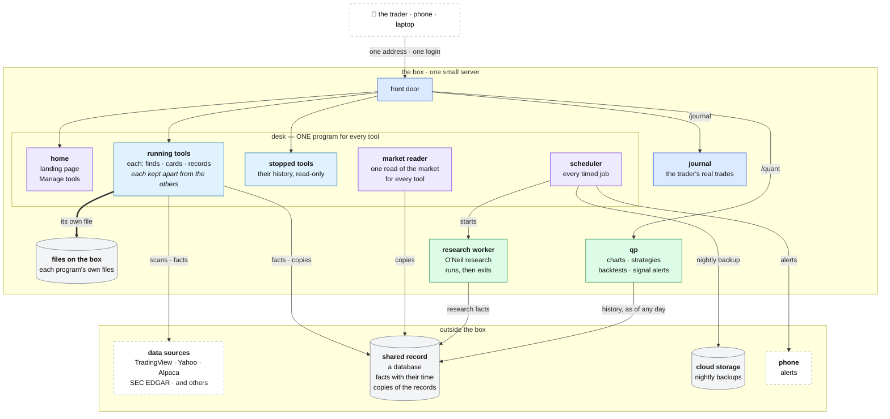
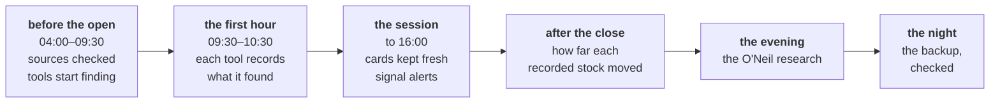

# Trade Desk: the architecture

This is the top of the design. It says what the Trade Desk is, shows the whole
of it in one picture, and explains each block of that picture in a few lines.

**How to read the design.** It is a tree. Each block in the picture has its own
document one level down, and each part of a block has its own document below
that. Every document names the one above it in its first line. Read this one
first, then go down only into the branch you need.

---

## Contents

1. [What the desk is](#1-what-the-desk-is)
2. [What shapes the design](#2-what-shapes-the-design)
3. [The whole desk, in one picture](#3-the-whole-desk-in-one-picture)
4. [The blocks](#4-the-blocks)
5. [How the blocks share data](#5-how-the-blocks-share-data)
6. [A trading day](#6-a-trading-day)
7. [Rules that apply everywhere](#7-rules-that-apply-everywhere)
8. [Running it](#8-running-it)
9. [Where the build stands, and the way there](#9-where-the-build-stands-and-the-way-there)
10. [Decisions](#10-decisions)
11. [Risks](#11-risks)
12. [The document tree](#12-the-document-tree)
13. [Words used here](#13-words-used-here)

---

## 1. What the desk is

The Trade Desk is a private research desk for one day trader. Each trading
morning it finds the stocks worth looking at, using several screening methods
side by side. It shows everything worth knowing about each of those stocks on
one card. And it keeps an honest record of what each method found and how
those stocks then moved, so the trader can learn which methods are worth
trading.

It also charts and backtests trading rules, alerts the trader when a saved rule
fires, and reviews the trader's real trades. **It never places an order.**

### What it does

| Job | The question it answers |
|---|---|
| **Find** | which stocks are worth looking at right now, by each of my methods? |
| **Know** | what is there to know about this stock today, on one card? |
| **Read the market** | should I be trading at all today, and where is the strength? |
| **Learn** | which methods find stocks that move? |
| **Test** | if I had traded this rule on what my methods found, what would have happened? |
| **Review** | how did my real trades go? |

### How it learns

The desk is a research instrument before it is a trading screen:
- **Each method is a tool.** A tool is one way of finding stocks, run as an
  experiment, with its own history. Tools never share results.
- **Each tool records what it found, once a day,** at a fixed minute in the
  first hour of trading.
- **After the close, the desk records how far each of those stocks moved.**
- **Over weeks, that record shows which tools find stocks that move,** against
  a plain benchmark tool that every other must beat.
- **Facts about the world are shared; results are not.** A fact (a stock's
  news, the market's trend) can label a card, but it never changes which
  stocks a tool finds.

How the record is taken and measured is described two levels down, in the
documents of a running tool.

---

## 2. What shapes the design

### What it must live with

| Constraint | What follows |
|---|---|
| **one trader** *(solo mode)* | one login; no accounts or roles; simple beats scalable. **Hosted mode** adds accounts and admin/user roles ([ACCOUNTS.md](design/13-accounts/ACCOUNTS.md)) |
| **one small server** with 1 GB of memory | every program has a memory budget, and a tool must cost little |
| **free data** *(solo mode)* | free and public sources, two of them unofficial; each can change or fail without notice. **Hosted mode** uses licensed, swappable providers, chosen from the [admin dashboard](design/14-admin/ADMIN.md) |
| **New York hours** | the desk works from 04:00 to the close on trading days, and the first hour after the open matters most |
| **no orders** | the desk finds, explains, measures and records; it never trades |

### What it must achieve, in order

When two goals pull against each other, the higher one wins.
1. **A true record.** What a tool records holds exactly what was known at that
   minute: nothing later leaks in, and nothing missing is guessed.
2. **No silent failure.** Anything that fails, or does not run, shows on one
   page and reaches the phone.
3. **Ready every morning.** A program that crashes restarts in seconds and
   loses nothing.
4. **Fits the server.** Every program stays inside its memory budget.
5. **One person can run it.** One command to deploy, one to restore, one page
   for its health.
6. **Every number explains itself.** Its source, its time and its meaning are
   one tap away.

### Two deployment modes: solo and hosted

The desk was designed for one trader on one box — **solo mode** — and everything
below describes that. The same design runs commercially as a hosted,
multi-tenant service — **hosted mode** — which adds four things and changes
nothing else:

| Added in hosted mode | Document |
|---|---|
| **accounts, login and admin/user roles** | [design/13-accounts/ACCOUNTS.md](design/13-accounts/ACCOUNTS.md) |
| **an admin dashboard** to manage providers, keys, flags and thresholds | [design/14-admin/ADMIN.md](design/14-admin/ADMIN.md) |
| **a hosted Postgres as the record** (not box files); the data model is the same | [design/DATA-MODEL.md](design/DATA-MODEL.md) |
| **licensed, swappable data providers** (free sources are not licensed for commercial use) | [design/08-data-sources/DATA-SOURCES.md](design/08-data-sources/DATA-SOURCES.md) |

Solo mode stays free and private; hosted mode is the commercial product.
Accounts and provider abstraction are **designed now so the build is mode-ready,
and switched on when commercial** — they cost nothing structural, because the
data model carries account scoping in both modes
([DATA-MODEL.md](design/DATA-MODEL.md) §5).

---

## 3. The whole desk, in one picture



Some lines are left out to keep the picture readable: the scheduler also
starts the work of qp and the journal; qp and the journal keep their own files;
and the backup copies the shared record as well as the files.

| Block | What it does | Its document |
|---|---|---|
| **the box** | the one server everything runs on | [design/01-box/BOX.md](design/01-box/BOX.md) |
| **front door** | the one address and the one login | [design/02-front-door/FRONT-DOOR.md](design/02-front-door/FRONT-DOOR.md) |
| **desk** | one program that runs every tool | [design/03-desk/DESK.md](design/03-desk/DESK.md) |
| **files on the box** | where each program keeps what it records | [design/04-files/FILES.md](design/04-files/FILES.md) |
| **qp** | charts, strategies, backtests, signal alerts | [design/05-qp/QP.md](design/05-qp/QP.md) |
| **research worker** | the slow, heavy research: the O'Neil method | [design/06-research-worker/RESEARCH-WORKER.md](design/06-research-worker/RESEARCH-WORKER.md) |
| **journal** | the trader's real trades, after the fact | [design/07-journal/JOURNAL.md](design/07-journal/JOURNAL.md) |
| **data sources** | everything the desk reads from outside | [design/08-data-sources/DATA-SOURCES.md](design/08-data-sources/DATA-SOURCES.md) |
| **shared record** | the facts and copies more than one program needs | [design/09-shared-record/SHARED-RECORD.md](design/09-shared-record/SHARED-RECORD.md) |
| **backups** | a copy of everything, off the box, every night | [design/10-backups/BACKUPS.md](design/10-backups/BACKUPS.md) |
| **alerts** | what reaches the phone, and the health page | [design/11-alerts/ALERTS.md](design/11-alerts/ALERTS.md) |

How today's desk becomes this one: [design/12-migration/MIGRATION.md](design/12-migration/MIGRATION.md).

---

## 4. The blocks

### 4.1 The front door

The trader reaches the whole desk at **one address**, from a phone or a laptop,
with **one login**. The front door sends each request to the right program and
keeps everything else closed to the outside. It holds nothing and computes
nothing: if it stops, the desk keeps working, and only the pages are out of
reach.

### 4.2 The desk

**One program runs every tool.** For each tool it finds the stocks, builds
their cards, keeps the day's list, records what the tool found, and serves the
tool's pages.

Its parts:
- **Home:** the landing page, the lists across all tools, and the page that
  adds, starts, stops and edits tools. Home belongs to the desk itself, so any
  tool can be stopped.
- **Running tools:** each one kept apart from the others inside the program,
  so no tool can see or change another's results.
- **Stopped tools:** what each one ever recorded, still readable.
- **The market reader:** one read of the market for every tool, kept with its
  history.
- **The scheduler:** the only clock of the whole desk. It runs every timed
  job, including the work of the other programs, and records every run.

**Why one program.** A tool costs the desk a little memory instead of a whole
program; there is one clock, so nothing runs twice; and nothing a page shows
has to be copied between programs ([§10](#10-decisions)).

### 4.3 Files on the box

Each program keeps what it records in **its own files on the box**, and every
file has **exactly one program that writes it**. Each tool's results are kept in
that tool's own file, so the desk works without the network and the tools stay
apart.

### 4.4 qp

The chart and backtest program, kept as it is because it is the best-built part
of the old desk:
- a library of indicators, each checked against TradingView;
- the chart;
- a builder for trading rules;
- the backtest of a rule on the stocks the tools found, on the days they found
  them;
- signal alerts when a saved rule fires on today's stocks, on its page and on
  the phone.

It has no clock of its own: the desk's scheduler starts its alerts. It reads
the tools' history from the shared record.

### 4.5 The research worker

A job the scheduler starts, which does the slow, heavy research of the O'Neil
method (earnings, relative strength, industry groups, the market's trend),
writes its results with their dates into the shared record, and exits. It is
the only writer of that research, and no page ever waits for it.

### 4.6 The journal

The trader's real trades, after the fact: from the broker's records, from
uploaded files, or typed in. It turns them into complete trades, measures them,
and keeps the trader's notes. It has its own program and file, because it
shares nothing live with the tools.

### 4.7 Outside the box

| Block | What it is |
|---|---|
| **data sources** | TradingView's scanner, Yahoo, Alpaca, SEC EDGAR and others. Each is reached through one piece of code that knows its limits, and that says "unavailable, because …" rather than guessing |
| **shared record** | a database for what more than one program needs: facts about the world with the time they became known, the O'Neil research, and a copy of every tool's records |
| **backups** | every night, a copy of every file and of the shared record goes to cloud storage, and is checked by restoring it. One command puts a night back |
| **alerts** | anything that fails reaches the phone once, and its recovery once. A check from outside the box says when the desk itself has stopped. One page shows the health of everything |

---

## 5. How the blocks share data

### 5.1 Three kinds of data

| Kind | Example | Rule |
|---|---|---|
| **facts about the world** | a stock's short interest; the index's close; a company's quarterly earnings | shared by every tool; stored once, with the time it became known and its source |
| **results of a method** | what a tool found this morning, and how those stocks moved | belong to one tool; never shared, never mixed |
| **the trader's records** | strategies, backtests, trades, notes, settings | belong to the trader; changed only by the trader |

### 5.2 Where each lives

| Data | Lives in | Written only by |
|---|---|---|
| each tool's results, its screeners and its settings | the tool's own file, with a copy in the shared record | the desk |
| the market's history | the desk's own file, with a copy in the shared record | the desk |
| facts about stocks | the shared record | the desk, each kind of fact through its own source |
| the O'Neil research | the shared record | the research worker |
| strategies and backtests | qp's file | qp |
| trades and notes | the journal's file | the journal |
| keys and passwords | protected files on the box, never copied anywhere | the trader |

**One writer for each.** No two programs write the same file or the same kind of
fact, so nothing is overwritten by surprise.

### 5.3 Every fact carries its time

A fact records what it describes, its value, its source, and **when the desk
learned it**. A fact that could not be had says so, with the reason. That is
what keeps the record true:
- a tool's morning record holds the facts known at its minute;
- a backtest sees only the facts known before each decision;
- a journal trade sees only the facts known at its entry.

### 5.4 Time

Every instant is stored in universal time and shown in New York time. One
trading calendar, with its holidays and half days, serves every block. Ages and
look-backs are counted in trading days, so a weekend never looks like missing
data.

---

## 6. A trading day



| When (New York) | What happens | Who |
|---|---|---|
| before the first scan | every outside source is checked | the scheduler |
| 04:00 to the close | each tool scans at its pace, cards what it finds, and keeps its cards fresh | the desk |
| in the first hour | each tool records the stocks it has found, at its own minute | the desk |
| through the session | saved trading rules are checked against today's stocks, and alerts sent | the scheduler, qp |
| after the close | how far each recorded stock moved | the desk |
| the evening | the O'Neil research for every stock the tools have seen | the research worker |
| when the research ends | a backup of everything, checked | the scheduler |
| all day | the trader's real trades come in from the broker | the scheduler, the journal |

The exact times of every job: the desk's scheduler
([design/03-desk/DESK.md](design/03-desk/DESK.md)).

### 6.1 When something goes wrong

| Event | What happens |
|---|---|
| a source fails | the facts it gives show "unavailable, because …", and the cards still build. The health page turns red, and the phone is told |
| the desk crashes | it restarts in seconds, and every tool's list comes back from its file. A record whose minute passed while it was down is marked missed, never taken late as if on time |
| the desk does not come back | the check from outside the box tells the phone |
| the research fails | each step reports on its own. Facts keep their dates, so a card says how old they are |
| the shared record is down | each tool keeps working from its own file; the copies catch up later |
| qp or the journal is down | the desk carries on; the phone is told |
| the server is lost | a new one is set up, and one command restores last night's backup |

---

## 7. Rules that apply everywhere

Each document applies these to its own block. Each was learned from a fault on
the live desk.

| Rule | Means |
|---|---|
| **honest gaps** | a missing value says it is missing, and why; it is never shown as 0, as "no", or as a bad sign |
| **no hindsight** | every number uses only what was known at its moment |
| **a label, never a filter** | shared facts describe a card; they never change which stocks a tool finds |
| **one writer** | every file and every kind of fact has one program that writes it |
| **results stay apart** | one tool's results never reach another |
| **one definition** | each calculation is written once, in one place |
| **versions** | a screener or a model that changes gets a new version, and every record says which version made it |
| **checked on save** | a setting that cannot work is refused when saved, with the reason |
| **failures are loud** | a job that fails or does not run reaches the phone |
| **one record, at its minute** | a tool's daily record is taken only at its minute; a missed one is marked, never faked |
| **no overlap** | a job never runs twice at once |
| **trading days, not hours** | ages and look-backs are counted on the trading calendar |
| **proven before it ships** | every change passes the tests; every move is compared with what it replaces before the old part stops |
| **secrets stay put** | keys never appear in a reply, a log, the code or a backup |

The faults behind each rule are named in the block documents.

---

## 8. Running it

**The box** is one small cloud server with 1 GB of memory and a swap file.
Today the desk's programs leave it almost nothing spare; one program for every
tool frees most of that memory.

**One supervisor** keeps every program running, restarts it if it stops, and
holds it to its memory budget. **One command** deploys a new version: it backs
everything up, restarts the programs in order, checks each one, and stops at
the first failure.

**Backups** go off the box every night and are checked by restoring them. One
command puts a night back, and a monthly rehearsal proves it works. Keys are
never in a backup: the trader keeps their own copy.

Detail: [design/01-box/BOX.md](design/01-box/BOX.md) and
[design/10-backups/BACKUPS.md](design/10-backups/BACKUPS.md).

---

## 9. Where the build stands, and the way there

**On 2026-10-08,** the data half of the plan is built and deployed: the shared
record, the research worker, run history and alerts, verified backups, the one
address. Most of it runs **in shadow**: beside the old way, compared with it,
with nothing depending on it yet. The program half is next.

| Block | Today |
|---|---|
| front door | built; the one address and login work, but the domain and closing the other ports are not done |
| desk | being built: the way one program holds several tools is built; the tools still run as five separate programs |
| files on the box | built |
| qp | mostly built; reading the tools' history from the shared record is built but off |
| research worker | built, in shadow; the cards still use qp's numbers |
| journal | mostly built; stops and the snapshot of each trade's entry are not |
| data sources | partly behind their own code; the rest moves with the desk |
| shared record | built, in shadow |
| backups | built |
| alerts | the phone works for the most important jobs; the health page is not built |

**The way there.** Six steps. Each ships on its own, keeps the desk working, is
compared with what it replaces, and can be undone.

| Step | What |
|---|---|
| **A** | the desk program starts, serving the stopped tools; the old archive program stops |
| **B** | the desk takes the running tools, one at a time, each only after a week in which it records exactly what the tool's own program records |
| **C** | one scheduler for everything; the old timers are retired |
| **D** | the shared facts and the one market read are switched on, each when its comparison is clean |
| **E** | the health page, scorecards, live pages, phone-first pages |
| **F** | a model to rank each tool's stocks, when the trader chooses one |

Detail, with each step's check and undo: [design/12-migration/MIGRATION.md](design/12-migration/MIGRATION.md).

---

## 10. Decisions

| Decision | Decided |
|---|---|
| **how the tools run** | **one program for every tool** (by the trader, 2026-10-08). The earlier plan, two programs (one for the pages, one for the jobs), would have had to copy everything a page shows between them all day, and would have loaded the code twice. Why in full: [design/03-desk/DESK.md](design/03-desk/DESK.md) |
| **where a tool's results are kept** | in the tool's own file on the box, with a copy in the shared record. A record kept only in a remote database would make every scan and every page depend on the network |
| **the database** | Postgres, for the shared record — and, in hosted mode, the canonical record ([DATA-MODEL.md](design/DATA-MODEL.md)) |
| **where the shared record lives** | **open**: on Railway for now. It could move onto the box or to AWS; moving is one restore. The trader decides |
| **the server** | the 1 GB server; a 2 GB one would remove the squeeze |
| **the address** | a free domain name with its own certificate |
| **alerts to the phone** | ntfy: faults on one channel, signal alerts on another; a free outside check for when the desk itself stops |
| **the language** | JavaScript for the desk and the journal, Python for qp and the research. No rewrite: it adds risk without a trading gain |
| **merging identical scans across tools** | dropped: every tool's screeners differ, so there is nothing to merge |
| **one tool's daily record time** (T6) | **open**: its record is taken before its screener starts looking. Move the record later, or start the screener earlier: this decides what the tool measures |
| **a model** | prepared, not built; the trader may choose one later |
| **commercial direction** | a hosted, multi-tenant mode beside the solo box (by the trader, 2026-10-14); solo stays free and private |
| **accounts and roles** | designed now, built when commercial ([ACCOUNTS.md](design/13-accounts/ACCOUNTS.md)) |
| **the canonical record (hosted)** | the relational data model in a hosted Postgres ([DATA-MODEL.md](design/DATA-MODEL.md)); the uploaded schema is adopted |
| **commercial data provider** | swappable by design; the licensed provider is chosen later, from the admin dashboard ([DATA-SOURCES.md](design/08-data-sources/DATA-SOURCES.md), [ADMIN.md](design/14-admin/ADMIN.md)) |

---

## 11. Risks

| Risk | What contains it |
|---|---|
| TradingView's scanner is unofficial and could change or refuse the desk | one piece of code reaches it and refuses a changed answer; it is checked before every day; the desk says plainly when it cannot see |
| free data has limits (some sources are a day behind, thin, or slow) | each source's code states its limits; the desk falls back where it can and says when it cannot |
| one program for every tool: a crash stops them all | it restarts in seconds; nothing is lost; a missed record is marked and the phone is told |
| one server, no spare | nightly backups, checked; a restore in one command, rehearsed monthly; the shared record holds a copy of every record |
| memory on a 1 GB server | a budget for every program, enforced; the heavy research runs in the evening, when nothing else does |
| a source that is confidently wrong | sources are cross-checked where they overlap, and every fact keeps its source |

---

## 12. The document tree

Read from the top. Each document names the one above it in its first line, and
has its own diagram.

```
ARCHITECTURE.md ................................... the whole desk (this document)
│
├── design/01-box/BOX.md .......................... the box: memory, supervisor, deploy, secrets
├── design/02-front-door/FRONT-DOOR.md ............ the address, the login, routing
├── design/03-desk/DESK.md ........................ the desk: one program, each tool kept apart
│   ├── design/03-desk/WEB.md ..................... how a page reaches its tool
│   ├── design/03-desk/HOME.md .................... the landing page, the lists across tools, Manage tools
│   ├── design/03-desk/TOOL.md .................... one running tool, end to end
│   │   ├── design/03-desk/tool/SCREENERS.md ...... its screeners and how it finds stocks
│   │   ├── design/03-desk/tool/CARD.md ........... the card: every field and its source
│   │   ├── design/03-desk/tool/REGISTERS.md ...... its daily record and the outcomes
│   │   ├── design/03-desk/tool/LEARNING.md ....... the score and the scorecard
│   │   └── design/03-desk/tool/PAGES.md .......... its pages
│   ├── design/03-desk/STOPPED-TOOLS.md ........... a stopped tool's history
│   ├── design/03-desk/MARKET.md .................. the market read
│   └── design/03-desk/JOBS.md .................... the scheduler, job by job
├── design/04-files/FILES.md ...................... every file on the box and its writer
├── design/05-qp/QP.md ............................ qp
│   ├── design/05-qp/CHART.md ..................... the page and the print sheets
│   ├── design/05-qp/LIBRARY.md ................... the checked indicators
│   ├── design/05-qp/STRATEGIES.md ................ trading rules and how they become trades
│   ├── design/05-qp/BACKTEST.md .................. the backtest
│   ├── design/05-qp/SIGNAL-ALERTS.md ............. signal alerts
│   └── design/05-qp/FEEDS.md ..................... price bars
├── design/06-research-worker/RESEARCH-WORKER.md .. the research worker
│   └── design/06-research-worker/ONEIL.md ........ the O'Neil method, letter by letter
├── design/07-journal/JOURNAL.md .................. the journal
│   ├── design/07-journal/IMPORT.md ............... how trades come in
│   └── design/07-journal/REVIEW.md ............... the page and the analysis
├── design/08-data-sources/DATA-SOURCES.md ........ every outside source
├── design/09-shared-record/SHARED-RECORD.md ...... the shared record
├── design/10-backups/BACKUPS.md .................. backup and restore
├── design/11-alerts/ALERTS.md .................... alerts and the health page
├── design/12-migration/MIGRATION.md .............. from today's desk to this one
├── design/13-accounts/ACCOUNTS.md ............... accounts, login and roles (hosted mode)
├── design/14-admin/ADMIN.md ..................... the admin dashboard (hosted mode)
├── design/DATA-MODEL.md ......................... the relational data model, all tables
└── design/FRONTEND-SUPPORT-AUDIT.md ............. the 3-tool design-support reconciliation
```

**Where to read them.** Each document has a PDF in [pdf/](pdf), in the same
tree, and [pdf/DESIGN.pdf](pdf/DESIGN.pdf) holds them all in this order. The
index, with what is written so far: [design/README.md](design/README.md).

**Every document has the same parts:** its place in the tree; what it is; its
diagram; its parts; what it owns and reads; what happens when it fails; what
it is built on; and its status.

**What the design is built on.** The desk that runs today, documented from its
code under [legacy/](legacy): every card field and its source, every
calculation, the research method, the O'Neil method and the journal. Each block
document names the faults of the old desk that its design prevents. The first
design, which this tree replaces, is kept in
[archive/design-v1/](archive/design-v1/README.md) until the tree carries
everything in it.

---

## 13. Words used here

| Word | Meaning |
|---|---|
| **desk** | the one program that runs every tool |
| **tool** | one way of finding stocks, run as an experiment, with its own history |
| **screener** | one question a tool asks TradingView's scanner, such as "stocks up 5 % on heavy volume" |
| **card** | everything the desk knows about one stock on one day |
| **benchmark** | a plain tool that every other tool must beat |
| **fact** | one thing known about a stock or the market, with its source and the time it became known |
| **shared record** | the database for what more than one program needs |
| **qp** | the chart and backtest program |
| **research worker** | the job that does the O'Neil research, then stops |
| **O'Neil method** | William O'Neil's way of reading stocks and the market (CANSLIM) |
| **in shadow** | built and running beside the old way, compared with it, but nothing depends on it yet |
