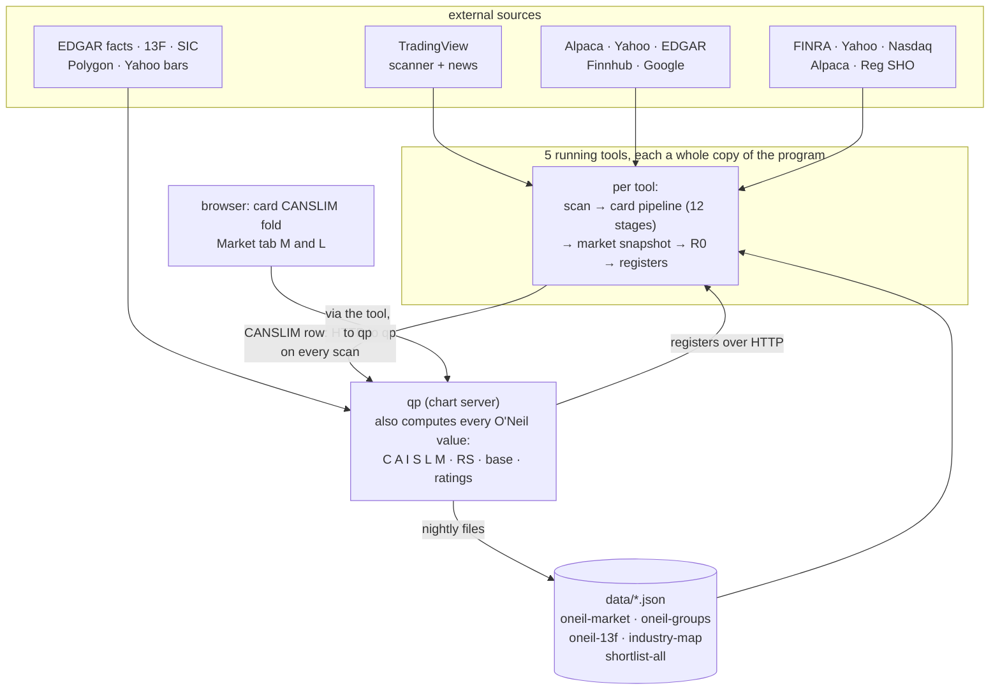
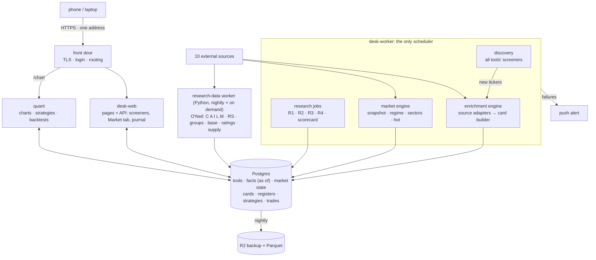
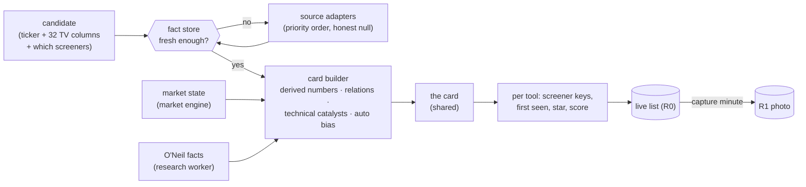
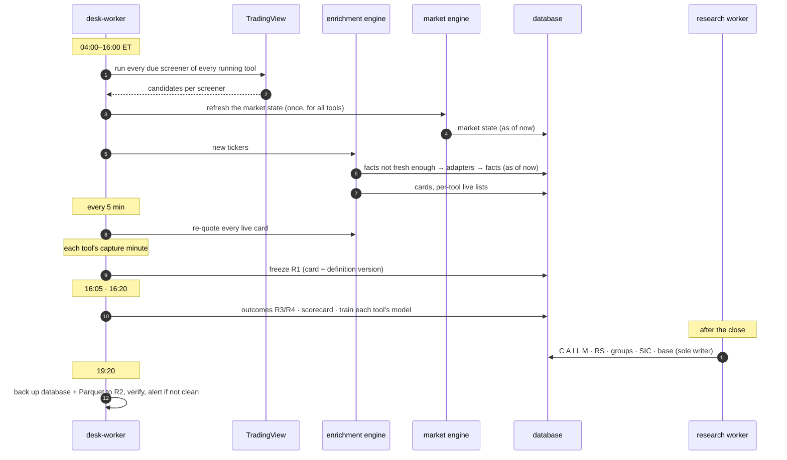

# If the desk were built from the beginning

The same jobs, the same research rules, rebuilt around what the 2026-10
review found. Every design choice below points at the failure it prevents.

How the desk runs today is in [ARCHITECTURE.md](ARCHITECTURE.md). The rules
each program must keep are in [screeners/README.md](../screeners/README.md)
and [qp/README.md](../qp/README.md).

---

## What the desk actually does

TradingView is where the candidates come from. It is **not** where most of
the desk's work happens.

| Job | What it is | Weight |
|---|---|---|
| **1. Discovery** | each tool's screeners ask TradingView's scanner for candidates | one request per screener per scan |
| **2. The card** | every candidate is filled with everything known about it: derived numbers, short interest, borrow, news and catalyst, market context, industry and group, the full CANSLIM reading, themes, score, shortlist marks | **the biggest part of the desk**: ten external sources, about twenty steps, each with its own cache, freshness and fallback |
| **3. The market** | the Market tab: the desk's live read (indexes, regime, sectors, hot sectors) and O'Neil's method (the market model M, industry groups L), also stamped on every card | every scan, plus nightly |
| **4. Research** | freeze the photo (R1), measure what moved (R3), join them (R4), judge screeners, train the score | daily |
| **5. Charts, strategies, backtests** | qp, on the stocks the tools found | on demand |
| **6. The journal** | every trade after the fact | on demand, plus broker sync |

The design has to be built around job 2, not around job 1.

---

## Where the data comes from

Ten external sources feed the desk today.

| Source | Feeds | Cadence | Needs |
|---|---|---|---|
| **TradingView scanner** | candidates and their 32 columns; re-quotes every 5 min; the market snapshot (SPY, QQQ, IWM, DIA, VIX, 15 sector ETFs) | every scan | nothing |
| **TradingView news** | headlines | live cards, every scan | nothing |
| **Yahoo Finance** | news; short interest (fallback); daily bars of ^GSPC/^IXIC for the market model; outcome bars (R3); weekly bars for the base; chart bars | per scan, nightly, 16:05, on demand | nothing |
| **Alpaca** | Benzinga news; shortable flag; bars (move rate, R3 fallback, journal); account fills (journal) | per scan, daily, 16:05 | key |
| **FINRA** | short interest (one file for every symbol) | daily | nothing |
| **Nasdaq** | short interest (fallback); Reg SHO threshold list | daily, per settlement day | nothing |
| **NYSE** | Reg SHO threshold list | per settlement day | nothing |
| **SEC EDGAR** | filings as news; company facts (C and A); SIC codes (industry groups); Form 13F (I) | per scan, nightly, quarterly | a User-Agent |
| **Polygon** | grouped-daily whole market (the RS rating); bars | nightly, on demand | key |
| **Finnhub**, **Google News** | news (Finnhub with a key; Google only when the others return fewer than 2 items) | live cards | key / nothing |

Plus computed sources: derived numbers, relations, technical catalysts,
themes, the desk regime, sector scores, RS ratings, group ranks, the base,
up/down volume, the score.

---

## Today, as it runs

| Found in the review | Root cause in the architecture |
|---|---|
| the same ticker's news, short interest and borrow fetched by **every tool that found it**; five tools computing the **same market snapshot** from the same ETFs, minutes apart | the card pipeline and the market read live **inside each tool**, not as shared services |
| while qp restarts, every card's CANSLIM fold is blank and every scan freezes its `cs*` columns as empty into R1; when an O'Neil file is missing, the Market tab asks the chart server to build it | **O'Neil values are computed inside the chart program**, though they are card fields and Market-tab sections |
| F-21: the industry map flipped between SIC and TradingView every morning | two writers for one shared file |
| facts with no time: short interest, borrow and news cached per process per day; the backtest has to reconstruct CANSLIM "as of" a day | **no fact store** with as-of timestamps |
| hot-sector state and live cards lost on every restart | state that matters kept in memory |
| S-1: anyone on the internet could change keys and strategies | thirteen public ports, no front door |
| D-S9: T6 photographs at 10:16 a screener that starts at 11:30 | times and windows never checked against each other |
| qp restart took 3 min 20 s; the 113,854-restart incident | two supervisors in the past, port handover by guesswork |
| fixes verified only when someone runs the tests | no CI |

---

## The principles

| Principle | Means | Prevents |
|---|---|---|
| **The card is a product, built once** | a ticker's facts are fetched and computed once, by one enrichment engine, and every tool reads them | five tools fetching the same news and short interest; cards that disagree between tools |
| **Every source behind an adapter** | one adapter per source states what it returns, how fresh it must be, its fallback order and its honest null ("could not ask" is never "no") | source logic scattered through the pipeline |
| **Every fact carries when it became known** | a fact store keyed by ticker, fact family and time | look-ahead (F-20, F-26, F-28); "as of" reconstructions |
| **The market is read once** | one market engine builds the snapshot, regime, sectors and O'Neil's M and L for every tool, with history | five copies of the same read disagreeing |
| **Research data is not the chart server's job** | the O'Neil chain runs as its own worker and writes to the fact store; the chart server only reads | a chart restart blanking cards |
| **Isolate results, share facts** | each tool's candidates, registers, shortlist and model stay its own; facts about a ticker and the market are shared, as labels, never filters | the research rule |
| **Tools are data** | a tool is a row: its screeners, windows and capture times; one engine runs all of them | 90 MB per tool; tools stopped for lack of memory |
| **One writer for every fact** | every table names its single owner; two sources for one fact are both stored, with a stated priority | F-21 |
| **One clock** | one scheduler, with a run history and an alert when a run fails or does not happen | jobs spread over five processes, pm2 cron and systemd |
| **Config checked when saved** | capture before its screeners' windows: refused, with the reason | D-S9 |
| **One front door** | one HTTPS address, one login, no other open port | 13 public ports |
| **Proven before it ships** | every pull request runs the tests; red blocks the merge | no CI |

---

## The target, in one picture

| Part | Does |
|---|---|
| **front door** | HTTPS, the one login, routing; closes every other port |
| **desk-web** | every page: the screener suite, each tool's tabs, the Market tab, the journal. Never runs a timed job |
| **desk-worker** | the only scheduler. Hosts discovery, the enrichment engine, the market engine and the research jobs; records every run; pushes an alert when one fails or does not happen |
| **enrichment engine** | the card builder (below) |
| **market engine** | the Market tab (below) |
| **research-data worker** | the O'Neil chain, moved out of the chart server (below) |
| **quant** | today's qp: the verified library, charts, strategies, backtests, alerts. Reads registers and facts from the database, as of any date |
| **Postgres** | the system of record; on one small box, SQLite with one writer per file is the lighter alternative: the ownership rules matter more than the engine |

---

## The card, end to end

The enrichment engine turns a candidate into a card. It runs for every
**new** ticker at once, and re-checks each fact family on that family's own
clock.

| Fact family | Sources, in priority | Fresh for | On the card |
|---|---|---|---|
| quote, levels, ranges, volume, float, cap | TradingView scanner | 5 minutes | header, Volume & Float, Range, Price, EMAs |
| derived numbers, relations | computed from the quote | with the quote | signal tags, PM/ADR, range positions |
| short interest, days to cover | FINRA → Yahoo → Nasdaq | a day | Volume & Float |
| borrow | Alpaca shortable; Reg SHO lists (Nasdaq, NYSE) | a day / settlement day | borrow note |
| news | TradingView, Alpaca, Yahoo, EDGAR, Finnhub; Google as fallback | each scan, live cards | News fold |
| catalyst, auto bias | computed from news (39 categories, 3 tiers) and the tape | with the news | badges, bias button |
| market context | the market engine | each scan | Market Context fold, ALL BULL/BEAR |
| industry, group | SIC (EDGAR) first; TradingView label only when SIC has none | nightly | header, L |
| C, A (earnings tables) | EDGAR company facts | nightly | CANSLIM fold |
| I (institutions) | Form 13F | nightly | CANSLIM fold |
| L (group rank, RS in group) | RS ratings (Polygon whole market) + groups | nightly | CANSLIM fold |
| M (market model per card) | the market model + the stock on distribution days | nightly + per scan | CANSLIM fold |
| base, U/D ratio, A/D, RS line | weekly and daily bars | nightly / on demand | CANSLIM fold |
| themes | ticker and industry lists | static | Themes |
| score | the tool's own model | at discovery | score |
| shortlist marks | this tool; the union of every tool | live | ☆, ★ also |

**Rules the engine keeps** (each learned on the live desk):
- a missing value is **null with a reason**, never zero, never bearish
  (D-S2, F-14);
- a failed source never fails the card (soft stages);
- every fact is stored **with the time it became known**, so R1 freezes and
  backtests read exactly what was known then;
- shared facts are **labels, never filters**;
- one adapter per source; a second source for the same fact is stored beside
  the first with a stated priority (the F-21 lesson);
- each source's health is judged by its content, not by "it answered"
  (the data check).

---

## The Market tab, end to end

The market engine builds the market state **once for every tool**, keeps its
history, and stamps it on every card.

| Section | Built from | When | Also used by |
|---|---|---|---|
| **Indexes** | TradingView: SPY, QQQ, DIA, IWM, VIX | each scan | — |
| **Desk analysis**: short-term bias, mid-term stage, long-term bias, final regime | TradingView index columns (SMAs, Bollinger, ADX, VWAP, RVOL) | each scan | every card's Market Context; the score; R2 |
| **Sector heatmap** and **hot sectors** | 15 sector ETFs; hot state counted **per trading day** and **persisted** | each scan | cards' 🔥 HOT, sector bias |
| **M: O'Neil market model** | ^GSPC, ^IXIC daily bars (distribution days, rally attempts, follow-through) | nightly + on demand | cards' M; the backtest's CANSLIM gate |
| **L: industry groups** | SIC map + whole-market RS ratings | nightly | cards' L |

Today the first three are computed separately by each tool on every scan,
and the hot state is lost on restart; M and L are computed by qp.

---

## O'Neil, placed correctly

Today every O'Neil value is computed **inside qp**, because qp has the bars,
pandas and the nightly job. But what O'Neil produces is **card fields** (the
CANSLIM fold and the `cs*` columns frozen in R1) and **Market-tab sections**
(M and L). That placement is why a chart restart leaves cards without their
CANSLIM reading, and why every scan of every tool calls the chart server.

In the rebuild:

| Piece | Owner | Read by |
|---|---|---|
| C, A (EDGAR), I (13F), supply (EDGAR shares), SIC map, RS ratings, groups (L), market model (M), base, ratings | **research-data worker**, writing facts with their dates | the enrichment engine (cards), the market engine (Market tab), quant (backtest gate, as of a day) |
| S and N on the card | the card builder, from those facts plus the card's own float, short interest, news and new highs | — |
| the CANSLIM fold, the `cs*` columns | the card | — |
| M and L sections | the Market tab | — |

The method itself does not change ([CANSLIM.md](../qp/CANSLIM.md)); only its
home does.

---

## A trading day, end to end

---

## Where the data lives

| Data | Owner (only writer) | Today |
|---|---|---|
| tools, screeners (versioned), windows, capture times | desk-web, validated on save | `tools.config.json` + `tools.local.json` + each tool's SQLite |
| **ticker facts** (quote, short interest, borrow, news, catalyst …), each with its time | enrichment engine | per-process caches and card JSON, per tool |
| **cards** (shared) and per-tool live lists | enrichment engine / desk-worker | each tool's memory, lost on restart |
| **market state** with history (snapshot, regime, sectors, hot state) | market engine | each tool's memory; hot state lost on restart |
| **O'Neil facts** (C, A, I, SIC, RS, groups, M, base, ratings) | research-data worker | `data/oneil-*.json`, `industry-map.json`, qp caches |
| registers R1–R4, shortlist | desk-worker | one SQLite per tool |
| strategies, backtests | quant | `~/.qp/platform.db` |
| trades | journal (in desk-web) | `data/journal/journal.db` |
| job runs | desk-worker | memory, per tool |
| secrets | you, in a secret store | files in `data/`, mode 0600 |

---

## Memory, then and now

| Program | Today | Target |
|---|---|---|
| screener tools (each with its own pipeline and market read) | 5 × ~90 MB | inside desk-web + desk-worker |
| archive (6 stopped tools) | ~80 MB | 0 (same tables, read-only) |
| journal | ~65 MB | inside desk-web |
| desk-web + desk-worker (one enrichment and market engine for all tools) | — | ~150 + ~200 MB |
| quant | 70–150 MB | 70–150 MB |
| research-data worker | inside qp | runs as a job, then exits |
| Postgres | — | ~60–100 MB |
| **total, 5 tools** | **~660–740 MB** | **~480–600 MB** |
| each extra tool | +~90 MB | a few MB: it adds screeners, not a pipeline |

Today's figures are from pm2 on the box (2026-10-06); target figures are
estimates.

---

## Getting there without a rewrite

Each step ships on its own, keeps the desk working, and can be undone.

| # | Step | Risk |
|---|---|---|
| 1 | **CI on every pull request** (Jest and qp's `run_all`) | none |
| 2 | **One front door** (Cloudflare Tunnel; close every port) | low · needs a domain |
| 3 | **Config checked on save** (capture vs windows) | low |
| 4 | **One writer per shared fact**: the `data/*.json` files become tables with owners | low–medium |
| 5 | **The fact store and the source adapters**: short interest, borrow and news move out of each tool into one shared service with per-family freshness; tools read from it. The first big saving: each ticker fetched once | medium · compare cards between old and new for a week |
| 6 | **The market engine, once**: one snapshot, regime and sector read for all tools; hot state persisted | low–medium |
| 7 | **The research-data worker**: the O'Neil chain leaves the chart server and writes facts; the card and Market tab stop calling qp | medium |
| 8 | **One scheduler with run history and alerts** | medium · run side by side for a week |
| 9 | **Tools as configuration**: one engine hosts every tool; R1 rows compared row by row before the old process stops | the largest step · reversible per tool |
| 10 | **Postgres and the Parquet lake** | medium · the backup proves the copy |
| 11 | **One web shell** (one bar, one origin) | low |

---

## What stays exactly as it is

- The research method: one photo a day per tool, entries A and B, outcomes
  in ATR, the benchmark, the mirrors.
- Every card field, every Market-tab section, every source and its fallback
  order: their **home** changes, their **content** does not.
- Each tool's results, model and history isolated from every other tool.
- "A label, never a filter" for every shared fact.
- The O'Neil method as built, and qp's verified library and engine.
- Archived tools stay readable; the nightly backup and the one password.

## Decisions that are yours

- **Where it runs:** stay on EC2, or a managed host.
- **A domain name** for the one HTTPS address.
- **How far to go:** steps 1–7 remove most of the duplicated work and the
  risk found in the review; step 9 is where the per-tool memory cost goes away.
