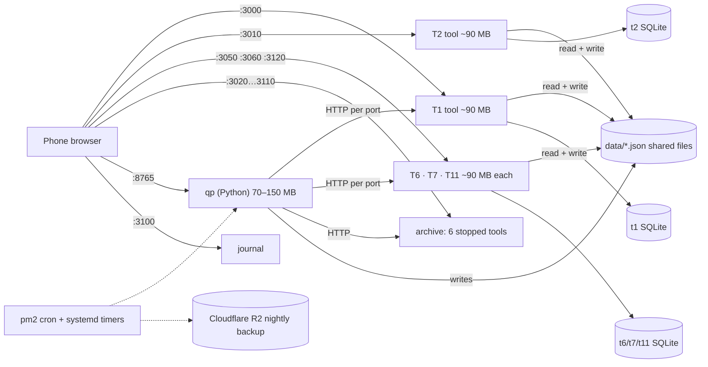
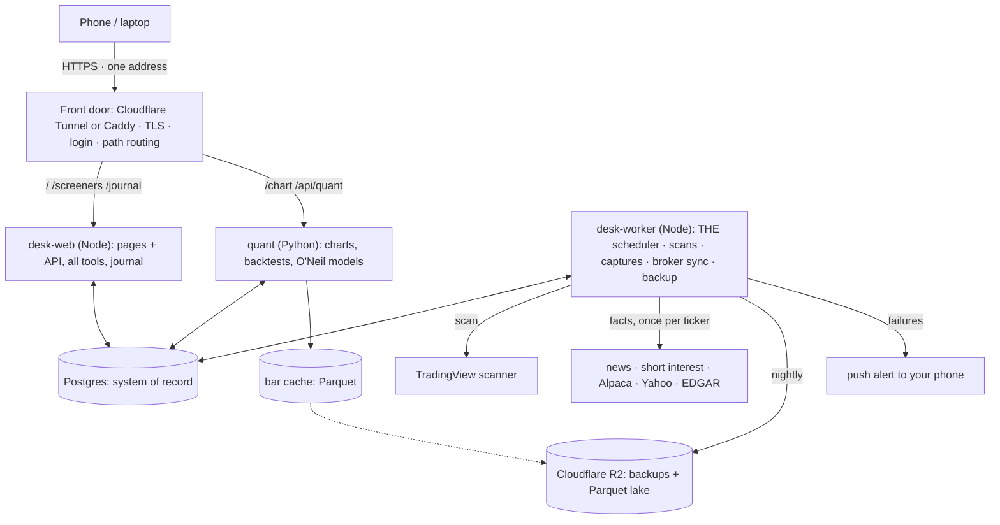
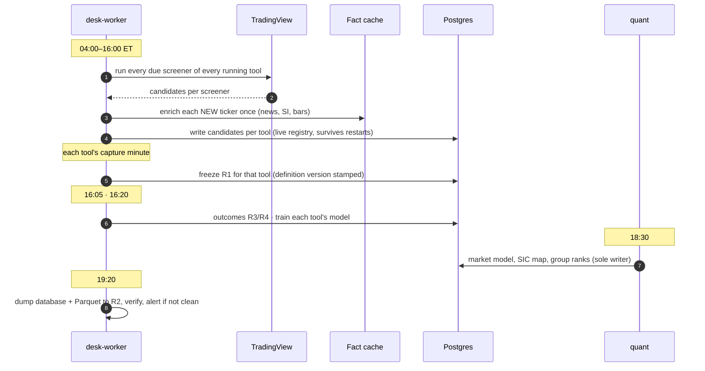

# If the desk were built from the beginning

The same three jobs (find stocks, test strategies, journal trades) and the
same research rules, rebuilt around what the 2026-10 review found on the real
box. Every design choice below points at the failure it prevents.

How the desk runs today is in [ARCHITECTURE.md](ARCHITECTURE.md). The rules
the screener tools must keep in a rebuild are in
[screeners/README.md](../screeners/README.md); qp's and the journal's come
with their phases.

---

## Today, as it runs

Eight long-running programs on one small machine (913 MB RAM, pm2), answering
on thirteen public ports. They talk over HTTP and through JSON files that
several of them write.

Each tool is a whole copy of the program with its own scheduler (12–13 jobs
each). Adding a tool needs about 180 MB free; the box had 214 MB free.

| Found in the review | Root cause in the architecture |
|---|---|
| F-21: the industry map flipped between SIC and TradingView every morning | two writers for one shared file |
| S-1: anyone on the internet could change keys and strategies | thirteen public ports, no front door, plain http |
| D-S9: T6 photographs at 10:16 a screener that starts at 11:30 | times and windows edited in two places, never checked against each other |
| qp restart took 3 min 20 s; the "113,854 restarts" incident | two supervisors in the past, port handover by guesswork |
| T8's list fading silently for months | a shared fact owned by one optional process, with no alert |
| the same ticker's news fetched by every tool that found it | isolation implemented as separate programs instead of separate data |
| fixes verified only when someone runs the tests | no CI on the repository |

---

## The principles

| Principle | Means | Prevents |
|---|---|---|
| **Tools are data, not programs** | a tool is a row: its screeners, windows and capture times; one engine runs all of them | 90 MB per tool; six tools stopped because the box is full |
| **One writer for every fact** | every shared table names its single owner; a fact with two sources stores both, with a stated priority | F-21, lost updates of many processes writing one file |
| **One front door** | everything under one HTTPS address, routed by path, one login, no other port open | 13 ports, cross-port cookie and CORS workarounds |
| **One clock** | one scheduler owns every timed job, with a run history and an alert when a run fails or does not happen | 60+ cron jobs across 5 processes, plus pm2 cron and systemd |
| **Config is checked when saved** | a capture before its screener's window, a window outside market hours, a tool with no screener: refused, with the reason | D-S9 |
| **Isolate results, share facts** | each tool's candidates, registers, shortlist and model stay its own; a price or a news story is fetched once and used by all | keeps the research rule, removes duplicate fetching |
| **As of the date, always** | every stored number carries when it became known, so a backtest can never read the future | F-20, F-26, F-28 were all look-ahead |
| **Proven before it ships** | every pull request runs the full test suites; a red check blocks the merge | no CI today |

---

## The target, in one picture

Three programs instead of eight, whatever the number of tools. Only the front
door faces the internet.

| Part | Status | Does |
|---|---|---|
| **Front door** | new | HTTPS with automatic renewal; the one login (today's code, moved to the edge); routes `/chart` to quant and everything else to desk-web; closes ports 3000–3120 and 8765 |
| **desk-web** | reshaped | one shell, one top bar, every page; all tools behind `/api/tools/T2/…`; the journal as a module; never runs a timed job, it only answers |
| **desk-worker** | new | the only scheduler: discovery scans, R1–R4 captures, outcomes, training, broker fetches, backups; every run recorded (started, finished, rows, error); a missed or failed run pushes an alert |
| **quant** | kept | today's qp: indicators, strategies, backtests, O'Neil; reads registers from the database instead of eleven ports; sole writer of the market model, groups and SIC map |

---

## A trading day, end to end

The live registry moves into the database, so a restart no longer empties the
screen (today it lives in each process's memory).

---

## Where the data lives

| Data | Owner (only writer) | Store | Today |
|---|---|---|---|
| tools, screeners (versioned), windows, capture times | desk-web (validated on save) | Postgres | `tools.config.json` + `tools.local.json` + each tool's SQLite |
| live candidates (R0) | desk-worker | Postgres, per tool | process memory, lost on restart |
| registers R1–R4, shortlist | desk-worker | Postgres per tool + daily Parquet | one SQLite per tool, read over HTTP |
| ticker facts: news, short interest, borrow | desk-worker | Postgres cache, keyed by ticker + time | fetched separately by each tool |
| market model, groups, SIC industry map | quant | Postgres | `data/*.json`, some with two writers |
| bars | quant | Parquet (local, mirrored to R2) | `~/.qp-cache` |
| strategies, backtests | quant | Postgres | `~/.qp/platform.db` |
| trades, setups, grading | desk-web (journal) | Postgres | `data/journal/journal.db` |
| job runs | desk-worker | Postgres | a Monitor tab per tool, memory only |
| secrets: API keys, broker keys | you | a secret store; broker keys encrypted at rest | files in `data/`, mode 0600 |

**Why Postgres instead of today's SQLite files:** three programs write at
once, and one database gives one backup, one place to query, and transactions
across tools. On the current box it costs about 60–100 MB, less than one tool
process today. If the desk stays on one machine, SQLite in WAL mode with a
single writer per file is the lighter alternative; **the ownership rules
matter more than the engine**.

---

## Memory, then and now

| Program | Today | Target |
|---|---|---|
| screener tools | 5 × ~90 MB | inside desk-web + worker |
| archive (6 stopped tools) | ~80 MB | 0 (same tables, read-only flag) |
| journal | ~65 MB | inside desk-web |
| desk-web + desk-worker | — | ~150 + ~150 MB |
| quant / qp | 70–150 MB | 70–150 MB |
| Postgres | — | ~60–100 MB |
| **total, 5 tools** | **~660–740 MB** | **~430–550 MB** |
| each extra tool | +~90 MB | a few MB |

Today's figures are from pm2 on the box (2026-10-06). Target figures are
estimates; measure after step 6.

---

## Getting there without a rewrite

Each step ships on its own, keeps the desk working, and can be undone. Safety
and cheap wins first; the largest change last.

| # | Step | Risk |
|---|---|---|
| 1 | **CI on every pull request:** GitHub Actions runs Jest and qp's `run_all`; a red check blocks merging | none · about a day |
| 2 | **One front door:** Cloudflare Tunnel gives HTTPS on one address; close every port in the EC2 firewall; the login moves in front | low · needs a domain on Cloudflare |
| 3 | **Config checked on save:** capture vs window, windows vs market hours, mirrors vs bases (fixes D-S9 and its class) | low |
| 4 | **One writer per shared fact:** the `data/*.json` files become tables with a named owner, starting with the industry map, market model and groups | low–medium |
| 5 | **One scheduler with run history and alerts:** desk-worker takes the timed jobs from every tool, pm2 cron and systemd; a failed backup or scan reaches your phone | medium · run old and new side by side for a week |
| 6 | **Tools as configuration:** one engine hosts every tool, migrated one at a time; for a week each tool runs in both and its R1 rows are compared row by row before the old process stops | the largest step · reversible per tool |
| 7 | **Postgres and the Parquet lake:** the per-tool SQLite files load into one database; daily registers land in R2 as Parquet | medium · the backup proves the copy |
| 8 | **One web shell:** the three apps share one bar, one stylesheet, one login, one origin; the cross-port code is deleted | low |

---

## What stays exactly as it is

- The research method: one photo a day per tool, entries A and B, outcomes in
  ATR, the benchmark (Stocks in Play).
- Each tool's results, model and history isolated from every other tool.
- "A label, never a filter" for every shared fact on a card.
- qp's engine, its as-of discipline and every saved strategy.
- Archived tools stay readable forever.
- The nightly backup to Cloudflare R2 and the one password.

## Decisions that are yours

- **Where it runs:** stay on EC2 (cheapest, already working) or move to a
  managed host (managed Postgres and deploys, a monthly bill that grows with
  use). Steps 1–6 are the same either way.
- **A domain name** for the one HTTPS address (needed for step 2).
- **How far to go:** steps 1–5 remove most of the risk found in the review
  for a few days of work; step 6 is where the per-tool memory cost goes away.
