# Registers: the research record

**Trunk section:** [§6.6 Registers](ARCHITECTURE.md#66-registers).

> **Build status (2026-10-08).** Built: R1 photos (stamped with their screener versions), R3 outcomes and the shortlist are dual-written to Postgres, and all eleven tools' history was imported with 0 differences (`/api/registers/parity`). The tool's SQLite stays the record until `registersMode on` (MIGRATION step 17). R2 still lives in each tool's SQLite.

**Talks to:** the Card (§6.3), whose cards and tool cards the photo freezes;
Tools and screeners (§6.2), for capture and entry times and screener versions;
the Market (§6.4), whose history R2 reads; Sources (§6.1), for the outcome
bars; Learning (§6.7), which trains and judges on R4; Quant (§6.8), which
backtests over R1; Platform (§6.10), which backs the registers up and exports
them.

**Built on:** [REGISTERS](../../legacy/screeners/REGISTERS.md) (every register and
column), [METHODOLOGY](../../legacy/screeners/METHODOLOGY.md) (the photo, the entries,
the measure), [DATA-MODEL](../../legacy/screeners/DATA-MODEL.md), and the code in
`src/warehouse/registers.js`, `src/sideH/capture.js`, `src/scheduler.js`,
`src/db/index.js`, `scripts/backup-r2.js`.

---

## Contents

1. [What the registers are for](#1-what-the-registers-are-for)
2. [The legacy registers in full](#2-the-legacy-registers-in-full)
3. [What failed](#3-what-failed)
4. [The new design](#4-the-new-design)
5. [Contracts](#5-contracts)
6. [How the rebuild is proven](#6-how-the-rebuild-is-proven)

---

## 1. What the registers are for

They turn a day of screening into data that can be judged, learned from and
backtested, without look-ahead:

| Register | Question it answers |
|---|---|
| **R0** | what is on screen right now? |
| **R1** | what did each card look like at the tool's photo minute? |
| **R2** | what was the market doing around the photo? |
| **R3A / R3B** | from entry A / B, how far did each photographed card run, each way, in ATR? |
| **R4A / R4B** | the photo and its outcome, side by side: one example per card per day |
| **Shortlist** | what did the trader (or the auto-rule) pick? |

Every register exists **per tool**: tools are separate experiments.

```mermaid
gantt
  dateFormat HH:mm
  axisFormat %H:%M
  section Live
  R0 live list (every scan, refresh every 5 min) :active, 04:00, 16:00
  section Morning
  R2 market snapshots (8 slots)       :09:26, 10:01
  Shortlist auto-rule (1 min before R1):milestone, 09:35, 0m
  R1 photo (per tool, e.g. 09:36)     :milestone, 09:36, 0m
  section After the close
  R3A / R3B outcomes                  :milestone, 16:05, 0m
  R4A / R4B training rows             :milestone, 16:05, 0m
  Model training                      :milestone, 16:20, 0m
```

---

## 2. The legacy registers in full

| Register | Written | Trigger | Table | One row per |
|---|---|---|---|---|
| R0 | continuously | every scan and refresh | memory + `r0_checkpoint` | ticker, today |
| R1 | the tool's capture minute | scheduler `R1 Capture HH:MM` | `r1_frozen` | ticker, date |
| R2 | 09:26, 09:31 … 10:01 | scheduler | `r2_market_snapshots` | slot, date |
| R3A / R3B | 16:05 | `R3 EOD Capture` | `r3a` / `r3b` | ticker, date |
| R4A / R4B | read time, and copied at 16:05 | R3 capture | `r4a_train` / `r4b_train` | ticker, date |
| Shortlist | each star; the auto-rule | ☆, auto-rule | `shortlist` | date (a list) |

### 2.1 R0: the live list

Every card of today, live and stale, in the process's memory, checkpointed to
the database after each scan, reloaded on a same-day restart, cleared at
midnight. Exported with R1's columns plus `liveNow` and `lastUpdated`.

### 2.2 R1: the photo

At the capture minute, `captureR1` takes **every R0 row of today**, live or
stale, and stores each row's **complete JSON**. A re-capture replaces the day.
Exported columns:

| Group | Columns | Source |
|---|---|---|
| Identity | `ticker`, `date`, `capturedAt` | — |
| State at the photo | `inShortlist`, `_score`, `bias` | R0 |
| Price | `price`, `prevClose`, `open`, `change`, `gapPct`, `vwap` | quote, derived |
| Moving averages | `sma5`, `ema9`, `ema13`, `ema20`, `ema50` | quote |
| Volatility, volume | `rvol`, `atr`, `adrPct`, `dayHigh`, `dayLow` | quote, derived |
| Ranges | week, month, quarter, year high / low / position; `allTimeHigh` | quote, derived |
| Size | `mcap`, `floatShares` | quote |
| Short interest | `shortFloat`, `daysToCover`, `shortBasis`, `shortAsOf` | FINRA / Yahoo / Nasdaq |
| Pre-market | `pmHigh`, `pmLow`, `pmRange`, `pmAdrRatio` | quote, derived |
| Classification | `sector`, `industry`, `screenerKeys`, `themes` | quote, desk |
| Market context | `regime`, `regimeLabel`, `longTerm`, `midTerm`, `shortTerm`, `broadResolved`, `secBias`, `secScore`, `secHot` | market |
| Relations (27) | `vsEma9 … vsPmLow`, `distEma9 … distPmLow`, `maStack`, `maStackScore`, `monthQuarter`, `pmAdrBand`, `dayRangePos`, `aboveAllMas`, `belowAllMas` | derived |
| CANSLIM (31) | `csEpsChg`, `csSalesChg`, `csQuarter`, `csAccelerating`, `csBeats`, `csGrowth3yr`, `csStability`, `csRoe`, `csBaseWeeks`, `csBaseDepth`, `csPivot`, `csPctToPivot`, `csBaseScore`, `csHandle`, `csUdRatio`, `csAdLetter`, `csRsLineTell`, `csGroup`, `csGroupLevel`, `csGroupRank`, `csGroupOf`, `csRsInGroup`, `csGroupMembers`, `csFunds`, `csFundsChg`, `csFundsDir`, `csMarket`, `csDdChecked`, `csDdHeld`, `csDdAvgRel`, `csDdVerdict` | qp |
| Catalyst | `catalyst` (label) | news |
| Cross-tool | `shortlistedElsewhere` | unified shortlist |
| Timing | `foundMinsFromOpen` (earliest match, minutes from 09:30; negative pre-market) | R0 `seenAt` |

Frozen in the JSON but not exported: `shortSrc`, `shortTrend`, `shortable`,
`easyToBorrow`, `regSho`, `regShoDay`, `move2hPct`, `trend6mPct`, the full
catalyst, news, `seenAt`, `autoBias`, `_changeFromOpen`.

### 2.3 R2: market snapshots

Eight slots, 09:26 to 10:01, each the whole market snapshot as JSON; skipped
when no scan has built one yet.

| Group | Columns |
|---|---|
| When | `date`, `slot`, `capturedAt` |
| SPY | close, change, week change, SMA 5/20/50/200, Bollinger upper/lower |
| QQQ | close, change, week change, SMA 5/20/50/200 |
| IWM, DIA, VIX | close, change (and week change for IWM, VIX) |
| Desk read | `regime`, `regimeLabel`, `shortBias`, `shortScore`, `midStage`, `longBias`, counts of bullish / bearish sectors, `breakouts` (up to 5 symbols up > 3 % on > 2× volume) |
| O'Neil | `oneilStatus`, `oneilAsOf`, `oneilDistributionDays`, `oneilSessionsSinceFtd`, `oneilFtdDate` (read at export: D-D3) |
| Per sector (15) | bias, score, change, hot |

### 2.4 R3A / R3B: outcomes

At 16:05, for every ticker in today's R1:

1. 1-minute bars for the day from **Yahoo**, then **Alpaca** for tickers Yahoo
   returned empty; daily bars from Yahoo, else Alpaca; batches of 100.
2. **ATR14** from daily bars **strictly before today**.
3. **Entry** = the **open** of the bar at the entry minute; no bar at that
   minute = no row (logged `missing HH:MM bar`).
4. From the entry bar to the close: `hh` = highest high, `ll` = lowest low.
5. `upR = (hh − entry) / ATR14`, `downR = (entry − ll) / ATR14`, both positive.
6. The **opening range** 09:30–09:35 high and low.

Columns: `date`, `ticker`, `entryPrice{A,B}`, `hh{A,B}`, `ll{A,B}`, `atr14`,
`upR_{A,B}`, `downR_{A,B}`, `capturedAt`; `or_high`, `or_low` stored but not
exported (D-D4). Worked example: entry $10, high $12.50, low $9.40, ATR $1 →
upR 2.5, downR 0.6.

### 2.5 R4A / R4B: training rows

R1 joined to R3A (or R3B) on ticker. Read live, and at 16:05 the rows with an
outcome are copied into `r4a_train` / `r4b_train` for training and for
Analysis export and upload. R1's `price` is called **`price936`** whatever the
capture time (P-1). **Narrower than R1:** no CANSLIM columns, no week, quarter
or year ranges, no `allTimeHigh`, `daysToCover`, `shortBasis`, `shortAsOf`
(D-D2).

### 2.6 Shortlist

One row per date holding a list of items: `ticker`, `tvSymbol`, `addedAt`,
`method` (`manual` or `auto`), `price`, `change`, `sector`, `score` at that
moment, `exported`, `exportedAt` (copied to TradingView from the Shortlist
tab).

- **Auto-rule:** one minute before the photo, the top `shortlistTopN` (5)
  cards with a score of at least `shortlistMinScore` (70) are added, once a day.
  With the scorer off, it adds nothing (D-D1).
- **Unified list:** each change is published to `data/shortlist-all.json`;
  other tools show `★ also T2`; `inShortlist` stays this tool's own.

### 2.7 Reading them

A tool's **Warehouse** tab (pick a date and a register; CSV or JSON);
`GET /api/warehouse/available-dates?register=R1` and
`GET /api/warehouse/<REG>/<date>`; qp over localhost for charts, R1 sheets and
backtests; **Cloudflare R2** nightly CSVs per tool × register × day under
`analysis/`; archived tools through the archive process, read-only.

---

## 3. What failed

| ID | Fault | Root cause | Prevented by |
|---|---|---|---|
| D-D2 | R4 narrower than R1 | R4 is a copied table with its own column list | R4 is a view over R1 and R3 |
| D-D3 | an old R2 day shows today's O'Neil status | read at export | R2 reads the market history, which holds M as it was |
| D-D4 | the opening range is stored but not exported | a hand-kept export list | exports generated from the schema |
| P-1 | `price936` whatever the capture time | a historical name | the photo's price is `price`; the legacy name is kept only in legacy exports |
| D-S9 | T6's photo taken before its screener can find anything | no check | checked on save ([TOOLS-AND-SCREENERS.md](TOOLS-AND-SCREENERS.md) §8.3) |
| D-D1 | the auto-rule adds nothing | no scores | scores applied in-process ([LEARNING.md](LEARNING.md)) |
| — | empty `cs*` columns frozen for tickers first seen while qp was down or restarting | CANSLIM fetched from qp and cached in each tool for the day | facts read from the fact store |
| D-D8 | a manual route (`POST /api/warehouse/collect`) re-runs the R1 capture at any time and replaces the day's photo, silently | `INSERT OR REPLACE` with no time check | only the scheduler takes a photo; a late one is marked late (§4.2) |
| — | R0 lost on restart until the checkpoint reload; hot-sector and live state in memory | memory state | tool cards are rows |
| — | outcomes on weekday arithmetic; a missing bar silently drops a ticker (logged only) | no trading calendar; reasons not stored | the trading calendar; a reason row for every ticker not measured |
| — | uploaded external rows mixed into training and verdicts | one table for both | uploads stored apart and labelled |
| — | registers spread over one SQLite file per tool, read by qp over HTTP from each tool's port | per-tool processes | one database; quant reads directly |

---

## 4. The new design

### 4.1 R0 is the tool cards

There is no separate live register: R0 is the day's **tool cards** joined to
the shared cards ([CARD.md](CARD.md) §5.1). They are rows, so a restart loses
nothing, and they are kept after the day closes.

### 4.2 R1: the photo

At each tool's capture minute (from the tool row), the register job writes,
for every tool card of the day (live or stale):

| Column | Contents |
|---|---|
| `tool`, `day`, `ticker` | key |
| `captured_at` | the instant |
| `card` | the whole card as JSON: every fact family with its value, status, source and `known_at` |
| `tool_card` | the whole tool card: screener keys **with versions and first-match times**, first seen, live, star, manual bias, score (with model version, sample, confidence) |
| `market_state_id` | the market state the card carried |
| `capture_version` | the version of the photo's definition |

Nothing is left out, so any column can be added to an export later without
losing a day.

**One photo, at its minute.** Only the scheduler takes a photo, at the
capture minute. A photo that could not be taken then (the desk was down) is
recorded as **missed**, with the reason. A photo taken later by hand keeps its
real instant and is marked **late**; late photos stay out of training and
verdicts unless included on purpose, because they hold what was known after
the minute the method is defined at. A photo is never replaced.

### 4.3 R2: a view of the market history

R2 is generated from the market states of the trading day nearest to each
slot (09:26, 09:31 … 10:01), and carries the O'Neil status **as it was** in
that state ([MARKET.md](MARKET.md) §5.2). Its columns are those of §2.3.

### 4.4 R3: outcomes on the trading calendar

At 16:05 on each trading day (half days: 15 minutes after their close), for
every R1 row of every tool:

| Step | Rule |
|---|---|
| bars | 1-minute and daily bars through the bar adapters (Yahoo, then Alpaca), stored once per ticker per day and shared by every tool |
| ATR14 | from the 14 sessions before the day, on the trading calendar |
| entries | the open of the bar at each of the tool's entry minutes |
| hh, ll, upR, downR | as §2.4 |
| opening range | 09:30–09:35 high and low |
| result | `ok`, or a **reason** (`no bar at 09:37`, `no daily history`, `halted`), stored as a row |

R3 is one table with an `entry` column (`A`, `B`), so a third entry can be
added without a new table.

### 4.5 R4: a view

`R4 = R1 ⋈ R3` on tool, day, ticker, entry. Every R1 column is available,
CANSLIM, ranges and all. A model or scorecard selects the columns it uses;
the view never drifts. **Uploaded rows** (examples from outside the tool) live
in their own table, are labelled by source, and are excluded from verdicts
unless explicitly included.

### 4.6 Shortlist

| Table | Key | Columns |
|---|---|---|
| `shortlist` | tool, day, ticker | `added_at`, `method` (manual, auto), the card's price, change, sector and score at that moment, `exported_at` |

The unified view is a query over every tool's shortlist (no shared file). The
auto-rule runs one minute before each tool's photo, from scores that now
exist. Starring a card adds its row and unstarring removes it; the card's ☆/★
is read from here, so a pick is recorded once.

### 4.7 Exports

Generated from the schema, never from a hand-kept column list:

| Export | Format | Where |
|---|---|---|
| a register for a tool and day | CSV or JSON | the Warehouse tab, the API |
| the nightly analysis set | Parquet (and CSV for compatibility) | R2 bucket, `analysis/<tool>/<register>/<day>` |
| the legacy CSV layout (with `price936`) | CSV | on request, for old notebooks |

---

## 5. Contracts

### Owns

| Table / view | Key |
|---|---|
| `r1_photos` | tool, day, ticker |
| `r2_slots` (view) | tool, day, slot |
| `r3_outcomes` | tool, day, ticker, entry |
| `r4` (view) | tool, day, ticker, entry |
| `r4_uploads` | tool, day, ticker, entry, source |
| `shortlist` | tool, day, ticker |
| `bars_day` | ticker, day (shared outcome bars) |

### Reads

| From | What |
|---|---|
| tools and screeners | capture minute, entries, screener versions |
| card | cards and tool cards |
| market | market states |
| sources | bars |

### Read by

| Domain | What |
|---|---|
| learning | R4 per tool |
| quant | R1 per tool and day (backtest universes), R3 (outcomes) |
| platform | exports and backups |

### Routes (desk-web)

| Route | Returns |
|---|---|
| `GET /api/tools/:tool/registers/:reg/dates` | the days a register has |
| `GET /api/tools/:tool/registers/:reg/:day?format=csv\|json` | the register |
| `POST /api/tools/:tool/shortlist/:ticker`, `DELETE …` | star, unstar |
| `GET /api/shortlist?day=` | every tool's shortlist |

---

## 6. How the rebuild is proven

1. **R1 parity.** For a week, each tool's new R1 is compared column by column
   with the old tool's `r1_frozen` (exported columns and frozen JSON).
2. **R3 parity.** For the same week, upR and downR match the old R3 to the
   cent, except where the trading calendar or a stored reason explains it.
3. **R4 completeness.** Every R1 column is present in R4.
4. **Old history imported.** Every legacy tool database (running and
   archived) is imported into the new tables; row counts per tool, register
   and day match.
5. **Legacy exports.** The legacy CSV layout regenerated from the new tables
   is byte-identical for a sample of past days.
