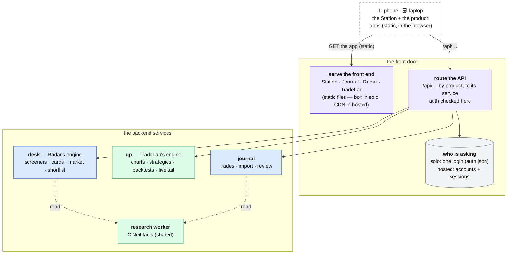

# The front door

**Above:** [ARCHITECTURE.md](../../ARCHITECTURE.md) §4.1.
**Front-end design:** [FRONT-END-DESIGN.md](FRONT-END-DESIGN.md) specifies the
Trading Station home and its cards for the three product apps the trader can open
(the Journal, Radar, TradeLab) and the one to come (TradePilot).
**Talks to:**
- the trader's phone and laptop (the browser, running the **product apps**);
- the **backend services** the apps call for data: the [desk](../03-desk/DESK.md)
  (the engine behind **Radar**), [qp](../05-qp/QP.md) (**TradeLab**), the
  [journal](../07-journal/JOURNAL.md) (**the Journal**), and the
  [research worker](../06-research-worker/RESEARCH-WORKER.md);
- the [box](../01-box/BOX.md) (solo) or the hosting and CDN (hosted) it runs on.

---

## 1. What it is

The front door is **the one entry to the Trading Station and its product apps**.
The front end is a set of **self-contained apps** — the Station launcher, the
Journal, Radar, TradeLab (and later TradePilot) — each a static app that runs in
the browser and switches its own screens client-side
([FRONT-END-DESIGN.md](FRONT-END-DESIGN.md)). The front door does two things:

- **serves the static front end** — the Station and every product app;
- **routes each app's `/api/…` calls** to the backend service that owns the data,
  after checking who is asking.

It carries the sign-in. It holds no business state and computes nothing: the apps
are static files, the data lives behind the API.

**Two deployment shapes, one model.** The product-first shape above is the design
target in both modes; only *where* it is hosted and *how* a caller is identified
differ:

| | Solo (personal self-host) | Hosted (commercial) |
|---|---|---|
| serves the apps | the box, over one domain | a **CDN/edge** |
| the API | local services on the box | the backend services, scaled |
| who is asking | **one login** (one trader) | **accounts and sessions** ([ACCOUNTS.md](../13-accounts/ACCOUNTS.md)), every call scoped to an account |

**What it owns:** the domain and its certificate; the rule for which API calls go
to which service; the sign-in (the password file in solo, the session check in
hosted).

**What it never does:** hold business state; compute a card, a chart or a metric;
let an API call through without a valid sign-in; or decide what a screen shows —
the apps and the services do that.

If it stops, the backend keeps scanning, photographing and researching; only the
front end and the API are out of reach until it restarts.

---

## 2. The diagram

---

## 3. Its parts

### 3.1 The address and TLS

- **Solo.** A free DuckDNS name, `<name>.duckdns.org`; a small updater (cron,
  every 5 minutes) points it at the box's address, its token in `~/.duckdns/token`
  (mode 0600). **Caddy** serves HTTPS on 443 with a certificate it obtains and
  renews itself. Once the name answers, only 80 and 443 stay open in the AWS
  security group; the service ports (3000–3120, 8765, 8080) close to the internet.
  Caddy and the updater are the box's own system services (systemd, cron), like
  `sshd`, each with one supervisor ([BOX.md](../01-box/BOX.md) §4.1).
- **Hosted.** A real domain; TLS and the static front end are served by the
  **CDN/edge**, and the API is reached at the same origin (for example `/api/…`
  on the product domain, or an `api.` host). The CDN caches the apps per the
  deploy's cache rules (`frontend-design/_headers`: the app HTML at a short TTL,
  hashed assets immutable) so a deploy shows at once without caching stale data.

### 3.2 What it serves: the Station and the product apps

The front end is **static**. The front door serves each app's files; the app runs
in the browser and switches its own screens with no page reload and no per-screen
server route:

| App | What it is | Its screens (client-side) |
|---|---|---|
| **Station** | the launcher and marketing home | the home; cards that open each product |
| **The Journal** | the production tool | Overview · Calendar · Time · Risk · Stats · Setups · Trade ledger · Import · Notes · Settings · More ([JOURNAL.md](../07-journal/JOURNAL.md)) |
| **Radar** | the screener + analysis tool | Screener · Shortlist · Market · Settings, and a drill-in **analysis workspace** (Overview · Technical · CAN SLIM · Fundamental) ([PAGES.md](../03-desk/tool/PAGES.md)) |
| **TradeLab** | charts, strategies, backtests | a tool rail: Chart · Indicators · Strategy · Backtest · Register · Alerts · Print ([QP.md](../05-qp/QP.md)) |
| **TradePilot** | future | — (a coming-soon card only) |

Because each app owns its own screen switching, the front door does **not** route
`/tools/T<n>/`, `/market`, `/screeners…` or the Journal's tabs to the server:
those are views inside an app, not server paths. The front door routes only
**the app itself** (a static GET) and **its data calls** (§3.3).

### 3.3 What it routes: the API, by product

Every app gets its data from the backend over `/api/…`. The front door checks the
sign-in (§3.4), then sends the call to the service that owns the data:

| API group | Service | Serves the app |
|---|---|---|
| `/api/radar/…` (screeners, cards, market, shortlist, settings, warehouse) | the [desk](../03-desk/DESK.md) — Radar's engine | Radar |
| `/api/tradelab/…` and the live chart WebSocket | [qp](../05-qp/QP.md) | TradeLab |
| `/api/journal/…` | the [journal](../07-journal/JOURNAL.md) | the Journal |
| the shared O'Neil facts and market read | the [research worker](../06-research-worker/RESEARCH-WORKER.md) / desk, read by the above | Radar (and TradeLab backtests) |

The desk is **Radar's back end**, not a user home: Radar's screener selector lists
the desk's tools (T1/T2/T7), and tapping a stock opens the desk's card as Radar's
analysis workspace ([CARD.md §3.6](../03-desk/tool/CARD.md),
[PAGES.md §4.1](../03-desk/tool/PAGES.md)). The desk's operator-only surfaces
(Manage tools, the cross-tool comparison, the scorecard) are **not** in the Radar
app; they sit under the admin surface ([HOME.md §3.4](../03-desk/HOME.md),
[ADMIN.md](../14-admin/ADMIN.md)). The exact API paths are settled in the backend
build; what is fixed here is that each product's calls reach that product's
service, and nothing else.

In **hosted mode** every `/api/…` call carries the signed-in account, and the
service answers only that account's rows ([ACCOUNTS.md](../13-accounts/ACCOUNTS.md),
[DATA-MODEL.md](../DATA-MODEL.md)); shared data (the market read, the O'Neil
research) is global.

### 3.4 Who is asking

**Solo — one login.** One trader, one password, one cookie, checked by every
service before an API call runs:

| Part | Rule |
|---|---|
| `data/auth.json` | mode 0600, gitignored, written by `scripts/set-password.sh`. It holds the password as a **scrypt** hash (N 16384, r 8, p 1) and a random signing secret, re-read when it changes so a new password applies everywhere at once |
| the cookie `td_auth` | `<expiry>.<HMAC-SHA256(secret, "td1.<expiry>")>`, valid 30 days. A cookie, not Basic auth, because cookies ignore the port: signed in to one service is signed in to all. `HttpOnly; SameSite=Lax`, and `Secure` over HTTPS |
| no password set | **locked, not open**: every outside request gets a page saying how to set one |
| a new password | writes a new secret, which signs everyone out |
| minimum length | 10 characters |
| let through without the cookie | `/login`, `/logout`; calls from the box itself (`127.0.0.1`, `::1`) that did not pass through the front door |
| **never a bypass** | every API call the front door forwards carries `X-Forwarded-For`, which every service reads as "not local", so a call through the door is never mistaken for the box calling itself |
| failed attempts | counted per address and slowed down |

Checked by the desk (`src/auth/index.js`), the journal (same module) and qp
(`quant-platform/chart/auth.py`, pure ASGI, so its WebSocket is covered too).

**Hosted — accounts.** The one login is replaced by accounts, admin/user roles and
per-session sign-in ([ACCOUNTS.md](../13-accounts/ACCOUNTS.md)). The cookie
mechanics above become the session service's; sign-in is `/login` on the product
domain; every API call is scoped to an account, and the admin role reaches the
admin surface ([ADMIN.md](../14-admin/ADMIN.md)).

**To build (both):** a request that changes anything must carry the front end's
own `Origin`, so no cross-site form or script can act as the trader; a session
list and "sign out everywhere".

### 3.5 The Station and cross-app navigation

The **Station** is the launcher: its cards open each product app, and each app
carries a link back to the Station. Because the apps are separate static apps, the
"shell" is light — a card grid on the Station and a back-link in each app — not a
server-rendered top bar shared across programs. Every app answer sets `Secure`,
`SameSite=Lax` cookies and is served with the deploy's cache rules so a new
version shows at once.

---

## 4. Contracts

| It owns | Form |
|---|---|
| the static front end | the Station and the product apps (`frontend-design/*` today; the production build in the front-end pipeline) |
| the API routing rule | each product's `/api/…` to its service |
| the sign-in | solo: `data/auth.json`, the `td_auth` cookie; hosted: the session service ([ACCOUNTS.md](../13-accounts/ACCOUNTS.md)) |
| the address | solo: the DuckDNS name + Caddy's certificate; hosted: the domain + CDN |

| Route | Does |
|---|---|
| `GET /`, `GET /journal`, `GET /radar`, `GET /tradelab` (and their assets) | serve the app (static) |
| `GET /login`, `POST /login`, `POST /logout` | sign in, sign out |
| `/api/…` | checked, then forwarded to the owning service (§3.3) |

---

## 5. When it fails

| Event | What happens |
|---|---|
| the front door (gateway/edge) stops | solo: pm2 restarts it in seconds; hosted: the edge is redundant. The backend keeps running; the front end and API are out of reach meanwhile |
| TLS cannot renew (solo) | systemd restarts Caddy; a certificate that cannot renew is reported on the health page before it expires (to build) |
| the box's address changes (solo) | the DuckDNS updater points the name at the new address within 5 minutes |
| a backend service is down | its `/api/…` calls answer a clear error naming the service; the app shows that panel as unavailable and the other screens still work |
| no sign-in (no password solo / no session hosted) | the API is locked; the apps load but show the sign-in |

---

## 6. Built on

**The old desk.** Every program listened on a public port of its own, over plain
HTTP — thirteen of them: the five running tools, the archive on the six stopped
tools' ports, qp on 8765, the journal on 3100. The 2026-10 review put them behind
one gateway and one login (`desk-gateway`), routing `/`, `/tools/T<n>/`,
`/quant/` and `/journal/` to the programs, which **rendered their own HTML**.

**What changed, and why this document was rewritten.** That gateway was built for
a front end where the desk served pages by path. The front end we built instead is
**static product apps** (the Station, the Journal, Radar, TradeLab) that switch
their own screens and call an **API** — deployed as static files (see
`frontend-design/_headers`, a Cloudflare Pages config), not HTML served on tool
ports. The front door is therefore an **app-server + API gateway + sign-in**, and
the per-tool-port, pages-by-path model is the *legacy* delivery being replaced, not
the design target. The desk is Radar's API back end, not the home at `/`.

**What failed in the old model.**
- **No login at all (S-1).** Anyone who found a port could change settings, keys
  and strategies; qp's log showed internet scanners on 8765. The sign-in fixed it.
- **Cross-program pages.** Separate per-port programs needed credentialed CORS and
  a `fetch` wrapper to carry the cookie across ports; self-contained apps calling
  one API origin do not.

**Documents:** `docs/SHELL.md`; `src/shell/gateway.js` and
`tests/shell.gateway.test.js`; `scripts/setup-domain.sh`; `src/auth/index.js`;
`quant-platform/chart/auth.py`.

---

## 7. Status

| Part | Status |
|---|---|
| the sign-in (one login), locked when unset | **built** (S-1) |
| the gateway (one port, routing, never a login bypass) | **built and running** (`desk-gateway`, step 14) — today routing legacy pages-by-path; it keeps the TLS, sign-in and `/api/…` routing when the front end becomes static apps |
| serving the static product apps (Station · Journal · Radar · TradeLab) and routing `/api/…` by product | **to build**: the apps exist as prototypes (`frontend-design/*`); wiring them to the services replaces the pages-by-path routing |
| the domain and Caddy (solo) | **script written, not run.** It installs Caddy with `apt-get`, but the box runs Amazon Linux 2023 (`dnf`): **fix this before running it** (Caddy's static binary or its `dnf` package) |
| closing the service ports (solo) | **the trader's to do**, after the domain answers |
| the `Secure` cookie flag | follows HTTPS |
| the `Origin` check; the session list and "sign out everywhere" | **to build** |
| hosted: the CDN-served apps, the API gateway, accounts/sessions, every call account-scoped | **designed** (§1–3.4, [ACCOUNTS.md](../13-accounts/ACCOUNTS.md)); **to build** in the hosted build |
