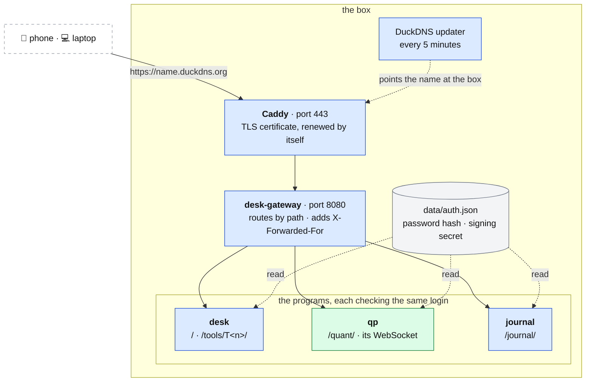

# The front door

**Above:** [ARCHITECTURE.md](../../ARCHITECTURE.md) §4.1.
**Talks to:**
- the trader's phone and laptop;
- the [desk](../03-desk/DESK.md), [qp](../05-qp/QP.md) and the
  [journal](../07-journal/JOURNAL.md), behind it;
- the [box](../01-box/BOX.md) it runs on.

---

## 1. What it is

The one address the trader uses, on a phone or a laptop:
- **HTTPS** on a free domain name;
- **one login** for every program;
- **every program behind one port, by path**.

**What it owns:**
- the domain and its certificate;
- the routing rules;
- the login's password file.

**What it never does:**
- hold state;
- compute anything;
- let a request in without the login.

If it stops, the desk keeps scanning and photographing, and only the pages are
out of reach until it restarts.

---

## 2. The diagram

---

## 3. Its parts

### 3.1 The address and TLS

- **The name.** A free DuckDNS name, `<name>.duckdns.org`. A small updater
  (cron, every 5 minutes) points the name at the box's address. Its token is
  kept in `~/.duckdns/token`, mode 0600.
- **TLS.** Caddy serves HTTPS on 443 with a certificate it obtains and renews
  itself, and passes every request to the gateway on 8080. Caddy passes the Host
  through, so the pages know which address the browser used.
- **Ports.** Once the name answers, only 80 and 443 stay open in the AWS
  security group. The program ports (3000–3120, 8765, 8080) close to the
  internet.

Caddy and the DuckDNS updater are system services: systemd and cron. They are
the box's own services, like `sshd`, not desk programs. Each has one
supervisor, as every program does ([BOX.md](../01-box/BOX.md) §4.1).

### 3.2 Routing by path

The gateway (`src/shell/gateway.js`) holds no state.

| Path | Goes to |
|---|---|
| `/`, `/login`, `/logout`, `/screeners…`, `/market`, `/status`, `/settings` | the desk's home (today `/`, `/login` and `/logout` only; the rest **to build** with home in the desk, [WEB.md](../03-desk/WEB.md) §3.2) |
| `/tools/T<n>/…` | that tool, in the desk (running or stopped) |
| `/quant/…` | qp, including its live chart WebSocket (`/ws/live`) |
| `/journal/…` | the journal |

**How pages that write absolute paths keep working.** Pages ask for `/api/…`,
`/desk.js` or `/static/…` at the root of their own address.
- **Sub-requests.** The browser sends the page's address as `Referer`, and the
  gateway sends the request to that page's program. Only a Referer from the
  same address is followed.
- **Navigations.** A link or `window.open` to an absolute path, from a page
  inside a program, is redirected under that program's prefix. `/`, `/login`
  and `/logout` always belong to the desk.
- **Redirects.** When a program redirects to one of its own paths
  (`/login?next=…`), the gateway keeps it under that program's prefix.
- **Links between programs.** Every HTML answer sets the cookie `desk_shell`
  to the address the browser used. The page shell then links by path
  (`/tools/T2/`, `/journal/`, `/quant/`) instead of by port
  ([WEB.md](../03-desk/WEB.md) §3.3).

### 3.3 The one login

**One password, one cookie, checked by every program:**
- the desk (`src/auth/index.js`);
- the journal (the same module);
- qp (`quant-platform/chart/auth.py`). It is pure ASGI, so its WebSocket is
  covered too.

| Part | Rule |
|---|---|
| `data/auth.json` | mode 0600, gitignored, written by `scripts/set-password.sh`. It holds the password as a **scrypt** hash (N 16384, r 8, p 1) and a random signing secret. It is re-read when it changes, so a new password applies everywhere at once |
| the cookie `td_auth` | `<expiry>.<HMAC-SHA256(secret, "td1.<expiry>")>`, valid 30 days. A cookie, not Basic auth, because cookies ignore the port: signed in on one program is signed in on all. `HttpOnly; SameSite=Lax`, and `Secure` once the desk is served over HTTPS |
| no password set | **locked, not open**: every outside request gets a page saying how to set one |
| a new password | writes a new secret, which signs everyone out |
| minimum length | 10 characters |
| let through without the cookie | `/login`, `/logout`; calls from the box itself (`127.0.0.1`, `::1`) that did not pass through the front door |
| **never a bypass** | every request the gateway forwards carries `X-Forwarded-For`, which every program reads as "not local". A request through the front door is therefore never treated as the box calling itself |
| failed attempts | counted per address and slowed down |

**To build:**
- a request that changes anything must carry the desk's own `Origin`, so that
  no cross-site form or script can act as the trader;
- a list of sessions, and "sign out everywhere".

### 3.4 The page shell, across programs

Every page of every program carries the same top bar (`public/desk.js`,
`public/desk.css`). It names the programs and links to them by path when the
page came through the front door, and by port when it did not. The bar and its
assets are never cached without a check, so a deploy shows at once.
Detail: [WEB.md](../03-desk/WEB.md) §3.3.

---

## 4. Contracts

| It owns | Form |
|---|---|
| the routing table | built from the tool registry and the apps list ([FILES.md](../04-files/FILES.md)) |
| the login | `data/auth.json`; the `td_auth` cookie |
| the address | the DuckDNS name; Caddy's certificate |

| Route | Does |
|---|---|
| `GET /login`, `POST /login`, `POST /logout` | sign in, sign out (served by the desk) |
| everything else | forwarded by path (§3.2) |

---

## 5. When it fails

| Event | What happens |
|---|---|
| the gateway stops | pm2 restarts it in seconds. The programs keep running; pages are out of reach meanwhile |
| Caddy stops, or its certificate cannot renew | systemd restarts Caddy. A certificate that cannot renew is reported on the health page before it expires (to build) |
| the box's address changes | the DuckDNS updater points the name at the new address within 5 minutes |
| a program behind it is down | the gateway answers "T2 is not answering (port 3010)", naming the program and its port |
| no password is set | every program is locked until one is set |

---

## 6. Built on

**The old desk.** Every program listened on a public port of its own, over
plain HTTP. There were thirteen: the five running tools, the archive on the six
stopped tools' ports, qp on 8765 and the journal on 3100.

**What failed there.**
- **No login at all (S-1).** Until the 2026-10 review, anyone who found a port
  could change settings, keys and strategies. qp's log already showed internet
  scanners on 8765. The one login above fixed it (S-1).
- **Cross-program pages.** They needed credentialed CORS and a `fetch` wrapper
  to carry the cookie across ports.

**Documents:**
- the code repository's `docs/SHELL.md`;
- `src/shell/gateway.js` and `tests/shell.gateway.test.js`;
- `scripts/setup-domain.sh`;
- `src/auth/index.js`;
- `quant-platform/chart/auth.py`.

---

## 7. Status

| Part | Status |
|---|---|
| one login in every program, locked when unset | **built** (S-1) |
| the gateway: one port, every program by path, never a login bypass | **built and running** (`desk-gateway`, step 14) |
| the domain and Caddy | **script written, not run.** It installs Caddy with `apt-get`, but the box runs Amazon Linux 2023, which uses `dnf`: **fix this before running it** (install Caddy's static binary or its `dnf` package) |
| closing the program ports | **the trader's to do**, after the domain answers |
| the `Secure` cookie flag | follows HTTPS |
| the `Origin` check; the session list and "sign out everywhere" | **to build** |
