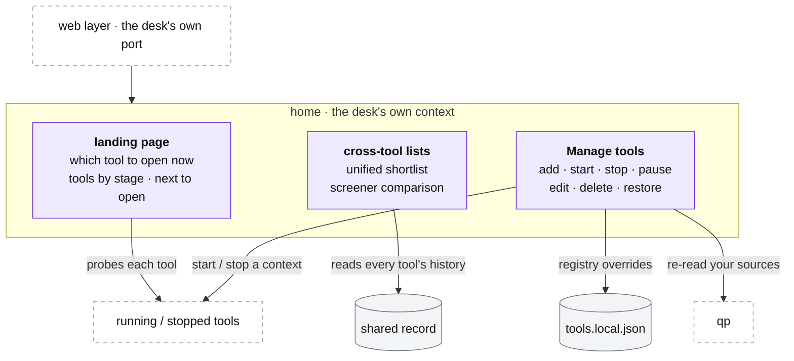

# The desk: home

**Above:** [DESK.md](DESK.md) §4 (home).

**Talks to:**
- the [web layer](WEB.md), which serves home on the desk's own port;
- the [running tools](TOOL.md) and [stopped tools](STOPPED-TOOLS.md), which home
  lists, starts, stops and compares;
- the [files on the box](../04-files/FILES.md): home runs in the desk's own
  context, with the desk's own file;
- [qp](../05-qp/QP.md), told to re-read its tool list when tools change.

---

## 1. What it is

**The desk's own front: the landing page, the lists that span every tool, and
Manage tools.** Home belongs to the desk itself, not to any tool, so **any tool
— T1 included — can be stopped** ([DESK.md](DESK.md) §3). It is where the trader
decides which tool to open, reads the lists that only make sense across tools
(the unified shortlist, the screener comparison), and adds, starts, stops,
pauses, edits, deletes or restores a tool.

**What it owns:** the tool registry's overrides, the landing page, and the
cross-tool views.

**What it never does:** scan, or write a tool's file — it starts and stops tools,
it does not run their pipelines.

---

## 2. The diagram

---

## 3. Its parts

### 3.1 The landing page

Answers one question: **which tool should I open now?** It lists the tools by
stage — **validated**, **under study**, **collecting data** — and for each one:
its name and purpose, its check window and whether it is live now, how many cards
it has today, whether its scorer is ready, and a plain-words summary of its
screeners generated from the live rules. When no tool is worth opening, it says
which opens next and at what time, measured on the market's clock, not the
phone's. A tool that is down still gets a card saying so.

**Stages** are set by the day count, not by time alone: a tool with fewer than 15
frozen photo days is *collecting data*, 15 or more is *under study*, and
*validated* is set **only by hand** — time does not make a screener good.

### 3.2 The cross-tool lists

These are the views that only make sense across tools. Each is a **view, never a
filter**: nothing on one tool changes because of another's
([ARCHITECTURE §7](../../ARCHITECTURE.md#7-rules-that-apply-everywhere)).

- **The unified shortlist:** every tool's starred stocks for the day, unioned, so
  a card can show **★ also T2 T7**. In the design the union is kept in the shared
  record, not a file many processes rewrite at once (D-S13).
- **The screener comparison:** every screener of every tool judged side by side
  against the benchmark tool (which every tool must beat by a clear margin) and
  its mirror. Because home runs in the desk, it can read every tool's scorecard,
  **including a stopped tool's and the benchmark's** — the old comparison page
  lost both when a tool stopped (D-S14).

### 3.3 Manage tools

Add, start, stop, pause, edit, delete and restore, each with a guard so a broken
setting cannot reach the scans:

| Action | What happens |
|---|---|
| **Add** | a new tool with a fresh id (never reused, so history filed under an old id is never confused), its own port, default capture times, and no screeners — built on its own page. Started at once if there is memory, else created stopped with the reason |
| **Start** | refused if deleted (restore first) or if memory is short; opens the tool's context and registers its jobs |
| **Stop** | not the desk's own context; closes the tool's context, and its history stays readable as a stopped tool ([STOPPED-TOOLS.md](STOPPED-TOOLS.md)) |
| **Pause / Resume** | the tool stays up but stops scanning; its status says since when and why, so a quiet tool is never mistaken for a broken one |
| **Edit** | name, description, colour, capture times (checked in order and inside the session) |
| **Delete** | marks it deleted and off every list; **nothing is erased**, and its history stays readable |
| **Restore** | takes the deleted mark off; it comes back stopped |

**The two guards:**
1. **Memory.** A tool is not started with less than the free-memory floor, read
   from the box, so the kernel is never left to choose what to kill on a full
   box ([DESK.md](DESK.md) §4.3).
2. **Capture times take effect cleanly.** A capture-time change is read when a
   tool's context (re)starts. In the old desk a restart in the session emptied
   the tool's list, so the change waited until 16:50; in the design the list is
   saved to the tool's file after every change, so a capture-time change can take
   effect without losing the day's list ([DESK.md](DESK.md) §7 — the
   capture-time fault).

Every change tells qp to re-read its list of sources, so the tool appears or
disappears on qp's register picker with no restart.

### 3.4 Home in the commercial product

Home is the **desk's operator front**, not a user screen. In the commercial
product its parts split by audience:

| Home part | Commercial surface |
|---|---|
| landing page — "which tool to open now" | folds into **Radar's screener selector**: a user picks among the built-in presets (T1/T2/T7, shared read-only) and their own screeners ([PAGES.md §4.1](tool/PAGES.md)) |
| cross-tool lists (unified shortlist, screener comparison) | the unified shortlist is **per account** ([ACCOUNTS.md](../13-accounts/ACCOUNTS.md)); the screener comparison and scorecards are an **operator/advanced view** under the [admin surface](../14-admin/ADMIN.md), not a user tab |
| Manage tools (add/start/stop/pause/edit/delete/restore) | an **operator/admin** action in the [admin dashboard](../14-admin/ADMIN.md); a user does not start or stop desk contexts |

So in hosted mode "which tool to open" and "my shortlist" are the user's, scoped
to their account; managing the tools themselves, the memory guard and the
cross-tool comparison stay with the operator.

---

## 4. Contracts

**Served by** the desk on its own port, in the desk's own context.

| It owns | Form |
|---|---|
| the tool registry's overrides | `data/tools.local.json` (name, desc, accent, capture times, enabled, and the deleted/pending markers), merged over `tools.config.json` ([FILES.md](../04-files/FILES.md)); written to a temp file and renamed |
| the landing page and the cross-tool views | the desk's own context |

| It reads | From |
|---|---|
| each tool's state (up, down, cards today, scorer) | the running and stopped tools, probed directly |
| every tool's shortlist and scorecard, stopped tools included | the shared record |

| Routes (the desk's own port) | Do |
|---|---|
| the landing page; the comparison | which tool to open; every screener judged |
| Manage tools: add, start, stop, pause/resume, edit, delete, restore | the table in §3.3; each answers with the outcome or the reason it was refused |

---

## 5. When it fails

| Event | What happens |
|---|---|
| a tool is down | its card on the landing page says so; the other tools are unaffected |
| a start is refused (memory, deleted) | nothing changes; the message says why |
| a capture-time change lands during the session | it takes effect when the tool's context restarts, without emptying the day's list |
| the benchmark tool is stopped | the comparison still shows it, because home reads stopped tools too (D-S14) |

---

## 6. Built on

**The old desk:** the suite page and the comparison in
[legacy/screeners/PAGES.md](../../legacy/screeners/PAGES.md); Manage tools in
[legacy/screeners/TOOL-LIFECYCLE.md](../../legacy/screeners/TOOL-LIFECYCLE.md).

**What failed there:**

| ID | Fault | Prevented by |
|---|---|---|
| — | T1 carried the landing page, Manage tools and the desk-wide jobs, so T1 could not be stopped | home runs in the desk's own context; any tool can be stopped |
| — | a capture-time change needed a restart, which emptied the list, so it waited until 16:50 | the list is saved to the file, so the context can restart cleanly |
| D-S13 | the unified shortlist file was rewritten by many processes; simultaneous publishes lost a change | the union kept in the shared record |
| D-S14 | the comparison lost the benchmark and every stopped tool when a tool stopped | home reads stopped tools' scorecards too |

---

## 7. Status

| Part | Status |
|---|---|
| the landing page, the comparison, Manage tools | **built** (legacy, on T1) |
| home and the desk jobs in the desk's own context, so T1 can be stopped | **to build** (step B, with T1, last) |
| the unified shortlist and the comparison reading the shared record | **to build** (steps D–E) |
| hosted mode: the landing folds into Radar's screener selector, the shortlist is per account, Manage tools and the comparison are operator/admin surfaces | **designed** (§3.4, [ACCOUNTS.md](../13-accounts/ACCOUNTS.md), [ADMIN.md](../14-admin/ADMIN.md)); **to build** in the hosted build |
