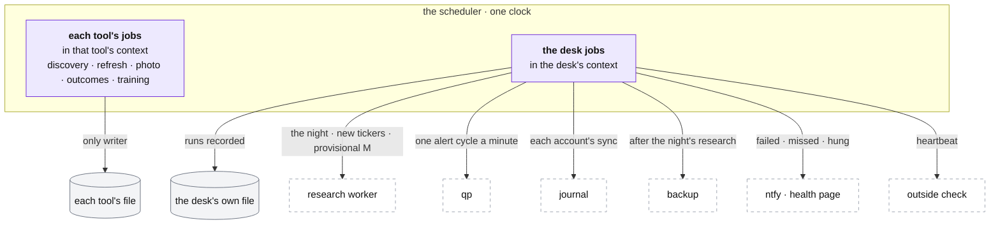

# The desk: the scheduler and the desk jobs

**Above:** [DESK.md](DESK.md) §4 (scheduler and desk jobs) and §4.6 (a trading
day, by the clock).

**Talks to:**
- every [running tool](TOOL.md), whose jobs it runs in that tool's context;
- the [research worker](../06-research-worker/RESEARCH-WORKER.md), [qp](../05-qp/QP.md)
  and the [journal](../07-journal/JOURNAL.md), whose timed work it starts;
- the [backups](../10-backups/BACKUPS.md) and [alerts](../11-alerts/ALERTS.md):
  it starts the night's backup and raises every failed, missed or hung run;
- the desk's own [file](../04-files/FILES.md), where every run is recorded.

---

## 1. What it is

**The only clock of the whole desk.** One scheduler runs every timed job: each
tool's jobs **in that tool's context**, and the desk's own jobs **in the desk's
context** — including the timed work of the other programs (the research worker's
runs, qp's alert cycles, the journal's syncs, the night's backup). Every run is
recorded; a run that fails, does not happen, or hangs reaches the phone.

Because there is one clock, **nothing runs twice** and **no job runs twice at
once** — the old desk's deepest reason for its two-program split, kept without
the split ([DESK.md](DESK.md) §7).

**What it owns:** the schedule of every job, and the run history, in the desk's
own file.

**What it never does:** run a job outside its tool's context, or let one job's
failure end the program ([DESK.md](DESK.md) §4.2).

---

## 2. The diagram

---

## 3. A trading day, by the clock

New York time, on trading days. Each tool's jobs run in its own context; the
desk jobs in the desk's.

| When | Job | Whose context |
|---|---|---|
| 03:45 | every outside source checked | desk |
| 04:00–09:00 every 30 min; 09:00–10:00 every 5; 10:00–16:00 every 15; 16:00 | discovery: each screener only inside its own window | each tool, with one market read |
| 04:00–16:00 every 5 min | every card re-quoted and re-scored | each tool |
| 04:00–16:00 every 5 min, while any wait | research for the stocks carded for the first time | desk → research worker |
| 09:00–15:30 every 30 min | the market model, provisional | desk → research worker |
| 09:25–16:05 every minute, while alerts are on | qp's alert cycle | desk → qp |
| one minute before each tool's photo | the shortlist rule | each tool |
| each tool's minute (09:36 … 10:16) | the record of the day (R1) | each tool |
| 09:26, 09:31 … 10:01 | R2: the market at fixed minutes | the market reader |
| 16:05 | the outcomes (R3) | each tool |
| 16:20 | the scorer training, where a tool has one | each tool |
| 16:50 | capture-time changes made during the session take effect | desk (home) |
| 18:30 | the night: the O'Neil research, then the backup | desk → research worker, backup |
| every minute, each account on its interval | the journal's sync | desk → journal |
| every 5 min | the heartbeat; the box's memory and disk | desk |
| the 1st of each month, 09:10 | the restore rehearsal | desk |
| 00:00 | each tool's list starts a new day | each tool |

What a discovery scan and a refresh do: [TOOL.md](TOOL.md) §3 and
[tool/SCREENERS.md](tool/SCREENERS.md). What the night and the restore test do:
[RESEARCH-WORKER.md](../06-research-worker/RESEARCH-WORKER.md),
[BACKUPS.md](../10-backups/BACKUPS.md).

---

## 4. Its parts

### 4.1 Every run recorded

Each job keeps its **schedule and its on/off state in the desk's file**, so they
survive a restart, and each run records when it ran, how long it took, and
whether it succeeded or its error (with the stack, so a job failing every five
minutes can be traced to a line). The run history is the record the health page
reads and the alerts fire from ([ALERTS.md](../11-alerts/ALERTS.md)).

### 4.2 Failed, missed and hung all alert

- **Failed:** a job that threw — recorded in its tool's (or the desk's) run
  history, and alerted if it is a job that alerts. The other jobs are
  unaffected.
- **Missed:** a slot that passed while the desk was down. On start-up the desk
  records it as missed and alerts; **a photo is never taken late as if on time**
  ([DESK.md](DESK.md) §4.1).
- **Hung:** a run that outran its time — recorded and alerted; the scheduler does
  not start the next one over it.

A step of the research worker that has not succeeded within its clock (for
example, earnings not refreshed in 8 days) turns the health page amber, then red
([RESEARCH-WORKER.md](../06-research-worker/RESEARCH-WORKER.md) §4).

### 4.3 No overlap

A scan that starts while another is still running is skipped and recorded; a
refresh during a scan is skipped too. Two scans of one tool never run at once.
Because the whole desk has one scheduler, a job can never be started twice by two
schedulers — the fault the two-program design most feared.

### 4.4 Starting the other programs

The desk jobs are how the other programs get their clock, so each program can be
down without a silent gap:

| Job | Starts | Recorded as |
|---|---|---|
| the night, new tickers, provisional M | the research worker | a desk run, and the worker's own `research_runs` row |
| the alert cycle, every minute in the session while alerts are on | qp (`POST /api/alerts/cycle`); the new signals come back and the desk pushes each to the phone | a desk run ([SIGNAL-ALERTS.md](../05-qp/SIGNAL-ALERTS.md)) |
| each account's sync, on its interval | the journal (`POST /api/journal/sync`) | a desk run ([IMPORT.md](../07-journal/IMPORT.md)) |
| the backup, after the night's research | the backup ([BACKUPS.md](../10-backups/BACKUPS.md)) | a desk run |
| the heartbeat, every 5 min | the outside check, that the desk itself is up | a desk run ([ALERTS.md](../11-alerts/ALERTS.md)) |

### 4.5 Changing a job

A job's schedule can be toggled off, edited (a cron expression, refused unless
valid) or reset to its default, from the Monitor tab. An off job keeps its row.
A job whose name carries a tool's capture time (the photo, the shortlist rule)
gets a new name when that time changes, so it returns to its default schedule —
a change made cleanly through home's capture-time path ([HOME.md](HOME.md)).

---

## 5. Contracts

| It owns (the desk's own file) | Holds |
|---|---|
| the schedule and on/off of every job | kept across restarts |
| the run history of every job | when, how long, ok or the error with its stack |

| It starts | When |
|---|---|
| the research worker | the research jobs (§3) |
| qp's alert cycle | every minute in the session while alerts are on |
| the journal's sync | on each account's schedule |
| the backup | after the night's research run |

| Routes (the Monitor tab) | Do |
|---|---|
| toggle a job | on ↔ off; the row and schedule are kept |
| edit a schedule | a cron expression, refused unless valid; applies at once |
| reset a schedule | back to the default |

---

## 6. When it fails

| Event | What happens |
|---|---|
| a tool's job throws | recorded in that tool's run history with its stack; alerts if it is a job that alerts; the other tools are unaffected |
| the desk was down at a slot | the slot is recorded as missed and alerts; a missed photo is never taken late |
| a run hangs | recorded as hung and alerted; the next run is not started over it |
| a started program (worker, qp, journal) is down | the start fails, is recorded and alerts; the desk carries on |
| a capture-time job is renamed | it returns to its default schedule; stray rows from the old name are cleared at start-up |

---

## 7. Built on

**The old desk:** each tool had its own scheduler (`src/scheduler.js`) and its own
Monitor tab ([legacy/screeners/MONITOR.md](../../legacy/screeners/MONITOR.md));
the desk-wide jobs lived on T1, and qp's nightly O'Neil chain ran from a
hand-installed systemd timer outside pm2.

**What failed there:**

| ID | Fault | Prevented by |
|---|---|---|
| — | every tool ran its own scheduler, and the desk-wide jobs sat on T1 (so T1 could not be stopped) | one scheduler; the desk jobs in the desk's own context |
| Q-N5 | the nightly O'Neil job ran from a hand-installed timer; without it the data went stale silently | the desk's scheduler runs it; a missed or failed run alerts |
| — | run history lived only in memory, so a restart lost it and a missed slot was invisible | the run history and schedules kept in the desk's file; missed slots recorded on start-up |
| — | a tool's capture-time job kept a stale custom schedule under its old name | renamed jobs return to default; stray rows cleared at start-up |

---

## 8. Status

| Part | Status |
|---|---|
| run history and alerts for the most important jobs | **built** (step 12; [ALERTS.md](../11-alerts/ALERTS.md)) |
| one scheduler for the whole desk, every tool's jobs in its context | **to build** (step C): one scheduler per tool until then |
| the desk jobs (research runs, the night, the restore test, journal sync, qp's alert cycles) on the one scheduler | **partly**: the new-ticker and provisional-M runs are started by T1's scheduler; the night's run is still the last step of qp's own nightly job until step C ([RESEARCH-WORKER.md](../06-research-worker/RESEARCH-WORKER.md)) |
