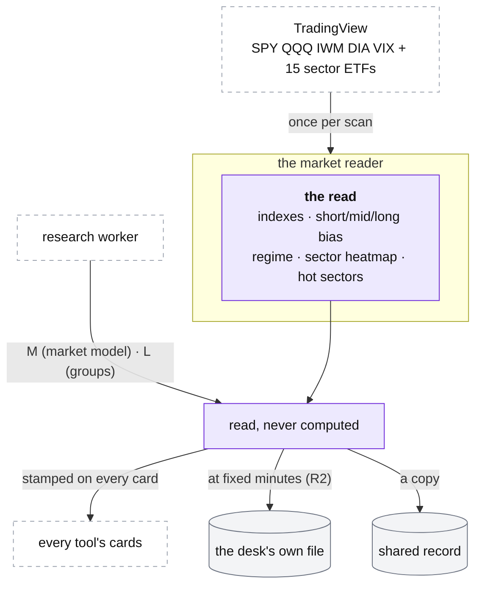

# The desk: the market reader

**Above:** [DESK.md](DESK.md) §4 (the market reader).

**Talks to:**
- every [running tool](TOOL.md), which asks it for the market state once per scan;
- the [data sources](../08-data-sources/DATA-SOURCES.md): the indexes and the 15
  sector ETFs from TradingView;
- the [research worker](../06-research-worker/RESEARCH-WORKER.md), the only writer
  of the O'Neil market model (M) and the industry groups (L);
- the [shared record](../09-shared-record/SHARED-RECORD.md) and the desk's own
  [file](../04-files/FILES.md), where the market history (R2) lives.

---

## 1. What it is

**One read of the market for every tool.** On each scan the desk reads the
market once — the indexes, the regime, the short-, mid- and long-term reads, the
15 sectors and the hot ones — and stamps that one read onto every card of every
tool. It keeps the read with its history, and it **reads** (never computes) the
O'Neil market model (M) and the industry groups (L) that the research worker
writes.

Two systems sit side by side, kept apart on purpose:

| System | Built by | Answers |
|---|---|---|
| **the desk's read** | the market reader, on every scan | what the tape is doing right now (indexes, regime, sectors) |
| **O'Neil's method** | the research worker, after each close | should you be buying at all, and where the leadership is (M, L) |

**What it owns:** the market read, and its history (R2) in the desk's own file.

**What it never does:** compute M or L (the research worker does), or change which
stocks a tool finds — the market is a **label, never a filter**.

---

## 2. The diagram

---

## 3. Its parts

### 3.1 The read, once per scan

Read from TradingView's scanner: SPY, QQQ, IWM, DIA, VIX and 15 sector ETFs,
with their close, change, weekly change, moving averages, Bollinger bands, ADX,
VWAP and relative volume. One read per scan is shared by every tool — the old
desk read the same ETFs five times a scan, minutes apart ([DESK.md](DESK.md) §7).
**No regime rather than a wrong one:** if SPY and QQQ are both incomplete, the
scan records no regime and the cards keep no made-up bearish context (D-S2).

### 3.2 The desk's read: indexes, bias, regime, sectors

- **Indexes:** SPY, QQQ, DIA, IWM, VIX — price, change today, change on the week.
- **Short-term bias:** a score over the indexes and VIX, bucketed bullish /
  neutral / bearish, with each signal shown.
- **Mid-term stage** (uptrend / pullback / rebound / sideways / downtrend) from
  the moving-average structure, and **long-term bias** from the 50- and 200-day
  (golden cross and price against the 200-day).
- **The regime:** long-term × mid-term, with a Bollinger overlay, giving a named
  regime and a stance (long / neutral / short), and a confidence from whether the
  terms agree.
- **The sector heatmap:** the 15 ETFs scored (moving-average and VWAP checks,
  relative strength to SPY, an ADX factor), banded bullish / neutral / bearish,
  with the **hot** ones marked — hot at once above a high score, or after several
  days above a sustained one, cooling off after days below a floor. The hot-sector
  state is kept in the desk's file, so a restart no longer forgets it
  ([DESK.md](DESK.md) §7).

### 3.3 O'Neil's method: M and L, read not computed

The **market model (M)** — the confirmed-uptrend / under-pressure / correction
state over the S&P 500 and Nasdaq Composite, with distribution days and
follow-throughs — and the **industry groups (L)** are the research worker's facts
([ONEIL.md](../06-research-worker/ONEIL.md)). The market reader reads the latest
`oneil_m` (final or provisional) and `group_ranking` and shows them on the Market
tab and on each card. It computes no part of them, and a missing file makes the
tab say "not built yet · last run DATE" rather than triggering a build inside a
page request ([RESEARCH-WORKER.md](../06-research-worker/RESEARCH-WORKER.md) §6).

### 3.4 Stamped on every card, kept as history

The one read is stamped onto every card's market context (regime, the three
terms, the sector read). It is kept with its history in the desk's own file as
**R2** — the market at fixed minutes around each tool's photo (09:26, 09:31 …
10:01) — so a photo records exactly the market of its minute. The M fact is
carried **as it was**, not re-read at export time, so an old R2 day shows the
status of that day, not today's (D-D3).

### 3.5 The Market dashboard (front end)

The commercial product surfaces this one read as **Radar's standalone Market
dashboard** ([PAGES.md §4.1](tool/PAGES.md)): the indexes, the regime with its
stance, the sector heatmap and the hot sectors, plus O'Neil's M and the group
leadership (L). It reads a **materialized `market_snapshot` read model**
([DATA-MODEL.md](../DATA-MODEL.md) §3.8), published atomically when a read is
stored, never recomputed in the page. This is the **global** market view; a
stock's card carries only a **snapshot and a link** to it, not a second dashboard
([CARD.md §3.6](tool/CARD.md)) — the two "Market" surfaces mean different things
and must not be merged. In hosted mode the dashboard is shared across accounts
(the market is global), served from the same read model, and the index/sector
quotes come from the licensed provider chosen in the
[admin dashboard](../14-admin/ADMIN.md), not TradingView
([DATA-SOURCES.md §3.7](../08-data-sources/DATA-SOURCES.md)).

---

## 4. Contracts

| It owns | Form |
|---|---|
| the market read | made once per scan, in the desk's context |
| the market history (R2) | the desk's own file ([FILES.md](../04-files/FILES.md) §3.2) |

| It reads | From |
|---|---|
| index and sector ETF quotes | TradingView ([DATA-SOURCES.md](../08-data-sources/DATA-SOURCES.md)) |
| `oneil_m` (final or provisional), `group_ranking` | the research worker, through the shared record |

| It copies | To |
|---|---|
| each market state | the shared record, so qp and the journal read the market as of a day ([SHARED-RECORD.md](../09-shared-record/SHARED-RECORD.md)) |

The full field list of the Market tab and R2, and every regime and sector
threshold, is in [tool/REGISTERS.md](tool/REGISTERS.md) and the card document
[tool/CARD.md](tool/CARD.md).

---

## 5. When it fails

| Event | What happens |
|---|---|
| SPY and QQQ are both incomplete | no regime this scan; the cards keep no context, never a made-up bearish one (D-S2) |
| the O'Neil model file is missing | the tab says "not built yet · last run DATE"; no build runs in the page request |
| the research worker has not run | M and L keep their dates; the desk's own read still works |
| the desk restarts | the hot-sector state comes back from the desk's file, not forgotten |

---

## 6. Built on

**The old desk:** the Market tab, built by each tool on every scan, in
[legacy/screeners/MARKET-TAB.md](../../legacy/screeners/MARKET-TAB.md); the
market snapshots (R2) in
[legacy/screeners/REGISTERS.md](../../legacy/screeners/REGISTERS.md).

**What failed there:**

| ID | Fault | Prevented by |
|---|---|---|
| — | the market was read five times a scan, by five tools, minutes apart | one read per scan for every tool |
| — | the hot-sector state lived in memory and was forgotten on every restart | kept in the desk's own file |
| D-S2 | an incomplete read could produce a made-up regime | no regime rather than a wrong one |
| D-D3 | R2's O'Neil status was read at export time, so an old day showed today's status | the M fact carried as it was |
| — | a missing O'Neil file made the tab ask qp to build it in a page request | pages only read; the research worker writes |

---

## 7. Status

| Part | Status |
|---|---|
| the desk's read (indexes, regime, sectors), built per scan | **built** (legacy, per tool) |
| one read per scan for every tool, stored once, with its history | **in shadow** (step 6): one read stored per scan; each tool still reads its own |
| M and L read from the research worker's facts | **in shadow** ([RESEARCH-WORKER.md](../06-research-worker/RESEARCH-WORKER.md)); the cards still use qp's values until the switch |
| the standalone Market dashboard reading the `market_snapshot` read model; hosted = shared across accounts, licensed provider | **designed** (§3.5, [DATA-MODEL.md](../DATA-MODEL.md)); **to build** in the hosted build |
