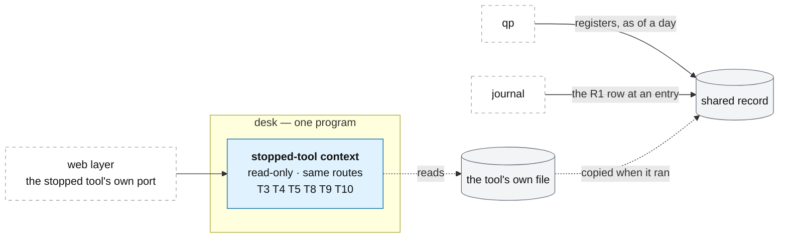

# The desk: stopped tools

**Above:** [DESK.md](DESK.md) §4 (stopped tools) and §3 (the tool context).

**Talks to:**
- the [web layer](WEB.md), which serves a stopped tool on its own address;
- [home](HOME.md), which stops, deletes and restores tools;
- the stopped tool's own [file](../04-files/FILES.md), read-only;
- [qp](../05-qp/QP.md) and the [journal](../07-journal/JOURNAL.md), which read a
  stopped tool's history through the shared record.

---

## 1. What it is

**A stopped tool's history, still readable.** Stopping a tool ends its scanning,
but **everything it ever recorded stays open** on its own address: its registers,
its photos, its outcomes, its scorecard. A deleted tool is the same — off every
list, but nothing erased.

In the design a stopped tool is **a read-only context inside the desk**
([DESK.md](DESK.md) §3), opened over its file read-only, answering the same
**read-only data API** it did when it ran (and, for the legacy addresses, on the
same port). This is an **operator/history** surface, not a product screen in the
Radar app ([tool/PAGES.md §4](tool/PAGES.md)); in hosted mode it is read via the
API, account-scoped (§7). It replaces the old desk's separate **archive** program,
which loaded a copy of the modules for each stopped tool.

**What it owns:** nothing new — it only reads a tool's stored file.

**What it never does:** scan, re-quote, score, or write anything. It has no
scanner, scheduler or write route.

---

## 2. The diagram

---

## 3. Its parts

### 3.1 A read-only context

When the desk starts, each stopped tool's file is opened **read-only**
([DESK.md](DESK.md) §4.1). The context answers the same page and warehouse
routes the running tool did, on the same port — so a saved chart, a bookmark and
qp's register reads over the old URL all keep working. It registers no jobs and
holds no live list.

### 3.2 Fully readable, scorecard included

A stopped tool stays **completely** readable — its registers, its photos and its
scorecard. The old archive answered only the warehouse routes, so a stopped
tool's scorecard, and the benchmark tool's, vanished from the comparison (D-S14).
Reading a stopped tool as a desk context fixes that: the comparison can still
judge against a stopped benchmark ([HOME.md](HOME.md) §3.2).

### 3.3 Started, stopped, restored

Home moves a tool between running and stopped ([HOME.md](HOME.md) §3.3): stopping
closes the running context and opens the read-only one; starting closes the
read-only context (releasing the port) and opens the running one; restoring a
deleted tool takes the deleted mark off and brings it back stopped. An id is
never reused, so a stopped or deleted tool's history is never confused with a new
tool's.

### 3.4 Where qp and the journal read it

qp and the journal never open a tool's file — they read its photos and outcomes
from the **shared record**, which holds a copy of every tool's registers written
while it ran ([SHARED-RECORD.md](../09-shared-record/SHARED-RECORD.md)). So a
backtest or a trade snapshot over a stopped tool's history needs no running tool
at all; the read-only context is for the tool's own pages.

---

## 4. Contracts

| It reads | From |
|---|---|
| a stopped tool's registers, photos, outcomes, scorecard | that tool's own file, opened read-only |

| It serves | Where |
|---|---|
| the tool's page and warehouse routes, read-only | the tool's own port ([WEB.md](WEB.md), [tool/PAGES.md](tool/PAGES.md)) |

It writes nothing. The copies qp and the journal read are in the shared record,
written by the tool while it ran ([SHARED-RECORD.md](../09-shared-record/SHARED-RECORD.md)).

---

## 5. When it fails

| Event | What happens |
|---|---|
| the desk restarts | each stopped tool's file is reopened read-only; its pages come back on its port |
| a stopped tool's file is missing | its context reports the file is unreadable, rather than serving empty pages silently |
| a tool is started | its read-only context is closed first, so it releases the port before the running context takes it |

---

## 6. Built on

**The old desk:** the **archive** program
([legacy/screeners/TOOL-LIFECYCLE.md](../../legacy/screeners/TOOL-LIFECYCLE.md),
"The archive"), one read-only process that opened each stopped tool's database
and answered `/api/warehouse/*` on its port.

**What failed there:**

| ID | Fault | Prevented by |
|---|---|---|
| D-S14 | the archive answered only the warehouse routes, so a stopped tool's scorecard (and the benchmark's) disappeared from the comparison | a stopped tool is a full read-only context, scorecard included |
| — | the archive loaded a separate copy of the modules for each stopped tool ("require-cache surgery") | one program, one read-only context per stopped tool |

---

## 7. Status

| Part | Status |
|---|---|
| stopped tools served by the old archive program | **built** (legacy) |
| stopped tools served by the desk as read-only contexts | **to build** (migration step A): the desk's first job, in place of the archive |
| hosted mode: a stopped tool's history is read-only and **scoped to its account** (one account's stopped tools, never another's); the copy qp/journal read is the account's rows in the managed Postgres | **designed** ([ACCOUNTS.md](../13-accounts/ACCOUNTS.md), [DATA-MODEL.md](../DATA-MODEL.md)); **to build** in the hosted build |
