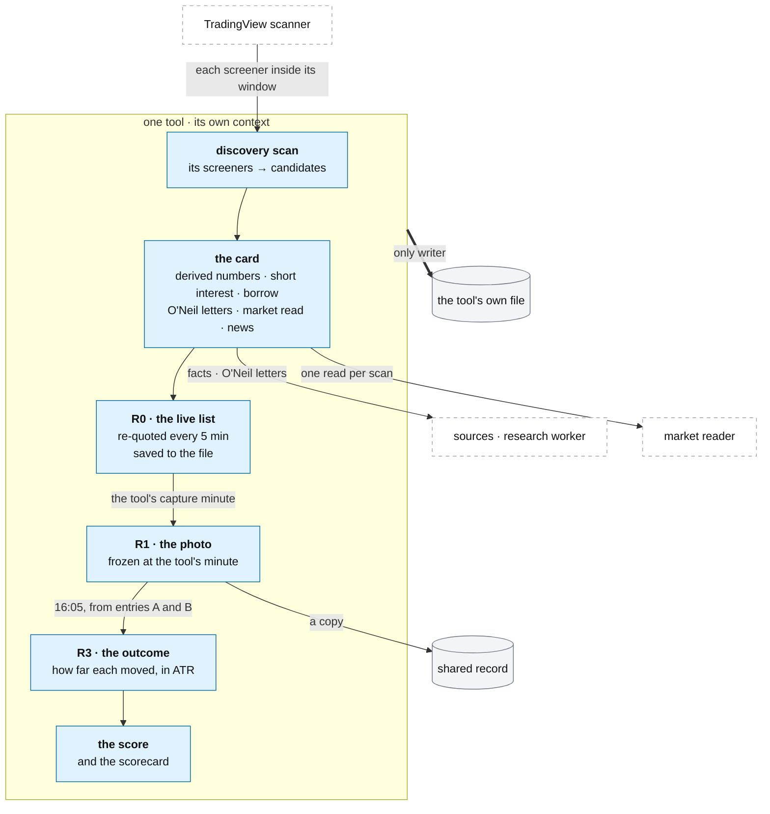

# The desk: one running tool, end to end

**Above:** [DESK.md](DESK.md) §4 (running tools) and §4.5 (the research each tool
runs).

**Talks to:**
- the [web layer](WEB.md), which brings its pages and API;
- the [scheduler](JOBS.md), which runs its scans, refreshes, captures and
  outcomes in its context;
- the [market reader](MARKET.md), for one market read per scan;
- the [data sources](../08-data-sources/DATA-SOURCES.md) (candidates, quotes, short
  interest, borrow, bars) and the [research worker](../06-research-worker/RESEARCH-WORKER.md)
  (the O'Neil letters);
- the [shared record](../09-shared-record/SHARED-RECORD.md) and its own
  [file](../04-files/FILES.md), of which it is the only writer.

---

## 1. What it is

**One tool, as one experiment.** A tool is one way of finding stocks: its own
screeners, its own cards, its own daily record, its own shortlist, its own
score, kept apart from every other tool ([DESK.md](DESK.md) §3). It finds the
stocks its screeners match, turns each into a card with everything known about
it, keeps today's live list, freezes a photo of that list once a day, measures
how far each photographed stock moved, scores its cards, and serves its pages.

This document is the shape of a running tool end to end; each part has its own
document one level down:

| Part | Document |
|---|---|
| its screeners and how it finds stocks | [tool/SCREENERS.md](tool/SCREENERS.md) |
| the card: every field and its source | [tool/CARD.md](tool/CARD.md) |
| its daily record and the outcomes | [tool/REGISTERS.md](tool/REGISTERS.md) |
| the score and the scorecard | [tool/LEARNING.md](tool/LEARNING.md) |
| its pages | [tool/PAGES.md](tool/PAGES.md) |

**What it owns:** its screeners, its live list, its registers, its shortlist and
its score — all in its own file. **What it never does:** see or change another
tool's results, compute O'Neil data (the worker does), or place an order.

---

## 2. The diagram

---

## 3. Its parts, in order

### 3.1 Find: the screeners and the scan

Each tool asks **TradingView's scanner** one request per enabled screener whose
run window contains the current minute. Every request carries the screener's own
filters **plus the tradability floor** (a price, average-volume and ATR minimum
applied to every screener, with named exceptions) and a base stock filter. A
changed or misaligned answer is refused rather than shifting every field by one
column ([DATA-SOURCES.md](../08-data-sources/DATA-SOURCES.md)). The matches of
every screener are merged into one row per ticker, which screener keys list which
screeners found it. Detail: [tool/SCREENERS.md](tool/SCREENERS.md).

### 3.2 Know: the card

Each row becomes a card: derived numbers (gap, ranges, ADR %, distances to each
level), short interest and borrow, the O'Neil letters (read from the
[research worker](../06-research-worker/RESEARCH-WORKER.md), not computed here),
the market read stamped on from the [market reader](MARKET.md), and news with a
catalyst. A missing value says it is missing and why — never 0, never bearish.
Every field, its source, and when a blank is legitimate:
[tool/CARD.md](tool/CARD.md).

### 3.3 Keep: the live list (R0)

The cards of today, live (matched this scan) and stale (matched earlier, kept on
screen and re-quoted), held in the tool's context and **saved to its file after
every change**, so a restart brings the list back rather than emptying the screen
for the rest of the day ([DESK.md](DESK.md) §7). Cleared at midnight.

### 3.4 Record: the photo (R1) and the market (R2)

At the tool's **own minute** in the first hour (09:36 … 10:16 today), every card
on the list is frozen exactly as known then — the photo. **Only the photo judges
the tool.** A missed minute (the desk was down) is marked, never taken late as if
on time. The market reader stores R2, the market at fixed minutes around the
photo. Detail: [tool/REGISTERS.md](tool/REGISTERS.md).

### 3.5 Measure: the outcome (R3)

After the close, from two fixed entry minutes (A and B, a few minutes after the
photo), the desk measures how far each photographed stock moved up and down to
the close, in units of the stock's average daily range (ATR). **A move of 1.3 ATR
or more is a good move.** There is no stop, target or exit: this judges what a
tool finds, not a trade.

### 3.6 Learn: the score and the scorecard

Over weeks, the photos and their outcomes show **which screeners find stocks that
move** — judged by the move, with consistency across days deciding, against the
tool's own baseline, the **benchmark** tool (which every other must beat by a
clear margin) and the **mirror** of each screener (the same setup facing the
other way, to test whether its direction is real). The order of work: collect for
about a month, cut the screeners whose stocks do not move, then work on entries.
A model to rank a tool's stocks is prepared, not built, until the trader chooses
one. Detail: [tool/LEARNING.md](tool/LEARNING.md).

### 3.7 Show: its pages

The tool's eight tabs (its cards, the market read, the shortlist, the warehouse
of registers, the scorecard, the screener builder, settings, the monitor), served
in its context on its own port ([WEB.md](WEB.md)). Detail:
[tool/PAGES.md](tool/PAGES.md). In the commercial product this same tool is
**Radar**: its Screener landing, Shortlist, Market dashboard, custom-screener
Settings, and the four-tab analysis workspace ([tool/PAGES.md §4.1](tool/PAGES.md)).

### 3.8 The data lifecycle: fetch → store → show → update → keep

The steps above are one **sensitive data lifecycle**, and it is worth stating
whole because the front end depends on getting it right
([DATA-MODEL.md](../DATA-MODEL.md), [data-model/DATA_LIFECYCLE.md](../data-model/DATA_LIFECYCLE.md)):

1. **Fetch** (§3.1–3.2): the scan and the card pull from outside sources
   (the scanner, bars, EDGAR, short interest, news) and the research worker.
2. **Store as canonical facts** (§3.3–3.4): the live list (R0) and the frozen
   photo (R1) are written to the tool's own file — the **canonical record**, one
   writer, honest nulls.
3. **Show from a read model, never from the raw facts**: the front end reads
   **materialized read-model snapshots** (`stock_card_snapshot`,
   `stock_technical_read_snapshot`, `stock_canslim_snapshot`,
   `stock_fundamental_read_snapshot`, `market_snapshot`), each published
   **atomically** with its own `as_of` / `published_at`
   ([CARD.md §3.6](tool/CARD.md), [MARKET.md §3.5](MARKET.md)). A page never
   recomputes and never shows a half-written update.
4. **Update intraday**: R0 is re-quoted every five minutes; a changed fact
   invalidates and republishes the affected read-model snapshot, so the card
   refreshes without the page recomputing.
5. **Keep permanent**: the photo (R1) and its outcomes (R3) are **immutable** —
   frozen at the capture minute, copied to the shared record, and never
   back-dated; editing a screener later never changes what a past photo means
   (the rebuild rule, [SCREENERS.md §4.5](tool/SCREENERS.md)).

**Two modes.** Solo mode runs this on the box: canonical facts in the tool's
SQLite file, read models computed and served by the desk. Hosted mode runs the
same lifecycle on the managed Postgres ([DATA-MODEL.md](../DATA-MODEL.md)), every
canonical and read-model row **scoped to an account** and isolated by row-level
security ([ACCOUNTS.md](../13-accounts/ACCOUNTS.md)); shared facts (the market
read, the O'Neil research) stay global. The five steps and their invariants are
identical in both.

---

## 4. Contracts

| It owns (the tool's own file, SQLite — the only writer) | Holds |
|---|---|
| its screeners and their versions | the definitions, each change a new version |
| R0 (the live list), R1 (the photos), R3 (the outcomes), the training rows, the shortlist | one file per tool ([FILES.md](../04-files/FILES.md), [tool/REGISTERS.md](tool/REGISTERS.md)) |
| its settings | the tradability floor, capture times, the shortlist rule, the scorer switch |

| It reads | From |
|---|---|
| candidates, quotes, levels, ranges, short interest, borrow, bars | the data sources ([DATA-SOURCES.md](../08-data-sources/DATA-SOURCES.md)) |
| the O'Neil letters for its tickers | the research worker ([RESEARCH-WORKER.md](../06-research-worker/RESEARCH-WORKER.md)) |
| the market read | the market reader ([MARKET.md](MARKET.md)), once per scan |

| It copies | To |
|---|---|
| each photo (R1) and its outcomes | the shared record, so qp and the journal read its history without opening its file ([SHARED-RECORD.md](../09-shared-record/SHARED-RECORD.md)) |

Its jobs — discovery, refresh, the shortlist rule, the photo, the outcomes,
the scorer training — run in its context on the one scheduler
([JOBS.md](JOBS.md)).

---

## 5. When it fails

| Event | What happens |
|---|---|
| a screener's answer is changed or misaligned | that answer is refused and the scan report says why; no card gets shifted values |
| a source fails | that field shows `unavailable` with the reason; the card still builds |
| the desk is down at the tool's photo minute | the minute is marked missed and the phone is told; never taken late |
| a scan outlasts its slot | the next slot is skipped and recorded; two scans of one tool never run at once |
| the tool is paused | scans return at once saying so; the cards already found stay; the registers are untouched |

---

## 6. Built on

**The old desk:** every tool was its own program, running this pipeline against
its own screeners. The pipeline is
[legacy/screeners/DATA-PIPELINE.md](../../legacy/screeners/DATA-PIPELINE.md); the
method, [legacy/screeners/METHODOLOGY.md](../../legacy/screeners/METHODOLOGY.md);
the registers, [legacy/screeners/REGISTERS.md](../../legacy/screeners/REGISTERS.md);
the lifecycle, [legacy/screeners/TOOL-LIFECYCLE.md](../../legacy/screeners/TOOL-LIFECYCLE.md).

**What failed there** (the tool-level faults; the desk-level ones are in
[DESK.md](DESK.md) §7):

| ID | Fault | Prevented by |
|---|---|---|
| — | the live list lived only in memory and was lost on restart | saved to the tool's file after every change |
| D-S12 | the scorecard graded every screener on the upward move, so a bearish screener's verdict was backwards | judged by the move in the screener's own direction ([tool/LEARNING.md](tool/LEARNING.md)) |
| D-D1 | with the scorer off, the shortlist auto-rule added nothing | the score and the shortlist rule ([tool/LEARNING.md](tool/LEARNING.md)) |
| F-14 | a missing input shown as zero | a missing input gives a missing output ([tool/CARD.md](tool/CARD.md)) |

---

## 7. Status

| Part | Status |
|---|---|
| the pipeline (screeners, card, live list, photo, outcomes), as each tool's own program | **built** (legacy) |
| the same pipeline run in the desk's context, tool by tool | **to build** (step B), each only after a clean week of photos ([DESK.md](DESK.md) §3, the comparison copy) |
| the score and scorecard rebuilt | **to build** (step E–F; [tool/LEARNING.md](tool/LEARNING.md)) |
| the level-3 documents (SCREENERS, CARD, REGISTERS, LEARNING, PAGES) | **written** |
| the read-model snapshots the front end reads, published atomically (§3.8) | **designed** ([DATA-MODEL.md](../DATA-MODEL.md), [CARD.md §3.6](tool/CARD.md)); **to build** in the infrastructure phase |
| hosted mode: the lifecycle on the managed Postgres, every row account-scoped under RLS | **designed** (§3.8, [ACCOUNTS.md](../13-accounts/ACCOUNTS.md)); **to build** in the hosted build |
