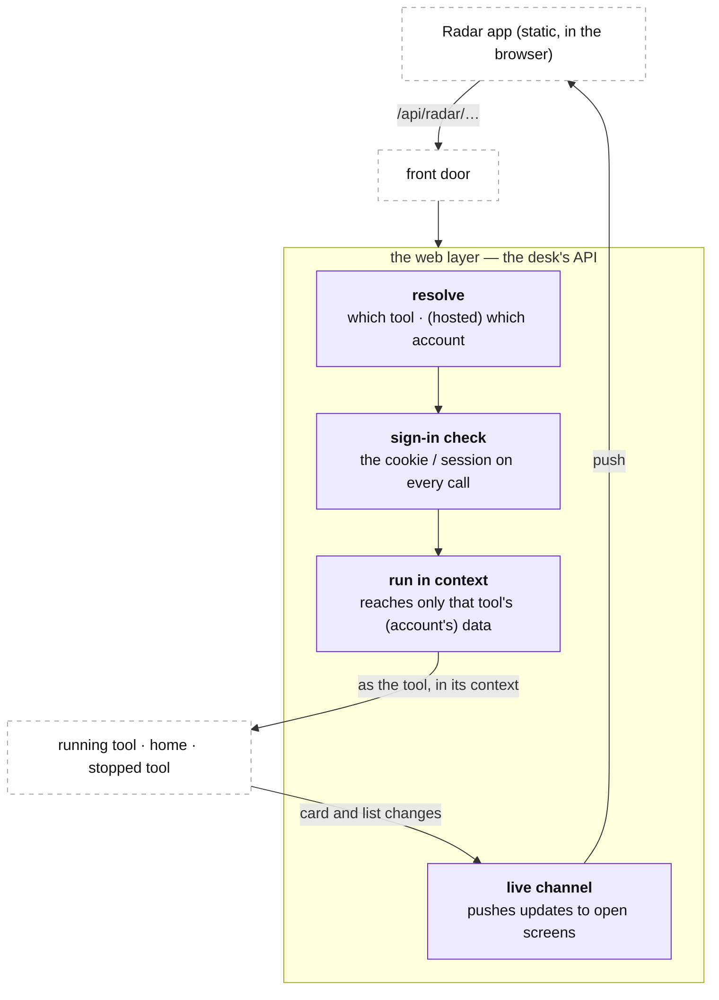

# The desk: the web layer

**Above:** [DESK.md](DESK.md) §4 (the web layer).

**Talks to:**
- the [front door](../02-front-door/FRONT-DOOR.md), which brings it every page and
  API call;
- [home](HOME.md), the [running tools](TOOL.md) and the
  [stopped tools](STOPPED-TOOLS.md), whose pages and routes it serves;
- the [scheduler](JOBS.md), which runs the timed work the pages trigger.

---

## 1. What it is

**The desk's API — the data behind the Radar app.** The front door serves the
static front end and hands the desk every `/api/radar/…` call
([FRONT-DOOR.md](../02-front-door/FRONT-DOOR.md)). The web layer decides which
tool (and, hosted, which account) the call belongs to, checks the sign-in, and
**runs it inside that tool's context** so it can only touch that tool's data
([DESK.md](DESK.md) §3). It answers with **data, not pages** — the Radar app is
the UI ([PAGES.md](tool/PAGES.md)) — and pushes live updates to open screens.

**What it owns:** resolving the tool/account, the sign-in check, and the live
channel.

**What it never does:** render the app's screens (the static app does that), scan,
compute a card, or let a request run heavy work (that goes to a job,
[DESK.md](DESK.md) §4.2).

---

## 2. The diagram

---

## 3. Its parts

### 3.1 Resolving the tool (and the account)

A call names its tool (and, hosted, carries its account). The web layer resolves
it and answers in that tool's context. **Legacy addresses keep working:** each
tool ran as its own program on its own port, so the one program also listens on
each tool's port and the desk's own, and a saved address, a bookmark and qp's
register reads over the old URLs still resolve while the tools move in one at a
time ([MIGRATION.md](../12-migration/MIGRATION.md)). Those ports are the
transitional surface; the Radar app itself calls `/api/radar/…`, not a tool port.

### 3.2 The sign-in check

Every call is checked before anything runs — the one login in solo, the
account/session in hosted ([FRONT-DOOR.md §3.4](../02-front-door/FRONT-DOOR.md)).
A call from the box itself (qp reading a register, the scheduler) is allowed
without it. Nothing is open to the outside without a valid sign-in (S-1).

### 3.3 No server page shell

The old desk wrapped every response in a server-rendered top bar. The built front
end does not need one: each product is a **self-contained app** that carries its
own navigation ([PAGES.md](tool/PAGES.md), the Radar app; the Station is the
launcher). The web layer returns **data**, and a deploy of the app shows at once
through the front end's cache rules, not a shared server bar. (The old `desk.js`/
`desk.css` shell is legacy, retired with the move to apps.)

### 3.4 Running each request as its tool

The web layer runs each call **inside its tool's context** ([DESK.md](DESK.md)
§3): it reads that tool's live list and writes only that tool's data. A database
query made outside every context is an error, not a quiet write into another
tool's data — so one tool's call can never reach another's results. Hosted mode
widens this to the account (§3.6).

### 3.5 The live channel

A page left open is kept fresh: when a scan, a star, or a re-quote changes a
tool's cards, the change is pushed to that tool's open pages, rather than the
page showing numbers as old as the last load (D-S15). The channel is per tool, so
a page only ever sees its own tool's updates. qp's chart has its own live tail
([FEEDS.md](../05-qp/FEEDS.md)); this is the desk's.

### 3.6 Hosted mode: the account-scoped API

Everything above is solo mode — one program, one listener per tool port, one
login. In hosted mode the web layer is the **API behind the front door**
([FRONT-DOOR.md §3.2](../02-front-door/FRONT-DOOR.md)):

- the **context is the account first**, then the tool: the login check becomes an
  account/session check ([ACCOUNTS.md](../13-accounts/ACCOUNTS.md)), and a request
  runs scoped to that account, reaching only that account's rows (row-level
  security, [DATA-MODEL.md](../DATA-MODEL.md));
- the **tool** is resolved from the request, not from a per-tool port — the three
  front ends are served from a CDN and call one API;
- the **live channel is per account and tool**, so a push never crosses accounts.

The isolation rule is unchanged, only widened: solo keeps one tool's page out of
another tool's file; hosted also keeps one account out of another's.

---

## 4. Contracts

**Served by** the desk (one Node program), behind the front door. It answers the
apps' data calls; the routes belong to the data they serve:

| API group | Document |
|---|---|
| a running tool's data (the card list, the market read, the warehouse, the shortlist, the scorecard, the screener builder, settings, monitor) | [PAGES.md](tool/PAGES.md) |
| home/operator: the landing data, the cross-tool lists, Manage tools | [HOME.md](HOME.md) |
| a stopped tool's read-only history | [STOPPED-TOOLS.md](STOPPED-TOOLS.md) |

| It owns | Form |
|---|---|
| resolving the tool (hosted: the account) | from the call; legacy tool ports still resolve (§3.1) |
| the sign-in check | solo: the desk cookie ([BOX.md](../01-box/BOX.md) §4.3); hosted: the session ([ACCOUNTS.md](../13-accounts/ACCOUNTS.md)) |
| the live channel | a per-tool (hosted: per-account) push to open screens |

---

## 5. When it fails

| Event | What happens |
|---|---|
| the front door is down | the desk keeps scanning and photographing; only the front end and the API are out of reach ([DESK.md](DESK.md) §6) |
| a call would run heavy work | it is a job or runs in pieces, so one call cannot hold up another tool's scans ([DESK.md](DESK.md) §4.2) |
| the desk restarts | the API comes back; each tool's list comes back from its file; an open screen reconnects to the live channel |
| a call carries no valid sign-in | it is refused, unless it comes from the box itself |

---

## 6. Built on

**The old desk:** every tool served its own pages on its own port; the pages are
in [legacy/screeners/PAGES.md](../../legacy/screeners/PAGES.md), the routes in
[legacy/screeners/API.md](../../legacy/screeners/API.md), the login and the one
address in [legacy/architecture/ARCHITECTURE.md](../../legacy/architecture/ARCHITECTURE.md).

**What failed there:**

| ID | Fault | Prevented by |
|---|---|---|
| D-S15 | the Screener tab did not refresh itself; cards were as old as the last load | the live channel pushes changes to open pages |
| S-1 | a tool's port was reachable from the internet (seen in qp's log too) | the login check on every request |
| — | each tool loaded the whole program to serve its own port | one program, one listener per port, one copy of the code |

---

## 7. Status

| Part | Status |
|---|---|
| the sign-in and the one address | **built**; the domain and closing the other ports are not done ([ARCHITECTURE §9](../../ARCHITECTURE.md#9-where-the-build-stands-and-the-way-there)) |
| the data API answering per tool, in one program (legacy tool ports still resolve) | **to build** (step B): the way one program holds several tools is built; the tools still run as separate programs |
| the static apps served by the front door, calling this API (not server-rendered pages) | **to build**: the apps are prototypes (`frontend-design/*`); wiring them to the API replaces the page-serving ([PAGES.md](tool/PAGES.md), [FRONT-DOOR.md](../02-front-door/FRONT-DOOR.md)) |
| the live channel to open screens | **to build** (step E: live screens) |
| hosted mode: the account-scoped API behind the door, apps on a CDN, the live channel per account and tool | **designed** (§3.6, [ACCOUNTS.md](../13-accounts/ACCOUNTS.md)); **to build** in the hosted build |
