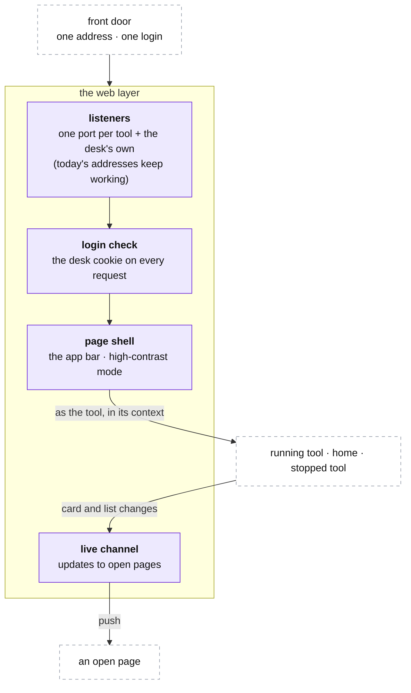

# The desk: the web layer

**Above:** [DESK.md](DESK.md) §4 (the web layer).

**Talks to:**
- the [front door](../02-front-door/FRONT-DOOR.md), which brings it every page and
  API call;
- [home](HOME.md), the [running tools](TOOL.md) and the
  [stopped tools](STOPPED-TOOLS.md), whose pages and routes it serves;
- the [scheduler](JOBS.md), which runs the timed work the pages trigger.

---

## 1. What it is

**The one way in, for every tool and for home.** The front door hands the desk
every request; the web layer decides which tool (or home) it belongs to, checks
the login, wraps it in the page shell, and **runs it inside that tool's context**
so it can only touch that tool's file ([DESK.md](DESK.md) §3). It keeps today's
addresses working — one listener per tool port, plus the desk's own — and pushes
live updates to pages left open.

**What it owns:** the listeners, the login check, the page shell, and the live
channel.

**What it never does:** scan, compute a card, or let a page run heavy work in the
request (that goes to a job, [DESK.md](DESK.md) §4.2).

---

## 2. The diagram

---

## 3. Its parts

### 3.1 One listener per tool, plus the desk's own

Today each tool is its own program on its own port, and the trader (and qp)
reach it there. The desk keeps **every one of those ports**: the one program
listens on each tool's port and on the desk's own, so a saved address, a
bookmark, and qp's register reads over the old URLs all keep working while the
tools move in one at a time ([MIGRATION.md](../12-migration/MIGRATION.md)). A
request on a tool's port is that tool's; a request on the desk's own port is
home's.

### 3.2 The login check

Every request carries the desk's login cookie, checked here before anything runs
— the same login for every tool, home, qp and the journal
([FRONT-DOOR.md](../02-front-door/FRONT-DOOR.md)). A call from the box itself
(qp reading a register, the scheduler) is allowed without it. Nothing on a tool's
port is open to the outside without the cookie (S-1, closed by the login).

### 3.3 The page shell

Every page carries the same top bar naming the programs (screeners, qp, journal)
with the current one marked, and a high-contrast mode readable outdoors. The
shell is served from one place, so a change to the bar reaches every page at
once.

### 3.4 Running each request as its tool

The web layer resolves the tool from the port and runs the request **inside that
tool's context** ([DESK.md](DESK.md) §3): the page reads that tool's live list
and writes only that tool's file. A database query made outside every context is
an error, not a quiet write into another tool's file — so one tool's page can
never reach another's results.

### 3.5 The live channel

A page left open is kept fresh: when a scan, a star, or a re-quote changes a
tool's cards, the change is pushed to that tool's open pages, rather than the
page showing numbers as old as the last load (D-S15). The channel is per tool, so
a page only ever sees its own tool's updates. qp's chart has its own live tail
([FEEDS.md](../05-qp/FEEDS.md)); this is the desk's.

### 3.6 Hosted mode: the account-scoped API

Everything above is solo mode — one program, one listener per tool port, one
login. In hosted mode the web layer is the **API behind the front door**
([FRONT-DOOR.md §3.2](../02-front-door/FRONT-DOOR.md)):

- the **context is the account first**, then the tool: the login check becomes an
  account/session check ([ACCOUNTS.md](../13-accounts/ACCOUNTS.md)), and a request
  runs scoped to that account, reaching only that account's rows (row-level
  security, [DATA-MODEL.md](../DATA-MODEL.md));
- the **tool** is resolved from the request, not from a per-tool port — the three
  front ends are served from a CDN and call one API;
- the **live channel is per account and tool**, so a push never crosses accounts.

The isolation rule is unchanged, only widened: solo keeps one tool's page out of
another tool's file; hosted also keeps one account out of another's.

---

## 4. Contracts

**Served by** the desk (one Node program), behind the front door. The routes
themselves belong to the pages they serve:

| Routes | Document |
|---|---|
| a running tool's pages and API (the card list, the market read, the warehouse, the shortlist, the scorecard, the screener builder, settings, monitor) | [PAGES.md](tool/PAGES.md) |
| home: the landing page, the cross-tool lists, Manage tools | [HOME.md](HOME.md) |
| a stopped tool's read-only history | [STOPPED-TOOLS.md](STOPPED-TOOLS.md) |

| It owns | Form |
|---|---|
| the listeners | one port per tool and the desk's own |
| the login check | the desk cookie ([BOX.md](../01-box/BOX.md) §4.3) |
| the live channel | a per-tool push to open pages |

---

## 5. When it fails

| Event | What happens |
|---|---|
| the front door is down | the desk keeps scanning and photographing; only the pages are out of reach ([DESK.md](DESK.md) §6) |
| a page would run heavy work | it is a job or runs in pieces, so one page cannot hold up another tool's scans ([DESK.md](DESK.md) §4.2) |
| the desk restarts | the listeners come back on every port; each tool's list comes back from its file; an open page reconnects to the live channel |
| a request carries no valid login | it is refused by the login check, unless it comes from the box itself |

---

## 6. Built on

**The old desk:** every tool served its own pages on its own port; the pages are
in [legacy/screeners/PAGES.md](../../legacy/screeners/PAGES.md), the routes in
[legacy/screeners/API.md](../../legacy/screeners/API.md), the login and the one
address in [legacy/architecture/ARCHITECTURE.md](../../legacy/architecture/ARCHITECTURE.md).

**What failed there:**

| ID | Fault | Prevented by |
|---|---|---|
| D-S15 | the Screener tab did not refresh itself; cards were as old as the last load | the live channel pushes changes to open pages |
| S-1 | a tool's port was reachable from the internet (seen in qp's log too) | the login check on every request |
| — | each tool loaded the whole program to serve its own port | one program, one listener per port, one copy of the code |

---

## 7. Status

| Part | Status |
|---|---|
| the login and the one address | **built**; the domain and closing the other ports are not done ([ARCHITECTURE §9](../../ARCHITECTURE.md#9-where-the-build-stands-and-the-way-there)) |
| one listener per tool port, in one program | **to build** (step B): the way one program holds several tools is built; the tools still run as separate programs |
| the live channel to open pages | **to build** (step E: live pages) |
| hosted mode: the account-scoped API behind the door, front ends on a CDN, the live channel per account and tool | **designed** (§3.6, [ACCOUNTS.md](../13-accounts/ACCOUNTS.md)); **to build** in the hosted build |
