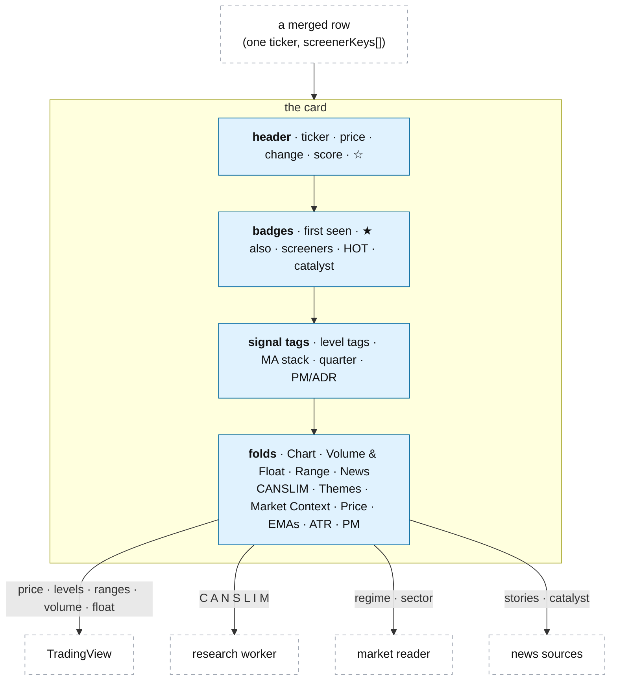

# The card: every field and its source

**Above:** [TOOL.md](../TOOL.md) §3.2 (know: the card).

**Talks to:**
- the [screeners](SCREENERS.md), whose matches become cards;
- the [data sources](../../08-data-sources/DATA-SOURCES.md) (TradingView, bars, short
  interest, borrow, news) and the [research worker](../../06-research-worker/RESEARCH-WORKER.md)
  (the O'Neil letters);
- the [market reader](../MARKET.md), whose one read is stamped on every card;
- the [registers](REGISTERS.md), which freeze the card into the photo (R1).

---

## 1. What it is

**Everything the desk knows about one stock on one day, on one card.** A card is
built for every row a scan found: the price and levels from TradingView, derived
numbers, short interest and borrow, the O'Neil letters, the market read, and news
with a catalyst. One rule governs all of it: **a missing value says it is
missing, and why — never 0, never "no", never a bad sign** (honest gaps).

**What it owns:** nothing stored of its own — it is the view over a row of the
tool's live list, frozen into the photo ([REGISTERS.md](REGISTERS.md)).

**What it never does:** compute an O'Neil letter (the research worker does), or
colour a fact as good or bad (colour means direction or size, never a verdict).

---

## 2. The diagram

**One level of folding.** Every section is a fold, closed by default except the
header and badges, and each closed fold shows its key numbers on its heading
line. No folds inside folds.

---

## 3. Top to bottom

### 3.1 Header

The ticker (taps to the chart), a TradingView link, the price and today's change
(green up, red down), a **Live / Stale** mark (Live = matched this scan; Stale =
matched earlier, still re-quoted every 5 minutes, dimmed), the sector and
industry, the **score** (0–100 or `—`, orange, tapping opens the breakdown) with
its scoring-table label, and this tool's **☆ / ★** shortlist star (yellow).

### 3.2 Badges

In order: **first seen** (the earliest minute any screener matched it, styled by
pre-market / early / late); **★ also T2 T7** (other tools that shortlisted it,
violet); one **screener badge** per screener that matched today (coloured, faded
if it did not match this scan); **🔥 HOT** (its sector is hot); **▲▲ ALL BULL /
▼▼ ALL BEAR** (price above every level, the stack in order, and a bullish
catalyst); and the **catalyst** (⚡ tier 1, ● tier 2, · tier 3, 📈 technical),
with a `+N` for the rest and a tooltip giving the tier, detail, corroboration,
age, confidence and evidence.

### 3.3 Signal tags

One row from the row's relations: ten **level tags** (`9MA 13MA 20MA 50MA 5MA
VWAP PDC OPEN PMH PML`, ▲ above green / ▼ below red, the distance in the tooltip,
no tag when the level is missing); the **MA stack** (`9>13>20>50` bull,
`9<13<20<50` bear, or mixed); the **month quarter** (Q1–Q4 of the 1-month range);
and the **PM/ADR band** with the ratio.

### 3.4 The folds

| Fold | Closed line | Open |
|---|---|---|
| **Chart** | tap to open | a TradingView widget, daily candles, mounted only when the card is on screen and the fold is open |
| **Volume & Float** | RVOL · cap · float · days to cover | each coloured by **magnitude** (§4) |
| **Range** | W · M · Q · Y positions | four bars (week = 5 sessions, month, quarter, year), each with its low, high and the price's position; the all-time high as a distance |
| **News** | N stories · top headline, or "nothing in three weeks" | up to 5 newest headlines with source tag, age and link; a warning when a source did not answer; how many older were hidden |
| **CANSLIM · O'Neil** | the C A N S L I M one-liner | the seven letters, a **"Not shown:"** line naming each missing letter and why, the relative strength, and a nested Full tables fold |
| **Themes** | tap to open | theme tags (AI, Space, Nuclear) from a ticker and an industry list |
| **Market Context** | regime · long · short | the regime with its stance, the three terms, the sector with its bias and score, and the **bias button** |
| **Price** | price · gap · VWAP | price, previous close, VWAP, 5-day MA, open, gap % |
| **EMAs** | 9 · 20 · 50 | EMA 9/13/20/50, green above / red below the price |
| **ATR & Move** | ADR % · move × ATR | ADR $, ADR %, today's range ÷ ATR, day high/low |
| **Pre-Market Range** | PM/ADR · range | PM high, low, range, PM/ADR |

**The CANSLIM fold** reads the O'Neil letters from the
[research worker](../../06-research-worker/RESEARCH-WORKER.md)'s dated facts (in
the design, not qp's routes), so a card first built while qp is down no longer
freezes blanks into the photo ([ONEIL.md](../../06-research-worker/ONEIL.md)).
The full tables — eight quarters of C, the annual run of A, the whole base of N,
supply, 13F, the market model — are the field-by-field detail below.

**The bias button** cycles AUTO → LONG → SHORT, saved per card: AUTO shows what
the desk would choose and why (a ⚡ when a catalyst decided it, "no read" when
nothing points either way); a manual choice is carried into scoring
([LEARNING.md](LEARNING.md)).

### 3.5 Display rules that keep it honest

- **Reverse splits.** TradingView's longer-window highs are not split-adjusted,
  so when a window's high is more than 10× the next shorter window's, that window
  and every wider one are hidden, and the card says which and why.
- **Identical windows** are labelled (`= month`) so they do not look like a
  broken column.
- **The score is `—` when there is none**, never 0 — a missing score is not a low
  score.

### 3.6 The analysis workspace (the card as four tabs)

In the commercial front end the card is presented as a **four-tab analysis
workspace** for one stock, reading the materialized read models
([DATA-MODEL.md](../../DATA-MODEL.md) §3.8), never recomputing:

| Tab | Shows | Read model |
|---|---|---|
| **Overview** | a compact decision summary — the folds above as sections: chart, volume & float, range, news, CAN SLIM summary, themes, market context, price, EMAs, ATR & move, pre-market | `stock_card_snapshot` |
| **Technical** | the detailed price/volume evidence: chart, indicators, ranges, levels, multi-timeframe | `stock_technical_read_snapshot` |
| **CAN SLIM / O'Neil** | the seven factors and their evidence | `stock_canslim_snapshot` |
| **Fundamental · Market · News** | company financials, valuation, events and stock-specific news | `stock_fundamental_read_snapshot` |

Two approved rules the Overview keeps: **no Score Breakdown** (removed, must not
return) and **no section numbers**. The Overview summarizes facts the deeper tabs
own, never shows a value that contradicts its owning tab, and its Market Context
is a snapshot and a link, not a second market dashboard. The folds in §3.4 are
the Overview's compact sections; the depth lives in the owning tab.

---

## 4. Colour language

One meaning per colour, everywhere:

| Role | Colour | Used for |
|---|---|---|
| **Direction** | green / red | price relative to something (above/below a level, up/down on the day). A good score is never green |
| **Magnitude** | one hue, 4 intensities | how big, never whether it is good: RVOL, float, cap, short %, days to cover, PM/ADR, sector heat |
| **Model** | orange | the score, and only the score |
| **Someone else** | violet | another tool's shortlist |
| **Mine** | yellow | your shortlist star |
| **No claim** | grey | missing data, below a threshold, switched off |
| **Furniture** | blue | links, borders, bar fills — never to say something |

Magnitude steps (present / notable / extreme): RVOL ≥ 1.5 / 3 / 5×; float ≤ 50 /
20 / 10M (smaller is louder); cap ≤ $2B / 300M / 50M; short % ≥ 5 / 10 / 20; days
to cover ≥ 2 / 5 / 10.

---

## 5. Every field, and when a blank is legitimate

The exhaustive checklist — all ~97 fields, their source, and whether a blank is a
bug or the honest answer — is
[legacy/screeners/CARD-FIELDS.md](../../../legacy/screeners/CARD-FIELDS.md),
carried into this document's leaf. The rule it encodes is the point:

**A blank is not automatically a bug.** Some fields are blank because a job has
not run (fixable); others because the honest answer is "no answer", and filling
them would mean inventing a number. The card always says which.

| Kind of blank | Examples | It means |
|---|---|---|
| **a bug** | ticker, price, change, sector, RVOL, cap, regime, ADR, day high/low | a source that always answers did not — investigate |
| **a job not run yet** | C/A (EDGAR not walked), L (group ranks not built), M (model not built) | "not fetched yet · last run DATE"; the research worker catches up |
| **honestly no answer** | `%Chg n/a (loss a year ago)`, `ROE n/a (equity ≤ 0)`, "no short interest reported", "under 7 weekly bars", "nothing in three weeks", EMA 50 on a new listing | correct — never shown as 0 or as bearish |

The sources a field can need: **TV** (the scanner, every scan), **BARS** (daily
bars), **EDGAR**, the research worker's market model / groups / 13F, **NEWS**, and
**DESK** (computed from the above). Each O'Neil letter's full table carries its
own `as_of` date, so the card can say how old each reading is
([ONEIL.md](../../06-research-worker/ONEIL.md)).

---

## 6. Contracts

| It reads | From |
|---|---|
| price, levels, ranges, volume, float, cap, sector | TradingView ([DATA-SOURCES.md](../../08-data-sources/DATA-SOURCES.md)) |
| short interest, borrow | FINRA / Yahoo / Nasdaq, Alpaca |
| the O'Neil letters, as of the day | the research worker's facts ([RESEARCH-WORKER.md](../../06-research-worker/RESEARCH-WORKER.md)) |
| the regime and sector read | the market reader ([MARKET.md](../MARKET.md)) |
| news and the catalyst | the news sources |

It stores nothing of its own; the card's fields are frozen into the photo and the
training rows ([REGISTERS.md](REGISTERS.md)). The card is served by the tool's
pages ([PAGES.md](PAGES.md)).

---

## 7. When it fails

| Event | What happens |
|---|---|
| a source fails | that field shows `unavailable` / "not fetched yet", with the reason; the rest of the card builds |
| an O'Neil letter is not computed yet | the CANSLIM fold's "Not shown:" line names the letter and why; never a 0 |
| a value is honestly absent | it says so (`n/a (loss a year ago)`, "under 7 weekly bars"); never shown as a bad sign |
| TradingView sends misaligned columns | the whole scan batch is refused, so no card shows shifted values ([SCREENERS.md](SCREENERS.md)) |

---

## 8. Built on

**The old desk:** the card's layout and display rules in
[legacy/screeners/CARD.md](../../../legacy/screeners/CARD.md); every field, its
source and its legitimate blanks in
[legacy/screeners/CARD-FIELDS.md](../../../legacy/screeners/CARD-FIELDS.md); the
enrichment pipeline in
[legacy/screeners/DATA-PIPELINE.md](../../../legacy/screeners/DATA-PIPELINE.md).

**What failed there:**

| ID | Fault | Prevented by |
|---|---|---|
| F-14 | a missing input shown as zero | a missing input gives a missing output, and the card says why |
| — | the CANSLIM fold read qp's routes, so a card built while qp was down froze blanks | the letters read from the research worker's dated facts |
| — | longer-window highs were not split-adjusted, so a reverse split showed a false range | windows above a 10× jump are hidden, with the reason |

---

## 9. Status

| Part | Status |
|---|---|
| the card, its folds, the colour language, the honest-blank rule | **built** (legacy) |
| the CANSLIM fold reading the research worker's facts | **in shadow** ([RESEARCH-WORKER.md](../../06-research-worker/RESEARCH-WORKER.md)); the cards still use qp's values until the switch |
| the score shown (the scorer is off on every tool today) | **to build** ([LEARNING.md](LEARNING.md)) |
