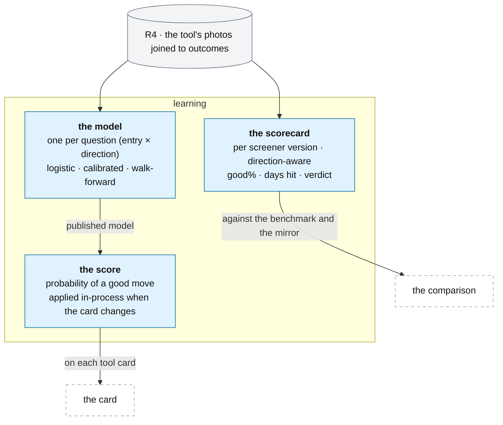

# A tool's score and scorecard

**Above:** [TOOL.md](../TOOL.md) §3.6 (learn: the score and the scorecard).

**Talks to:**
- the [registers](REGISTERS.md), which supply R4, the only training data;
- the [card](CARD.md), which shows the score;
- the [screeners](SCREENERS.md), whose versions the scorecard judges, with the
  mirror and the benchmark;
- the [research worker](../../06-research-worker/RESEARCH-WORKER.md), which trains
  the models after the outcomes ([JOBS.md](../JOBS.md)).

---

## 1. What it is

**Two questions over a tool's own record.**

| | The score | The scorecard |
|---|---|---|
| **Asks** | of the stocks this tool found before that looked like this one, how many made a good move? | keep this screener, watch it, or drop it? |
| **About** | one card, at discovery | one screener, over all its days |
| **Used for** | ranking today's cards; filling the shortlist. **Never a filter** | the order of work: collect, cut, then entries |
| **Learns from** | the tool's own R4 | the tool's own R4 |

**What it owns:** the tool's models and its scorecards.

**What it never does:** filter a tool's candidates, learn from another tool's
data, mix entry A with entry B, or grade on a curve different from the one good-
move line.

---

## 2. The rules both keep

Each was learned on the live desk:

1. **Each tool learns only from itself** — tools are separate experiments.
2. **No look-ahead:** inputs are what was known at the photo; outcomes only after
   the entry; ATR from the days before.
3. **One good-move line:** `≥ 1.3 ATR` in the trade's direction, from the entry,
   before the close (a big move is `≥ 2`). The score, the scorecard and the
   shortlist never grade on different curves — the old score called a win `> 1.3`
   while the scorecard used `≥ 1.3`.
4. **Entries A and B are never mixed.**
5. **Honest about thin data:** every number carries its sample, and below a
   minimum there is no number.
6. **Explainable:** a score says why; a verdict shows its sample and thresholds.
7. **Unit-free features first:** relations (above/below a level, % distance,
   range position, the MA stack, PM/ADR) compare a $2 stock with a $200 one.
8. **The score is fixed at the photo** and re-computed only when the card changes.
9. **Retrained every day** after the outcomes are in.
10. **The market matters:** prefer the same regime, fall back to all and say so.

---

## 3. The diagram

---

## 4. The score

### 4.1 What it predicts

For each tool and each of **six questions** (entry A or B × long, short or
either), the **probability that the card makes a good move** (`≥ 1.3 ATR` in that
direction from the entry). The card shows the question its bias points to, at the
tool's chosen entry, as a number 0–100 (the calibrated probability × 100), beside
the tool's **base rate** for that question — so a 60 against a base rate of 55
reads as the small edge it is.

### 4.2 Features

Chosen per tool from a fixed menu, in order of preference: **unit-free
relations** (above/below each level, % distance, range positions, MA stack,
PM/ADR, gap %, ADR %, RVOL); **context** (regime group, sector bias, hot sector,
catalyst tier and sentiment, minutes from the open, shortlisted elsewhere); **the
tool's own screener keys** with enough cards; and the **CANSLIM letters** once
enough photographed days carry them. A feature enters only if it improves the
walk-forward score.

### 4.3 The model, and its validation

| Part | Choice | Why |
|---|---|---|
| model | regularised logistic regression per question | small samples; coefficients explain themselves; calibrated by construction — not PCA factors averaged equally, which pull the score to the middle and say nothing to a trader |
| similar cards | the 20 nearest past cards on the standardised features, with how many made a good move | the explanation a trader trusts |
| regime | regime group as a feature; a separate model per regime group only with enough rows | the old sub tables rested on a handful of days |
| validation | **walk-forward by day:** train on days before, test on the next, over all history | no look-ahead in the evaluation either |
| publish rule | a new version is published only if its walk-forward Brier score beats the base rate's | a model no better than "always say the base rate" must not pretend to be |
| minimum | at least 100 photographed cards over 10 days for the question; else no score, and the card says why | thin data shows no number |

Trained by the research worker after the outcomes (16:20), from the tool's R4
only. A model is a **versioned record**: question, features, coefficients,
scaler, training window, sample, walk-forward metrics, published or not, and why.

### 4.4 Applied when the card changes, and explained

The card engine scores each tool card from the tool's current published model
**in-process** (a dot product and a logistic) whenever the card changes — at
discovery, each re-quote, a new market state, a bias change — and stores the
score with the model version, the sample and a confidence interval. There is **no
separate scorer process**, which is why the old scorer sat off on every tool
(D-D1). The photo freezes the score of the card it froze, so the model is judged
on the features it saw. Tapping the score shows the question, the probability and
base rate, the sample and interval, the model version and its walk-forward
accuracy, the **named features that pushed it up or down**, and the **20 most
similar past cards** with their outcomes.

### 4.5 The shortlist auto-rule

One minute before the photo, the top N cards (default 5) whose score is at least
the setting (default 70) **and** whose model is published. With no published
model, nothing is added and the tool says why.

---

## 5. The scorecard

### 5.1 Direction-aware

Each screener is graded on **its own direction** — a bullish screener on `upR`, a
bearish one (most mirrors) on `downR`, a direction-agnostic one (a gap screener,
the benchmark) on the larger. The direction is a field of the screener version.
The old scorecard graded every screener on the move **up**, so a short setup that
worked read as a failure and the mirror comparison was backwards (D-S12).

### 5.2 The numbers, per screener version and entry, from captured rows only

| Number | Formula |
|---|---|
| cards, days | rows, distinct days |
| **good %** | share with R ≥ 1.3 in its direction, with a Wilson 90 % interval |
| big % | share with R ≥ 2 |
| median and average R | in its direction |
| average adverse R | the other direction |
| **days hit** | share of days whose best card reached 1.3 — **the deciding number: consistency** |

Rows of an older screener version are shown apart, never pooled with the current
one. **Uploaded** rows are excluded unless included on purpose, so a verdict never
rests on data the tool did not collect.

### 5.3 The verdict

| Verdict | Rule (settings, versioned; defaults from the legacy desk) |
|---|---|
| not enough data | under 20 cards or 5 days |
| **keep** | good % ≥ 35 **and** days hit ≥ 50 % |
| **watch** | good % ≥ 25 **or** days hit ≥ 40 % |
| **drop** | otherwise |

The thresholds and the sample are printed beside every verdict.

### 5.4 The two comparisons

1. **Against the benchmark** — the tool's own baseline, and the plain in-play
   benchmark tool (which every tool must beat by 5 points of good %) — with the
   intervals shown, so a 3-point gap on a thin sample is never read as proof, and
   the caveat that part of a gap can be a difference of universe. The benchmark
   **always runs**, so the comparison never vanishes when it is stopped (D-S14,
   fixed by reading stopped tools, [HOME.md](../HOME.md)). The tool's baseline
   counts **each card once**, whatever the number of screeners that found it.
2. **Against its mirror** — same window, same universe, so the only difference is
   direction: **directional**, **both sides work**, or **neither beats the
   benchmark**.

---

## 6. Contracts

| It owns | Key |
|---|---|
| `models` | tool, question, version |
| `scorecards` | tool, screener version, entry, day computed |

| It reads | From |
|---|---|
| R4 per tool (uploads only when asked) | the registers ([REGISTERS.md](REGISTERS.md)) |
| screener versions, direction, mirrors, the benchmark | the screeners ([SCREENERS.md](SCREENERS.md)) |

| Read by | What |
|---|---|
| the card | the tool's current published model per question ([CARD.md](CARD.md)) |
| the registers | the auto-rule's scores ([REGISTERS.md](REGISTERS.md)) |

| Routes (the tool's Analysis tab, and home's comparison) | Return |
|---|---|
| `GET …/models` | model versions with their metrics and publish decision |
| `GET …/scorecard?entry=A\|B` | every screener's numbers and verdict |
| `GET /api/compare?entry=A\|B` | every screener against the benchmark and its mirror ([HOME.md](../HOME.md)) |

---

## 7. When it fails

| Event | What happens |
|---|---|
| a question has too little data (under 100 cards / 10 days) | no model, no score; the card says why |
| a model does not beat the base rate in walk-forward | it is not published; the card shows no score, not a false one |
| the benchmark tool is stopped | the comparison still runs, reading the stopped tool (D-S14) |
| a screener's definition changed | its old-version rows are shown apart, never pooled with the new |

---

## 8. Built on

**The old desk:** today's score and scorecard, step by step, and why neither
should be copied, in
[legacy/screeners/SCORING-TODAY.md](../../../legacy/screeners/SCORING-TODAY.md);
the intent for their replacements in
[legacy/screeners/IDEAS.md](../../../legacy/screeners/IDEAS.md); the measure, the
benchmark and the mirrors in
[legacy/screeners/METHODOLOGY.md](../../../legacy/screeners/METHODOLOGY.md).

**What failed there:**

| ID | Fault | Prevented by |
|---|---|---|
| D-D1 | the scorer sat off on every tool; the auto-rule added nothing | the model applied in-process, no scorer process |
| D-S12 | every screener graded on the move up, so bearish setups read as failures | direction-aware grading |
| — | ~60 features against a few hundred rows; PCA factors averaged equally; buckets normalised by the best | a small per-tool feature set, one fitted logistic, calibrated probabilities |
| — | two good-move curves (`> 1.3` vs `≥ 1.3`) | one definition |
| — | the pooled baseline counted a card once per screener that found it | each card counted once |
| — | uploaded rows mixed into verdicts; thresholds fixed in code | uploads excluded unless asked; thresholds as versioned settings |

---

## 9. Status

Prepared, not built, by the trader's choice: the direction-aware scorecard
(Wilson intervals, the 1.3 ATR line) and the training set are built; there is an
empty model slot with its contract; **no model is trained** and the legacy scorer
stays off.

| Part | Status |
|---|---|
| the direction-aware scorecard and the training set | **built** (prepared) |
| the scorecard page | **to build** (step E) |
| a trained, published model and the in-process score | **to build** (step F), when the trader chooses one |
