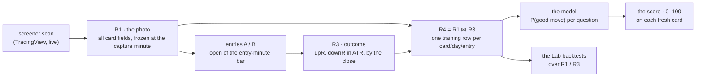

# Prediction-model research — scan → outcome → score

**Status: research, HELD (not building).** This file settles the open questions
for **Phase 2** — turning the live screeners into a learning system — so that when
we build it we are *confirming* parameters, not inventing a method. The method
itself is already designed; see the specs below.

**Draws on (already written):**
- [LEARNING.md](LEARNING.md) — the score and the model.
- [REGISTERS.md](REGISTERS.md) — R0–R4: the photo and the outcome, without look-ahead.
- [CARD.md](CARD.md) — every card field and its source (the model's inputs).
- [SCREENERS.md](SCREENERS.md) — the screeners and their versions.
- the reference desk's [legacy/screeners/METHODOLOGY.md](../../../legacy/screeners/METHODOLOGY.md) — the measure, battle-tested over a live month.
- downstream: the Lab [../../05-qp/BACKTEST.md](../../05-qp/BACKTEST.md); the history [../../10-backups/BACKUPS.md](../../10-backups/BACKUPS.md).

---

## 1. The goal, in one line

Take a **photo** of every screener card at a fixed minute (the inputs), measure
**how far each ran** by the close (the output), and train a **model** that reads a
fresh photo and predicts the output — the card's **score**.

The goal as stated — *"screenshot at X, register all card fields, then the
end-of-day output, then a model that anticipates the output from the inputs"* — is
exactly this pipeline:

---

## 2. Your open questions, answered

| Your question | Answer (proposed default) | Fixed in |
|---|---|---|
| When do we snapshot — when a card hits the screen, or at a set time? | **A set time per screener — one "photo" a day**, taken one minute after one of that screener's scans so it freezes a fresh list. *Not* "whenever a card appears". | REGISTERS §3.2 |
| With a market-open condition? | The photo is in-session; cards keep re-quoting 04:00–16:00, but **only the photo trains**. A card found after the photo can still be traded — it just teaches the model nothing. | METHODOLOGY "the learning moment" |
| Do we assume an entry time? | **Yes — two entries per screener** (A and B), a few minutes after the photo, taken at the **open** of that minute's bar. Two, so we can compare which entry the screener suits. | REGISTERS §3.4 |
| Same time for all scanners, or different? | **Different**, tied to each screener's own session (table in §5). | METHODOLOGY, per tool |
| What is the output, and how is it measured — high−low / open−low vs high−open / close? | **Neither raw high−low nor close.** Two numbers from the entry: **`upR = (high − entry) / ATR14`** and **`downR = (entry − low) / ATR14`**, both positive — the favorable and adverse excursions (MFE / MAE) in ATR units. A **bullish** screener is graded on `upR`, a **bearish** one on `downR`, a **direction-agnostic** one on the larger. | REGISTERS §3.4, LEARNING §2 |

### Why `upR`/`downR`, and not high−low or close

- **Close** is a single point — it discards the whole path. A card that ran +3 ATR
  and then closed flat *was* a good find; grading on the close calls it nothing.
- **Raw high−low** blends both directions into one figure and can't say whether the
  move went the screener's way.
- **`upR` / `downR`** are the favorable and adverse excursions, each measured from
  the **entry** (the open of the entry-minute bar), each divided by **ATR14** — the
  stock's own daily range, computed from the 14 sessions *before* today, so nothing
  looks ahead. Dividing by ATR makes a \$2 and a \$200 stock comparable and ties
  "a good move" to **one line everywhere: `upR ≥ 1.3`** (a big one `≥ 2`).
- There is **no stop, target or exit.** We are measuring whether the *screener*
  finds movers — the only thing a screener can be held responsible for. Which
  entry/stop/target to trade comes *after* we know which screeners are worth
  keeping (§7).

Worked example — entry \$10, high \$12.50, low \$9.40, ATR \$1 → **upR 2.5,
downR 0.6**.

---

## 3. The score engine — what predicts the output

Already specified in [LEARNING.md](LEARNING.md); **not yet trained** (by choice).

- **Target:** `P(good move)` — the probability that `upR` (or `downR`, by
  direction) reaches 1.3 from the entry. Shown as 0–100 beside the screener's
  **base rate**, so a 60 against a 55 base rate reads as the small edge it is.
- **One model per "question"** = entry (A or B) × direction (long / short / either).
- **Features**, in order of preference: **unit-free relations** (above/below each
  MA, % distance to each level, range position, the MA stack, PM/ADR, RVOL, ADR%,
  gap%); **context** (market regime, sector bias, catalyst tier/sentiment,
  minutes-from-open, shortlisted-elsewhere); the **screener keys**; and the
  **CANSLIM letters** once enough days carry them. A feature enters only if it
  improves the walk-forward score.
- **Guarantees:** no look-ahead (inputs = the photo, outcome = after it, ATR =
  before it); **walk-forward by day**; **calibrated** probabilities; **published
  only if it beats the base rate**; a minimum sample or it shows **no score**; and
  **explainable** — named feature contributions plus the **20 most similar past
  cards** with their outcomes.

---

## 4. The model family — your "ML model" decision

This is the one genuinely open choice. Everything in §2–§3 is settled method; the
function in the middle of the pipeline is not.

**The baseline already in the design:** a **regularised logistic regression per
question**, calibrated, walk-forward validated. Chosen for month-one reality — a
screener yields *dozens* of photographed cards a month, logistic coefficients
explain themselves, and the probability is calibrated by construction.

> The *legacy* scorer was **PCA + Ridge regression** (`sklearn`, see the reference
> `src/scoring`). It is deliberately **not** copied: averaging PCA factors equally
> pulls every score toward the middle and tells a trader nothing.

**Richer ML, and the trade-offs at our data scale:**

| Model | What it buys | What it costs here |
|---|---|---|
| **Gradient-boosted trees** (XGBoost / LightGBM) | captures non-linear interactions; the strongest tabular performer | hungry for rows; overfits small samples; needs isotonic/Platt **calibration**; explainability only via **SHAP** |
| Random forest | robust, little tuning | same data appetite; still needs calibration |
| Small neural net | flexible | not justified at this scale; opaque |

**Recommendation (to confirm):**

1. **Ship the logistic baseline first** — it works at month-one data volumes and
   meets the explainability contract directly.
2. **Graduate to gradient-boosted trees *per question* when the data earns it** —
   rule of thumb, hundreds to low-thousands of photographed rows per question.
   Keep the calibration, walk-forward, publish-only-if-it-beats-the-base-rate, and
   the explanation layer (SHAP contributions + 20-nearest-neighbours) so the card
   still says *why*.
3. **Same target, same guarantees** whichever model is used — only the estimator
   in the middle changes, so the upgrade never touches R1/R3/R4 or the card.

### The data gate ties straight to the backup (Phase 3)

Richer ML is a **data-volume** question, not a preference. One screener × one month
is not enough for boosted trees. The **imported history** — the old tool's months
of registers across eleven tools, produced by the **same filters** as our five
screeners (so the rows line up) — is what makes a non-linear model viable, and our
screeners extend it every day. So the model upgrade and the R2 history import are
**one project**: build the logistic baseline, let the data accrue, switch the
estimator when it is earned.

---

## 5. The five screeners — proposed capture / entry / direction

Inherited from the reference desk so the imported history lines up (identical
filters → comparable rows). All times **ET**.

| Screener (our name) | Photo | Entries A / B | Graded on |
|---|---|---|---|
| Trend Leaders | 09:36 | 09:37 / 09:40 | long — `upR` |
| Pre-Market Movers | 09:36 | 09:37 / 09:40 | long — `upR` |
| Volume Surges | 09:36 | 09:37 / 09:40 | agnostic — the larger |
| MA Stack Breakout | 09:46 | 09:47 / 09:51 | long — `upR` |
| Growth Pullback | 09:46 | 09:47 / 09:51 | long — `upR` |

> The reference also runs a **mirror** of each *directional* screener (the same
> setup facing the other way) to answer "is the edge directional, or does the
> screener just find movers?". Optional, noted here, not part of the five.

---

## 6. Settled vs. needs-your-decision

**Settled (adopt the specs as defaults):** the photo mechanism, R0–R4, the
`upR`/`downR` measure, the 1.3R good-move line, the feature menu, the
walk-forward / calibration / publish rules, and the capture/entry table above.

**Needs your decision:**

1. **Model family** — logistic now, boosted-trees-when-earned (recommended), or
   something else from the start.
2. **Capture / entry times** — adopt the reference's (recommended, for history
   continuity) or set your own.
3. **Scope** — do we also run the **mirrors**? (Doubles the registers; answers "is
   it direction, or just movement".)

---

## 7. Order of work (when unparked)

1. **Register layer** — freeze **R1** daily, per screener (Phase 2 proper).
2. **Import the history** from the R2 backup (Phase 3) — seeds the training set.
3. **Outcome job** — **R3** at 16:05: outcome bars → ATR14 → `upR`/`downR`.
4. **Scorecard** — keep / watch / drop, per screener, before any modelling
   ([LEARNING.md §5](LEARNING.md)).
5. **Train the baseline model**; graduate the estimator when the data supports it.
6. **The Lab** ([../../05-qp/QP.md](../../05-qp/QP.md)) backtests over R1 / R3.

> Collect first, cut second, model third, setups last — the measure deliberately
> does not pick an entry/stop/target, because that question only matters for the
> screeners that survive the cut.
