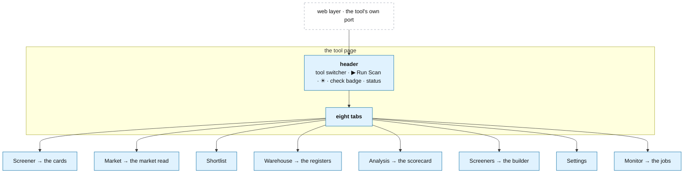

# A tool's pages

**Above:** [TOOL.md](../TOOL.md) §3.7 (show: its pages).

**Talks to:**
- the [web layer](../WEB.md), which serves these pages in the tool's context on
  its own port;
- [home](../HOME.md), which carries the pages that span tools (the landing page,
  the comparison, Manage tools);
- every other part of the tool: the [card](CARD.md), the [market read](../MARKET.md),
  the [registers](REGISTERS.md), the [scorecard](LEARNING.md), the
  [screeners](SCREENERS.md) and the [scheduler](../JOBS.md).

---

## 1. What it is

**One running tool's own screens: eight tabs over its own data.** Each tab is a
view of one part of the tool, served in the tool's context on its own port, so a
page only ever shows and changes that tool's results. The screens that span tools
— the landing page, the screener comparison, Manage tools — belong to
[home](../HOME.md), not here.

**What it owns:** nothing stored — the tabs are views; a change on a tab writes
through to the part that owns the data.

**What it never does:** reach another tool's data, or run heavy work in a page
request ([WEB.md](../WEB.md)).

---

## 2. The diagram

---

## 3. The header

| Control | Does |
|---|---|
| **⚡ tool name ▾** | switches to another tool (each opens on its own port) |
| **▶ Run Scan** | a full scan now; says "paused — no scan run" when paused |
| **☀** | high-contrast mode, readable outdoors |
| **check badge** | `● CHECK NOW · until 10:30 ET`, or `check 09:00–10:30 ET`, from the tool's screeners; refreshed every minute |
| **status** | the last scan's result |

---

## 4. The eight tabs

| Tab | What it is | Detail |
|---|---|---|
| **Screener** | today's cards, with the filters (search, screener, news, catalyst, aligned) and the sort (score, change, RVOL, live first, newest found) | [CARD.md](CARD.md) |
| **Market** | the indexes, the O'Neil model (M), the regime, the sectors and the groups (L) | [MARKET.md](../MARKET.md) |
| **Shortlist** | the starred stocks, one list per day; a day picker, a card per stock with its method (manual/auto), and **📋 Copy to TradingView** | [REGISTERS.md](REGISTERS.md) §3.6 |
| **Warehouse** | the registers by date (R0, R1, R2, R3, R4, Shortlist), with CSV and JSON export | [REGISTERS.md](REGISTERS.md) |
| **Analysis** | the screener scorecard (which screeners find movers) and the model panel | [LEARNING.md](LEARNING.md) |
| **Screeners** | the screener builder: the list, the editor, test, mirror, pause | [SCREENERS.md](SCREENERS.md) |
| **Settings** | the tradability floor, the hot-sector and sector-bias thresholds, the shortlist rule, the scorer, the data-source check, backups | [SETTINGS (legacy)](../../../legacy/screeners/SETTINGS.md) |
| **Monitor** | the scheduled jobs and the last scan's report | [JOBS.md](../JOBS.md) |

The **Screener** tab is kept fresh by the live channel, rather than showing cards
as old as the last load ([WEB.md](../WEB.md), D-S15). The three filters narrow the
list once, and every tab draws from that narrowed list; the open tab is
remembered in the browser.

---

## 5. What changes from today

| Change | Why |
|---|---|
| The tabs are served **in the tool's context by the desk**, on the tool's own port, not by a separate per-tool program | one program for every tool ([WEB.md](../WEB.md)) |
| The Screener tab **refreshes itself** from the live channel | it showed stale cards until a reload, tab switch or Run Scan (D-S15) |
| The Warehouse and Market tabs read the **shared record** for a past day | a stopped tool needed the archive; the shared record serves every tool's history |
| The cross-tool pages (landing, comparison, Manage tools) are **home's**, read in process | the old desk read other tools over HTTP from T1, and lost a stopped tool's scorecard (D-S14, [HOME.md](../HOME.md)) |

---

## 6. Contracts

**Served by** the desk in the tool's context ([WEB.md](../WEB.md)); every route
needs the desk login, except a call from the box itself. The route groups (the
same ones the tool answers today, carried into the desk):

| Group | Does | Detail |
|---|---|---|
| `/scanner`, `/health`, `/api/version`, `/api/tool` | the page, the tool's health and identity | §3 |
| `/api/scan`, `/api/registry` | run a scan; today's live list (R0) and a card's bias | [SCREENERS.md](SCREENERS.md), [REGISTERS.md](REGISTERS.md) |
| `/api/card`, `/api/news` | one card, live or frozen; fetch news now | [CARD.md](CARD.md) |
| `/api/screeners` | the builder: list, create/edit, test, mirror, pause, rename, delete | [SCREENERS.md](SCREENERS.md) |
| `/api/shortlist` | star/unstar, today's and every day's list, export, the auto-rule, the union across tools | [REGISTERS.md](REGISTERS.md) |
| `/api/warehouse` | the registers by date, and export (also what a stopped tool serves, read-only) | [REGISTERS.md](REGISTERS.md), [STOPPED-TOOLS.md](../STOPPED-TOOLS.md) |
| `/api/market` | the market read, and the O'Neil M and L | [MARKET.md](../MARKET.md) |
| `/api/analysis` | the scorecard, the model, training data | [LEARNING.md](LEARNING.md) |
| `/api/settings`, `/api/monitor`, `/api/datacheck` | the tool's settings, its jobs, the source check | [JOBS.md](../JOBS.md) |

The full route list (81 routes today) is
[legacy/screeners/API.md](../../../legacy/screeners/API.md). An unknown `/api/…`
path answers a 404 that says so, never the landing page.

---

## 7. When it fails

| Event | What happens |
|---|---|
| a tab's source is down | that tab says so (a feed warning, "market read unavailable"); the other tabs work |
| a past day is asked for and the shared record is down | the Warehouse and Market tabs say so; today's live tab still works |
| a heavy export is requested | it runs as a job or in pieces, so one page cannot hold up the tool's scans ([WEB.md](../WEB.md)) |
| the tool is paused | the header and the Monitor tab say since when and why; the cards already found stay on screen |

---

## 8. Built on

**The old desk:** the eight tabs in
[legacy/screeners/PAGES.md](../../../legacy/screeners/PAGES.md), the full route
list in [legacy/screeners/API.md](../../../legacy/screeners/API.md).

**What failed there:**

| ID | Fault | Prevented by |
|---|---|---|
| D-S15 | the Screener tab did not refresh itself; the cards were as old as the last load | the live channel keeps it fresh |
| D-S14 | the comparison and a stopped tool's scorecard were lost when a tool stopped | the cross-tool pages are home's, reading stopped tools too |
| — | each tool served its own pages as its own program; qp and the landing page read tools over HTTP | the desk serves every tool's pages in one program |

---

## 9. Status

| Part | Status |
|---|---|
| the eight tabs and their routes | **built** (legacy, per-tool programs) |
| the tabs served in the tool's context by the desk | **to build** (step B) |
| the Screener tab refreshing itself; the Warehouse and Market tabs reading the shared record | **to build** (steps D–E) |
