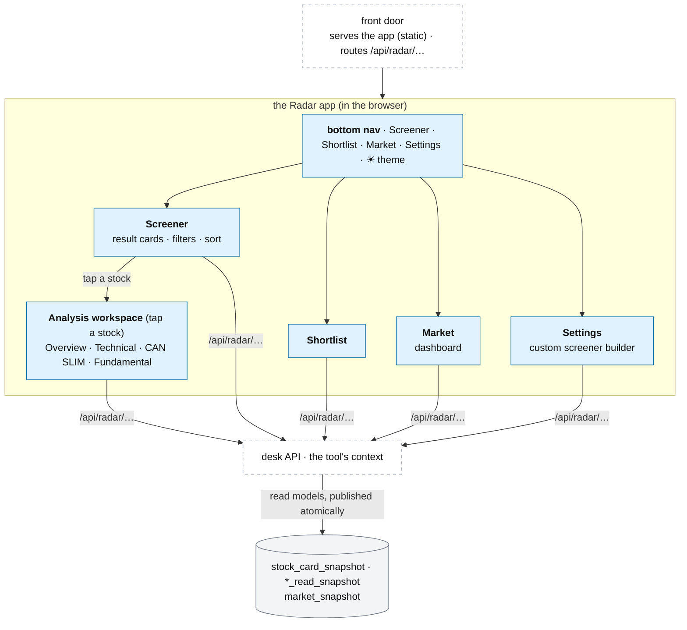

# A tool's pages — the Radar app

**Above:** [TOOL.md](../TOOL.md) §3.7 (show: its pages).

**Talks to:**
- the [front door](../../02-front-door/FRONT-DOOR.md), which serves this app
  (static) and routes its `/api/radar/…` calls to the desk;
- the [web layer](../WEB.md), the desk's API that answers those calls in the
  tool's (and the account's) context;
- every part of the tool it reads: the [card](CARD.md), the
  [market read](../MARKET.md), the [registers](REGISTERS.md), the
  [scorecard](LEARNING.md), the [screeners](SCREENERS.md) and the
  [scheduler](../JOBS.md);
- the [admin surface](../../14-admin/ADMIN.md) and [home](../HOME.md), which carry
  the operator views (the warehouse, the scorecard, Manage tools).

---

## 1. What it is

**The screens of the Radar product for one tool.** In the built front end a tool
is shown as the **Radar app** ([FRONT-END-DESIGN.md](../../02-front-door/FRONT-END-DESIGN.md),
`frontend-design/radar.html`): a self-contained app that runs in the browser,
switches its own screens with no page reload, and reads its data from the desk
over `/api/radar/…`. It presents **four screens** and, when the trader taps a
stock, a drill-in **analysis workspace**:

| Screen | What it is |
|---|---|
| **Screener** | today's result cards for the chosen screener(s), with filters and sort — the landing screen |
| **Shortlist** | the starred stocks, one list per day |
| **Market** | the standalone market dashboard |
| **Settings** | the custom screener builder and the tool's settings |
| *(drill-in)* **Analysis workspace** | one stock in four tabs: Overview · Technical · CAN SLIM · Fundamental |

**What it owns:** nothing stored — the screens are views over the tool's data; a
change writes through to the part that owns it ([SCREENERS.md](SCREENERS.md),
[REGISTERS.md](REGISTERS.md)).

**What it never does:** reach another tool's or another account's data, recompute
a card in the browser (it reads the materialized read models,
[CARD.md §3.6](CARD.md)), or run heavy work in an API request
([WEB.md](../WEB.md)).

**The desk engine still does the work.** These screens are the *face*; the
screeners, the card pipeline, the market read and the registers behind them are
the desk ([TOOL.md](../TOOL.md)). Operator and research views that are not part of
the trader's app — the warehouse of raw registers, the screener scorecard, the job
monitor, Manage tools — live under the admin surface (§4), not in Radar.

---

## 2. The diagram

---

## 3. The screens

### 3.1 Screener — the result cards

The landing screen: today's cards for the selected screener(s), with the filters
(search, screener, news, catalyst, aligned) and the sort (score, change, RVOL,
live first, newest found). It is kept fresh by the live channel rather than
showing cards as old as the last load ([WEB.md](../WEB.md), D-S15). The filters
narrow the list once, and every screen draws from that narrowed list; the open
screen is remembered in the browser. Each card and its fields:
[CARD.md](CARD.md). The screener selector offers the tool's built-in presets
(T1/T2/T7) and the account's own screeners ([SCREENERS.md](SCREENERS.md)).

### 3.2 Shortlist

The starred stocks, one list per day: a day picker, a card per stock with its
method (manual/auto), and **📋 Copy to TradingView**. The star is the tool's own
(and, hosted, the account's own). Detail: [REGISTERS.md §3.6](REGISTERS.md).

### 3.3 Market — the dashboard

The standalone market dashboard: the indexes, the regime with its stance, the
sector heatmap and the hot sectors, and O'Neil's market model (M) and group
leadership (L). It reads the materialized `market_snapshot`
([MARKET.md §3.5](../MARKET.md)). This is the **global** market view; a stock's
analysis workspace carries only a Market-context snapshot and a link here, never a
second dashboard ([CARD.md §3.6](CARD.md)).

### 3.4 Settings — the custom screener builder

The tool's Settings screen is the **custom screener builder** ([SCREENERS.md](SCREENERS.md)):
the list of screeners, the rule editor, test, mirror, pause, plus the tool's own
settings (the tradability floor, the hot-sector/sector-bias thresholds, the
shortlist rule, the theme). A user's screeners are their own; the built-in presets
are shared read-only ([DESK.md §1](../DESK.md)).

### 3.5 The analysis workspace — a stock in four tabs

Tapping a stock opens the four-tab workspace, each tab reading a materialized read
model and never recomputing ([CARD.md §3.6](CARD.md), [DATA-MODEL.md §3.8](../../DATA-MODEL.md)):

| Tab | Shows | Read model |
|---|---|---|
| **Overview** | the decision summary: the card's folds as sections | `stock_card_snapshot` |
| **Technical** | price/volume evidence, indicators, ranges, levels, multi-timeframe | `stock_technical_read_snapshot` |
| **CAN SLIM / O'Neil** | the seven factors and their evidence | `stock_canslim_snapshot` |
| **Fundamental · Market · News** | financials, valuation, events, stock news | `stock_fundamental_read_snapshot` |

Two approved rules the Overview keeps: **no Score Breakdown** and **no section
numbers** ([CARD.md §3.6](CARD.md)).

---

## 4. The operator views (not in the Radar app)

The old per-tool page also carried operator and research screens. These are **not**
in the trader's Radar app; in the built product they sit under the admin/operator
surface, because they are about running and judging tools, not finding stocks:

| Operator view | Where it lives now |
|---|---|
| **Warehouse** — the raw registers by date (R0–R4, Shortlist), CSV/JSON export | the admin surface / data export ([REGISTERS.md](REGISTERS.md), [ADMIN.md](../../14-admin/ADMIN.md)) |
| **Analysis** — the screener scorecard and the model panel | the operator/advanced view ([LEARNING.md](LEARNING.md), [HOME.md §3.4](../HOME.md)) |
| **Monitor** — the scheduled jobs and the last scan's report | the admin surface ([JOBS.md](../JOBS.md), [ADMIN.md](../../14-admin/ADMIN.md)) |
| **Manage tools**, the cross-tool comparison | home, operator-only ([HOME.md §3.3–3.4](../HOME.md)) |

Solo mode still exposes these to the single trader; hosted mode gates them to the
admin role ([ACCOUNTS.md](../../13-accounts/ACCOUNTS.md)).

---

## 5. Contracts

**Served and routed by** the front door: the app is static; its data calls go to
the desk's API in the tool's (and the account's) context
([WEB.md](../WEB.md), [FRONT-DOOR.md §3.3](../../02-front-door/FRONT-DOOR.md)).
Every call needs the sign-in, except a call from the box itself. The API groups,
by screen:

| Group | Serves | Detail |
|---|---|---|
| `…/scan`, `…/registry`, `…/card`, `…/news` | the Screener cards: run a scan, today's live list (R0), one card (live or frozen), fetch news | [SCREENERS.md](SCREENERS.md), [CARD.md](CARD.md) |
| `…/shortlist` | star/unstar, each day's list, export, the auto-rule | [REGISTERS.md](REGISTERS.md) |
| `…/market` | the market dashboard (`market_snapshot`), M and L | [MARKET.md](../MARKET.md) |
| `…/screeners`, `…/settings` | the builder (list, create/edit, test, mirror, pause) and the tool's settings | [SCREENERS.md](SCREENERS.md) |
| the analysis read models | Overview/Technical/CANSLIM/Fundamental snapshots | [CARD.md §3.6](CARD.md), [DATA-MODEL.md](../../DATA-MODEL.md) |
| *(operator)* `…/warehouse`, `…/analysis`, `…/monitor` | the operator views (§4), gated to the admin role in hosted mode | [REGISTERS.md](REGISTERS.md), [LEARNING.md](LEARNING.md), [JOBS.md](../JOBS.md) |

The legacy per-tool program answered 81 HTTP routes that also rendered the pages
([legacy/screeners/API.md](../../../legacy/screeners/API.md)); the built app keeps
the **data** routes and drops the page-rendering ones. An unknown `/api/…` path
answers a 404 that says so, never an app shell.

---

## 6. When it fails

| Event | What happens |
|---|---|
| a screen's source is down | that screen says so (a feed warning, "market read unavailable"); the others work |
| a past day is asked for and the shared record is down | the Shortlist/Market history says so; today's live screen still works |
| a heavy export is requested | it runs as a job or in pieces, so one request cannot hold up the tool's scans ([WEB.md](../WEB.md)) |
| the tool is paused | the Screener header says since when and why; the cards already found stay on screen |

---

## 7. Built on

**The old desk** served each tool as its **own program on its own port**, rendering
**eight tabs** of HTML — Screener, Market, Shortlist, Warehouse, Analysis,
Screeners, Settings, Monitor — in
[legacy/screeners/PAGES.md](../../../legacy/screeners/PAGES.md), with the full 81
routes in [legacy/screeners/API.md](../../../legacy/screeners/API.md).

**What changed, and why this document was reframed.** The front end we built is a
single **Radar app** (static, client-side screen switching, calling an API), not
eight server-rendered tabs on a tool port. Its trader-facing screens are Screener,
Shortlist, Market and Settings plus the four-tab analysis workspace; the old
Warehouse/Analysis/Monitor tabs are operator views that moved out of the user app
(§4). The engine behind the screens is unchanged.

**What failed in the old model:**

| ID | Fault | Prevented by |
|---|---|---|
| D-S15 | the Screener tab did not refresh itself; cards were as old as the last load | the live channel keeps the Screener screen fresh |
| D-S14 | the comparison and a stopped tool's scorecard were lost when a tool stopped | the operator comparison reads stopped tools too ([HOME.md](../HOME.md)) |
| — | each tool served its own pages as its own program; qp and the landing read tools over HTTP | one API behind the front door; the app is static |

---

## 8. Status

| Part | Status |
|---|---|
| the eight tabs and their routes, as each tool's own program | **built** (legacy, per-tool programs) |
| the Radar app — four screens + the analysis workspace — reading the desk API | **prototype built** (`frontend-design/radar.html`); the API wiring and read models **to build** (infrastructure phase) |
| the operator views split out of the user app (warehouse, scorecard, monitor, Manage tools) | **designed** (§4, [ADMIN.md](../../14-admin/ADMIN.md)); **to build** |
| the Screener screen refreshing itself; Market/Shortlist reading history | **to build** (steps D–E) |
| hosted: the app on a CDN, the API account-scoped, operator views gated to admin | **designed** ([FRONT-DOOR.md](../../02-front-door/FRONT-DOOR.md), [ACCOUNTS.md](../../13-accounts/ACCOUNTS.md)); **to build** |
