# A tool's registers: the daily record and the outcomes

**Above:** [TOOL.md](../TOOL.md) §3.4 (record) and §3.5 (measure).

**Talks to:**
- the [card](CARD.md), whose cards the photo freezes;
- the [screeners](SCREENERS.md), for the capture minute, the entry minutes and
  the screener versions;
- the [market reader](../MARKET.md), whose history R2 is a view of;
- the [data sources](../../08-data-sources/DATA-SOURCES.md), for the outcome bars;
- the [scorecard](LEARNING.md), which trains and judges on R4;
- [qp](../../05-qp/QP.md), which backtests over R1 and reads R3, and the
  [shared record](../../09-shared-record/SHARED-RECORD.md), which holds a copy.

---

## 1. What it is

**How a day of screening becomes data that can be judged, learned from and
backtested, without look-ahead.** Each tool keeps its own registers — tools are
separate experiments — and every value in them is exactly what was known at its
minute.

| Register | The question it answers |
|---|---|
| **R0** | what is on screen right now? |
| **R1** | what did each card look like at the tool's photo minute? |
| **R2** | what was the market doing around the photo? |
| **R3** (A / B) | from entry A / B, how far did each photographed card run, each way, in ATR? |
| **R4** (A / B) | the photo and its outcome, side by side: one example per card per day |
| **Shortlist** | what did the trader, or the auto-rule, pick? |

**What it owns:** the photos (R1), the outcomes (R3) and the shortlist, in the
tool's own file, with a copy in the shared record.

**What it never does:** take a photo late and call it on time, guess a missing
bar, or carry a value that was not known at the minute it records.

---

## 2. The diagram

```mermaid
gantt
  dateFormat HH:mm
  axisFormat %H:%M
  section Live
  R0 the tool cards (every scan, re-quoted every 5 min) :active, 04:00, 16:00
  section Morning
  R2 market slots (8, a view of the market history)   :09:26, 10:01
  shortlist auto-rule (1 min before the photo)         :milestone, 09:35, 0m
  R1 the photo (the tool's minute, e.g. 09:36)         :milestone, 09:36, 0m
  section After the close
  R3 outcomes (entries A and B, in ATR)                :milestone, 16:05, 0m
  R4 training rows (R1 ⋈ R3, a view)                   :milestone, 16:05, 0m
  the scorer trains                                     :milestone, 16:20, 0m
```

---

## 3. The registers, in full

### 3.1 R0 — the live list, as rows

R0 is the day's **tool cards**: live (matched this scan) and stale (matched
earlier, still re-quoted every 5 minutes). In the design they are **rows saved to
the tool's file after every change**, not a memory list with a checkpoint, so a
restart loses nothing and the day's list is kept after the close. Cleared at
midnight.

### 3.2 R1 — the photo

At the tool's capture minute, the register job writes, for **every tool card of
the day** (live or stale):

| Column | Contents |
|---|---|
| `tool`, `day`, `ticker` | the key |
| `captured_at` | the instant |
| `card` | the whole card as JSON: every fact family with its value, status, source and `known_at` |
| `tool_card` | the whole tool card: screener keys **with their versions and first-match times**, first seen, live, star, manual bias, score (with model version, sample, confidence) |
| `market_state_id` | the market state the card carried |
| `capture_version` | the version of the photo's definition |

Nothing is left out, so any column can be added to an export later without losing
a past day. The exported column set carries forward the legacy photo — identity,
price, moving averages, volatility and volume, the four range windows, size,
short interest, pre-market, classification, market context, the 27 relations, the
31 CANSLIM columns, the catalyst label, the cross-tool flag, and
`foundMinsFromOpen` — the exact list in
[legacy/screeners/REGISTERS.md](../../../legacy/screeners/REGISTERS.md).

**One photo, at its minute.** Only the scheduler takes a photo, at the capture
minute. A photo that could not be taken then (the desk was down) is recorded as
**missed**, with the reason. A photo taken later by hand keeps its real instant
and is marked **late**; late photos stay out of training and verdicts unless
included on purpose, because they hold what was known after the method's minute.
**A photo is never replaced** — the old desk's `POST /api/warehouse/collect`
re-ran the capture at any time and silently overwrote the day (D-D8).

### 3.3 R2 — a view of the market history

R2 is the market around the photo, at eight fixed slots (09:26, 09:31 … 10:01).
In the design it is **generated from the market states** the market reader stored
([MARKET.md](../MARKET.md)), so it carries the O'Neil status **as it was** in that
state — not re-read at export time, where an old day used to show today's status
(D-D3). Its columns (SPY/QQQ/IWM/DIA/VIX, the desk read, the O'Neil status, and
the 15 sectors) are those in the legacy register.

### 3.4 R3 — outcomes, on the trading calendar

At 16:05 on each trading day (half days: 15 minutes after their close), for every
R1 row:

| Step | Rule |
|---|---|
| **bars** | 1-minute and daily bars through the bar adapters (Yahoo, then Alpaca), stored **once per ticker per day** and shared by every tool |
| **ATR14** | from the 14 sessions **before** the day, on the trading calendar — no look-ahead, and no weekday arithmetic that treats a weekend as missing data |
| **entries** | the **open** of the bar at each of the tool's entry minutes (A and B) |
| **hh, ll** | from the entry bar to the close: highest high, lowest low |
| **upR, downR** | `upR = (hh − entry) / ATR14`, `downR = (entry − ll) / ATR14`, both positive |
| **opening range** | 09:30–09:35 high and low |
| **result** | `ok`, or a **reason row** (`no bar at 09:37`, `no daily history`, `halted`) — every ticker not measured says why, rather than being dropped with only a log line |

A **good move is `upR ≥ 1.3`** — the same line everywhere. There is no stop,
target or exit: this measures what a tool finds, not a trade. R3 is **one table
with an `entry` column** (`A`, `B`), so a third entry can be added without a new
table. Worked example: entry $10, high $12.50, low $9.40, ATR $1 → upR 2.5,
downR 0.6.

### 3.5 R4 — a view, not a copy

`R4 = R1 ⋈ R3` on tool, day, ticker and entry. **Every R1 column is available** —
CANSLIM, the wider ranges, all of it — because R4 is a view, not a narrower
copied table that drifts from R1 (D-D2). A model or the scorecard selects the
columns it uses. **Uploaded rows** (examples from outside the tool) live in their
own table, labelled by source, and are excluded from verdicts unless explicitly
included, so a verdict is never diluted by outside data.

### 3.6 Shortlist

One row per tool, day and ticker: `added_at`, `method` (manual, auto), and the
card's price, change, sector and score at that moment, with `exported_at` when it
was copied to TradingView. The **auto-rule** runs one minute before each tool's
photo, adding the top N cards above a minimum score — which now have a score,
where with the scorer off the old rule added nothing (D-D1). The **unified
shortlist** is a query over every tool's table (no shared file rewritten by many
processes), and the card's ☆/★ is read from here, so a pick is recorded once.

---

## 4. Contracts

| It owns (the tool's file, with a copy in the shared record) | Key |
|---|---|
| `r1_photos` | tool, day, ticker |
| `r2_slots` (a view over the market history) | tool, day, slot |
| `r3_outcomes` | tool, day, ticker, entry |
| `r4` (a view, R1 ⋈ R3) | tool, day, ticker, entry |
| `r4_uploads` | tool, day, ticker, entry, source |
| `shortlist` | tool, day, ticker |
| `bars_day` (shared outcome bars) | ticker, day |

| It reads | From |
|---|---|
| the capture minute, the entries, the screener versions | the tool and its screeners ([SCREENERS.md](SCREENERS.md)) |
| the cards and tool cards | the card pipeline ([CARD.md](CARD.md)) |
| the market states | the market reader ([MARKET.md](../MARKET.md)) |
| the outcome bars | the bar sources ([DATA-SOURCES.md](../../08-data-sources/DATA-SOURCES.md)) |

| Read by | What |
|---|---|
| the scorecard | R4 per tool ([LEARNING.md](LEARNING.md)) |
| qp | R1 per tool and day (backtest universes) and R3 (outcomes), as of a day ([BACKTEST.md](../../05-qp/BACKTEST.md)) |
| the journal | the R1 row known at a trade's entry ([REVIEW.md](../../07-journal/REVIEW.md)) |

**Exports are generated from the schema**, never a hand-kept column list, so a
stored column is never missing from an export (D-D4): CSV or JSON per register
and day on the Warehouse tab and the API; the nightly analysis set (Parquet, and
CSV for old notebooks); and the legacy CSV layout, with `price936`, on request —
the photo's price is `price` now, and the historical name lives only in that
legacy export (P-1).

---

## 5. When it fails

| Event | What happens |
|---|---|
| the desk was down at the capture minute | the photo is recorded as **missed**, with the reason; never taken late as if on time |
| a photo is taken by hand later | it keeps its real instant and is marked **late**; out of training and verdicts unless included on purpose |
| a ticker has no bar at an entry minute | a **reason row** says so (`no bar at 09:37`); it is not silently dropped |
| a daily history is too short for ATR14 | the outcome row's result names it; no guessed ATR |
| the shared record is down | the register is written to the tool's file; the copy catches up later |

---

## 6. Built on

**The old desk:** every register and column in
[legacy/screeners/REGISTERS.md](../../../legacy/screeners/REGISTERS.md), the photo
and the outcome measure in
[legacy/screeners/METHODOLOGY.md](../../../legacy/screeners/METHODOLOGY.md).

**What failed there:**

| ID | Fault | Prevented by |
|---|---|---|
| D-D8 | a manual route re-ran the photo at any time and silently replaced the day | only the scheduler takes a photo; a late one is marked late, never replaced |
| D-D3 | an old R2 day showed today's O'Neil status | R2 is a view of the market history, which holds M as it was |
| D-D2 | R4 was a copied table narrower than R1 | R4 is a view over R1 and R3 |
| D-D4 | the opening range was stored but not exported | exports generated from the schema |
| P-1 | `price936` whatever the capture time | the price is `price`; the legacy name only in the legacy export |
| D-D1 | the auto-rule added nothing (no scores) | scores computed in process ([LEARNING.md](LEARNING.md)) |
| — | outcomes on weekday arithmetic; a missing bar dropped a ticker with only a log line | the trading calendar; a reason row for every ticker not measured |
| — | registers in one SQLite file per tool, read by qp over HTTP from each port | a copy in the shared record; qp reads it as of a day |

---

## 7. Status

| Part | Status |
|---|---|
| R1 photos (stamped with their screener versions), R3 outcomes and the shortlist dual-written to the shared record; all eleven tools' history imported with 0 differences | **built, in shadow** (the tool's file stays the record until the switch) |
| R0 as rows, R4 as a view, R2 as a view of the market history, reason rows for every ticker not measured | **to build** |
| the switch to read registers from the shared record | **to build** (step D; [BACKTEST.md](../../05-qp/BACKTEST.md)) |
