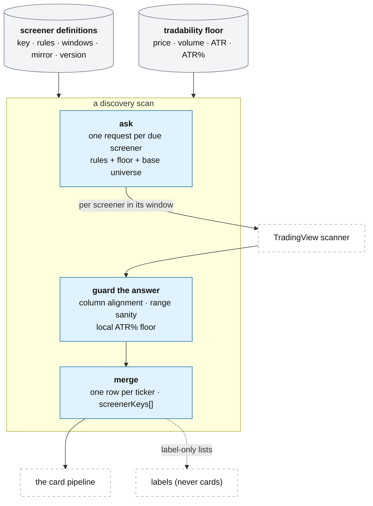

# A tool's screeners and discovery

**Above:** [TOOL.md](../TOOL.md) §3.1 (find: the screeners and the scan).

**Talks to:**
- the [data sources](../../08-data-sources/DATA-SOURCES.md): TradingView's scanner, one
  request per due screener;
- the [scheduler](../JOBS.md), which runs discovery in the tool's window;
- the [card](CARD.md), which every match becomes;
- the [scorecard](LEARNING.md), which judges each screener and its mirror.

---

## 1. What it is

**A tool's set of questions to TradingView's scanner, and how a scan turns their
answers into candidates.** A screener is one question ("stocks up 5 % on heavy
volume"); a tool is a set of them, run as one experiment. Each scan asks every
screener whose window is open, merges the answers into one row per ticker, and
hands them to the card pipeline.

**What it owns:** the tool's screener definitions and their versions, and the
tradability floor, all in the tool's own file.

**What it never does:** decide a card's fields (the card pipeline does), or let a
label-only list become a card.

---

## 2. The diagram

---

## 3. A screener

Each tool keeps its screeners in its own file; tools never share screeners.

| Field | Meaning |
|---|---|
| `key` | the stable id, made from the name once (`ma-stack-breakout`). It is **stamped on every card the screener matches** (`screenerKeys`), so it never changes, not even on rename |
| `name` | what is shown; renamed freely |
| `filters` | the rules, each `{ left, operation, right }` — exactly the shape TradingView's own screener sends |
| `sort`, `limit` | how the matches are ranked, and how many to take (default 50) |
| `runFrom`, `runTo` | the **run window** (New York time): the minutes it may scan; empty = every scan |
| `checkFrom`, `checkTo` | the **check window**: when it is worth opening the tool; empty = the run window |
| `mirrorOf` | the screener this one mirrors (§3.3) |
| `labelOnly` | a **list** screener: its matches never become cards (§3.4) |
| `enabled`, `pausedAt`, `pausedReason` | on/off, and when and why it was paused |
| `version` | **new in the design**: a definition that changes gets a new version, and every card records the version that matched it (§3.5) |

**A rule** is a TradingView column, one of 15 operators (is above / below / equal
/ between / crosses / above-or-below by %, has / has none), and a number, a pair,
or **another column** — so "price above the 20-day EMA" and "SMA 5 above EMA 9"
are expressible. A column may carry a timeframe after `|` (`EMA50|1` is the daily
EMA 50, `close|1W` the weekly close). TradingView silently **ignores a column it
does not know**, which widens a screener instead of failing it, so every offered
column is checked against TradingView.

## 4. Its parts

### 4.1 The tradability floor

One floor — a minimum price, average volume, ATR in dollars and ATR as a % of
price — is added to **every** screener of the tool **at scan time**, in the
request itself, because a screener asks for its top N and filtering afterwards
would spend those slots on stocks that were never eligible. TradingView cannot
compare two columns, so the ATR-% leg runs locally after the answer comes back.
Two named exceptions: a **list-only** screener takes no floor, and the
**neglected-names** screeners (a stock nobody is trading yet) keep only the price
floor. A screener may drop the two "could you get out" legs (volume and
dollar-ATR) while price and ATR % still apply.

### 4.2 The scan

Each discovery scan runs **every enabled screener whose run window contains the
current minute**, each as one request carrying the rules, the floor, the base
stock universe (common and preferred stock, depositary receipts, non-ETF funds;
never pre-IPO), the screener's sort, and a page of matches. The answers are
guarded and merged:

- **Column alignment:** if TradingView's columns come back misaligned, that
  screener returns nothing for the scan rather than shifting every field by one
  (D-S3).
- **Range sanity:** if the week range equals the month range on every one of
  many rows, it is logged — the columns are serving another window's values.
- **Merge:** one row per ticker across the tool's screeners, with `screenerKeys`
  listing every screener that matched it; a field empty in one screener's answer
  is filled from another's, never overwritten.

A failed screener is logged and the others go on. When no screener is due, the
scan ends cleanly with nothing — a normal state for much of the day.

### 4.3 Mirrors

A mirror is the same setup facing the other way, to test whether a screener's
direction is real ([LEARNING.md](LEARNING.md)). It is **not** made by flipping
every operator: a rule is either directional or a quality guard.

| Rule | Mirrors to |
|---|---|
| a directional field above a number (change, gap, pre-market change, performance) | the operator flips **and** the number changes sign: `change > 5` → `change < −5` |
| a range on a directional field | negated: `3…10` → `−10…−3` |
| RSI (a 0–100 oscillator) | reflected around 50: `RSI > 70` → `RSI < 30` |
| a comparison of two columns | the operator flips and each side swaps to its counterpart: `close > 1-month high` → `close < 1-month low` |
| a quality guard (price > $1, volume, cap, float) | **unchanged** |

The sort flips when it is on a directional field, and the mirror keeps the same
windows, because the pair must be measured over the same minutes.

### 4.4 List-only screeners

A list screener (a growth universe, say) decides membership of a list, not
whether a stock can be day-traded today. It takes no floor, and its matches go to
a separate `labels` pile — **never to cards or registers**.

### 4.5 Versioned definitions, checked on save

Two rules the old desk lacked:
- **Versions.** A screener's key never changes, but a change to its rules,
  windows or sort makes a **new version**, and every card records the version
  that matched it — so a frozen photo records the rules that produced it, and
  editing a rule never changes what a past card means (the rebuild rule). The
  old desk had no versions: editing a rule silently changed what a key meant for
  every past card.
- **Checked on save.** A definition is refused on save, with every reason, if it
  has no name or rules, an unknown column or operator, a "between" without two
  values, or a run window with one end or out of order — because a malformed rule
  sent to TradingView returns an empty list that looks exactly like "nothing
  matched today". **In the design the check also refuses a tool whose photo
  minute falls in no screener's window** (the D-S9 case), which the old check
  missed. And **no startup repair silently rewrites a definition** (D-S10): the
  old desk re-applied "repairs" guarded by "the field is empty", which put back a
  window a user had cleared.

### 4.6 What each tool hunts

The specific set each tool runs — the gap-and-go, the breakout, the neglected
names (T6), the benchmark (the plain in-play list) — and why each was chosen, is
the research method in
[legacy/screeners/METHODOLOGY.md](../../../legacy/screeners/METHODOLOGY.md). A
new tool starts with **no** screeners and is built on its own Screeners page; an
empty tool is visibly empty, never seeded with a copy of another tool's set.

### 4.7 The scanner provider (solo vs hosted)

Everything above describes the scan against **TradingView's scanner**, which is
free but **personal-use only** ([DATA-SOURCES.md §3.7](../../08-data-sources/DATA-SOURCES.md)).
This is the one place a tool's discovery reaches an outside source, so it is where
the swappable-provider boundary sits:

- **Solo mode** asks TradingView, as described.
- **Hosted mode** asks the **licensed scanner provider** chosen in the
  [admin dashboard](../../14-admin/ADMIN.md). A screener's rules, floor, windows,
  mirror and versions **do not change** when the provider is switched; a provider
  adapter translates the rule shape (today TradingView columns and its 15
  operators) to the active provider's fields, and the commercial-licensing guard
  refuses a provider flagged personal-use for a commercial deployment.

In the commercial front end this builder is **Radar's Settings / custom screener**
([PAGES.md §4.1](PAGES.md)); a user's screeners are their own, and the built-in
presets (T1/T2/T7) are shared read-only ([DESK.md §1](../DESK.md),
[ACCOUNTS.md](../../13-accounts/ACCOUNTS.md)).

**Where a custom screener is kept.** In **solo mode** the Settings builder keeps a
user's custom screeners on the **device** (the browser), exactly as the prototype
shows ("Saved on this device") — there is no server-side scanner consuming them
yet, so the builder is configuration only. In **hosted mode** they are persisted
**per-account server-side** and run on the licensed provider; moving from solo to
hosted carries the same definition shape (name, conditions, running windows,
timezone) up to the account.

---

## 5. Contracts

| It owns (the tool's own file) | Holds |
|---|---|
| `screeners` | one row per screener: key, name, filters, sort, limit, windows, mirror, labelOnly, enabled, pause, **version** |
| `screener_versions` (**new**) | each change a version, so a card can name the version that matched it |
| the tradability floor | the tool's settings (price, volume, ATR, ATR %) |

| It reads | From |
|---|---|
| candidates | TradingView's scanner, one request per due screener ([DATA-SOURCES.md](../../08-data-sources/DATA-SOURCES.md)) |

| Routes (the tool's Screeners tab, [PAGES.md](PAGES.md)) | Do |
|---|---|
| list, create/edit (checked on save), rename, mirror (and preview), pause/resume, delete | the builder; a rename keeps the key; a pause keeps every card the screener matched |
| test a definition without saving | how selective a rule is: the total matched, not only the capped page |
| history, the rules in words | per-screener day counts; a plain-words summary generated from the live rules, so a tool's description can never drift from what it runs |

---

## 6. When it fails

| Event | What happens |
|---|---|
| TradingView returns misaligned columns | that screener returns nothing this scan; no card gets shifted values |
| a screener matches nothing | it is a clean empty result, not an error — the test route and the floor show whether the rule is too tight |
| a definition is malformed | refused on save, with every reason; never sent to TradingView to come back empty |
| a screener is paused | it finds nothing new; its past cards keep its key and stay in every register and backtest |
| the tool's photo minute falls in no screener's window | refused on save (D-S9), so the photo is never taken on an empty list |

---

## 7. Built on

**The old desk:** the builder in
[legacy/screeners/SCREENER-BUILDER.md](../../../legacy/screeners/SCREENER-BUILDER.md),
the floor and the tool settings in
[legacy/screeners/SETTINGS.md](../../../legacy/screeners/SETTINGS.md), the scan's
first stage in
[legacy/screeners/DATA-PIPELINE.md](../../../legacy/screeners/DATA-PIPELINE.md).

**What failed there:**

| ID | Fault | Prevented by |
|---|---|---|
| D-S9 | a tool's photo minute could fall outside every screener's window (the T6 case) | the save check refuses it |
| D-S10 | startup repairs guarded by "the field is empty" put back a window or rule a user had cleared | no startup repair rewrites a definition |
| D-S3 | misaligned columns would shift every field | the screener returns nothing for that scan |
| — | definitions were not versioned, so editing a rule changed what a key meant for every past card | versioned definitions; a card records its version |

---

## 8. Status

| Part | Status |
|---|---|
| the builder, the floor, mirrors, the scan, the save check, the plain-words summary | **built** (legacy) |
| versioned definitions, and the save check that the photo minute falls in a window | **to build** |
| no startup repair rewrites a cleared definition | **to build** (D-S10) |
| hosted mode: the swappable licensed scanner provider (adapter + commercial-licensing guard), per-account screeners, shared read-only presets | **designed** (§4.7, [DATA-SOURCES.md §3.7](../../08-data-sources/DATA-SOURCES.md), [ADMIN.md](../../14-admin/ADMIN.md)); **to build** in the hosted build |
