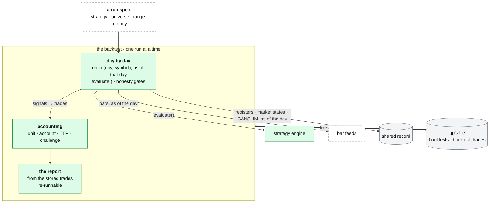

# qp: the backtest

**Above:** [QP.md](QP.md) §3 (the backtest).

**Talks to:**
- the [strategy engine](STRATEGIES.md), whose `evaluate()` it calls day by day;
- the [bar feeds](FEEDS.md), for bars as of a day;
- the [shared record](../09-shared-record/SHARED-RECORD.md), for registers, market
  states and CANSLIM facts as of a day;
- the [research worker](../06-research-worker/RESEARCH-WORKER.md), the only writer
  of those facts;
- qp's own [files](../04-files/FILES.md), where runs and trades live.

---

## 1. What it is

**A strategy, replayed over many days on the stocks the tools actually found,
on the days they found them, honestly.** For every trading day in the range and
every symbol in that day's universe, it calls **the same `strategy.evaluate()`
the chart preview uses** ([STRATEGIES.md](STRATEGIES.md)), as of that day. There
is no separate backtest evaluator, so the preview and the backtest cannot
disagree.

**What it owns:** the run, its trades, and the report. Every run stores a frozen
copy of the strategies it ran, so editing a strategy later never changes what an
old result means.

**What it never does:** compute an indicator or a fact, or look ahead.

---

## 2. The diagram

**One run at a time** (the box is small). A second start while one runs is
refused with the running one's number. A run can be stopped (at its next
symbol); closing the page does not stop it; if qp restarts, the run is marked
interrupted. It works one (day, symbol) pair at a time, reporting the share of
pairs done.

---

## 3. Its parts

### 3.1 The universe

| `universe.kind` | Each day evaluates |
|---|---|
| `symbols` | the same fixed list every day |
| `register` | one register (R1 or Shortlist) **as that tool froze it that day** |
| `tools` | the registers of every tool assigned to the strategy, unioned; with two books (a long and a short strategy), their tools are unioned too |

`extra_symbols` adds names to a register universe; their trades are marked
`_extra`, so "not on the register" stays visible.

### 3.2 Honesty rules (all on by default)

| Rule | What it prevents |
|---|---|
| **As of the day.** Each (day, symbol) is evaluated with `asof` = that day; only trades **entered that day** count. Warm-up days are context, never trades | look-ahead; double-counting warm-up signals |
| **The watchlist gate** (`scan_gate`): a trade taken **before the tool had found the stock** is dropped (`scan_gate: false` shows the old numbers on purpose; no effect on a `symbols` universe) | trades no alert could have fired |
| **The desk fill** (`fill: desk`): next bar's open, levels from the decision close | the optimistic `close` fill |
| **Costs:** `cost_bps` per side (a round trip pays twice), and per-share fees with a per-order minimum | "a backtest without costs lies" |
| **Open at the end:** a position still open when its window ends is recorded as `open` with its unrealised return, never mixed into the win rate | flattering win rates |
| **Coverage, stated:** pairs evaluated, pairs whose feed returned no bars, pairs per tool, how many each filter removed | a thin feed or one dominant tool passing for a strategy that rarely fires |

### 3.3 The settings of a run

**What to test:** `strategy_id` / `strategy` / `strategies` (one, or two books);
`universe` (default register R1); `start`, `end`; `tf` (default 5m); `feed`;
`view` (all / regular); `fill` (default **desk**); `days` warm-up (default 3);
`rules` (session rules).

**Filters and caps (opt-in):**

| Spec | Does |
|---|---|
| `min_rvol` | the In-Play filter: evaluate a pair only if its relative volume, measured by qp at the strategy's window start, is above this; below and unverifiable are counted apart |
| `canslim` | a gate on the CANSLIM letters **as known on that day**, read from the shared record; a rule naming a letter that cannot be rebuilt for a past day is refused before the run; blocked and unverifiable pairs are counted. **In the design it has a control on the page** (Q-N4) |
| `check_shortable` | drops shorts the broker would not lend. Alpaca keeps no borrow history, so today's flag is applied to a past day and the report says so; a name it cannot answer for is kept and named ([FEEDS.md](FEEDS.md)) |
| `rank_per_day` + metric | keep the best N signals a day. Metrics: `vwap_extension`, `tight_stop`, `reg_score`, `rvol`. **No default: an unnamed or unknown metric is an error**, because the wrong one silently reshapes the strategy |
| desk caps | one entry per stock per day, and a whole-run trades-per-day cap, applied in the order signals fired |

**Money: choose one accounting.**

| Block | Answers |
|---|---|
| **unit** | per-trade % returns |
| **account** | real money: shares from the stop so every stop-out loses the same %; equity compounds in trade order; trades with no usable stop are excluded and counted, never sized at 1 share; trades the buying power could not take are skipped and counted |
| **TTP** (prop firm) | dollar P&L for a fixed size; the min-profit rule (a winner under `min_profit_ps` $/share does not count towards the target; losses always count), tested on the position's average across its fills; every fill pays its own order fee |
| **challenge** (on an account run) | did the account reach `target_pct` **before** it ever touched `max_dd_pct`? Also walks a worst case in which every open position stops out at once |

### 3.4 What a run reports

The report is computed afterwards from the stored trades, so it re-runs on any
past backtest, and it says whether every number is in **dollars** (an account
run) or **unit %**.

| Section | Numbers |
|---|---|
| headline | trades, wins, losses, breakeven (exactly 0 is not a win), win rate, gross profit/loss, net profit, **profit factor** (none with no losing trade, never ∞), expectancy, average win/loss, payoff ratio, largest win/loss |
| R-multiples | total, average, best, worst, and the distribution in buckets; **R reads from net**, the same money as net profit; the gross total beside it |
| holding time | average, longest, shortest, winners vs losers, total time in positions |
| splits | by side, exit reason, symbol, day |
| equity and risk | the curve marked at exit, maximum drawdown in $ and %, its length, streaks |
| ratios | Sharpe, Sortino, Calmar from daily returns over every session in the range (flat days included), annualised and flagged as extrapolation on short samples |
| exposure | share of regular-hours minutes in a position |
| sample adequacy | each warning as a fact and its reason |
| the borrow check | states loudly when "check shortable" was ticked but nothing was answered |
| prop-firm detail | counted vs wasted profit under the min-profit rule |

On the page, each trade opens that symbol and day on the chart with the run's
own timeframe, feed, fill model and strategy; a filter narrows the trades and
the filtered CSV. `rank_sweep` re-runs the per-day selection with every metric
to measure which suits a strategy.

---

## 4. What changes from today

| Change | Why |
|---|---|
| Registers, market states and CANSLIM facts are read **as of a day from the shared record** | today they are read over HTTP from each tool's port, and a stopped tool needed the archive program |
| The **CANSLIM gate has a control** on the page | it is API-only today (Q-N4) |
| Past backtests are **re-run against the shared record and compared** before the switch | to prove the shared record returns the same universes and facts the HTTP path did (step D) |

---

## 5. Contracts

**The code:** `quant-platform/chart/backtest.py`, `report.py`, `rank_sweep.py`,
`store.py`.

| It owns (qp's file, `~/.qp/platform.db`) | Columns |
|---|---|
| `backtests` | id, name, spec (the run spec JSON, **including a frozen copy of the strategies it ran**), status, progress, summary, error, timestamps |
| `backtest_trades` | id, bt_id, date, symbol, side, entry_ts, exit_ts (empty = open at the day's end), entry, exit, ret, reason (SL, TP, trail, exit, eod, open), ctx (the frozen register card) |

| It reads | From |
|---|---|
| bars, as of a day | the bar feeds ([FEEDS.md](FEEDS.md)) |
| a register as that tool froze it that day | the shared record (built, off: `quantRegistersMode`) |
| market states and CANSLIM letters, as of a day | the shared record (research worker's facts) |

| Routes, behind `/quant/` | Do |
|---|---|
| `POST /api/backtest` | start; refused while another runs |
| `GET /api/backtest/{id}` (`trades`) | status, progress, summary, trades |
| `GET /api/backtests` (`brief`) | every run, newest first |
| `POST /api/backtest/{id}/stop`; `DELETE …` | stop at the next symbol; delete |
| `GET /api/backtest/{id}/report`, `…/stats.json`, `…/csv`, `…/journal.csv` | the HTML report; every number; every trade with its card; one row per trade |

---

## 6. When it fails

| Event | What happens |
|---|---|
| the shared record is down | a run that needs registers or facts says so and does not run; charts still work |
| a feed returns no bars for a pair | that pair is counted in coverage as empty; the run goes on |
| a CANSLIM letter cannot be rebuilt for a past day | the run is refused before it starts, naming the letter |
| the borrow check is asked for and Alpaca answers nothing | the trade stands as "unchecked" and the report says so loudly |
| qp restarts mid-run | the run is marked interrupted ("run it again") |

---

## 7. Built on

**The old desk:** [legacy/qp/BACKTEST.md](../../legacy/qp/BACKTEST.md).

**What failed there:**

| ID | Fault | Prevented by |
|---|---|---|
| F-26 | the CANSLIM gate read the entry day's own close | letters as known **before** the decision bar |
| F-27 | an unreadable market model blocked pairs, and the failure was cached | the market state read as of a day; no cached failure |
| F-28 | as-of earnings dropped a quarter once re-reported a year later | earnings keyed by the quarter, not the filing |
| F-20 | `monday_high/low` and pre-market `day_open` saw the future | fixed in the library (2026-10) |
| F-23 | Yahoo daily reach was capped at a year, so CANSLIM N/S failed on yahoo | the real reach used |
| F-25 | `rank_sweep --backtest` found no stop on stored trades | the stop stored on every trade |
| Q-N4 | the CANSLIM gate has no control on the page | a control on the page |
| — | registers read over HTTP from each tool's port; a stopped tool needed the archive | read from the shared record |

---

## 8. Status

| Part | Status |
|---|---|
| the engine, the universes, the honesty rules, the accounting, the report | **built** (legacy, kept) |
| registers from the shared record | **built, off** (`quantRegistersMode`); today qp reads each tool's port |
| market states and CANSLIM letters as of a day | **to build** (step D) |
| the CANSLIM control on the page | **to build** (Q-N4) |
| a re-run of past backtests against the shared record, compared | **to do**, before step D |
