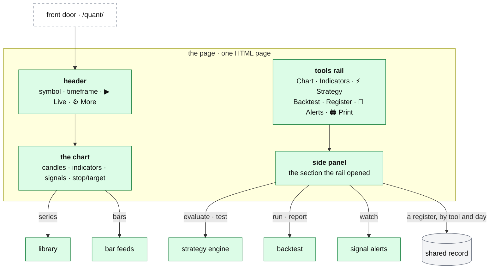

# qp: the page and the print sheets

**Above:** [QP.md](QP.md) §3 (the page).

**Talks to:**
- the [front door](../02-front-door/FRONT-DOOR.md), which brings it every request at
  `/quant/`;
- the [library](LIBRARY.md), the [strategy engine](STRATEGIES.md), the
  [backtest](BACKTEST.md) and [signal alerts](SIGNAL-ALERTS.md), which the page
  drives;
- the [bar feeds](FEEDS.md), for the chart;
- the [shared record](../09-shared-record/SHARED-RECORD.md), for the register browser.

---

## 1. What it is

**qp's one page.** Everything qp does, the trader reaches on one page at
`/quant/`: a chart, a rail of buttons, and the section each button opens. The
page holds no market math of its own — it draws what the library computes
([LIBRARY.md](LIBRARY.md)), marks what the engine evaluates
([STRATEGIES.md](STRATEGIES.md)), and reads what the backtest and the shared
record return.

Its working rule, kept from the old desk: **never trust a piece you have not
seen.** Plot the indicator, test the condition, then compose the strategy.

**What it owns:** the layout, the controls, and the settings the browser
remembers (the default feed is the one exception — it is saved on the box,
[FEEDS.md](FEEDS.md)).

**What it never does:** compute an indicator, decide a signal, or place an
order.

**Print sheets** belong to this document too: they render a register day, or
any list of stocks, as charts and spreadsheets for review.

---

## 2. The diagram

On a phone the side panel and the More sheet slide over the chart; the rail
can sit left of the chart or under the time axis (More → Tools).

---

## 3. Its parts

### 3.1 The header

| Control | Does |
|---|---|
| **Symbol** | any ticker |
| **TF** | 1m, 2m, 5m, 15m, 30m, 1h, 1d |
| **▶ Live** | re-computes on an interval over `/ws/live` and moves only the newest bar and indicator tips. Disabled while **As-of** is set (a past day is not live); moves only on feeds that are live ([FEEDS.md](FEEDS.md)) |
| **☰ Panel** | shows or hides the side panel |
| **⚙ More** | the chart settings sheet (§3.3) |

### 3.2 The tools rail

| Button | Opens |
|---|---|
| **Chart** | the settings sheet: type, scale, days, session, feed, as-of |
| **Indicators** | add an indicator, list and edit the ones drawn |
| **⚡ Strategy** | the strategy drawer ([STRATEGIES.md](STRATEGIES.md)) |
| **Backtest** | the backtest section ([BACKTEST.md](BACKTEST.md)) |
| **Register** | what the tools found, by tool and day (§3.6) |
| **🔔 Alerts** | the live signal watcher ([SIGNAL-ALERTS.md](SIGNAL-ALERTS.md)) |
| **🖨 Print** | print a register day as charts (§3.7) |

### 3.3 Chart settings (⚙ More / Chart)

| Setting | Options |
|---|---|
| **Type** | Candles, Bars, Line, Area, Heikin Ashi |
| **Scale** | Linear, Log, % |
| **Labels** | Clean (price only), or every indicator tagged on the scale |
| **Tools** | rail left of the chart, or under the time axis |
| **Days** | 1–730 days of bars; warm-up for the indicators is added automatically |
| **Session** | All-day (extended hours) or Regular |
| **Feed** | yahoo, yahoo_ext, alpaca, polygon, hybrid, hybrid_yahoo ([FEEDS.md](FEEDS.md)); **make default** sets the feed every chart and backtest starts with |
| **As-of** | the replay cutoff: every bar after this date is hidden, so a setup is judged as it stood then. Blank = everything through today |
| **⤢ Fit all bars** | fit the whole range |
| **Bar cache** | how much disk it uses; delete all, or delete bars over two days old |

### 3.4 The chart

- Candles with the chosen indicators: price overlays on the candles,
  oscillators (RSI, RVOL, ATR, slope) in their own pane, volume as a histogram
  underneath.
- Levels and support/resistance drawn as steps; session background bands; a New
  York time axis.
- A crosshair legend with OHLC and every indicator's value at that bar.
- After **Evaluate**: entry ▲ and exit ▼ markers, coloured by exit reason
  (stop, target, trail, rule, end of day), and the stop and target as the
  simulation used them ([STRATEGIES.md](STRATEGIES.md)).

### 3.5 Indicators

Pick a primitive from the verified library ([LIBRARY.md](LIBRARY.md)), its
length and source (close, open, high, low, hl2, hlc3, ohlc4, volume), **+ Add
to chart**. **On the chart** lists what is drawn; **Selected** edits one
indicator's parameters. Every primitive is offered, marked ✅ approved or 🚧
draft (all are approved today).

### 3.6 The register browser

What the tools froze, browsable by day. In the design this reads the
**[shared record](../09-shared-record/SHARED-RECORD.md) as of a day**, not each
tool's port over HTTP as it does today (QP.md §4):

- **Source and register:** one tool's R1 or shortlist, or all tools merged; the
  list names any tool whose history is missing and why, rather than coming back
  empty (fixed, L2-1).
- **Date,** then a card per stock: score, regime, sector, gap %, RVOL.
- Tap a card: the chart loads that ticker on that day's session.

### 3.7 Print sheets

For reviewing what the tools found the way a trader reviews charts: one chart
per stock, printable, with the numbers behind it. Each sheet is a
self-contained HTML page, so the browser's own print works, and each takes a
register (a tool's R1 or shortlist, or all tools merged).

| Sheet | Gives |
|---|---|
| **day-trade sheet** (`/api/r1/print`) | for every register day in a range, one chart per ticker over full extended hours (04:00–20:00 ET), from `days_before` trading days before (default 1) to `days_after` after; your timeframe (default 1m), feed and indicators; `cols` per row. Stops at **150 charts** and says so |
| **swing sheet** (`/api/r1/swing`) | one daily chart per ticker, a year (252 sessions) before the day the tool found it, that day marked, and every session since |
| **the numbers** (`/api/r1/csv`, `/api/r1/swing.csv`) | one row per bar: register day, symbol, time, session (pre/rth/post), OHLCV and one column per indicator, named as the legend names it; warm-up left empty, never zero. The swing CSV adds `phase` and `pct_from_found` |
| **the cards** (`/api/r1/cards.csv`) | every column the tool froze for each ticker that morning (score, RVOL, gap, ATR, regime, sector bias, catalyst): why it was on the list; no bar data needed |
| **a pasted list** (`/api/pairs/*`) | the same sheet and numbers for an explicit list of `symbol, date` pairs (a journal or review list), optionally with trades drawn; `/api/pairs/parse` shows how a pasted list will be read before anything is fetched |

The 150-chart ceiling and the bar cache's limits are why a few afternoons of
printing no longer fill the disk ([FEEDS.md](FEEDS.md)).

---

## 4. What changes from today

| Change | Why |
|---|---|
| The register browser and print sheets read the **shared record as of a day**, not each tool's port over HTTP | a stopped tool needed the archive program; the shared record serves every tool's history, running or stopped ([BACKTEST.md](BACKTEST.md)) |
| The **CANSLIM gate has a control** in the backtest section | it is API-only today (Q-N4, [BACKTEST.md](BACKTEST.md)) |
| The strategy Stage help no longer says Ready means "trusted to place real orders from" | the desk places no orders (Q-N3) |

---

## 5. Contracts

**Served by** `quant-platform/chart/static/index.html` and the routes in
`chart/server.py`, behind the front door at `/quant/`.

| Route | Does |
|---|---|
| `GET /` | the page (never cached) |
| `GET /api/chart` | candles and every indicator series ([FEEDS.md](FEEDS.md)) |
| `WS /ws/live` | the newest bar and indicator tips, on an interval |
| `GET /api/primitives` | every primitive, its parameters and approval ([LIBRARY.md](LIBRARY.md)) |
| `GET /api/screener/sources`, `…/dates`, `…/register` | the register browser: which tools answer, their days, and a day's cards (reads the shared record) |
| `GET /api/r1/print`, `…/swing`, `…/csv`, `…/swing.csv`, `…/cards.csv` | the print sheets and their numbers |
| `POST /api/pairs/parse`; `GET /api/pairs/print`, `…/csv` | a pasted list of `symbol, date` pairs |
| `POST /api/settings/default-feed` | the default feed ([FEEDS.md](FEEDS.md)) |

The strategy, backtest and alert routes are listed in their own documents.

---

## 6. When it fails

| Event | What happens |
|---|---|
| a feed returns nothing | the chart says which feed and for which symbol; warm-up is left empty, never shown as zero |
| the shared record is down | the register browser and the print sheets say so and show no day; the chart still works ([FEEDS.md](FEEDS.md) bars are separate) |
| a tool's history is missing | the picker names the tool that did not answer, rather than coming back empty (L2-1) |
| a print run would exceed 150 charts | it stops at 150 and says so |

---

## 7. Built on

**The old desk:** [legacy/qp/PAGE.md](../../legacy/qp/PAGE.md) (every control on
the page) and the print sheets in
[legacy/qp/ALERTS-AND-PRINTS.md](../../legacy/qp/ALERTS-AND-PRINTS.md).

**What failed there:**

| ID | Fault | Prevented by |
|---|---|---|
| L2-1 | with a tool down, the date list came back empty without saying why | the picker names the source that did not answer |
| Q-N3 | the Stage help says Ready means "trusted to place real orders from" | the text is corrected; the desk places no orders |
| — | registers read over HTTP from each tool's port; a stopped tool needed the archive | read from the shared record, as of a day |
| — | a few afternoons of printing filled the disk and stopped the box | the 150-chart ceiling and the bar cache's limits ([FEEDS.md](FEEDS.md)) |

---

## 8. Status

| Part | Status |
|---|---|
| the page, the chart, indicators, the strategy drawer, print sheets | **built** (legacy, kept) |
| the register browser reading the shared record | **built, off** (`quantRegistersMode`); today it reads each tool's port ([BACKTEST.md](BACKTEST.md)) |
| the CANSLIM control in the backtest section | **to build** (Q-N4) |
| the Stage help text corrected | **to build** (Q-N3) |
