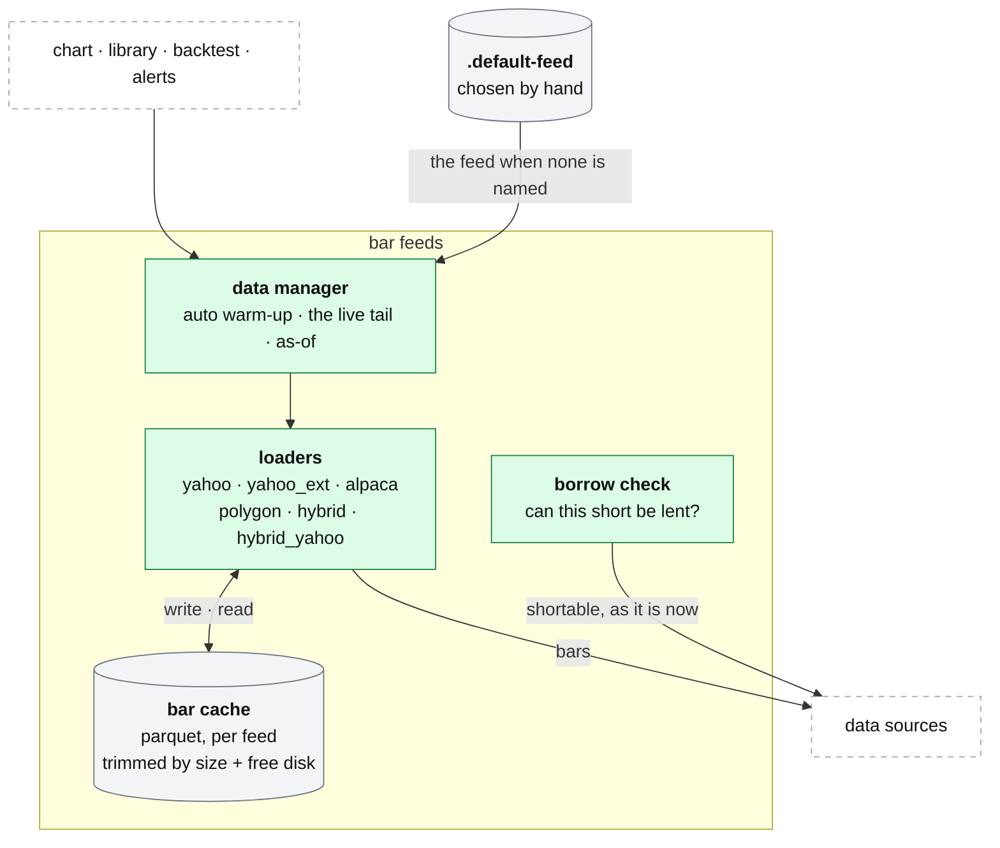

# qp: bar feeds, the cache and the borrow check

**Above:** [QP.md](QP.md) §3 (bar feeds and cache).

**Talks to:**
- the [data sources](../08-data-sources/DATA-SOURCES.md): Alpaca, Polygon, Yahoo;
- the [library](LIBRARY.md), the [chart](CHART.md), the
  [backtest](BACKTEST.md) and [signal alerts](SIGNAL-ALERTS.md), which all fetch
  bars through here;
- the [box](../01-box/BOX.md): the cache lives on its disk, and the keys in its
  secret files.

---

## 1. What it is

**One place for price bars, warmed up, cached within limits, with a check of
whether a short can be borrowed.** The chart, the compare tool, strategies,
backtests and alerts all fetch through the same loaders, each returning the same
shape: a time-zone-aware (UTC) frame of open, high, low, close and volume.

**What it owns:** the feed loaders, the bar cache on the box's disk, and the
borrow check.

**What it never does:** decide which feed is best on its own (the default is set
by hand), or treat a present key as a working feed.

---

## 2. The diagram

---

## 3. Its parts

### 3.1 The feeds

| Feed | Source | Strength | Weakness |
|---|---|---|---|
| `yahoo` | Yahoo Finance | free, current, years of daily history | shallow 1-minute history |
| `yahoo_ext` | Yahoo with its own pre-market and after-hours | one source, more hours: for strategies that read pre-market levels | — |
| `polygon` | Polygon.io | deep history, full extended hours, consolidated tape | the free plan is end of day: today's bars missing |
| `alpaca` | Alpaca IEX | live | IEX only: thin volume, about a week of intraday history, regular hours |
| `hybrid` | Polygon history + Alpaca for today | deep history and today | **volume seam**: Alpaca IEX volume is a fraction of Polygon's, which distorts every VWAP on the Alpaca part |
| `hybrid_yahoo` | Polygon history + Yahoo for today | deep history and today, both consolidated | — |

**The default feed is set by hand** (More → Feed → *make default*), saved on the
box in `quant-platform/.default-feed`, and used by every chart and backtest that
does not name one. It used to be inferred (Polygon whenever a key existed), and a
present key turned out not to mean the plan behind it covered the data: every
1-minute request was refused while the platform called Polygon its best feed.
Without a saved choice the default is `yahoo`. **In the design no route carries
its own default** — today `/api/chart`, `/api/strategy/explain` and the print
sheets name `polygon` when none is passed, though the page always passes one
(Q-N6).

### 3.2 Warm-up, the live tail, as-of

- **Auto warm-up:** the fetch window is extended so every indicator on the chart
  or in a strategy has enough history before the first bar shown — no manual
  juggling of days.
- **Live tail:** with **▶ Live**, the server re-computes on an interval and
  pushes only the newest bar and each indicator's newest value over `/ws/live`.
- **As of a day:** `asof` hides every bar after that date, for replay and for the
  backtest.

### 3.3 Which feeds actually answer

| Check | Asks | Use |
|---|---|---|
| `GET /api/health` | which feeds have credentials | an inventory only: a present key is not a working one |
| `GET /api/feedcheck` | one small real fetch per feed, judged by the data check's rules | the deploy prints this; it replaced a line that said "alpaca ok" every day while the key was refused with a 401. It never raises and never answers 4xx (its caller is a deploy script, where an exception would read as "the feed is down") |
| `GET /api/datacheck` | every loader, both indexes, cross-source agreement, the RS universe, the files qp builds, EDGAR | the full, slow answer ([DATA-SOURCES.md](../08-data-sources/DATA-SOURCES.md)) |

### 3.4 The bar cache

Bars are cached as parquet files on the box's disk, per feed (Polygon files
prefixed so feeds never mix). It has limits because nothing used to delete a
cached file: a print sheet is up to 150 charts, each a multi-day 1-minute frame;
a few afternoons of printing was gigabytes, and the day the disk filled, every
program on the box stopped.

| Trigger | Action |
|---|---|
| the cache is over its ceiling (`QP_CACHE_MAX_MB`, default **512 MB**) | trim the oldest files down to 70 % of the ceiling |
| the **disk** has less than `QP_CACHE_MIN_FREE_MB` free (default **1024 MB**) | trim hard, whatever the cache's size — the target is computed from what is there |

It trims where it grows: every loader calls the sweeper after writing. On the
page (More → Bar cache) and through `GET /api/cache`, `POST /api/cache/clear`
(`older_than_days` deletes only older files) and `POST /api/cache/sweep`. Every
cached file can be fetched again, so clearing is safe.

### 3.5 The borrow check

**Will the broker let this account short the name?** Most of what the tools find
is a small cap with no borrow, so for a short book this is the common case: one
backtest made +$1,345 across twelve trades, +$1,409 of it from a single short
the broker would not have lent — without it the run lost $63.

- Alpaca reports `shortable` **as it is now**; there is no history. A backtest
  applies today's flag to a past day and labels it as such.
- **An unanswerable check is not a refusal:** if Alpaca cannot be reached, the
  answer is "unchecked" and the trade stands, because dropping trades over a
  timeout would turn a network blip into a strategy result.
- The backtest report says loudly when the check was asked for and nothing was
  answered ([BACKTEST.md](BACKTEST.md)).

---

## 4. Contracts

**The code:** `quant-platform/chart/data_manager.py`, `tools/data/*.py` (the
loaders, the cache, the borrow check), and the feed routes in `chart/server.py`.

| It owns | Form |
|---|---|
| the bar cache | parquet under `~/.qp-cache/` (`QP_CACHE_DIR`), per feed; trimmed by size and free disk |
| the default feed | `quant-platform/.default-feed` (absent = `yahoo`) |

| It reads | From |
|---|---|
| bars | Alpaca, Polygon, Yahoo ([DATA-SOURCES.md](../08-data-sources/DATA-SOURCES.md)) |
| `shortable` | Alpaca, as it is now |
| the keys | the box's secret files — the deploy copies the desk's Alpaca pair into `quant-platform/.env`; `POLYGON_API_KEY` is optional ([BOX.md](../01-box/BOX.md)) |

| Route, behind `/quant/` | Does |
|---|---|
| `POST /api/settings/default-feed` | set the default feed |
| `GET /api/health`, `…/feedcheck`, `…/datacheck` | credentials; a real fetch per feed; the full data check |
| `GET /api/cache`; `POST /api/cache/clear`, `…/sweep` | cache size and free disk; delete; trim now |

---

## 5. When it fails

| Event | What happens |
|---|---|
| a feed returns nothing | the chart and backtest say which feed and for which symbols; the backtest's coverage line counts the empty feeds |
| a key is present but the plan does not cover the data | `feedcheck` shows it failing (not "ok"); the default feed is a hand choice, never inferred from a present key |
| the disk is nearly full | the sweeper trims hard on the next write; the page and API can clear the cache |
| Alpaca cannot answer the borrow check | the answer is "unchecked", the trade stands, and the report says so |

---

## 6. Built on

**The old desk:** [legacy/qp/DATA-FEEDS.md](../../legacy/qp/DATA-FEEDS.md), and
the full data check in [legacy/screeners/DATACHECK.md](../../legacy/screeners/DATACHECK.md).

**What failed there:**

| ID | Fault | Prevented by |
|---|---|---|
| Q-N6 | several routes default to `polygon` when no feed is passed, not the desk's default | no per-route defaults |
| — | a present key was read as a working feed ("alpaca ok" while refused 401) | `feedcheck`: a real fetch, judged by the data check's rules |
| — | nothing deleted a cached file; the day the disk filled, the box stopped | the cache ceiling and the free-disk floor, swept on every write |
| — | dropping shorts on a borrow timeout turned a network blip into a result | "unchecked" stands; the report says so |

---

## 7. Status

| Part | Status |
|---|---|
| the feeds, warm-up, the live tail, as-of, the cache and its limits, the borrow check | **built** (legacy, kept) |
| no per-route feed defaults | **to build** (Q-N6) |
| shared bars per alert cycle | moves with the alert switch (step C; [SIGNAL-ALERTS.md](SIGNAL-ALERTS.md)) |
