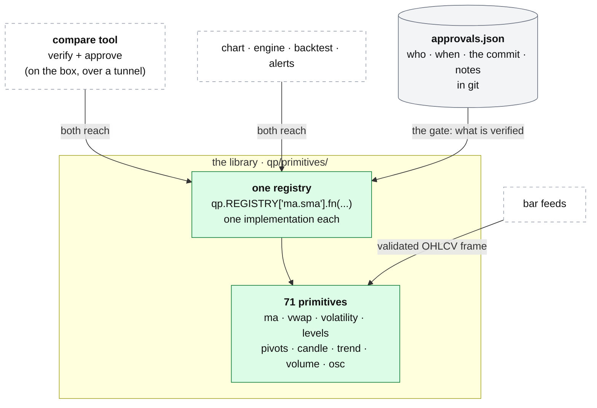

# qp: the verified library

**Above:** [QP.md](QP.md) §3 (the library).

**Talks to:**
- the [chart](CHART.md), the [strategy engine](STRATEGIES.md), the
  [backtest](BACKTEST.md) and [signal alerts](SIGNAL-ALERTS.md), which all reach
  the same functions through one registry;
- the [bar feeds](FEEDS.md), which give it the OHLCV frames it computes on.

---

## 1. What it is

**The only market math anywhere in qp.** Every indicator qp can draw or a
strategy can name is one function in `qp/primitives/`, registered into one
registry. The chart, the engine, the backtest and the alerts all reach the same
function, so **what was verified against TradingView is what the chart draws and
the backtest trades.**

A primitive is trusted **only once a person has compared it with TradingView and
approved it.** The approval is recorded in git.

**What it owns:** the 71 primitives, the registry, and the approvals.

**What it never does:** read a register, decide a signal, or fetch bars itself
(the feeds hand it a frame).

This is the one piece of the old desk built the way the whole desk should be,
and it carries over almost unchanged.

---

## 2. The diagram



---

## 3. What is in it: 71 primitives, all approved

| Group | Count | Primitives |
|---|---|---|
| `ma` | 7 | sma, ema, wma, rma, vwma, hma, pine_5day (Pine's 5-day MA on 1-minute data) |
| `vwap` | 16 | session, nday_block, nday_rolling, weekly, monthly, anchored, today_hh/ll, week_hh/ll, swing_hh/ll, last_hour_hh/ll, gap, stdev_bands |
| `volatility` | 6 | true_range, atr, atr_daily, stdev, bb, bb_ema |
| `osc` | 1 | rsi |
| `extremes` | 2 | highest, lowest |
| `levels` | 29 | day_open, prev_day_open/high/low/close, today_high/low, today_vol_max, pm_high/low, postmarket_high/low, postpre_high/low, weekly_open/high/low, prev_week_open, monthly_open/high/low, prev_month_open, monday_high/low, yearly_open, prev_year_open, window_high/low, dynamic_sr |
| `structure` | 2 | pivot_high, pivot_low |
| `pivots` | 1 | floor (P, R1–R3, S1–S3) |
| `candle` | 4 | body, upper_wick, lower_wick, bar_range |
| `trend` | 1 | slope |
| `volume` | 2 | avg_volume, rel_volume (RVOL) |

Derived quantities (body as % of range, move in ATR, distance to R1) are **not**
primitives: they are composed in a strategy with an `expr` operand
([STRATEGIES.md](STRATEGIES.md)). The full list, with every input, output and
parameter, is generated into [legacy/qp/CATALOG.md](../../legacy/qp/CATALOG.md)
and never edited by hand.

---

## 4. Its parts

### 4.1 How a primitive is defined

```python
from qp.registry import primitive, Param

@primitive(
    name='sma',                    # short name, unique across the WHOLE library
    group='ma',                    # key becomes 'ma.sma'
    description='Simple moving average of `source` over `length` bars.',
    params=(Param('length', 'int', default=9, min=1),),
    inputs=('source',),            # or ('bars',)
)
def sma(source, length): ...
```

| Part | Meaning |
|---|---|
| `inputs=('source',)` | takes one array: close, open, high, low, hl2, hlc3, ohlc4, volume, body_high, body_low |
| `inputs=('bars',)` | takes a validated OHLCV frame (time-zone aware, increasing, no duplicates) |
| `outputs` | one array aligned to the bars, or several named lines returned as a dict (`floor` → P, R1–R3, S1–S3; `bb` → upper/middle/lower) |
| `Param` | name, kind (int, float, str, bool), default, min, max, description |
| `compute_tf` | the primitive needs bars of this timeframe whatever the chart shows (`pine_5day` on 1-minute bars); the caller maps the result back |

**NaN marks warm-up and undefined bars** (outside the session, before an anchor,
a level not yet known) — never zero. Any missing operand makes a strategy rule
false. The decorator refuses a duplicate key **and** a duplicate short name,
because strategies name primitives by short name and a collision would silently
swap one for another.

### 4.2 Verification against TradingView

1. Run the compare tool on the box, on its own port, through an SSH tunnel
   (it binds `127.0.0.1`).
2. Pick a primitive, set symbol, timeframe, days, source and parameters,
   **Compute**.
3. Compare the qp chart with the TradingView widget beside it: the shape, and
   the values on two or three bars.
4. Match → **Approve as verified**, which writes `approvals/approvals.json`:
   who, when, the git commit of the code approved, and notes. Mismatch → do not
   approve; record the primitive, the settings and what differs.
5. Commit `approvals.json`. Re-approving after a fix overwrites the record so it
   points at the fixed code.

Verify VWAPs on Polygon on a completed day: an Alpaca IEX seam distorts volume
([FEEDS.md](FEEDS.md)).

### 4.3 Adding one

Write it in a group file under `qp/primitives/` (a new file is discovered
automatically); restart the compare tool, where it appears as 🚧; verify,
approve, then regenerate the catalogue (`tools/gen_catalog.py`) and commit.

### 4.4 Deliberate differences from the source Pine

Everything else matches bar for bar.

1. **VWAPs default to regular hours**, as a standard TradingView equities chart
   does; a flag accumulates extended hours.
2. **Two N-session VWAPs:** `nday_block` is Pine's block-reset study;
   `nday_rolling` is a trailing VWAP anchored N−1 sessions back.
3. **`last_hour_*` stops at 16:00 ET**: the raw Pine leaks into after-hours.
4. **`pivots.floor` defaults to regular-hours sessions**; `'eth'` gives the
   full-day behaviour.
5. **Before a VWAP's first anchor qp shows nothing**, where Pine shows a line
   that depends on how many bars happen to be loaded.
6. **Weekly, monthly and yearly levels are regular-hours only**; `weekly_open`
   is Monday 09:30, not the 04:00 pre-market print.
7. **Daily charts:** each daily bar is the regular-hours aggregate, so levels,
   pivots and session VWAPs work on 1-day frames.

---

## 5. Contracts

**The code:** `quant-platform/qp/`, copied into git under
[legacy/qp/library/](../../legacy/qp/library/README.md) so a rebuild can start
from verified math.

| It owns | Form |
|---|---|
| the registry | `qp/registry.py`, `qp/primitives/*` |
| the approvals | `quant-platform/approvals/approvals.json`, in git |
| the catalogue | `legacy/qp/CATALOG.md`, generated by `tools/gen_catalog.py`, never hand-written |

| Reached by | How |
|---|---|
| the chart, engine, backtest, alerts | `qp.REGISTRY['<group>.<name>'].fn(...)`; `qp.approved_primitives()` for the verified slice only |
| the compare tool | `GET /api/primitives`, `GET /api/data`, `POST /api/approve` (on its own port, `127.0.0.1`) |

---

## 6. When it fails

| Event | What happens |
|---|---|
| a primitive's inputs are short (warm-up) | it returns NaN for those bars; a strategy rule reading them is false, never zero |
| a primitive is not approved | it shows as 🚧 draft; a strategy may still name it, but the whole point is that approved is the slice to trust |
| a new primitive collides on key or short name | the decorator refuses it at import, so no silent swap |
| a value disagrees with TradingView | it is not approved; the mismatch is recorded with its settings |

---

## 7. Built on

**The old desk:** [legacy/qp/LIBRARY.md](../../legacy/qp/LIBRARY.md), the
generated [legacy/qp/CATALOG.md](../../legacy/qp/CATALOG.md), and the library's
code in [legacy/qp/library/](../../legacy/qp/library/README.md).

**Why it is the part to keep:** one implementation, one registry, a human
verification step with a recorded approval, a generated catalogue that cannot
drift, and stated deviations. It is the model for "one definition" across the
whole desk ([ARCHITECTURE §7](../../ARCHITECTURE.md#7-rules-that-apply-everywhere)).

---

## 8. Status

| Part | Status |
|---|---|
| the 71 primitives, the registry, the approvals, the compare tool, the generated catalogue | **built** (legacy, kept unchanged) |
