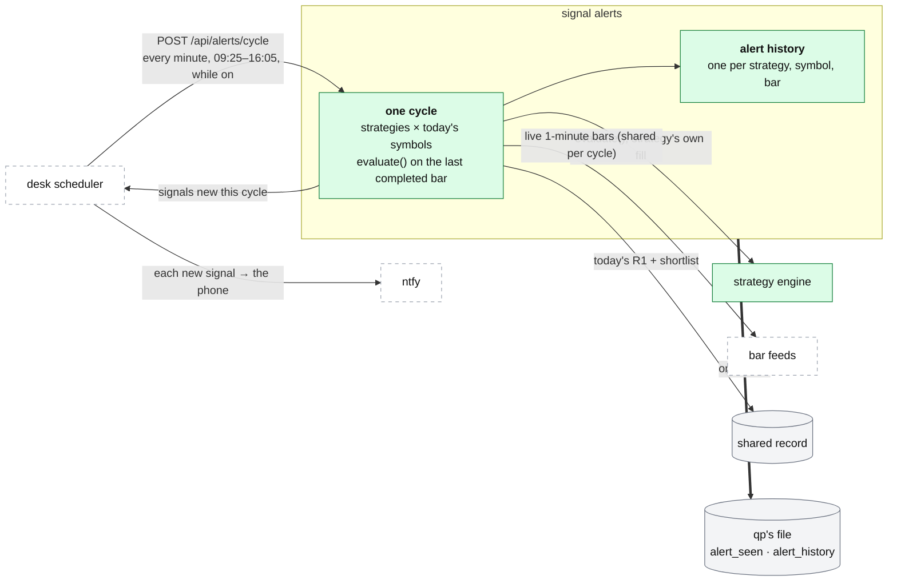

# qp: signal alerts

**Above:** [QP.md](QP.md) §3 (signal alerts).

**Talks to:**
- the [desk](../03-desk/DESK.md), whose scheduler starts each cycle and pushes
  the new signals to the phone ([JOBS.md](../03-desk/JOBS.md),
  [ALERTS.md](../11-alerts/ALERTS.md) §3.6);
- the [strategy engine](STRATEGIES.md), whose `evaluate()` decides a signal;
- the [bar feeds](FEEDS.md), for live 1-minute bars;
- the [shared record](../09-shared-record/SHARED-RECORD.md), for today's R1 and
  shortlist;
- qp's own [file](../04-files/FILES.md), where the alert history lives.

---

## 1. What it is

**Each saved strategy, watched on today's stocks, and an alert when it fires.**
Every strategy the trader has saved is evaluated on live 1-minute bars across
the union of today's R1 and shortlist, and an alert is raised when a strategy's
entry is true on the last completed bar. **It alerts only: nothing is ordered.**

In the design the watcher has **no clock of its own.** The desk's scheduler
starts **one cycle** each minute in the session; qp evaluates once, records what
it did, and returns the signals that are new in that cycle; the desk pushes each
new one to its ntfy topic ([ALERTS.md](../11-alerts/ALERTS.md)). So a cycle that
fails or does not run is a desk job that alerts, and signals reach the phone,
not only an open page.

**What it owns:** the alert history (what fired, when, and on which bar).

**What it never does:** keep a timer, hold a push key, or place an order.

---

## 2. The diagram

---

## 3. Its parts

### 3.1 One cycle

| Point | How |
|---|---|
| **Symbols** | the union of today's R1 and shortlist across the tools, read every cycle from the shared record, so a stock flagged at 11:00 is watched from the next cycle |
| **Strategies** | every saved strategy, read every cycle: a strategy saved next week is watched automatically. A strategy outside its own window (`window_start`–`window_end`, with 5 minutes of grace before it) is skipped |
| **Signal** | the strategy's entry group is true on the **last completed bar**, evaluated with the strategy's own fill model (default `desk`) — the same bar a backtest would trade (Q-N9) |
| **Feed** | the desk's default feed, read each cycle ([FEEDS.md](FEEDS.md)) |
| **Shared bars** | one fetch per symbol per cycle, shared by every strategy on that symbol (not one fetch per strategy-symbol pair) |
| **Isolation** | one bad symbol or strategy never stops a cycle; the error is kept in the cycle's record and the other work goes on |

### 3.2 No repeats, across restarts

One alert per strategy, symbol and signal bar. While a signal stays true,
repeats are held back for 10 minutes. **The seen-set is stored** (`alert_seen`),
so a restart never repeats an alert — today it is held in memory, and a restart
may alert once more.

### 3.3 The history

Every alert is kept (`alert_history`): the strategy, the symbol, the bar, the
time, and the cycle it fired in. So alerts can be reviewed, and a restart reads
back what already fired.

---

## 4. What changes from today

| Change | Why |
|---|---|
| **One cycle per minute, started by the desk's scheduler**, not qp's own watcher thread | a cycle that fails or does not run is a recorded desk job that alerts ([JOBS.md](../03-desk/JOBS.md)); today qp runs its own thread and a dead thread is silent |
| **Signals pushed to the phone** by the desk | today a signal reaches only an open page (a sound and a browser notification); qp holds no push key |
| **The strategy's own fill model** (default `desk`), not `close` | an alert and a backtest of the same strategy must take the same bar (Q-N9) |
| **Alert history and the seen-set stored** | a restart never repeats an alert, and alerts can be reviewed |
| **Shared bars per cycle** | one fetch per symbol, not per strategy-symbol pair |
| **The default feed, read each cycle** | it was fixed to Polygon, a day behind on the free plan (F-22) |

---

## 5. Contracts

**The code:** `quant-platform/chart/alerts.py`.

| It owns (qp's file, `~/.qp/platform.db`) | Key |
|---|---|
| `alert_seen` (the suppression set) | strategy, symbol, bar |
| `alert_history` (what fired) | strategy, symbol, bar |

| It reads | From |
|---|---|
| today's R1 and shortlist | the shared record |
| live 1-minute bars | the bar feeds ([FEEDS.md](FEEDS.md)) |
| every saved strategy | qp's own file ([STRATEGIES.md](STRATEGIES.md)) |

| Route, behind `/quant/` | Does |
|---|---|
| `POST /api/alerts/cycle` (**to build**) | run one cycle, started by the desk's scheduler; answer with the signals new in that cycle |
| `GET /api/alerts/status`, `…/recent` | state, what it watches, last cycle, errors; alerts newer than a time (an open page still polls this) |

The old `POST /api/alerts/start` / `stop` (qp's own watcher) retire with the
switch to the desk's scheduler.

---

## 6. When it fails

| Event | What happens |
|---|---|
| qp is down | each cycle the scheduler starts fails, is recorded and alerts ([JOBS.md](../03-desk/JOBS.md)) |
| one strategy or symbol throws in a cycle | the cycle goes on with the others; the error is in the cycle's record |
| a feed returns nothing for a symbol | that symbol is skipped this cycle and counted; no false signal |
| the shared record is down | the cycle has no symbol list and says so; it alerts as a failed job |
| qp restarts | the seen-set is read back from the file, so no alert repeats |

---

## 7. Built on

**The old desk:** the live signal watcher in
[legacy/qp/ALERTS-AND-PRINTS.md](../../legacy/qp/ALERTS-AND-PRINTS.md).

**What failed there:**

| ID | Fault | Prevented by |
|---|---|---|
| Q-N9 | the watcher evaluates with `close` while backtests default to `desk`, so an alert can fire on a different bar | the strategy's own fill model, the same as the backtest |
| F-22 | the watcher was fixed to Polygon (a day behind on the free plan) | the desk's default feed, read each cycle |
| — | the watcher is qp's own thread; a dead thread is silent | one cycle per minute, a recorded desk job |
| — | a signal reached only an open page | the desk pushes each new signal to the phone |
| — | alert repeats were held in memory; a restart could re-alert | the seen-set and history stored |

---

## 8. Status

| Part | Status |
|---|---|
| alerts on each strategy's own fill model; alert history kept | **built, live** (step 12) |
| cycles started by the desk's scheduler, new signals pushed to the phone | **to build** (step C) — today qp runs its own watcher thread and signals reach only an open page |
| today's lists read from the shared record | moves with the register switch (step D; [BACKTEST.md](BACKTEST.md)) |
