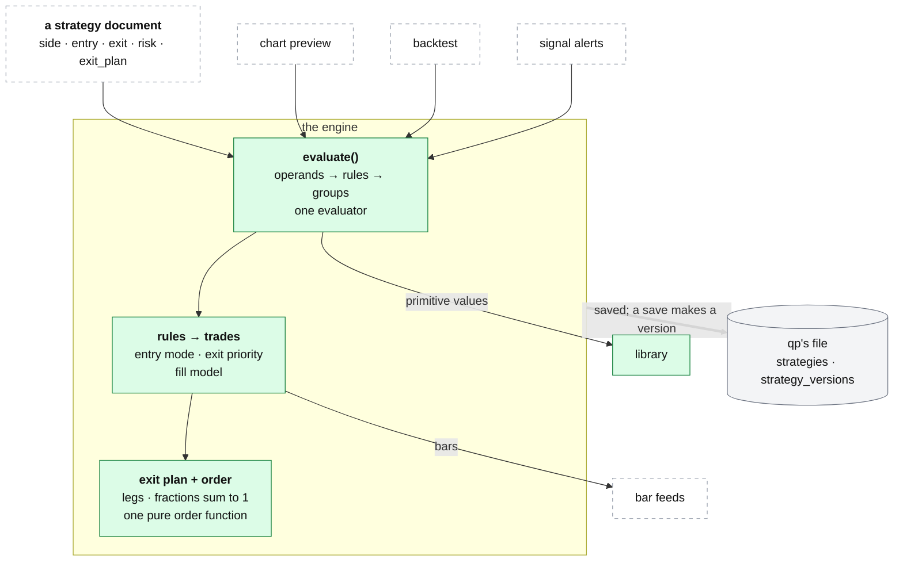

# qp: strategies

**Above:** [QP.md](QP.md) §3 (the strategy engine).

**Talks to:**
- the [library](LIBRARY.md), whose primitives a rule names;
- the [chart](CHART.md), where a strategy is built and previewed;
- the [backtest](BACKTEST.md) and [signal alerts](SIGNAL-ALERTS.md), which call
  the same evaluator;
- qp's own [files](../04-files/FILES.md), where strategies and their versions
  live.

---

## 1. What it is

**One grammar for a trading rule, and one evaluator that turns it into trades.**
A strategy is a document: a side, an entry group, an exit group, a risk block,
and an optional exit plan. It is evaluated over **the same verified primitive
values the chart draws** ([LIBRARY.md](LIBRARY.md)), by one function the preview,
the backtest and the alerts all call. There is no second evaluator, so a signal
on the chart is the signal the backtest trades and the alert fires.

**What it owns:** the grammar; the evaluator; the fill models; the exit plan;
the one order function; and, in the design, **strategy versions**.

**What it never does:** compute an indicator (the library does), read a register
(the backtest and alerts do), or place an order — the order function produces a
plan; nothing on the desk sends it.

---

## 2. The diagram



---

## 3. The strategy document

```json
{
  "name": "OR + VWAP 09:35 (Long)",
  "side": "long",
  "stage": "ready",
  "tools": ["T2"],
  "entry": { "logic": "AND", "rules": [ … ] },
  "exit":  { "logic": "OR",  "rules": [ … ] },
  "risk":  { "sl": {…}, "tp": {…}, "targets": [ … ], "window_start": 935 },
  "exit_plan": { … }
}
```

| Field | Meaning |
|---|---|
| `side` | `long` or `short` |
| `stage` | `development` (new strategies start here) or `ready` (finished). Set by hand, never earned automatically. The desk places no orders, so "ready" means finished, not "trusted to place orders" (Q-N3) |
| `tools` | the tools whose registers the strategy is meant for; refused on save if a tool id does not exist; the backtest's default universe |
| `entry`, `exit` | rule groups (§4.2) |
| `risk` | stops, targets, discipline and size gates (§4.4) |
| `exit_plan` | optional: the exit declared leg by leg (§4.6) |

---

## 4. Its parts

### 4.1 Operands: the values a rule compares

| Kind | Gives |
|---|---|
| `primitive` | a verified indicator; `sub` picks one line of a multi-line primitive (floor pivot `R1`, Bollinger `upper`, dynamic S/R `sr3`) |
| `price` | close, open, high, low, hl2, hlc3, ohlc4, volume |
| `time` | the bar's New York time: minutes since midnight, hhmm, hour, minute |
| `const` | a number |
| `expr` | arithmetic on two operands, nested freely: add, sub, mul, div (÷0 gives no value). Body % = body ÷ range × 100; move in ATR = (close − open) ÷ ATR |
| `trade` | **exit rules only**: the open position's entry price, bars held, unrealised pnl %; each trade sees its own |

Any operand may carry: `offset: n` (the value n bars ago); `hold: true` (carry
the last real value forward until it changes — Pine's `fixnan`, applied before
the offset, so a sparse pivot becomes a fixed level to retest); and `symbol`
(read from another symbol such as SPY, aligned bar by bar without look-ahead). A
primitive on a coarser timeframe shows only the last **completed** higher bar:
no same-day look-ahead.

### 4.2 Rules, operators and groups

A rule is *operand · operator · operand*, with optional timing. **Any missing
value (warm-up, outside a session) makes the rule false.**

| `op` | True when |
|---|---|
| `gt` `lt` `ge` `le` | above / below / at-or-above / at-or-below |
| `eq` `neq` | equal / not equal (floating-point tolerant) |
| `gt_pct` `lt_pct` | above / below by at least `pct` % of the right side's size |
| `cross_above` `cross_below` | the previous bar was on the other side and this bar crosses |
| `rising` `falling` | over `lookback` bars (default 12): ends above/below where it started, optionally by `min_pct`, with at least `consistency` (default 75 %) of non-zero changes pointing that way; flat bars do not count against it |
| `bounce_up` `bounce_down` | the bar's wick comes within `tol_pct` (default 0.15 %) of the right-hand level and closes back on its side, in the top/bottom 60 % of its own range |

Timing on a rule: `for_bars: N` (held on **all** of the last N bars),
`within_bars: N` (held on **any** of the last N), `offset: N` (the rule's
*result* was true N bars ago — shifts the result, where an operand offset shifts
a value).

Groups combine rules and nest to any depth:

| `logic` | True when |
|---|---|
| `AND` / `OR` | all / any of its rules hold |
| `ATLEAST` (`k`) | at least k of them hold (k below 1 counts as 1) |
| `THEN` (`window`) | its steps happen in order, each within `window` bars (default 10) of the previous |

### 4.3 From rules to trades

**Entry.** `entry_mode: edge` (default): one entry per stretch of bars on which
the entry group is true; a THEN sequence completing again is a new stretch.
`entry_mode: status`: any bar on which it is true while flat (re-enter after a
stop while the setup still holds).

**Exit, in a fixed priority, on each bar in a position:**
1. **Stop** first. With a single target, if both fall in one bar the stop wins
   (conservative). With scale-out legs, a leg target the bar traded through is
   banked first and the stop applies to what is left, as a real bracket does;
   `stop_first: true` makes the stop win instead.
2. **Target** (or the next scale-out leg).
3. **The exit rule**, as a status: it exits on any bar where the exit group is
   true. A `trade` operand is evaluated per trade.
4. **End of day**, when the session rules force it (reason `eod`).

A stop hit while the trade is in profit (a moved or trailing stop) is recorded
as `trail`.

### 4.4 The risk block

| Field | Meaning |
|---|---|
| `sl`, `tp` | `{type, value}`, type = `pct` (of entry), `atr` (× ATR 14 at entry), `points` (dollars); or `{type: "prim", anchor, value}`: a level that **trails** an indicator bar by bar, shifted to the protective side |
| | `freeze: true` on a `prim` stop/target: read the level once at the signal bar and hold it ("2 cents under the low of the turn") |
| `targets` | scale-out legs, each `{fraction, r_multiple}` or `{fraction, tp}`; what the legs do not take stays until the stop, exit rule or close |
| `window_start`, `window_end` | hhmm: entries only inside this window |
| `max_entries_per_day` | per symbol |
| `cooldown_bars` | after an exit, no new entry for this many bars (resets each day) |
| `min_hold_bars` | the exit rule is ignored for this many bars after entry |
| `max_stop_pct` / `min_stop_pct` | refuse an entry whose stop is further than / closer than N % (a stop too close cannot pay for its own costs) |
| `min_target_usd` | refuse an entry whose nearest target is less than $X from the fill |
| `stop_first` | when one bar touches both the stop and a leg target, assume the stop filled (default off) |
| `entry_mode` | `edge` or `status` |
| `breakeven_after_target` | **in the design, simulated, or refused on save**; today it is reported on the order plan but never simulated (Q-N7) |

**Session rules** (prop-firm style), passed with a run: `rth_entries` with
`entry_start` (09:30) and `entry_cutoff` (15:50) to open only in regular hours;
`eod_close` to flatten at the last bar; `max_entries_per_day`. With a next-bar
fill, a signal whose fill would land outside the window is dropped.

### 4.5 Fill models: the price a trade gets

Explicit on every run; **an unknown model is an error, never a silent
fallback.** The design uses **one** fill model across preview, backtest and
alerts, so an alert and a backtest of the same strategy take the same bar
(Q-N9): the strategy's own fill, default `desk`.

| `fill` | Entry fills at | Stop and targets measured from | Use |
|---|---|---|---|
| `close` | the signal bar's close | the same close | chart preview; optimistic by about a spread |
| `next_open` | the next bar's open | the fill (re-prices R, which a bracket cannot) | comparison |
| **`desk`** (default) | the next bar's open | the decision bar's close, as a bracket order really is priced | the honest backtest, and alerts |
| `live` | the decision price | the decision bar's close | `desk` with the future removed |

Why `desk` exists, from the code's own record: a WULF short decided at 15.37,
filled at 15.24, stop at 15.74. Priced from the fill it was 1.31 R; the plan
said 2.00 R. `desk` books the fill at the open and keeps every level where the
decision put it. With a next-bar fill, a signal on the last bar makes no trade;
a stop fills at its level on a touch but at the **open** on a gap through it (the
gap is charged); a target fills at its level.

### 4.6 The exit plan and the order

**The exit is declared, never inferred.** Every strategy reports the same
structure, written or derived from `risk`:

```
exit_plan = { shape, legs: [{fraction, sl, tp}, …], runner: {fraction, manage}, ok, errors, warnings }
```

Two rules keep the quantity correct: **every leg has its own stop** (a shared
stop is filled in from `risk.sl`, explicitly), and **the fractions sum to
exactly 1** (a plan summing to 0.9 never orders a tenth of every position).

**The order** is one pure function — a trade and an account in, the orders out,
or the reason there are none: a risk budget (`risk_usd`, or `risk_pct` of the
account); shares = budget ÷ risk per share; caps in order (position cap, account
ratio, per-order value, money left); below `min_shares`, nothing is sent; one
bracket per leg in whole shares with the odd shares to the runner; prices in
whole cents, rounded towards the entry. The backtest books exactly these orders.

### 4.7 Building and checking one, and versions

In the page's **⚡ Strategy** drawer ([CHART.md](CHART.md)): **▶ Evaluate** runs
it over the chart window (markers, the stop and target as drawn, whether entry
and exit are true now, a quick preview); **🔍 test** on any row marks every bar
where that one rule holds; the **signal funnel** (`/api/strategy/explain`) shows
each entry step's true-bar count so the step at zero is the blocker;
`explain_scan` ranks a whole register day by who came closest to firing.

**Versions.** Saving a strategy creates a version, and a backtest records the
versions it ran, so editing a strategy later never changes what an old result
means. Parity checks that the strategy as saved is the one a backtest ran; every
backtest also stores a frozen copy of the strategies it ran.

---

## 5. Contracts

**The code:** `quant-platform/chart/strategy.py` (operands, rules, groups,
pairing, fill models), `exit_protocol.py` (the declared plan), `order_plan.py`
(the one order function), `parity.py`, `store.py`.

| It owns (qp's file, `~/.qp/platform.db`) | Key |
|---|---|
| `strategies` (the working copy: id, name, the whole JSON, timestamps) | id |
| `strategy_versions` (**to build**: each save a version) | id, version |

| Copy | Where | Role |
|---|---|---|
| JSON copies | `~/.qp/strategies/*.json`, one per strategy, every save | read back only when the database has no strategies (wiped or new box); never merged into one that has rows |
| seeds | `chart/seeds/*.json`, in git | synced at start; a user-edited or `_keep_user_edits` seed keeps the stored copy; one bad seed is skipped and named |
| backtest snapshots | every run stores the strategies it ran | a lost strategy can be read back from them |

| Routes, behind `/quant/` | Do |
|---|---|
| `GET/POST/DELETE /api/strategies…` | list, create or update (a save makes a version), delete |
| `POST /api/strategies/{id}/tools` | assign tools without rewriting the strategy |
| `POST /api/strategy/evaluate`, `…/test` | preview; test one rule |
| `GET /api/strategy/explain`, `…/explain_scan` | the signal funnel |

The bundled seeds (OR + VWAP 09:35, T2 10:00 VWAP Extension, the SMB scalps,
PM Breakout) also exist as Pine scripts for TradingView's Strategy Tester
([legacy/qp/PINE.md](../../legacy/qp/PINE.md)).

---

## 6. When it fails

| Event | What happens |
|---|---|
| a rule reads a value not yet known (warm-up, outside a session) | the rule is false, never zero |
| an exit plan's fractions do not sum to 1, or a leg has no stop | the plan reports `ok: false` with the error; it is refused |
| an unknown fill model is named | an error, never a silent fallback |
| a strategy names a tool id that does not exist | refused on save |
| `breakeven_after_target` is set | in the design it is simulated, or refused on save; never reported-but-ignored (Q-N7) |

---

## 7. Built on

**The old desk:** [legacy/qp/STRATEGIES.md](../../legacy/qp/STRATEGIES.md), with
the five SMB scalps in [legacy/qp/SCALPS.md](../../legacy/qp/SCALPS.md) and
[SCALPS_SPEC.md](../../legacy/qp/SCALPS_SPEC.md).

**What failed there:**

| ID | Fault | Prevented by |
|---|---|---|
| Q-N9 | alerts use the `close` fill and backtests `desk`, so an alert can fire on a different bar | one fill model across preview, backtest and alerts |
| Q-N7 | `breakeven_after_target` is reported on the order plan but never simulated | simulated, or refused on save |
| Q-N3 | the Stage help says Ready means "trusted to place real orders from" | corrected; the desk places no orders |
| Q-11 | saving a strategy dropped "fix at entry", turning a fixed stop into a trailing one | fixed (2026-10); a save keeps `freeze` |
| — | a strategy edited after a run changed what the old result meant | versions, and the frozen copy in each backtest |

---

## 8. Status

| Part | Status |
|---|---|
| the grammar, the evaluator, the exit plan, the order function, the preview and funnel | **built** (legacy, kept) |
| one fill model across preview, backtest and alerts | **to build** (step C; Q-N9) — today alerts use `close` |
| `breakeven_after_target` simulated or refused | **to build** (Q-N7) |
| `strategy_versions` as a table | **to build** |
