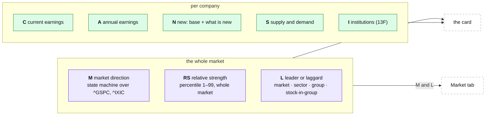

# The O'Neil method, letter by letter

**Above:** [RESEARCH-WORKER.md](RESEARCH-WORKER.md) §3.2 (the steps), which points
here for the method behind each letter, its rules, thresholds and traps.

**Talks to:**
- the [research worker](RESEARCH-WORKER.md), which runs these computations and
  writes each as a dated fact;
- the desk's [card](../03-desk/tool/CARD.md) and [market reader](../03-desk/MARKET.md),
  which show the readings;
- [qp's backtest](../05-qp/BACKTEST.md), whose CANSLIM gate reads the same facts as
  of a day.

---

## 1. What it is

**William O'Neil's CANSLIM, reconstructed from free, official data.** CANSLIM is
a way of finding leading growth stocks by seven marks: **C**urrent quarterly
earnings, **A**nnual earnings, **N**ew (a product, management, industry
conditions, or a price high out of a base), **S**upply and demand, **L**eader or
laggard, **I**nstitutional sponsorship, and **M**arket direction.

Three rules govern the whole reconstruction:
- **Reconstructed, and named as such.** Every reading is built from public data
  and called what it is (`rs`, never "IBD RS"); the numbers are ours, their
  provenance stated, because membership and sources differ from IBD's.
- **A label, never a filter.** No tool's candidates change because of a letter;
  the readings label a card and fill the Market tab
  ([ARCHITECTURE §7](../../ARCHITECTURE.md#7-rules-that-apply-everywhere)).
- **O'Neil's own numbers,** as named constants, printed beside any signal that
  fires, so a reading can be checked against its definition.

**What it is not** is as important as what it is: most of CANSLIM's ideas share a
name with a common indicator that measures something else (§3).

---

## 2. The diagram



The whole-market letters (M, RS, L) exist for every US stock the moment it is
carded; the per-company letters (C, A, N, S, I) are computed for the tickers the
tools find ([RESEARCH-WORKER.md](RESEARCH-WORKER.md) §3.2).

---

## 3. The traps the method must avoid

Most CANSLIM concepts have a plain-English name that means something else in
common use. Implementing the common reading gives a number that looks right and
measures a different thing.

| Concept | What it is | What it is mistaken for |
|---|---|---|
| **RS Rating** | a percentile 1–99 of 12-month performance against **every other stock** | RSI, which compares a stock to its own range |
| **C** | current quarter EPS vs **the same quarter a year ago** | sequential quarters (reintroduces seasonality) |
| **A** | annual EPS growth over 3–5 years, plus ROE: durability | a longer C |
| **Distribution day** | one session: index down ≥ 0.2 % on **higher volume** | any down day |
| **Distribution count** | days **live** in a rolling 25-session window, with expiry | a running total |
| **A/D Rating** | a letter A–E from 13 weeks of price and volume | Chaikin's A/D index, an unbounded cumulative line |
| **Follow-through day** | a confirmation on **day 4+** of a rally attempt: a big gain on higher volume | any strong up day |
| **N: new high** | price emerging from a **base** into new ground, on volume | any 52-week high |
| **Group rank** | rank of the stock's **industry group** | the sector (far too coarse) |
| **M** | a **rule-based state machine** over two indexes | a sentiment read or an MA cross |
| **RS line** | the plotted ratio stock ÷ index; "new high **before** price" is the tell | the RS Rating |
| **U/D volume ratio** | up-day volume ÷ down-day volume over 50 days | the A/D rating |
| **Base stage** | which base, counted **from the market bottom** | any consolidation |
| **Group rank vs Group RS** | **one fact**: rank 63 of 197 *is* the 68th percentile *is* B+ | three measurements that could disagree |
| **RS within the group** | "RS 1 of 13": the stock ranked against its own group only | the RS Rating |
| **N: the new thing** | **three** things: product, management, **better industry conditions** | two things, and a news feed |

Each row has a fixture in the worker's tests ([RESEARCH-WORKER.md](RESEARCH-WORKER.md)).

---

## 4. The letters

### 4.1 M: the market model

A state machine over the **S&P 500 (^GSPC)** and the **Nasdaq Composite
(^IXIC)**, daily bars. Three published states (confirmed uptrend, uptrend under
pressure, market in correction) and one internal (rally attempt).

| Rule | Value | Provenance |
|---|---|---|
| Distribution day | close ≤ prior close × (1 − 0.002) **and** volume > prior volume, while in an uptrend | IBD's −0.2 % floor on O'Neil's "closes lower on higher volume" |
| Stalling day | volume heavy, gain under ~0.2 %, close in the lower half of the range: counts as distribution, flagged apart | IBD |
| Live window | 25 sessions | IBD; the tight end of O'Neil's "5–6 weeks" |
| Removal | after 25 sessions, **or** when the index **trades** 5 % above that day's close | IBD |
| Under pressure | 5 live distribution days | IBD |
| Correction | 6+ live, or a decisive break of the rally low | IBD |
| The bottom | the **lowest close** of the correction (not an intraday low) | the 2010 workshop |
| Rally day 1 | the session **after** that lowest close; a new lower close moves the bottom and restarts the count | the workshop |
| Follow-through | day **4 or later**, gain **≥ 1.7 %**, volume **> the prior session** (that is the whole test) | O'Neil's last figure (1 % → 1.5 % → 1.7 %) |
| Late follow-through | days 8–11 late, beyond 11 very late: **flagged, never refused** | refusing creates a state the market can never leave |
| Status | counted **per index**, published as the **worse** of the two | "one index is enough" |

**Lesson from the first live run.** An extra test (volume above the 50-day
average) blocked the Nasdaq's August 2026 follow-through; the model said
"correction" through a confirmed rally. A rule stricter than the published one
fails to the wrong answer, in the direction of telling you not to buy. The
50-day comparison is reported beside a follow-through, never decides it. And the
caveat is always shown: about one follow-through in four fails — it is necessary
for a bottom, not sufficient.

### 4.2 RS: the relative strength rating

```
RS = 0.4·(P0/P63) + 0.2·(P0/P126) + 0.2·(P0/P189) + 0.2·(P0/P252)
```

63 / 126 / 189 / 252 trading days = 3 / 6 / 9 / 12 months, the latest quarter
weighted double; then **percentile-ranked 1–99 against every US stock**. Verified
against IBD's published formula. Two choices make it match: the universe is the
whole market (Polygon grouped daily, every US ticker each session), and prices
are **split-adjusted** — a 2-for-1 split would otherwise score a leader at −50 %.

### 4.3 L: groups and the four levels of strength

| Level | The number | How | Answers |
|---|---|---|---|
| Market | the M state + the index RS line | §4.1; index ÷ S&P 500 | buy at all? |
| Sector | rank of a coarse sector | aggregate performance | which half of the market |
| **Group** | rank X of N | **median** member RS, membership by SIC | the leading group? (O'Neil: ~37 % of a stock's move; sector ~12 %) |
| **Stock in group** | "RS 1 of 13" | the stock's RS ranked inside its group | leader or laggard |

**Membership** is the SIC code from EDGAR for every filer (TradingView labels
only where SIC has none — one writer, F-21). **Thin groups** (fewer than 6
ranked members) roll up one rung (4-digit industry → 3-digit group → 2-digit
major group), and are dropped if still thin. Groups are ranked by median RS;
**percentile and letter** (A+ ≥ 94 … E) are derived from the rank, never stored
as separate facts — rank 63 of 197 *is* the 68th percentile *is* B+ (one fact,
three prints). **Rotation**: rank now against rank three months ago. **The
divisor is stored with every rank** (IBD once went from 197 groups to 145), so
the card prints `63 of 197`, never a bare rank. The honest limit: our group rank
is ours, because membership differs; the rank within the group and the member
count are exact.

### 4.4 C and A: earnings, from EDGAR

From the SEC's company-facts API (official, free, a descriptive User-Agent;
CIK ↔ ticker from `company_tickers.json`).

- **C** (current quarter): eight quarters of EPS, the year-ago EPS and %Chg,
  sales, year-ago sales and %Chg, after-tax margin; **accelerating** (each of the
  last 2–3 quarters' %Chg larger than the one before); **beat +25 %**, X of 8.
- **A** (annual): fiscal years of EPS and %Chg (with the year's price high and
  low), the year **rebuilt from four quarters** to check against the filing,
  **3-year growth**, **stability** (the wobble around trend, 0–99, low is good),
  and **ROE** against O'Neil's **17 %** floor.

**The five EDGAR traps**, each of which produces a normal-looking wrong number:

| # | Trap | Rule |
|---|---|---|
| 1 | C is year over year, never sequential | compare to the quarter one year back (within 45 days) |
| 2 | Q4 is usually not filed as a quarter | Q4 = FY − Q1 − Q2 − Q3, **only when all three are present**; left out when EPS and net income disagree in sign |
| 3 | the same period is filed more than once | the most recently **filed** value wins |
| 4 | a % from a negative base is not a number | `n/a (loss a year ago)`; capped at ±999 % |
| 5 | revenue lives under four tags | read all four, take one per period |

Filings land weeks after quarter end, so **every block carries its own as-of
date** ([RESEARCH-WORKER.md](RESEARCH-WORKER.md) §3.3).

### 4.5 N: the base, and what is new

**The weekly base** (weekly, not a display choice: a base is 7–65 weeks, and
daily bars drown every shape test in noise): weeks, depth, waves down (the
decline typically comes in three), **accumulation weeks** (heavy volume, no price
progress), the **handle** (a controlled 2–8-week drift in the **upper half** — a
handle that gives back half the cup is the cup failing), lip and low with their
weeks, the **pivot**, % away, X of 6 checks. Needs 7 weekly bars.

**The RS line tell:** the RS line at a new high **while price is still in its
base** fires; both at new highs does not (that is arithmetic); the line off its
high does not. **Divergence:** the index made a new low in the window, the stock
did not, and the stock is above where it sat on the index's worst close —
distinct from "the index has not made a new low".

**What is new** (the N pipeline, designed, not built — §8): three things, not
two. New product/service, new management, **better industry conditions** (the
group's rank rising), harvested from EDGAR 8-K items, openFDA and USASpending,
scored by the price reaction and whether the RS line held. News APIs corroborate,
never trigger.

### 4.6 S: supply and demand

Shares outstanding (from EDGAR, its basis when not the cover figure, with an
as-of); **share-count change over about a year**, always from the same tag
(buying back / diluting / flat, or the reason there is no rate); float
(TradingView) and float as a % of shares; short interest and days to cover (from
the card's short-interest facts); **U/D volume ratio** over 50 sessions; and
**A/D**, a bounded 13-week score (−1 … +1, normalised by the window's volume so
it compares between stocks), banded to a letter that is **ours** (IBD does not
publish its boundaries), with the raw number beside it.

### 4.7 I: institutional sponsorship, from Form 13F

The SEC's quarterly 13F datasets. Counted as distinct **managers** by CIK,
unioned across every CUSIP of the issuer (stock, converts, options are one
company) and across a 13F-HR and its amendment (one manager). Per quarter: the
holder count, **of N** managers who filed at all, and the **share of filers**.
**Direction is read from the share**, with a 3 % relative dead band: `rising`
(up over the year and still up), `peaked` (up over the year, newest quarter
down), `flat`, `falling`, `turning up`; only `rising` and `turning up` are
coloured bullish, with the raw holder change printed beside, uncoloured. Only
managers over $100M file, 45 days after quarter end: the lag is stated on
screen.

### 4.8 On each card: the market reflected

Four per-card readings, each a different number on every card:

1. **Behaviour on the live distribution days:** on how many the stock beat the
   index close-to-close, and the average difference, with the dates behind a tap;
   it says so when there are none.
2. **Sessions since the follow-through,** banded early (< 25), established
   (25–150), late (> 150).
3. **Group rotation:** rank now vs three months ago, ▲ into / ▼ out of.
4. **The exposure implication,** in O'Neil's words.

---

## 5. Contracts

The research worker is the only writer; each letter is one fact family, keyed by
`market` or by ticker ([RESEARCH-WORKER.md](RESEARCH-WORKER.md) §4):

| Letter | Fact family |
|---|---|
| M | `oneil_m` (with `bars_universe` behind RS and `group_ranking` behind L) |
| RS | `rs_rating`, `rs_line` |
| L | `oneil_l`, `group_ranking`, `sic` |
| C, A | `oneil_c`, `oneil_a` |
| N | `oneil_n_base`, `oneil_n_events` |
| S | `oneil_s` |
| I | `oneil_i` |
| ratings | `oneil_ratings` (RS, group, A/D, volume vs 50-day; later EPS, SMR, Composite) |

**Everything explains itself.** Each fact family ships with a definition card:
what it means, how it is calculated, **what it is not** (the trap in §3), its
source and its as-of. The card and the Market tab show it on a tap.

---

## 6. When it fails

| Event | What happens |
|---|---|
| a source is slow or limited (EDGAR: ten requests a second) | the step works within its budget and carries the rest to the next night; the fact keeps its old date and the card says "last run DATE" ([RESEARCH-WORKER.md](RESEARCH-WORKER.md) §5) |
| no filings for a company | the fact's status is `none`, not a guessed 0 |
| a % from a negative base | `n/a (loss a year ago)`, not a wild number |
| a follow-through is late (days 8+) | it is flagged late, never refused |
| a group is thin | it rolls up a rung, or is dropped — never ranked on too few members |

Honest gaps everywhere: a missing reading says it is missing and why, and is
never shown as 0, "no", or a bad sign.

---

## 7. Built on

**The old desk:** [legacy/qp/CANSLIM.md](../../legacy/qp/CANSLIM.md), 1,653 lines,
the deepest document of the old desk — the traps, the exact rules and their
provenance, the card and panel specification, and the build phases. The code the
worker reuses: `oneil.py`, `relstrength.py`, `groups.py`, `sic.py`, `edgar.py`,
`f13.py`, `base.py`, `ratings.py`, `canslim.py`.

**What failed there** (the method's faults; the worker's own faults are in
[RESEARCH-WORKER.md](RESEARCH-WORKER.md) §6):

| Fault | Prevented by |
|---|---|
| a rule stricter than O'Neil's (a 50-day volume test) blocked a real follow-through and held the model in "correction" | only the published test decides; the extra is reported, never deciding |
| the industry map had two writers (SIC and TradingView) and flipped every morning (F-21) | one writer, SIC first, TradingView only where SIC has none |
| three separate fields for group rank, percentile and letter invited a card showing them disagree | one fact, three prints, derived from the rank |
| CANSLIM rebuilt "as of" a day separately in the backtest | dated facts the gate reads by `as_of` |

---

## 8. Status

Built, in shadow ([RESEARCH-WORKER.md](RESEARCH-WORKER.md) §7): M (the whole
market model), groups and the four levels, A/D, U/D, the RS line tell and
divergence, the EDGAR C and A tables, shares outstanding and the weekly base, and
13F sponsorship.

**To build,** each behind its own versioned definition:

| # | What |
|---|---|
| 1 | the **index RS line**, and **group new highs / lows** (cheap, from data already fetched) |
| 2 | the **sector rank** from SIC major groups, kept distinct from the group |
| 3 | **EPS rating** and **SMR** from EDGAR, then **Composite** once both exist (a composite without EPS and SMR would be a partial one wearing a complete name) |
| 4 | the **float estimate** (shares outstanding minus insider and 5 %-holder positions), labelled an estimate; funds / banks / management % |
| 5 | the **N pipeline** (§4.5): harvest → classify → react → persist → score → one line, with discarded counts printed as proof it is a filter, not a feed |

`rs_line`, `oneil_s`, `oneil_n_events` and `sic` as dated facts, and the ratings
beyond RS, group and A/D, are the other **to build** items the parent names.
