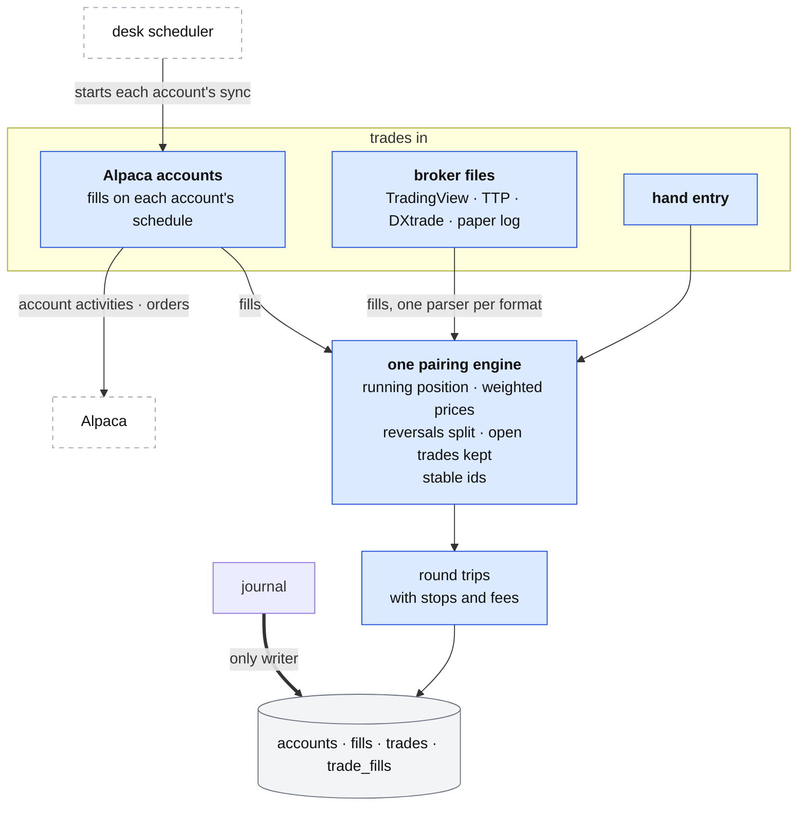

# The journal: how trades come in

**Above:** [JOURNAL.md](JOURNAL.md) §3 (trades in, the pairing engine, stops and
fees).

**Talks to:**
- the [desk](../03-desk/DESK.md), whose scheduler starts each account's sync
  ([JOBS.md](../03-desk/JOBS.md));
- the [data sources](../08-data-sources/DATA-SOURCES.md): Alpaca account activities
  and orders;
- the journal's own [file](../04-files/FILES.md), where accounts, fills and trades
  live;
- the [entry snapshot and the page](REVIEW.md), which read the trades this
  produces.

---

## 1. What it is

**Every real trade, turned from fills into round trips, once.** A trade reaches
the journal three ways — a synced Alpaca account, a broker file the trader
uploads, or hand entry — and each produces **fills**. **One pairing engine**, for
every source, turns fills into round trips: scale-ins, scale-outs, reversals and
open positions, handled once, with stable ids, so a second import updates and
never duplicates.

**What it owns:** the accounts, the fills, and the trades with their stops, fees
and fills.

**What it never does:** place an order, grade or size a trade, or keep a timer —
each sync is started by the desk.

---

## 2. The diagram

---

## 3. Its parts

### 3.1 The three ways in

| Way | Produces | Trade id from | Status |
|---|---|---|---|
| **Alpaca account** | fills, on each account's schedule | the account and the first fill (stable) | open or closed |
| **broker file** | fills, one parser per format | the file's own facts (stable) | as the fills pair |
| **hand entry** | one trade directly | the trade's own facts (stable) | closed when an exit price is given |

**Alpaca accounts.** The trader adds an account (name, key id, secret, paper or
live, every N minutes, last N days); the desk's scheduler runs each due account
on its interval, one at a time. A fetch asks Alpaca for every fill in its window
(oldest first, paged) and pairs them. The keys are used **read-only** (the
account and the fill activities, nothing else), live in a secret file the backup
never takes, and never appear in any answer. The window is widened to reach
**before the oldest open position**, so a trade held longer than the look-back
is not cut in half (D-J11).

**Broker files.** One parser per format, each with a sample file and a test
covering shorts, scale-ins, scale-outs and partial closes:

| Format | Detected by | Notes |
|---|---|---|
| **TradingView fills** | `symbol`, `side`, `qty` headers | the exchange prefix is stripped (`NASDAQ:AAPL` → `AAPL`) so it matches the same stock from Alpaca |
| **Trade The Pool** (trades, and orders history) | `action`, `shares`; or `datetime`, `orderid`, `event` | one working parser for both shapes |
| **DXtrade** (orders history) | `;` delimiter with `symbol`, `side`, `event` | every fill is read, not only market and stop/target rows; a market sell that closes a long is an exit, not a new short |
| **TradingView paper log** | two headers, `time` and `text` | the executed line takes the side of its queued "call" line; the parser reads the right capture groups |

Every format's clock time is read as **New York time** and turned into a real
instant, and a trade carries an **entry date and an exit date** (JOURNAL.md), not
one date and two clock times.

**Hand entry.** A trade typed in directly (date, ticker, direction, shares,
entry and exit, and optionally a stop, target, fees, setup and notes), computed
and paired like any other.

### 3.2 The one pairing engine

For every source, fills are grouped by account and ticker, sorted by time, and a
**running position** is tracked:

| Position | Becomes |
|---|---|
| 0 → not 0 | a trade opens; its direction is this fill's (a buy is long, a sell short) |
| moves further the same way | more entry; the entry price is the **volume-weighted average** of every entry fill |
| moves back toward 0 | exit; the exit price is the volume-weighted average of every exit fill |
| reaches 0 | the trade is finished (closed) |
| crosses 0 in one fill | the fill is **split**: the part to 0 closes the first trade, the rest opens a new trade the other way |
| not 0 at the end of the window | the trade is kept as **open**, with no exit |

A trade is closed only when its exit shares reach its entry shares; a partly
closed trade is open with no exit price. This is the one pairing code, used for
files too — not the old file importer, which opened at the first fill's price and
size, ignored further entries, and closed the whole position at the first exit
(D-J1).

### 3.3 Stable ids: a second import updates, never duplicates

Each trade's id is built from its own facts (the account and first fill id for
Alpaca; the broker's order id or the account, ticker, first fill time and price
for a file). So importing the same file twice stores each trade once (D-J3), and
a later fetch updates an open trade in place. **A closed trade is never
rewritten**, because by then it may carry a stop, a setup or a note.

### 3.4 Stops and fees

- **A stop on every trade** (JOURNAL.md): from the broker's stop order, the
  strategy's exit plan, or the trader. Without a stop there is no R, no capture
  and no grading, so this is what makes the [review](REVIEW.md) work (D-J9).
- **Fees as fees:** read from the broker where the file carries them, or from the
  account's fee rule, labelled **estimated**. Alpaca's regulatory and
  pass-through fees are read, not left at 0 (D-J15).

### 3.5 The import report

Every import answers with what it stored **and what it did not**: unmatched
fills, positions left open, and every row the parser could not read, each with
its reason. Nothing is dropped silently (D-J7).

---

## 4. Contracts

**The code:** `journal/server.js` and the importer and accounts modules, behind
the front door at `/journal/`.

| It owns (the journal's file) | Key |
|---|---|
| `accounts` (keys in the secret file `data/journal/journal-accounts.json`, mode 0600, never backed up) | id |
| `fills` | account, external id |
| `trades` | id (stable) |
| `trade_fills` (which fills made a trade, and each one's portion) | trade, fill, portion |

| It reads | From |
|---|---|
| account activities (fills) and orders | Alpaca, per account, read-only |

| Routes, behind `/journal/` | Do |
|---|---|
| `POST /api/journal/import` | a file in, an import report back |
| `POST /api/journal/sync` (**to build**) | one sync of the due accounts, started by the desk's scheduler |
| `GET/POST/DELETE /api/journal/accounts…`, `…/test`, `…/fetch` | accounts; no secret is ever returned |
| `POST /api/journal/trades`; `PATCH /api/journal/trades/:id` | hand entry; set stop, target, fees, setup, notes |

---

## 5. When it fails

| Event | What happens |
|---|---|
| an account's fetch fails | recorded with its reason; the account waits for its next turn; the sync's run record names it |
| a file has rows the parser cannot read | the report lists every skipped row with its reason; nothing is dropped silently |
| the journal is down | the desk is unaffected; the scheduler records the failed sync and alerts |
| the same file is imported twice | each trade is stored once (stable ids); an open trade updates, a closed one is not rewritten |
| a position is held longer than the look-back | the window reaches before the oldest open position, so it is not cut in half |

---

## 6. Built on

**The old desk:** [legacy/journal/IMPORT.md](../../legacy/journal/IMPORT.md) (the
file formats, run on a scratch database) and
[legacy/journal/ACCOUNTS.md](../../legacy/journal/ACCOUNTS.md) (the Alpaca
accounts and their pairing — the journal's best-built part, the model for every
source).

**What failed there:**

| ID | Fault | Prevented by |
|---|---|---|
| D-J1 | file imports opened at the first fill and closed the whole position at the first exit: every scale-in/out gave the wrong shares, prices and P&L | the one running-position engine |
| D-J2 | TradingView `sell` was always an exit, so every short was lost; the exchange prefix stayed | fills paired by position; the prefix stripped |
| D-J3 | a random id per trade, so re-importing duplicated everything | a stable id from the file's own facts |
| D-J4 | the paper log threw on any "call" line | the parser reads the right capture groups |
| D-J5 | TTP orders history imported nothing | one working TTP parser |
| D-J6 | DXtrade positions closed by hand never closed | every fill read, a market close is an exit |
| D-J7 | a file dropped what it could not pair, silently | the import report lists everything not used |
| D-J11 | an Alpaca position older than the window became a phantom short | the window reaches before the oldest open position |
| D-J12 | a trade had one date and two clock times | an entry date and an exit date |
| D-J15 | no fees for most sources | fees read, or estimated from the account's rule |
| — | none of the 84 journal tests covered the importer | one parser per format, each with a sample and a test |

---

## 7. Status

| Part | Status |
|---|---|
| Alpaca accounts synced; the running-position pairing | **built** (legacy, kept — the model for every source) |
| every broker file read as fills and paired by the one engine, with fees and a report of every row not read | **built** (step 11; D-J1 to D-J7) |
| stops on every trade; `accounts`, `fills`, `trade_fills` as tables; stable ids for files | **to build** |
| the sync started by the desk's scheduler | **to build** (step C); today the journal runs its own minute timer |
