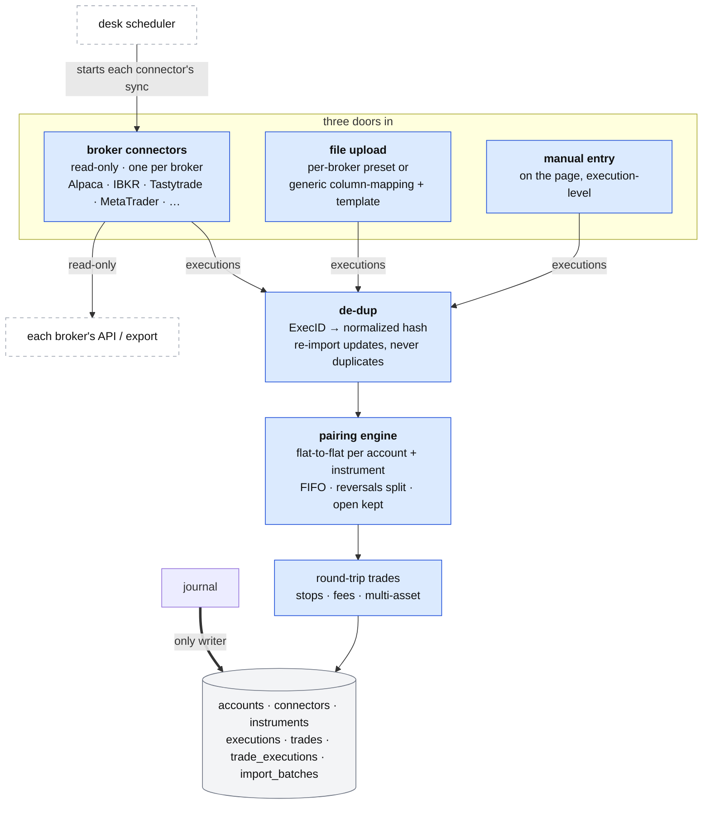

# The journal: how trades come in

**Above:** [JOURNAL.md](JOURNAL.md) §3 (trades in, the pairing engine, stops and
fees).

**Talks to:**
- the [desk](../03-desk/DESK.md), whose scheduler starts each connector's sync
  ([JOBS.md](../03-desk/JOBS.md));
- the [data sources](../08-data-sources/DATA-SOURCES.md): each broker's read-only API or
  export the connectors read;
- the journal's own [file](../04-files/FILES.md), where accounts, connectors,
  instruments, executions and trades live;
- the [entry snapshot and the page](REVIEW.md), which read the trades this
  produces.

---

## 1. What it is

**Every real trade, turned from executions into round trips, once — the way any
trading journal does it.** A trade reaches the journal three ways, the three
doors every trading-journal app offers:

- **broker connectors** — a read-only, scheduled auto-sync, one connector per
  broker;
- **file upload** — a broker's export, through a per-broker preset or a generic
  column-mapping wizard;
- **manual entry** — typed in on the page.

Each door produces **executions** (individual fills and position events). Behind
all three sits **one engine** that groups executions into round-trip trades,
**one de-dup rule** that keeps a re-import from ever duplicating, and **one
account tag** that keeps every broker and every source apart. It covers stocks,
options, futures, forex and crypto.

This replaces the old desk's three bespoke methods (an Alpaca-only sync, four
hard-coded file parsers, and API-only hand entry) with the de-facto standard of
leading trading journals, built on **read-only direct broker APIs — no
third-party aggregator** (§3.2).

**What it owns:** the accounts and their connectors, the executions, the
instruments, the trades (with their stops, fees, setup and notes), and the import
batches.

**What it never does:** place an order, hold any credential that *can* trade,
grade or size a trade, or keep a timer — the desk's scheduler starts every sync.

---

## 2. The diagram

---

## 3. Its parts

### 3.1 The three doors

| Door | How it runs | Produces |
|---|---|---|
| **broker connector** | read-only, on each account's schedule, started by the desk | executions, pulled from the broker |
| **file upload** | the trader uploads an export; a preset or a saved mapping reads it | executions, after a preview |
| **manual entry** | the trader fills a form on the page | executions, typed |

Every door ends in the same place: executions, de-duplicated (§3.6), paired into
trades (§3.5). No door has its own pairing or its own trade store.

### 3.2 Door 1 — broker connectors (read-only auto-sync)

**One connector per broker, behind one interface.** A connector is read-only, is
started by the desk's scheduler on the account's interval, normalizes the
broker's data into executions, and holds no credential that can trade or move
money. Its secret (an API key, a report token, an OAuth refresh token, or an
investor password) lives in the journal's secret file — mode 0600, never in a
backup, never returned by any route. The connectors the design targets, each a
different auth-and-transport shape:

| Connector | Auth | Transport | Notes |
|---|---|---|---|
| **Alpaca** | read-only API key + secret | poll the activities and orders API | built today; the first connector |
| **Interactive Brokers** | a read-only **Flex** token + a Query ID | poll the Flex Web Service | reporting only; "cannot place trades or move funds" |
| **Tastytrade** | **OAuth** (a long-lived refresh token; 15-minute access tokens) | poll the read-only endpoints | per-account read-only scope |
| **MetaTrader 4/5** | the broker server + the **investor (read-only) password** | MetaApi (free single account) or an FTP export | forex/CFD |
| **Tradovate / NinjaTrader** (futures) | — | a **local file** the desk watches | futures/prop platforms rarely have a read-only API |

**Why direct, not an aggregator.** Leading journals lead with a one-click
aggregator (SnapTrade, Plaid) because they must reach thousands of brokers for
thousands of users; a single trader with a few accounts gets the same data free
by calling each broker's own read-only API, which is what the Alpaca connector
already does. An aggregator adds a paid, cloud middleman for coverage this desk
does not need, so it is deliberately out of scope.

**What to expect per connector.** API connectors are **T+1**: a broker's
transaction feed settles once a day, so same-day fills may lag up to a day
(reconcile orders against transactions where a connector can). Local-file
adapters (MetaTrader, NinjaTrader) are near-real-time. Each connector's window
reaches **before the oldest open position**, so a trade held longer than the
look-back is never cut in half (D-J11).

### 3.3 Door 2 — file upload

For any broker without a connector, a file. Two paths, both ending in a preview:

- **Per-broker preset:** pick the broker, upload its native export; the preset
  knows the layout. Presets cover the common formats: **CSV, XLSX, TSV**, the
  **IBKR Flex** file (XML or CSV), and the **MetaTrader 4/5** HTML statement.
- **Generic column-mapping wizard:** upload any CSV; map *your* columns to the
  canonical fields — `date/time, symbol, side, quantity, price, fees, account,
  asset type`, and for options `strike / expiry / call-put` — and **save the
  mapping as a template** keyed by broker, so the next file of that shape is one
  click. (Saveable mappings are rare even among the commercial journals; they are
  the cheap win here.)
- **AI file-conversion:** an unrecognized export can be converted to the generic
  CSV by the desk's own model, since the desk already has one — no paid service.

**Two things the data cannot settle, so the trader does:** the **date format**
(mm/dd vs dd/mm is unresolvable from the data) and the **time zone** — both are
picked at import, with a preview. And **every import previews the trades it will
create before committing** (§3.10).

### 3.4 Door 3 — manual entry

A form **on the page**, not an API-only route as before. The trader creates a
trade (asset type + symbol) and adds each **execution** (entry and exit are
separate fills), through an asset-type-aware form: futures show the contract and
its multiplier, options the strike, expiry and call/put. It is for logging a few
trades by hand, never the bulk path — the file and the connectors are that.

### 3.5 The pairing engine

One engine, for every door. Executions are scoped by **account and instrument**,
sorted deterministically by time (a broker sequence or ExecID breaks a tie), and
a **running position** is tracked:

| Position | Becomes |
|---|---|
| flat → not flat | a trade opens; its direction is this execution's side |
| further the same way (scale-in) | stays in the open trade; the display entry is the volume-weighted average |
| back toward flat (scale-out) | a partial exit; realized P&L is matched **FIFO** |
| reaches flat | the trade closes |
| crosses flat in one execution (reversal) | the execution is **split** into a close leg (flat) and an open leg (the rest), never one trade |
| not flat at the window's end | the trade is kept **open**, with no exit |

**FIFO for realized P&L**, with the volume-weighted average kept only to *display*
a blended entry/exit; the two agree once a position is fully closed and differ
only on partial or multi-day trades. A trade carries a real **entry date and exit
date** (D-J12), and multi-day realized P&L is dated by the realization date.
Because no rule matches intent every time, a **manual split/merge** override is
always available — the one escape hatch the old auto-only engine lacked.

### 3.6 De-duplication: a re-import never duplicates

The hardest real-world problem, because this desk runs **both a connector and a
file against the same account** — the classic collision. A **key hierarchy**:

1. **primary:** `(account, trade-date, broker execution id)` — a broker ExecID is
   unique only within a trading day, so the date and account are part of the key;
2. **fallback (no ExecID):** a **normalized content hash** over account, symbol,
   side, quantity, price, time and fees — after **canonicalizing** price
   precision (3.85 = 3.8500), symbol format (`NASDAQ:AAPL` = `AAPL`) and time
   zone, which is exactly where naive hashes fail.

An execution already seen is skipped; an open trade is updated in place; **a
closed trade is never rewritten** (by then it may carry a stop, a setup or a
note).

### 3.7 Accounts keep everything apart

Every execution carries its **account**. The account scopes the de-dup, scopes
the running-position tracking (an open position in one account never pairs with a
fill in another), and partitions the page's numbers. The page shows each account
alone or all accounts combined; a cross-account merge is an explicit, rare opt-in.

### 3.8 Asset classes

One execution→trade→FIFO core, with an **instrument** that carries a **type** and
per-type metadata, so P&L is scaled right:

| Type | Needs | P&L |
|---|---|---|
| **stock / ETF** | — | shares × price move |
| **option** | ×100 contract multiplier; strike, expiry, call/put; legs grouped into one trade | forgetting ×100 makes P&L wrong by 100× |
| **future** | tick size, tick value, point multiplier (ES 0.25 × $50 = $12.50/tick; MES a tenth) | points × multiplier × contracts |
| **forex** | pip size and pip value per lot, with quote-currency conversion | the "$10/pip per lot" shortcut holds only when the quote currency is USD |
| **crypto** | fractional quantity; funding/swap as its own stream | handled at the position level, not per fill |

So an **execution is not only a buy or a sell**: the table carries event types
for **expiration, assignment, exercise and funding** too — an assignment turns an
option leg into a stock position, and must be booked, not dropped.

### 3.9 Stops and fees

- **A stop on every trade** — from the broker's stop order, a strategy's exit
  plan, or the trader. Without it there is no R and no capture, so this is what
  makes the [review](REVIEW.md) work (D-J9).
- **Fees per execution** — commission and fees as separate fields, from the
  broker's feed where it carries them, or from the account's **fee rule**
  (keyed on asset type, with a per-fill / per-order / per-share-or-contract /
  percentage basis, so a flat per-order fee does not multiply across split
  fills), labelled **estimated**. Regulatory fees are formulas; swap/funding are
  time-based accruals, not per-fill (D-J15).

### 3.10 The import report, batches and undo

- **Preview before commit:** every file and every sync shows the trades it will
  create before anything is written.
- **The import report** lists what was stored **and what was not** — unmatched
  executions, positions left open, and every row the parser could not read, each
  with its reason. Nothing is dropped silently (D-J7); no commercial journal
  shows a per-row reason log, so this exceeds the norm.
- **Every import is a batch** with a one-click **undo**, so a bad file is
  reversed whole.

---

## 4. Contracts

**The code:** `journal/server.js` and its connector, importer and pairing
modules, behind the front door at `/journal/`.

| It owns (the journal's file) | Key |
|---|---|
| `accounts` | id |
| `connectors` (per account: kind, schedule, look-back; the secret in `data/journal/journal-accounts.json`, mode 0600, never backed up) | account |
| `instruments` (type and per-type metadata: multiplier, tick value, expiry, strike) | id |
| `executions` (one fill or event: side/event type, qty, price, fees, time, account, instrument, broker execution id) | account, external id |
| `trades` | id (stable) |
| `trade_executions` (which executions made a trade, and each one's portion) | trade, execution |
| `import_batches` (what one import or sync wrote, for undo) | id |

| It reads | From |
|---|---|
| executions (activities, orders, Flex reports, statements) | each broker, through its connector, **read-only** ([DATA-SOURCES.md](../08-data-sources/DATA-SOURCES.md)) |
| an uploaded file | the trader |

| Routes, behind `/journal/` | Do |
|---|---|
| `POST /api/journal/import` | a file in; a preview, then (on confirm) an import report back |
| `POST /api/journal/import/mapping` | save or reuse a column-mapping template |
| `POST /api/journal/sync` | one sync of the due connectors, started by the desk's scheduler |
| `GET/POST/DELETE /api/journal/accounts…`, `…/connectors…`, `…/test` | accounts and connectors; no secret is ever returned |
| `POST /api/journal/trades`; `PATCH /api/journal/trades/:id` | manual entry; set stop, target, fees, setup, notes |
| `POST /api/journal/trades/:id/split`, `…/merge` | the manual pairing override |
| `DELETE /api/journal/imports/:id` | undo one import batch |

---

## 5. When it fails

| Event | What happens |
|---|---|
| a connector's sync fails | recorded with its reason; the account waits for its next turn; the sync's run record names it |
| the same account arrives by a connector **and** a file | the de-dup key hierarchy stores each execution once; an open trade updates, a closed one is not rewritten |
| a file has rows the parser cannot read | the report lists every skipped row with its reason; nothing is dropped silently |
| a date format or time zone is wrong | caught at the preview before commit, not after; the import is re-run with the right pick |
| an import was wrong | its batch is undone in one click |
| the journal is down | the desk is unaffected; the scheduler records the failed sync and alerts |
| a position is held longer than the look-back | the connector's window reaches before the oldest open position, so it is not cut in half |

---

## 6. Built on

**The old desk:** [legacy/journal/IMPORT.md](../../legacy/journal/IMPORT.md) (the
four hard-coded file parsers, run on a scratch database) and
[legacy/journal/ACCOUNTS.md](../../legacy/journal/ACCOUNTS.md) (the Alpaca
accounts and their running-position pairing — the one part worth keeping).

**The standard adopted:** the de-facto import model of leading trading journals
(a 2026 survey of Tradervue, TradeZella, TraderSync, TradesViz and others) — the
three doors over one engine, direct read-only broker APIs, the de-dup key
hierarchy, split/merge and import-undo, and per-class asset handling.

**What the old desk's methods got wrong, and the redesign prevents:**

| ID | Fault | Prevented by |
|---|---|---|
| D-J1 | file imports opened at the first fill and closed the whole position at the first exit | the one flat-to-flat FIFO engine |
| D-J2 | TradingView `sell` was always an exit, so shorts were lost; the exchange prefix stayed | executions paired by position; the symbol canonicalized |
| D-J3 | a random id per trade, so re-importing duplicated everything | the de-dup key hierarchy (ExecID → normalized hash) |
| D-J6 | DXtrade positions closed by hand never closed | every execution read; the pairing decides direction |
| D-J7 | a file dropped what it could not pair, silently | the per-row import report and the preview |
| D-J11 | a position older than the window became a phantom short | the window reaches before the oldest open position |
| D-J12 | a trade had one date and two clock times | a real entry date and exit date; FIFO over timed executions |
| D-J15 | no fees for most sources | fees per execution, from the broker or a basis-aware fee rule |
| — | four hard-coded parsers, no generic path, no mapping | presets **plus** a generic column-mapping wizard with saved templates and AI conversion |
| — | one asset class (equities) assumed | an instrument type discriminator with per-class multipliers and event types |

---

## 7. Status

The import methods are a **redesign**: the old Alpaca-only sync, four hard-coded
parsers and API-only entry are replaced.

| Part | Status |
|---|---|
| the running-position pairing and stable ids (the kernel to keep) | **built** (legacy) |
| the Alpaca connector | **built**; now the first of the connector model |
| the connector interface; IBKR, Tastytrade, MetaTrader, futures-file connectors | **to build** |
| file upload: presets **+** the generic column-mapping wizard, saved templates, date/time-zone picker, AI conversion | **to build** (today: four hard-coded parsers) |
| manual entry on the page | **to build** (today: API only) |
| FIFO realized P&L; the de-dup key hierarchy; split/merge; import-batch undo | **to build** |
| instruments with per-class metadata; option/future/forex/crypto P&L and event types | **to build** |
| the sync started by the desk's scheduler | **to build** (step C); today the journal runs its own minute timer |
