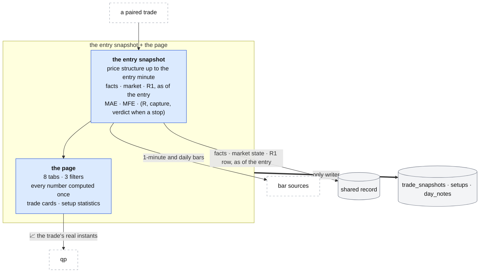

# The journal: the entry snapshot and the page

**Above:** [JOURNAL.md](JOURNAL.md) §3 (the entry snapshot, the page).

**Talks to:**
- the [front door](../02-front-door/FRONT-DOOR.md) (`/journal/`);
- the [shared record](../09-shared-record/SHARED-RECORD.md): the facts, the market
  state and the R1 row known at a trade's entry;
- the [research worker](../06-research-worker/RESEARCH-WORKER.md), whose O'Neil
  facts the snapshot reads as of the entry;
- the [data sources](../08-data-sources/DATA-SOURCES.md): 1-minute and daily bars;
- [qp](../05-qp/QP.md): the chart of a trade;
- the journal's own [file](../04-files/FILES.md).

---

## 1. What it is

**What was true at the entry, and the patterns across trades.** Once a trade is
paired ([IMPORT.md](IMPORT.md)), the journal takes an **entry snapshot** — the
price structure from bars up to the entry minute, and the facts, the market state
and the R1 row **as they were known at the entry** — and measures how far the
trade ran for and against the trader (MAE and MFE). The **page** then shows every
trade and the patterns across them: by hour, weekday, price, size, side and
setup.

**What it owns:** each trade's entry snapshot, the setups, the day notes, and
every number on the page.

**What it never does:** look at anything known after the entry, or grade a trade
for execution.

---

## 2. The diagram

---

## 3. Its parts

### 3.1 The entry snapshot

Computed **as of the entry minute**, never falling back to "the last bar of the
day":

- **The price structure** from 1-minute bars up to the entry minute, plus the
  history the multi-day levels need (fetched, not left blank): VWAP and the EMAs
  and SMAs at the entry bar, Bollinger bands, the 5-day MA and its slope,
  2-day / week / month VWAP and highs/lows, the prior day's high and low, and
  where price sits against each. Bars are read in New York time, so the window is
  the real session the year round (D-J8).
- **The facts, the market state and the R1 row as known at the entry**, read from
  the [shared record](../09-shared-record/SHARED-RECORD.md) — the regime, the
  sector read, the O'Neil letters and the tool's own frozen card for that ticker
  and day. Not a table the journal never writes (D-J13).
- **MAE and MFE** between the entry and the exit: the worst and best excursion,
  as a % of the entry price.
- **R, capture and the verdict**, when the trade has a stop: R = P&L per share ÷
  |entry − stop|; capture = P&L per share ÷ MFE; the verdict reads from capture.
  A stop comes in with every trade now ([IMPORT.md](IMPORT.md)), so these are no
  longer always blank (D-J9).

### 3.2 One condition system over the snapshot

**One** condition system, not the old two (templates and a check library side by
side), and its fields are the ones the snapshot actually stores — so a condition
can be judged, where 55 of the old 77 seeded checks could never answer (D-J13). A
condition is direction-aware (what is aligned for a long is reversed for a
short), and a missing input reads as **blank**, never as "not aligned" (D-J19).

### 3.3 Setup statistics

Per setup, over its closed trades with an R: win rate, average win and loss R,
expectancy, profit factor, max drawdown, and the conditions that move the
result. This replaces the old grading engine, which could never produce a number
(it needed an R and no trade had a stop) and which nothing on the page read. It
is built only because the page now shows it (D-J14).

### 3.4 The page

Eight tabs over the trades the three filters (account, setup, source) narrow;
**every number is computed in one place**, so the page and the server never
disagree (D-J17):

| Tab | Shows |
|---|---|
| **Overview** | closed P&L, win % and long % rings, insights (the buckets that made or lost the most), six tiles (net P&L, win rate, profit factor, expectancy, payoff, max drawdown), the equity curve, and a strip (SQN, Kelly, recovery, consistency, streaks) |
| **Calendar** | a month grid of weekday net P&L and trade counts, with weekly totals; weekend trades are not dropped (D-J20) |
| **Time** | net P&L, trades, win rate and $/trade by entry hour, weekday, entry price and position size; and hold time, winners vs losers |
| **Risk** | the risk snapshot, the R-multiple distribution, and the P&L distribution |
| **Stats** | performance, trade, time, cost and volume groups, and the symbols with the largest net P&L |
| **Setups** | one row per setup with at least three closed trades: trades, win rate, $/trade, profit factor, total, average R, a small equity curve (§3.3) |
| **Trades** | per day, one card per trade (§3.5); the accounts and connectors panel sits above the list ([IMPORT.md](IMPORT.md)) |
| **Import** | the file import and its report ([IMPORT.md](IMPORT.md)) |

The numbers follow the old desk's definitions: a trade at exactly 0 is neither a
win nor a loss (but still a closed trade); profit factor is blank with no losing
trade, never ∞; drawdown walks the equity curve in exit order; times are shown in
New York whatever the browser.

### 3.5 A trade card, and the chart

Each card shows the ticker, side, setup and account; net P&L and % move (signed
by direction for every source, D-J20); the date, entry, exit, shares, durations,
stop and target; and the notes. The **setup, stop, target, fees and notes can be
edited on the page**, not only through the API. The **📈** link opens qp's print
sheet of that stock and day with the entry and exit drawn — at the trade's
**real** instants, so the marks land on the right bar (D-J10).

---

## 4. Contracts

**The code:** `journal/server.js`, behind the front door at `/journal/`.

| It owns (the journal's file) | Key |
|---|---|
| `trade_snapshots` (the entry snapshot, one per trade) | trade |
| `setups` | id |
| `day_notes` | day |

| It reads | From |
|---|---|
| facts, the market state and the R1 row, as of the entry | the shared record |
| 1-minute and daily bars | the bar sources ([DATA-SOURCES.md](../08-data-sources/DATA-SOURCES.md)) |

| Routes, behind `/journal/` | Do |
|---|---|
| `GET /api/journal/trades` (filters); `GET /api/journal/trades/:id` | trades; one trade with its executions and its snapshot |
| `PATCH /api/journal/trades/:id` | stop, target, fees, setup, notes, tags |
| `GET/POST/PATCH /api/journal/setups` | the setups the page edits |
| `GET /api/journal/stats` (filters) | every number of the page, computed in one place |

---

## 5. When it fails

| Event | What happens |
|---|---|
| the shared record is down | the snapshot waits and says so; trades still import and the page still shows P&L |
| a bar source returns nothing for the entry day | the snapshot says which values it could not compute; it never falls back to the last bar |
| a trade has no stop | R, capture, the verdict and the setup statistics for it are blank, and say they need a stop |
| a condition's input is missing | the condition is blank, never "not aligned" |

---

## 6. Built on

**The old desk:** [legacy/journal/PAGE.md](../../legacy/journal/PAGE.md) (every
tab and formula) and
[legacy/journal/ANALYSIS.md](../../legacy/journal/ANALYSIS.md) (the technical
snapshot, the two condition systems, the grading engine).

**What failed there:**

| ID | Fault | Prevented by |
|---|---|---|
| D-J8 | the bar window used a fixed −05:00 offset, so half the year it started an hour late and the snapshot fell back to the last bar | bars read in New York; the entry bar chosen by time |
| D-J13 | RVOL, ATR, pre-market levels and the market context were blank, and the multi-day levels saw the whole day | computed as of the entry; context read from the shared record |
| D-J14 | the grading half had no writer, no screen, and needed an R no trade had | setup statistics on the page, over trades that now carry a stop |
| D-J17 | the server's numbers differed from the page's | every number computed in one place |
| D-J19 | five rules read missing data as "not aligned" | a missing input is blank |
| D-J10 | the 📈 chart marked the trade 4–5 hours early | the trade's real instants |
| D-J20 | weekend trades dropped; a 0 trade broke no streak; a short's % move unsigned | corrected |

---

## 7. Status

| Part | Status |
|---|---|
| the page and its formulas | **built** (legacy, kept) |
| real New York instants | **built** (step 4) |
| the entry snapshot from the shared record; MAE and MFE | **to build** |
| stops on every trade (from [IMPORT.md](IMPORT.md)) | **to build** |
| one condition system over the snapshot; setup statistics | **to build** |
| the setup, stop, target, fees and notes editable on the page | **to build** |
