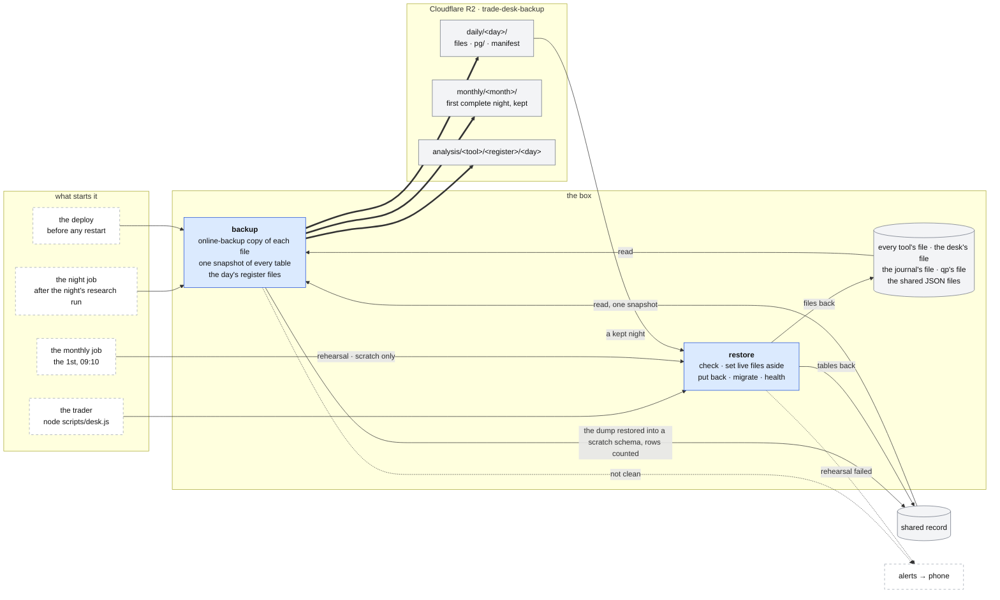

# Backups

**Above:** [ARCHITECTURE.md](../../ARCHITECTURE.md) §4.7 (outside the box) and
§8 (running it).

**Talks to:**
- the [desk's jobs](../03-desk/JOBS.md): the night job starts the backup after the
  night's research run, and the monthly job starts the rehearsal;
- the [deploy](../01-box/BOX.md) (§4.2), which backs up before it restarts
  anything;
- every [file](../04-files/FILES.md) on the box, which it reads;
- the [shared record](../09-shared-record/SHARED-RECORD.md), which it dumps;
- Cloudflare R2, where everything goes;
- the [alerts](../11-alerts/ALERTS.md), for a night that is not clean.

---

## 1. What it is

**A copy of everything the desk records, off the box, every trading night,
proven restorable.**
- **The backup** copies every file on the box and every table of the shared
  record to cloud storage (a Cloudflare R2 bucket). It then proves the copy of
  the shared record by restoring it into a scratch area and counting the rows.
- **The restore** puts any kept night back with one command.
- **The rehearsal** restores the newest night every month, so the restore is
  known to work before it is needed.

It also leaves **analysis files** in the bucket: each tool's records as one
file per day, which analysis tools such as DuckDB or pandas read in place.

**What it never does:**
- copies a secret;
- writes over a live file without moving it aside first;
- counts a night as kept when anything in it is missing.

**Why it matters.** The box is one machine with no second copy. Each tool's
file is the record of its research, and a lost file is a lost history. The
shared record's copy of the tools' records covers the hours since the last night
([SHARED-RECORD.md](../09-shared-record/SHARED-RECORD.md)); the backup covers everything else.

---

## 2. The diagram



---

## 3. Its parts

### 3.1 When it runs

| Trigger | When | Why |
|---|---|---|
| **the night** | each trading night, as soon as the night's research run ends, whatever its result | a dependency, not a clock time: the backup holds the night's facts. Tonight's registers are worth keeping even on a night the research failed |
| **the deploy** | before it restarts any program | a restart is when migrations run, so there is always a copy from just before a schema changed |
| **by hand** | `node scripts/backup-r2.js` (`--dry-run` builds everything and uploads nothing) | |

### 3.2 What it copies

| Source on the box | In the bucket |
|---|---|
| every SQLite file in `data/`: each tool's file, running or stopped (T1's is `tradedesk.db`), and the desk's own file | `data/<same>.db.gz` |
| the journal's file, `data/journal/journal.db` | `data/journal/journal.db.gz` |
| qp's file, `~/.qp/platform.db` | `qp/platform.db.gz` |
| the shared JSON files in `data/` (the tool registry, and the files being retired, [FILES.md](../04-files/FILES.md)), but no secret file | `data/<same>.json.gz` |
| every table of the shared record, read in **one snapshot** | `pg/<table>.jsonl.gz`, JSON lines; no `pg_dump` is needed on the box |

**Consistent copies.** Each SQLite file is copied with SQLite's online backup
API, so a copy taken while the desk is writing is still a whole database, never
half a write. The shared record is read in one transaction, so its tables agree
with each other.

**Stopped tools are included.** Their files are the only copy of what they
collected.

### 3.3 What it never copies

| File | Why |
|---|---|
| `data/keys.json` | the API keys and the shared record's address |
| `data/r2.json` | the backup's own credentials |
| `data/auth.json` | the login's password hash and signing secret |
| `data/journal/journal-accounts.json` | the journal's Alpaca account keys |

**A backup must not be the place a key leaks from** (S-2). The trader keeps
their own copy of the secrets, and a restore puts them back from it
([BOX.md](../01-box/BOX.md) §4.3).

**Not copied, because they rebuild themselves:**

| What | How it comes back |
|---|---|
| the bar caches (`~/.qp-cache/`) | fetched again on demand |
| trained score models (`src/scoring/outputs*`) | trained again from the registers. When a model is chosen, models become rows in the shared record, and the dump carries them ([LEARNING.md](../03-desk/tool/LEARNING.md)) |
| the comparison copy's file (`data/worker/`) | disposable: it is rebuilt from the tool's file |
| logs, qp's operations log | logs, not records |
| the code | the repository |

### 3.4 The bucket

```
trade-desk-backup/
├── daily/<day>/                    one folder per night, by New York date
│   ├── manifest.json               what was copied, sizes, sha256, failures, the check
│   ├── data/<file>.db.gz           every SQLite file
│   ├── data/<file>.json.gz         the shared JSON files
│   ├── data/journal/journal.db.gz
│   ├── qp/platform.db.gz
│   └── pg/<table>.jsonl.gz         every table of the shared record
├── monthly/<month>/                the first complete night of each month, kept
└── analysis/<tool>/<register>/<day>   one file per tool, register and day
```

**The manifest.** One per folder: the date, the start and end, the host, each
file with its kind, bytes and sha256, the register files with their row counts,
the shared record's tables with their row counts and the check's result
(`pg.verified`), `failures` (anything that should have been copied and was not)
and `notes` (not failures: a register with no rows that day).

**The check.** Before a night counts as kept, the dump is restored into a
scratch schema of the shared record and each table's rows are counted against
the live counts read in the same snapshot. A mismatch fails the night.

**A month is kept** only from a night with zero failures. The month's own
manifest is written last, and only then. While it is missing, each night writes
its copy to the month again. So a failed night is retried the next night, and
the month is never marked kept with a file missing.

**Retention** is set on the bucket, not in code: a lifecycle rule deletes each
`daily/` folder after 60 days. `monthly/` and `analysis/` are kept.

**Size.** About 17 MB compressed a night (measured 2026-10-02).

### 3.5 The analysis files

Each tool's registers for the day, one file per tool, register and day,
written as the registers are defined in [REGISTERS.md](../03-desk/tool/REGISTERS.md).
- **Format:** Parquet, so the columns keep their types and DuckDB and pandas
  read them in place. Today they are gzipped CSV, nested values as JSON in the
  cell.
- **How they are read:** through the desk's register code, with each tool's
  file opened read-only. A running tool, a stopped one and a desk that is down
  all export the same way, and the same answer the pages and qp get.
- `node scripts/backup-r2.js --all-dates` exports every past day, after a
  restore or a tool's history import.

```sql
SELECT * FROM read_parquet('analysis/T2/R1/*.parquet');
```

### 3.6 The restore

One command, `scripts/desk.js`, for the files and the shared record together:

| Command | Does |
|---|---|
| `node scripts/desk.js restore --list` | the nights and months kept, each with its manifest's result |
| `node scripts/desk.js restore <day> --to scratch` | the shared record into a scratch schema and the files into `restore/<day>/`; nothing live is touched |
| `node scripts/desk.js restore <day> --yes` | puts that night back on this box. Without `--yes` it only says what it would do |
| `node scripts/desk.js restore monthly/<month> --yes` | the same, from a monthly copy |
| `node scripts/restore-r2.js <day> [file \| all]` | download only, into `restore/<day>/` |

**A live restore, in order:**
1. checks every download against its sha256, and every SQLite file's
   integrity;
2. stops the programs (the desk, qp, the journal);
3. moves each live file aside to `<file>.pre-restore-<time>`, never deleting
   it, and dumps the live shared record to `restore/pre-restore-<time>/pg/`;
4. puts the night back;
5. runs the migrations;
6. starts the programs and checks each one's health;
7. prints each table's rows against the manifest.

### 3.7 The rehearsal

On the 1st of each month at 09:10 New York, the monthly job restores the newest
complete night into the scratch schema, counts every table and checks every
SQLite file's integrity. A failure is a red alert. By hand:
`node scripts/desk.js rehearse`.

### 3.8 A new box

1. Make the box and deploy: `./deploy-tools.sh` starts empty
   ([BOX.md](../01-box/BOX.md)).
2. Put the secrets back from the trader's copy: `scripts/set-r2-keys.sh`, the
   shared record's address, `scripts/set-password.sh`.
3. `node scripts/desk.js restore <day> --yes`.
4. Put the API keys back (`scripts/set-setting.js`, `scripts/set-alpaca-keys.js`)
   and the journal's accounts.

Nothing else is copied by hand.

**The proof, once:** a fresh box, restored with one command, serves the same
pages and numbers as the old one for a chosen past day.

### 3.9 Its credentials

`scripts/set-r2-keys.sh` asks for the R2 endpoint, the access key id, the
secret (typed hidden) and the bucket. It writes `data/r2.json` at mode 0600 and
tests the keys with a read-only request.
- **The key:** a Cloudflare account API token scoped to this bucket, with
  object read and write.
- **To rotate:** create a new token, run the script again, delete the old one.

---

## 4. Contracts

| It reads | It writes |
|---|---|
| every file in §3.2, read-only; the shared record, in one snapshot | the bucket; the scratch schema of the shared record, for the check; its run record, through the desk's jobs |

| The restore reads | It writes |
|---|---|
| a kept night or month | `restore/<day>/`; with `--yes`, the live files and the shared record, after setting the old ones aside |

**Its run record.** The night job and the monthly job record each run in the
desk's job history ([JOBS.md](../03-desk/JOBS.md)): the files and bytes copied,
the register files, the check's result, the failures. A night that is not clean
fails the job, and the job alerts.

---

## 5. When it fails

| Event | What happens |
|---|---|
| a file cannot be copied | the night is recorded with that failure and alerts. The month is not marked kept, so the next night tries again |
| the dump does not verify | the night fails and alerts; the previous kept night stands |
| R2 is unreachable, or the keys are wrong | the night fails and alerts with the reason. The files on the box and the shared record's copy of the registers are untouched |
| no `data/r2.json` | the backup is off, and says so in the night's record and on the health page |
| the rehearsal fails | a red alert. Until it passes, the restore is not known to work |
| a restore stops midway | the files set aside (`<file>.pre-restore-<time>`) and the live shared record's dump are kept. Putting them back is the same restore, from the set-aside copies |
| the box is lost | §3.8. Photos taken since the last night are in the shared record's copy of the registers |

---

## 6. Built on

**The old desk.**
- **A GitHub backup** pushed the API keys in plain text (S-2). It is gone.
- **Then a nightly R2 backup** under a pm2 cron, weekdays 23:20 UTC and once at
  every deploy. It copied every file but kept no history, did not alert, and
  ran fifty minutes after the O'Neil chain started, whether or not the chain had
  finished.
- **Restore was manual:** download, stop each program by hand, copy each file,
  delete its journal files, start again. A full restore onto a box had never
  been done.

The design that made it: the old PLATFORM §5–6, now carried here.

**The code:**
- `scripts/backup-r2.js`, `src/backup/r2.js`, `src/backup/pg.js`;
- `scripts/desk.js` and `src/backup/restore.js` (restore and rehearsal);
- `scripts/restore-r2.js`, `scripts/set-r2-keys.sh`;
- `src/jobs/night.js` (the night: the chain, then the backup);
- `tests/backup.r2.test.js`, against a fake S3 server;
- the code repository's `docs/BACKUPS.md`.

---

## 7. Status

| Part | Status |
|---|---|
| the nightly backup, the verified dump, the monthly copies, the one-command restore, the monthly rehearsal | **built** (step 13) |
| started by the desk's night job after the research run | **built**. It runs from the old pm2 cron until `scripts/retire-old-schedulers.sh` hands it over (step C) |
| the backup before every deploy | **to build** (step C). Today the pm2 cron runs it once at each deploy, beside the restarts rather than before them |
| the analysis files read through the desk with each file opened read-only | **to build** (step A, when the archive stops). Today each tool's port and the archive serve them |
| the analysis files as Parquet, under the registers' new names | **to build**. Today gzipped CSV, under the old names (R3A, R3B, R4A, R4B) |
| three monthly rehearsals passed | **to do**. Until then, the old manual steps stay written down |
| the new-box test | **to do**, once, before the old manual steps retire |
