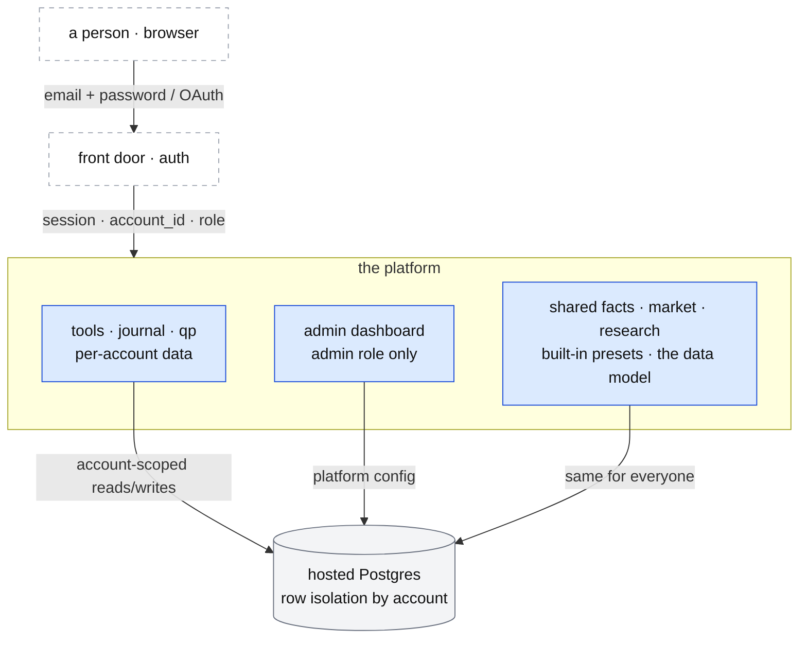

# Accounts, login and roles

**Above:** [ARCHITECTURE.md](../../ARCHITECTURE.md) — the **deployment modes**
section (solo vs hosted).

**Talks to:**
- the [front door](../02-front-door/FRONT-DOOR.md), which authenticates every
  request;
- the [data model](../DATA-MODEL.md), whose account-scoped tables isolate each
  tenant;
- the [admin dashboard](../14-admin/ADMIN.md), which the **admin** role reaches;
- every tool, the [journal](../07-journal/JOURNAL.md) and
  [qp](../05-qp/QP.md), whose per-user data (shortlists, custom screeners,
  trades, settings) is keyed by account.

---

## 1. What it is

**Who is using the platform, and what they are allowed to do.** This is a
**hosted-mode** concern. In solo mode there is one trader, one login and no
roles ([ARCHITECTURE §2](../../ARCHITECTURE.md#2-what-shapes-the-design)); the
design below is carried in the schema from the start so the build is
mode-ready, and the auth and isolation are **switched on when the product goes
commercial**.

**What it owns:** accounts, sessions, roles, and the rule that one account never
sees another's results.

**What it never does:** hold a trading permission (the platform places no
orders), or let a tool read another account's data.

---

## 2. The diagram

---

## 3. Its parts

### 3.1 Roles

| Role | Can | Cannot |
|---|---|---|
| **user** | use the tools, keep shortlists, build custom screeners, run the journal on their own accounts, set their own preferences | reach the admin dashboard; see another account's data; change providers or platform config |
| **admin** | everything a user can, plus the [admin dashboard](../14-admin/ADMIN.md): providers, keys, feature flags, thresholds, health, (later) plans and users | — |

Two roles are enough for launch. Finer roles (support, read-only ops) and
**plan tiers** (free/paid feature gates) are a later addition and are noted, not
designed, here.

### 3.2 What is per-account, and what is shared

This is the single most important boundary, and it follows the existing design's
"results stay apart, facts are shared" rule
([ARCHITECTURE §5](../../ARCHITECTURE.md#5-how-the-blocks-share-data)).

| Per-account (isolated) | Shared (same for everyone) |
|---|---|
| shortlists (`user_stock_list_item`) | facts about the world (quotes, bars, fundamentals, news) |
| custom screeners and their runs/results (`screener_definition.owner`, …) | the market snapshots and the O'Neil research |
| journal accounts, trades and notes | the built-in screener presets (T1/T2/T7) |
| preferences, saved layouts | the data model and the catalogs |

A **built-in preset** is shared and read-only to a user; selecting it creates
that user's own run/result rows, never shared. This keeps the desk's "a tool is
an experiment" idea per-user by default; **shared or curated screeners** across
accounts are a deliberate later option, not the default.

### 3.3 Isolation, enforced

- Every per-account table carries an `account_id`; reads and writes are filtered
  by the session's account. In Postgres this is enforced with **row-level
  security**, so isolation does not depend on every query remembering a `WHERE`.
- The **admin dashboard** is gated by the `admin` role, checked at the front door
  and again at the data layer.
- Solo mode fills `account_id` with one implicit account and leaves auth off.

### 3.4 Authentication

- Email + password with a verified email, password reset, and sessions; optional
  OAuth providers later. Since the record is a hosted Postgres
  ([DATA-MODEL.md](../DATA-MODEL.md)), a managed auth service (e.g. Supabase Auth)
  is the likely mechanism — chosen at build time, not fixed here.
- **Secrets stay put:** password hashes, session secrets and provider keys never
  appear in a reply, a log or a backup
  ([ARCHITECTURE §7](../../ARCHITECTURE.md#7-rules-that-apply-everywhere),
  [BOX.md](../01-box/BOX.md) §4.3).

---

## 4. Contracts

| It owns (hosted mode) | Holds |
|---|---|
| `account` | id, email, role (`user`/`admin`), state, created |
| `session` | account, issued/expiry, device (as the auth service models it) |
| the `account_id` on every per-account table | the isolation key ([DATA-MODEL.md](../DATA-MODEL.md) §3.7) |

| Reader | Reads |
|---|---|
| the front door | the session → account and role, on every request |
| every tool | only its caller's account-scoped rows |
| the admin dashboard | platform-wide config, if the role is admin |

---

## 5. When it fails

| Event | What happens |
|---|---|
| not signed in (hosted) | the tools are closed; the login page explains how to sign in |
| a user reaches an admin route | refused; the UI says it needs the admin role, not a vague error |
| a query omits the account filter | row-level security still blocks cross-account rows; the gap is a bug, not a leak |
| solo mode | one implicit account; no login friction |

---

## 6. Built on

- the desk's "results stay apart, facts are shared" rule
  ([ARCHITECTURE §5](../../ARCHITECTURE.md#5-how-the-blocks-share-data));
- the front door's one-login model, extended to many accounts
  ([FRONT-DOOR.md](../02-front-door/FRONT-DOOR.md));
- the account-scoped tables in the [data model](../DATA-MODEL.md) (§3.7);
- the commercial direction decided 2026-10-14 ([ARCHITECTURE §10](../../ARCHITECTURE.md#10-decisions)).

---

## 7. Status

| Part | Status |
|---|---|
| account scoping present in the data model | **designed** ([DATA-MODEL.md](../DATA-MODEL.md) §5) |
| roles (user/admin), isolation rules, auth approach | **designed** (this document) |
| auth, sessions and row-level security switched on | **to build, in hosted mode** (when commercial) |
| plan tiers / finer roles / billing | **later**, noted not designed |
