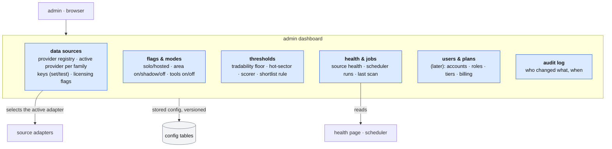

# The admin dashboard

**Above:** [ARCHITECTURE.md](../../ARCHITECTURE.md) — the **deployment modes**
section (solo vs hosted).

**Talks to:**
- the [data sources](../08-data-sources/DATA-SOURCES.md), whose provider registry
  and keys it manages — **this is where free sources are swapped for licensed
  ones**;
- [accounts](../13-accounts/ACCOUNTS.md), which gate it to the **admin** role;
- the [alerts & health page](../11-alerts/ALERTS.md) and the
  [scheduler](../03-desk/JOBS.md), which it surfaces;
- the tools' own [Settings](../03-desk/tool/PAGES.md), which it sits above.

---

## 1. What it is

**The operator's control panel: change how the platform runs, without touching
code.** It is where the one decision the trader called out is made — *use free
data now, switch to licensed, commercial data when the product is sold* — and it
makes that switch, and others like it, a setting rather than a deploy.

In **solo mode** the single trader is the admin, and this is their control
panel. In **hosted mode** it is reached only by the `admin` role
([ACCOUNTS.md](../13-accounts/ACCOUNTS.md)).

**What it owns:** the platform's **configuration** — the active providers and
their keys, the feature flags, the platform-default thresholds — as stored,
versioned, audited records.

**What it never does:** hold the facts themselves (those are the
[data model](../DATA-MODEL.md)), compute anything, or expose a secret value once
it is saved (keys are write-and-test, never shown back —
[DATA-SOURCES.md](../08-data-sources/DATA-SOURCES.md) §3.6).

---

## 2. The diagram

---

## 3. Its parts

### 3.1 Data sources — the swap

The reason this dashboard exists. It reads the **provider registry**
([DATA-SOURCES.md](../08-data-sources/DATA-SOURCES.md)) and lets the admin:

- see every fact family (quotes, bars, short interest, borrow, news,
  fundamentals, index/sector quotes) and the **providers that can serve it**
  — the full field-by-field map is [DATA-CATALOG.md](../08-data-sources/DATA-CATALOG.md);
- pick the family's **mode** — *prime + backup* (one active provider + an ordered
  fallback) or *merge* (several sources live at once, de-duplicated, e.g. news and
  the macro calendar) — and **enable/disable or rank** each source in it;
- **set and test** each provider's API key; a bad key fails the test loudly and
  the health page names it;
- read each provider's **licensing / commercial-use flag**.

**The commercial guard:** in hosted/commercial mode, a provider whose
licensing flag is not "ok for commercial" (free/unofficial sources such as the
TradingView scrape or Yahoo) **cannot be made the active provider**; the
dashboard refuses it and says why. In solo mode the free sources are allowed.
This is the mechanism behind "use free now, switch to licensed when commercial."

### 3.2 Flags & modes

Deployment mode (solo/hosted) and the per-area switches the design already has —
`factsMode`, `marketMode`, `researchMode`, etc.
([SHARED-RECORD.md](../09-shared-record/SHARED-RECORD.md) §3.6), each **off /
shadow / on** — plus enabling or pausing whole tools
([HOME.md](../03-desk/HOME.md)). The dashboard is the one place these are read
and set.

### 3.3 Thresholds & platform defaults

The platform-wide defaults the tools inherit: the tradability floor, the
hot-sector and sector-bias thresholds, the scorer on/off, the shortlist rule
([SCREENERS.md](../03-desk/tool/SCREENERS.md), [LEARNING.md](../03-desk/tool/LEARNING.md)).
A tool's own **Settings** tab still tunes that tool; the dashboard sets the
defaults and the platform-level values. (Per-tool screener config stays in the
tool's Settings — [PAGES.md](../03-desk/tool/PAGES.md) — this dashboard does not
duplicate it.)

### 3.4 Health & jobs

A read-only view over the [health page](../11-alerts/ALERTS.md) and the
[scheduler](../03-desk/JOBS.md): each data source's health and last error, the
scheduled jobs and their last runs, the last scan's result. A red source links
to §3.1 to fix its key or swap it.

### 3.5 Users & plans — *later*

Listing accounts, setting roles, and (when the product charges) plan tiers and
billing. Designed as a slot, not built now ([ACCOUNTS.md](../13-accounts/ACCOUNTS.md)).

### 3.6 Audit log

Every change made here is recorded — who, when, what changed, old value → new
value — and the configuration is **versioned**, so a bad change can be seen and
rolled back. Key *values* are never logged, only that a key changed.

---

## 4. Contracts

| It owns (config, versioned) | Holds |
|---|---|
| `provider_config` | per family: active provider, fallback order, enabled |
| `provider_key` | per provider: the secret (write/test only), set-at, last test result |
| `feature_flag` | mode, per-area switch, per-tool enabled |
| `platform_setting` | the default thresholds and rules |
| `admin_audit` | who changed what, when; config version |

Keys live in the secret store, not in a readable table
([BOX.md](../01-box/BOX.md) §4.3); `provider_key` holds a reference and the test
result, never the value.

| Reader | Reads |
|---|---|
| the source adapters | the active provider and key per family |
| the tools | the platform defaults they inherit |
| the health page | the same config, to judge each source |

---

## 5. When it fails

| Event | What happens |
|---|---|
| a non-admin opens it | refused; the UI says it needs the admin role |
| a key test fails | the change is saved as "untested/failed", the source stays `unavailable · key not set/refused`, and the health page names it |
| an unlicensed provider is chosen in commercial mode | refused, with the licensing reason; the previous provider stays active |
| a bad config change | the audit log shows it; the previous config version can be restored |

---

## 6. Built on

- the existing **keys-in-Settings** requirement (legacy fault D-T4) and the
  adapter contract ([DATA-SOURCES.md](../08-data-sources/DATA-SOURCES.md) §3.1, §3.6);
- the per-area **switches** already in the shared record
  ([SHARED-RECORD.md](../09-shared-record/SHARED-RECORD.md) §3.6);
- the **health page** and scheduler ([ALERTS.md](../11-alerts/ALERTS.md),
  [JOBS.md](../03-desk/JOBS.md));
- the commercial direction and the "swap sources from an admin dashboard"
  requirement (the trader, 2026-10-14).

---

## 7. Status

| Part | Status |
|---|---|
| provider registry, swap, licensing guard — as a design | **designed** (this document; extends [DATA-SOURCES.md](../08-data-sources/DATA-SOURCES.md)) |
| flags/modes and thresholds surfaced in one place | **designed** (the switches and settings already exist) |
| the dashboard itself, config tables, audit log | **to build** (hosted mode / when commercial) |
| users, plans, billing | **later** |
