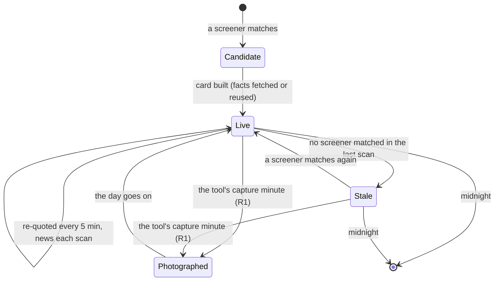

# The card

**Trunk section:** [§6.3 The card](../ARCHITECTURE.md#63-the-card). The
largest domain of the desk.

**Talks to:** Sources (§6.1) for every external fact; Tools and screeners
(§6.2) for candidates; the Market (§6.4) for market context; Research data
(§6.5) for the CANSLIM reading; Learning (§6.7) for the score; Registers
(§6.6), which freeze it.

**Built on:** [CARD-FIELDS](../legacy/screeners/CARD-FIELDS.md) (97 fields),
[CARD](../legacy/screeners/CARD.md) (layout and display),
[DATA-PIPELINE](../legacy/screeners/DATA-PIPELINE.md) (how each value is fetched and
computed), [CANSLIM](../legacy/qp/CANSLIM.md) §7, §11–§14 (the locked CANSLIM card
spec and what was built of it), and the code in `src/sideA`–`sideG` and
`public/index.html`.

---

## Contents

1. [What a card is](#1-what-a-card-is)
2. [The legacy card in full](#2-the-legacy-card-in-full)
3. [What was planned and never built](#3-what-was-planned-and-never-built)
4. [What failed](#4-what-failed)
5. [The new design](#5-the-new-design)
6. [Contracts](#6-contracts)
7. [How the rebuild is proven](#7-how-the-rebuild-is-proven)

---

## 1. What a card is

A card is **everything the desk knows about one ticker on one trading day**,
on one surface the trader reads in seconds, with the depth one tap away.

It answers, top to bottom:

1. What is it, and what is it doing right now? (ticker, price, change, live)
2. Why is it here? (which screeners, since when, any catalyst)
3. How does its price sit against its levels? (MAs, VWAP, previous close,
   open, pre-market high and low, ranges)
4. How much fuel? (relative volume, float, market cap, short interest, borrow)
5. What is the story? (news, catalyst)
6. Is it an O'Neil leader? (the CANSLIM reading)
7. Is the market with it? (regime, trend stages, sector)
8. How likely is it to move, by this tool's history? (the score)

**Two layers.** In the old desk each tool built its own copy of every card.
In the new design:

| Layer | Holds | One per |
|---|---|---|
| **card** | every fact about the ticker: quote, derived numbers, short interest, borrow, news, catalyst, market context, CANSLIM | ticker × trading day (shared by every tool) |
| **tool card** | what one tool adds: which of its screeners matched and when, first seen, live or stale, its star, its score, the trader's manual bias | tool × ticker × trading day |

### Its day



A stale card stays on screen, dimmed, and keeps being re-quoted. The photo
takes live and stale cards alike.

---

## 2. The legacy card in full

Every field below is kept in the new design. The `#` column is the field's
number in [CARD-FIELDS](../legacy/screeners/CARD-FIELDS.md), so each can be traced.

### 2.1 Layout

```
┌──────────────────────────────────────────────────────────┐
│ NVDA  TV↗  $128.40  +4.12%  ● Live          72  ☆        │  header
│ Electronic Technology · Semiconductors      B4 main      │
├──────────────────────────────────────────────────────────┤
│ first seen 09:12 · 18m before open  ★ also T7            │  badges
│ [Big Move 09:12] [Pre-Mkt 08:30]  🔥 HOT  ▲▲ ALL BULL     │
│ ⚡ Earnings Beat +1                                       │
├──────────────────────────────────────────────────────────┤
│ ▲9MA ▲13MA ▲20MA ▲50MA ▲5MA ▲VWAP ▲PDC ▲OPEN ▲PMH ▲PML   │  signal tags
│ 9>13>20>50   Q4 range   PM/ADR 1-2 · 1.34×               │
├──────────────────────────────────────────────────────────┤
│ ▸ Chart · Volume & Float · Range · News · CANSLIM ·      │  folds, closed,
│   Themes · Market Context · Price · EMAs · ATR & Move ·  │  each with a
│   Pre-Market Range                                       │  one-line summary
├──────────────────────────────────────────────────────────┤
│ score breakdown (opens when the score is tapped)         │
└──────────────────────────────────────────────────────────┘
```

One level of folding: every section is a fold, closed by default, and each
closed fold shows its key numbers on its heading line.

### 2.2 Header and badges

| # | Field | Source | Rule | Blank means |
|---|---|---|---|---|
| 1 | Ticker | TradingView | tap opens the full chart | never blank |
| — | `TV ↗` | TradingView symbol | links to `tvSymbol` (e.g. `NASDAQ:AAPL`) | — |
| 2 | Price | TradingView `close` | plain text: a price is a fact | never blank |
| 3 | Change % | TradingView `change` | green up, red down | never blank |
| 4 | Live / Stale | desk | Live = matched in the last scan; Stale = matched earlier today; stale is dimmed | outside the live window |
| 5 | Sector · Industry | TradingView labels | — | a fault: TradingView always sends them |
| 6 | Score | the tool's model | 0–100; ≥ 70 high, ≥ 40 mid; tap opens the breakdown | today always `—` (scorer off, D-D1) |
| 7 | Table label (`B4 main`, `B4 sub:STRONG_UP`) | the model | which scoring table produced the score; tap opens it | as 6 |
| — | ☆ / ★ | this tool's shortlist | yellow: the trader's own mark | — |
| 8 | First seen `HH:MM` · `Nm before open` / `at the open` / `+Nm` | desk (`seenAt`) | earliest match by any of this tool's screeners; pre-market, early (≤ 30 min after the open) and late styled differently | a fault |
| — | ★ also T2 T7 | the unified shortlist | violet: another tool's opinion | not shortlisted elsewhere |
| 9 | Screener badges, each with its first-match time | desk | one per screener that matched today; faded when it did not match in the last scan; tooltip gives its window | — |
| 10 | 🔥 HOT | market engine | the card's sector is hot | not hot |
| — | ▲▲ ALL BULL / ▼▼ ALL BEAR | desk | price above EMA 9, 13, 20, 50, SMA 5, VWAP, previous close, open and PM low; stack 9>13>20>50; **and** the catalyst bullish. Bearish mirror uses the PM high | not aligned |
| 11 | Catalyst badge | news | ⚡ tier 1, ● tier 2, · tier 3, 📈 technical; `+N` more; dimmed when the story is over 4 days old; tooltip: tier, detail, corroborating headlines, age, confidence, evidence | no catalyst in the window: normal |

### 2.3 Signal tags

| # | Field | Rule |
|---|---|---|
| 12 | Ten level tags: `9MA 13MA 20MA 50MA 5MA VWAP PDC OPEN PMH PML` | ▲ green when price is above the level, ▼ red below; tooltip gives the distance in %; no level, no tag |
| 13 | Stack | `9>13>20>50` (bull), `9<13<20<50` (bear) or `MA mixed`, with `n/3` in order |
| 14 | Month quarter | `Q1 range` … `Q4 range`: the price's position in the 1-month range |
| 15 | PM/ADR band | `<0.5`, `0.5-1`, `1-2`, `2-3`, `3+`, with the ratio |

### 2.4 The quote: 32 TradingView columns

Asked for on every scan and every 5-minute refresh:

| TradingView column | Card field | | TradingView column | Card field |
|---|---|---|---|---|
| `close` | `price` | | `High.1M` / `Low.1M` | `monthHigh` / `monthLow` |
| `open` | `open` | | `High.5D` / `Low.5D` | `weekHigh` / `weekLow` (5 sessions) |
| `change` | `change` (% today) | | `High.3M` / `Low.3M` | `quarterHigh` / `quarterLow` |
| `change_from_open` | `_changeFromOpen` | | `price_52_week_high/low` | `yearHigh` / `yearLow` |
| `relative_volume_intraday\|5` | `rvol` (preferred) | | `High.All` | `allTimeHigh` |
| `relative_volume_10d_calc` | `rvol` when the intraday one is empty or 0 | | `high` / `low` | `dayHigh` / `dayLow` |
| `VWAP` | `vwap` | | `ATR` | `atr` (14-day) |
| `EMA9` `EMA13` `EMA20` `EMA50` | `ema9` … `ema50` | | `premarket_high/low` | `pmHigh` / `pmLow` |
| `SMA5` | `sma5` | | `market_cap_basic` | `mcap` |
| `sector` / `industry` | `sector` / `industry` | | `float_shares_outstanding` | `floatShares` |
| `short_percentage_of_float` | never filled by TradingView: see short interest | | the row's symbol | `ticker`, `tvSymbol` |

**Safety checks on every answer:** a row whose length differs from the 32
columns asked for refuses the whole batch (D-S3: a shift would move every
field by one); a warning when two range windows come back identical for most
rows; rows with ATR under 3 % of price are dropped locally, because the
scanner cannot compare two columns (a missing ATR is kept).

### 2.5 Derived numbers and relations

Pure arithmetic on the quote. **A missing input gives a missing output, never
a zero** (F-14).

| Field | Formula |
|---|---|
| `prevClose` | `price / (1 + change / 100)` |
| `gapPct` | `(open − prevClose) / prevClose × 100` |
| `pmRange` | `pmHigh − pmLow` |
| `adrPct` | `atr / price × 100` |
| `pmAdrRatio` | `pmRange / atr` (0 when ATR is 0) |
| `weekRangePos` … `yearRangePos` | `(price − low) / (high − low) × 100` |
| `dayRangePos` | `(price − dayLow) / (dayHigh − dayLow) × 100` |
| `dist<Level>` for EMA 9/13/20/50, SMA 5, VWAP, prev close, open, PM high, PM low | `(price − level) / \|level\| × 100`, 3 decimals |
| `vs<Level>` | `above` / `below` |
| `aboveAllMas` / `belowAllMas` | all four EMAs known, and all above / all below |
| `maStack`, `maStackScore` | count of EMA9>13, 13>20, 20>50: 3 = `bull`, 0 = `bear`, else `mixed` |
| `monthQuarter` | month position < 25 `Q1`, < 50 `Q2`, < 75 `Q3`, else `Q4` |
| `pmAdrBand` | PM/ADR `<0.5`, `0.5-1`, `1-2`, `2-3`, `3+` |
| Move (× ATR), #94 | today's range ÷ ATR |
| Days to cover, #20 | from FINRA: shares short ÷ average daily volume; from Yahoo (its short ratio) and Nasdaq: as the source reports it |

### 2.6 Volume, float, short interest, borrow

| # | Field | Source, in order | Blank means |
|---|---|---|---|
| 16 | RVOL | TradingView | a fault |
| 17 | Market cap | TradingView | a fault |
| 18 | Float | TradingView | none for this ticker (new listings) |
| 19 | Short % (`shortFloat`), with `shortBasis` (`float`, or `outstanding` when no float: understates it), `shortAsOf`, `shortSrc`, `shortTrend` | **FINRA** file (`cdn.finra.org/equity/regsho/monthly/shrt{date}.txt`, then the OTC biweekly paths; one file for every symbol, cached for the day) → **Yahoo** `quoteSummary` (per symbol; cookie and crumb from `fc.yahoo.com`) → **Nasdaq** `api.nasdaq.com/api/quote/{t}/short-interest` (two weeks of history) | none reported. A success is cached per ticker for the day; a failure is not |
| 20 | Days to cover | computed from FINRA's shares short, or as Yahoo / Nasdaq report it | needs short interest (and average volume for FINRA) |
| — | `shortable`, `easyToBorrow`, `borrowNote` | **Alpaca** assets API, per symbol | null = could not ask; never "no" |
| — | `regSho`, `regShoDay`, `regShoNote` | **Nasdaq** `nasdaqth{yyyymmdd}.txt` + **NYSE** threshold list, for the settlement day | as above |

Borrow answers two different questions that are never merged: *will the
broker let you short it now* (Alpaca) and *is it on the Reg SHO threshold list*
(a symptom of hard borrow).

Magnitude colours (present / notable / extreme): RVOL ≥ 1.5× / 3× / 5×;
float ≤ 50M / 20M / 10M; cap ≤ $2B / $300M / $50M; short ≥ 5 % / 10 % / 20 %;
days to cover ≥ 2 / 5 / 10.

### 2.7 Range

| # | Field | Rule | Blank means |
|---|---|---|---|
| 21–24 | W, M, Q, Y position %, each with its low and high; all-time high as a distance | four bars | Q: under a quarter of history; Y: under a year |

**Reverse splits.** TradingView's longer-window highs are not split-adjusted.
When a window's high is more than **10×** the next shorter window's high, that
window and every wider one are hidden, and the card says why. The all-time-high
distance is suppressed the same way. **Identical windows** (the whole month
happened this week) are labelled `= month`.

### 2.8 News and catalyst

**Sources, asked in parallel for every live card:**

| Source | Endpoint | Needs | Tag |
|---|---|---|---|
| TradingView news | `news-headlines.tradingview.com/v2/headlines` | nothing | TV |
| Alpaca (Benzinga) | `data.alpaca.markets/v1beta1/news` | key | BZ |
| Yahoo | `query1.finance.yahoo.com/v1/finance/search` | nothing | YH |
| SEC EDGAR full-text | `efts.sec.gov/LATEST/search-index` | a User-Agent | SEC |
| Finnhub | `finnhub.io/api/v1/company-news` | key | FH |
| Google News RSS | `news.google.com/rss/search` | asked only when the five above returned fewer than 2 items | GN |

**Filters:** stories older than **21 days** are not shown; market round-ups
(more than 8 related symbols) are dropped; law-firm class-action notices never
count as catalysts; the same headline from several sources is kept once, with
its earliest time.

**The 39 catalyst categories**, matched against each headline of the last
**7 days**:

| Tier | Categories (sentiment) |
|---|---|
| **1**, base 100 | Bankruptcy (bear) · FDA Approval (bull) · FDA Rejection (bear) · Trial Win (bull) · Trial Fail (bear) · Earnings Beat (bull) · Earnings Miss (bear) · Guidance Raise (bull) · Guidance Cut (bear) · Takeover Target (bull) · M&A (neutral) · Dilution / offering (bear) · Short Report (bear) |
| **2**, base 60 | Trading Halt (neutral) · Acquiring (neutral) · Earnings, unclassified (neutral) · FDA Designation (bull) · Upgrade (bull) · Downgrade (bear) · Contract Win (bull) · Partnership (bull) · Buyback (bull) · Reverse Split (bear) · Stock Split (bull) · Index Add (bull) · Index Removal (bear) · Uplisting (bull) · Delisting Risk (bear) · Legal Risk (bear) · Dividend Cut (bear) |
| **3**, base 30 | Dividend Raise (bull) · Short Squeeze (bull) · Insider Buy (bull) · Insider Sell (bear) · Shelf Filing (bear) · Legal Win (bull) · Product Launch (bull) · Mgmt Change (neutral) · Restructuring (neutral) |

**Catalyst score** = tier base + 8 per corroborating headline (up to 3) +
recency (+15 under a day, +5 under two, −10 under four, −25 older). The best is
the catalyst; the rest are kept as `others`.

**Technical catalysts** (the tape, not a story), from the card's own numbers:

| Catalyst | Rule |
|---|---|
| Gap Up / Gap Down | \|gap\| ≥ 4 % on ≥ 2.5× volume |
| Big Move | \|change\| ≥ 2 × ADR % and ≥ 5 %, on ≥ 2× volume |
| Volume Surge | ≥ 5× volume with \|change\| ≥ 2 % |
| Monthly Breakout / Breakdown | through the 1-month high or low on ≥ 2× volume |
| Squeeze Setup | short float ≥ 20 %, up ≥ 3 %, on ≥ 3× volume |

A technical catalyst leads only when there is no fresh news, and it never sets
bias.

**Auto bias:** a manual long or short always wins; else a fresh, non-technical
tier-1 bull or bear catalyst decides; a tier-2 one decides unless both the
short-term market and the sector oppose it; else the market and sector context
decide; else "no read". The bias button cycles `⊙ AUTO (long ⚡)` → `▲ LONG` →
`▼ SHORT` → AUTO, saved per card; ⚡ means a catalyst decided it.

| # | On the card | Blank means |
|---|---|---|
| 25 | Catalyst label | nothing classified: normal |
| 26 | Story count | "nothing in three weeks" is a real answer |
| 27 | Top headline; the fold lists up to 5 newest with source tag, age and link; warns when a source is not answering; counts the hidden older stories; says when it was fetched | as 26 |

### 2.9 Market context and themes

Stamped on every card from the market snapshot of the scan
([MARKET.md](MARKET.md); legacy [MARKET-TAB](../legacy/screeners/MARKET-TAB.md)):
`regime`, `regimeLabel`, `longTerm`, `midTerm`, `shortTerm`, `broadResolved`
(the card's TradingView sector mapped to one of the 15 sector ETFs), `secBias`,
`secScore`, `secHot`. If SPY and QQQ are both incomplete there is no regime
this scan, and the card says so (D-S2).

| # | Field | Blank means |
|---|---|---|
| 89 | Regime · long · short, with the sector's bias and score, and the bias button | a fault |

**Themes** come from two static lists in `src/sideD/themes.js`: a ticker list
(NVDA → AI; RKLB → Space; IONQ → Quantum; OKLO → Nuclear; COIN → Crypto; LLY →
GLP-1, Pharma; … about 50 tickers) and an industry list (Semiconductors → AI,
Semiconductors; Biotechnology → Biotech; Solar Energy → Clean Energy, Solar; …
about 25 industries).

### 2.10 Price, EMAs, ATR, pre-market

| # | Field | Source | Blank means |
|---|---|---|---|
| 90 | Price, previous close, VWAP, open, gap % | TradingView, computed | a fault |
| 91 | 5-day MA | TradingView | under 5 sessions |
| 92 | EMA 9, 13, 20, 50, each green above / red below the price | TradingView | under that many sessions: a new listing has no EMA 50 |
| 93 | ADR $, ADR % | TradingView, computed | a fault |
| 94 | Move (× ATR) | computed | needs ADR |
| 95 | Day high / low | TradingView | a fault |
| 96 | PM high / low / range | TradingView | no pre-market trading: normal on a thin stock |
| 97 | PM / ADR | computed | needs 96 and ADR |

### 2.11 The CANSLIM reading

Fetched by the browser through the tool's `/api/market/oneil/*` routes, which
ask qp; also put on the row as 31 `cs*` columns so R1 freezes it. The method
behind every value is in [CANSLIM](../legacy/qp/CANSLIM.md); the facts come from
the research worker in the new design ([§6.5](../ARCHITECTURE.md#65-research-data-the-oneil-chain)).

**The one-line summary** (#28–#39): C (EPS %chg, sales %chg, quarter,
accelerating, beat +25 %) · A (3-year growth, wobble, ROE) · N (weeks, depth,
handle, pivot, % away, checks) · S (U/D, A/D) · L (group, rank, RS in group) · I
(funds, change, direction) · M (status, distribution days live, this stock on
those days). A missing letter appears on a "Not shown:" line with its reason.
**Relative strength:** RS line % off its own high (needs 30 sessions), and
divergence (needs 60 sessions and an index low).

**C: eight quarters** (#40–#49): column header `3 mo to`; EPS $; year-ago EPS
(a quarter within 45 days of one year back); %Chg (`n/a (loss a year ago)` is
correct: a % from a negative base means nothing); sales; year-ago sales; %Chg
(`n/a (no sales a year ago)` for a pre-revenue company); margin (net income ÷
revenue, capped ±999 %); **accelerating** yes/no over the last N quarters;
**beat +25 %** X of Y. A missing Q4 is deliberate when EPS and net income
disagree in sign (the share count moved).

**A: annual** (#50–#56): header `12 mo to` (a fiscal year and its own Q4 end on
the same day, so the date appears in both tables with different figures);
**from 4 quarters** (the year added up from C, `N of 4` when fewer); EPS $; %Chg
(`n/a (no prior year filed)` is a gap in filings; `n/a (loss a year ago)` is
correct); ROE (`n/a` when equity is zero or negative); 3-year growth (needs 4
unbroken years and a positive base); stability (needs 4 years; low is good);
ROE against the **17 %** floor.

**N: the weekly base** (#57–#64): weeks, depth, waves down, accumulation weeks
(0 is an answer), handle ("none yet" is an answer), lip price and week, low price
and week, pivot, % away, X of 6 checks. Needs 7 weekly bars.

**S: supply** (#65–#73): shares outstanding (EDGAR), its basis when not the
cover figure, as-of; **share count % change over about a year** with buying
back / diluting / flat, always from the same tag (`only one count on file` and
`too bunched to give a rate` are answers); float (TradingView) and float as % of
shares; short interest with basis and as-of; days to cover; **U/D volume** over
N sessions (needs 3, and some down-day volume); **A/D** grade and raw (needs 10).
"N sessions, short of 50/65" is the correct label on a young stock.

**L: leader or laggard** (#74–#79): group name; `rolled up` (ranked at the SIC
3-digit industry group because its 4-digit industry had under 6 ranked names)
or `rolled up twice` (the 2-digit major group); rank X of Y; percentile and
letter; RS X of N in its group; rotation ▲ into / ▼ out of. Absent for three
reasons, only the first fixable by waiting: ranks not built; no RS rating (under
a year old: correct); not in the industry map (an ETF, or no SIC).

**I: institutions** (#80–#83f): distinct **managers** by CIK, unioned across
every CUSIP of the issuer and across a 13F-HR and its amendment; change;
quarter history; "of N" managers who filed at all that quarter; **share of
filers** per quarter; **direction from the share** with a 3 % relative dead
band: `rising`, `peaked`, `flat`, `falling`, `turning up` (only `rising` and
`turning up` coloured bullish), with the raw holder change printed beside it,
uncoloured; newest-quarter %. Warnings when a quarter was counted by filing
rather than by manager, or the direction came from the raw count.

**M: market direction** (#84–#88): status; distribution days live (0 is an
answer); this stock on those days, X of Y; verdict **HOLDING UP / GIVING WAY**;
a sources line with the date of EDGAR, groups, market and 13F data, each saying
"pending" when its file is missing.

### 2.12 Score and shortlist

The score breakdown (tap the score): the base used (e.g. B4 = 09:40 long), the
entry time and bias, the card's regime, which table scored it (a regime `sub`
table or the `main` table and why), the bias the table read, its sample count,
its confidence, a bar per factor's bucket, and a button to open the table. How
it is computed today and why it is replaced: `LEARNING.md` (to write) when
written; legacy [SCORING-TODAY](../legacy/screeners/SCORING-TODAY.md).

The star (☆/★) adds the card to this tool's shortlist; `★ also T2` shows
other tools' stars.

### 2.13 Display rules

**One meaning per colour:**

| Role | Used for |
|---|---|
| **Direction** (green / red) | price against something; up or down on the day. A good score is never green |
| **Magnitude** (one hue, 4 intensities) | how big, never whether it is good |
| **Model** (orange) | the score, and only the score |
| **Someone else** (violet) | another tool's shortlist |
| **Mine** (yellow) | the trader's star |
| **No claim** (grey) | missing data, below a threshold, switched off |
| **Furniture** (blue) | links, borders, bar fills; never says anything |

**Above the cards:** search (ticker or sector); screener (all, or one); news
(any, has, none, not checked); catalyst (any, has, ⚡ major only, none); aligned
(any, fully bullish, fully bearish, either); sort (score, change, RVOL, live
first, newest found).

**The chart fold** mounts a TradingView widget only when the card is on screen
and the fold is open; if `tv.js` did not load, it says so (D-S4).

### 2.14 Per-tool extras

T6 (Unexplained Move) adds `move2hPct` (the move over the last 120 minutes,
Alpaca 1-minute bars) and `trend6mPct` (six-month trend before today) from its
post-scan tests (`TOOLS-AND-SCREENERS.md` (to write)).

---

## 3. What was planned and never built

The CANSLIM document locked a card specification and built it in phases
([CANSLIM](../legacy/qp/CANSLIM.md) §12). Phases 1–5 shipped. What did not:

| Item | What it is | Why it matters | In the new design |
|---|---|---|---|
| **The ratings row** (§7.1): Composite, EPS rating, SMR | the MarketSmith list-view line under the ticker: `Comp 96 · EPS 76 · RS 99 · Grp B+ · SMR B · A/D B+`, plus volume against its 50-day average and `grp 63 of 197 · RS 1 of 13` | the one line most mornings need | built: RS, Grp, A/D, volume vs 50-day and the two group facts exist; Composite, EPS rating and SMR are computed by the research worker from EDGAR |
| **The CANSLIM panel** (§11.3) | a full-width surface in letter order (C A N S L I M), each block with its own as-of date, instead of a fold squeezed into a 300–400 px card | an eight-quarter table does not fit in a card column | built as the card's detail view |
| **N, the news algorithm** (§10, phase 7) | 24 months of company events from EDGAR 8-K items (5.02 management, 8.01/7.01 product, 1.01 contract), openFDA and USASpending; kept only if the price **reacted** (beyond 1 ATR on heavy volume) and the RS line **persisted**; scored with decay 1.0 / 0.9 / 0.7 / 0.4; unconfirmed events listed apart; discarded counts printed | the difference between "what is new about this company" and "what was said this week" | built by the research worker; shown above the existing 3-week headline list, which stays |
| **L extras** (L4, L7) | new highs and lows within the group; the sector rank (1 of 33) kept distinct from the group | — | built |
| **S2** float estimate; **I3** funds / banks / management % | no free feed publishes float; Forms 3/4/5 for insiders | — | built, labelled as estimates |
| **Everything explains itself** (§13, E1–E8) | every label carries a tappable ⓘ, because `title` tooltips do not appear on a phone; a four-part definition: what it means, how it is calculated, **what it is not**, source and as-of; a Method page | 14 written explanations on the card are invisible on Android today | built into every field ([§5.6](#56-presentation)) |

---

## 4. What failed

| ID | Fault | Root cause | Prevented by |
|---|---|---|---|
| — | each tool fetches the same ticker's news, short interest and borrow, and builds its own card | the pipeline lives inside each tool | one shared card ([§5.1](#51-card-and-tool-card)) |
| — | while qp restarts, every card's CANSLIM fold is blank, and every scan freezes empty `cs*` columns into R1 | O'Neil values computed inside the chart server, asked for on every scan | facts read from the fact store, written by the research worker |
| — | R1 cannot say when a fact was learned; backtests rebuild CANSLIM "as of" a day | facts carry no time | `known_at` and `as_of` on every fact |
| D-S1 | short interest and borrow wiped on a re-quote | enriched fields not carried over | facts live apart from the quote |
| D-S2, F-14 | missing data read as bearish or as zero | no honest null | `status` on every fact; derived values blank on missing input |
| D-S3 | a column shift could misalign every field | positional parsing | the adapter refuses misaligned batches (kept) |
| D-S4 | the chart fold silently empty when `tv.js` failed | — | says so (kept) |
| D-D1 | no card has a score; the shortlist auto-rule adds nothing | scorer off on every tool | the model applied in-process ([§5.3](#53-the-card-builder)) |
| D-D2 | R4 narrower than R1 | a copied table | R4 is a view (`REGISTERS.md` (to write)) |
| D-D6 | a one-rung group roll-up shown as an ordinary industry on the Market tab | display | the card's rule used everywhere |
| D-D7 | the short-interest tooltip names the wrong source order | text not generated | tooltips generated from the adapter's order |
| — | 14 field explanations invisible on a phone | `title` attributes | tap ⓘ ([§5.6](#56-presentation)) |
| — | the industry theme list partly uses Yahoo-style names (`Banks—Regional`, `Drug Manufacturers—General`) that TradingView never sends | a list written against another source | themes keyed on SIC codes and a checked TradingView label list |

---

## 5. The new design

### 5.1 Card and tool card

- **The card** is built by the card engine (desk-worker) and is the same for
  every tool. It is a projection of the fact store: for each fact family, the
  latest `ok` fact at that instant, or the latest `none` / `unavailable` with
  its reason.
- **The tool card** holds `tool`, `ticker`, `day`, `screener_keys` (with the
  version and first-match time of each), `first_seen`, `live`, `star`,
  `manual_bias`, `score` (with model version, sample size and confidence).
- The page draws a tool's list from its tool cards, joined to the shared
  cards.

### 5.2 Fact families

Each family is fetched, refreshed and judged as one unit. Each is written only
by the card engine, except where noted.

| Family | Fields | Adapters, in priority | Refreshed | When a source fails |
|---|---|---|---|---|
| `quote` | the 32 columns (§2.4) | TradingView scanner | at discovery; every 5 min for live and stale cards | the batch is refused; the last quote stays, marked with its age |
| `derived` | §2.5 | computed from `quote` | with every quote | blank where an input is blank |
| `short_interest` | short shares, `shortFloat`, basis, as-of, trend, days to cover | FINRA → Yahoo → Nasdaq | once a day per ticker; again only after a failure | `unavailable` with each source's reason |
| `borrow` | shortable, easy to borrow, note | Alpaca | once a day | `unavailable` |
| `reg_sho` | on the threshold list, settlement day | Nasdaq + NYSE files | once per settlement day (one file for all) | `unavailable` |
| `news` | items with source, time, link; each source's status | TradingView, Alpaca, Yahoo, EDGAR, Finnhub; Google when fewer than 2 | each discovery scan for live cards; at most every 5 min per ticker | the other sources still count; the failing one is named |
| `catalyst` | catalyst, others, technical catalysts | computed from `news` and `quote` | with `news` and `quote` | — |
| `bias` | auto bias and its reason | computed from `catalyst` and market context | with either | "no read" |
| `market_context` | regime, trend stages, sector ETF, sector bias, score, hot | the market engine (§6.4) | each scan | no regime, said plainly |
| `themes` | theme tags | static lists, keyed on ticker and SIC code | daily | none |
| `oneil_*` | C, A, N, S, L, I, M, RS, ratings, N events | **the research worker** (§6.5) | nightly; M also on each market-state change | "not built yet · last run DATE" |
| `move_tests` (T6) | `move2hPct`, `trend6mPct` | Alpaca bars | at discovery, for the screeners that need them | the screener's test decides (`TOOLS-AND-SCREENERS.md` (to write)) |

A fact family that every tool needs is fetched **once per ticker**, whichever
tool found it first.

### 5.3 The card builder

Pure functions, each written once and tested with fixtures:

| Function | Input | Output | Spec |
|---|---|---|---|
| `derive(quote)` | quote | derived numbers and relations | §2.5 |
| `rangeSanity(quote)` | quote | hidden windows with reasons; `= month` labels | §2.7 |
| `classifyNews(items)` | news items | catalyst, others | §2.8: the 39 categories, filters, score |
| `technicalCatalysts(quote, derived, shortInterest)` | — | technical catalysts | §2.8 table |
| `autoBias(catalyst, marketContext, manualBias)` | — | bias and reason | §2.8 rule |
| `alignment(derived, catalyst)` | — | ALL BULL / ALL BEAR / none | §2.2 |
| `score(toolModel, card, toolCard)` | the tool's current model | score, sample, confidence, breakdown | `LEARNING.md` (to write) |

The score is computed **once, at discovery**, and again only when the trader
changes the bias.

### 5.4 Lifecycle and timing

| Event | What happens |
|---|---|
| a screener matches a ticker for a tool | tool card created or updated (screener key, first match); if the card does not exist today, the card engine builds it, fetching only families that are not fresh |
| every 5 minutes, 04:00–16:00 | one batched TradingView call re-quotes every card of today; `derived` recomputed |
| each discovery scan | `news` refreshed for live cards; `market_context` re-stamped |
| a scan in which no screener of the tool matched | the tool card becomes stale |
| the tool's capture minute | R1 freezes the card and the tool card (`REGISTERS.md` (to write)) |
| after the close | the research worker writes new `oneil_*` facts; tomorrow's cards read them |
| midnight New York | today's cards and tool cards close; history stays in the database |

A restart loses nothing: cards and tool cards are rows, not memory.

### 5.5 Every value carries its honesty

Each value on a card is one of:

| State | Shown as |
|---|---|
| a value | the value, with its unit and window (`RVOL 6.2×`, `rank 63 of 197`, `U/D 1.41 (50d)`) |
| `none`: the source answered that there is nothing | the answer in words (`nothing in three weeks`, `no handle yet`, `0 distribution days`) |
| `unavailable` | grey: `not fetched yet · last tried 09:41 · FINRA timeout` |
| correct `n/a` | the reason (`n/a (loss a year ago)`) |

No blank that reads as zero (CANSLIM X7, E6).

### 5.6 Presentation

- **The card keeps its layout** (§2.1), its folds, its colour language and its
  filters. Nothing that is on the card today moves.
- **The ratings row** (§3) sits under the ticker line, always visible.
- **The CANSLIM panel** opens from the row: full width, letter order, each
  block with its own as-of date, the N event table above the headline list.
- **Every label has a tappable ⓘ** with four parts: what it means, how it is
  calculated, what it is not, source and as-of. The text is generated from the
  same definitions the builder uses, so a tooltip cannot disagree with the
  code (D-D7).
- **A Method page** lists every formula and threshold with its provenance.

### 5.7 What R1 freezes

The whole card and the whole tool card at the capture minute, plus the
version of every screener that matched and the id of the market state used.
Every field in §2 is therefore in the photo, and every export is generated from
the schema (`REGISTERS.md` (to write)).

---

## 6. Contracts

### Owns

| Table | Key | Notes |
|---|---|---|
| `facts` (the families in §5.2 except `oneil_*` and `market_context`) | subject, family, `known_at` | shared fact store ([trunk §5.2](../ARCHITECTURE.md#52-the-fact-store)) |
| `cards` | ticker, day | the latest projection, kept for the day |
| `tool_cards` | tool, ticker, day | per-tool layer |

### Reads

| From | What |
|---|---|
| tools and screeners | candidates: tool, ticker, screener key and version, match time |
| market | the current market state |
| research data | `oneil_*` facts |
| learning | each tool's current model |

### Routes (desk-web)

| Route | Returns |
|---|---|
| `GET /api/tools/:tool/cards?day=` | the tool's cards for the day, with filters and sort as in §2.13 |
| `GET /api/cards/:ticker?day=` | one card with every family, its status and its as-of |
| `GET /api/cards/:ticker/canslim?day=` | the CANSLIM panel |
| `POST /api/tools/:tool/cards/:ticker/star` | star or unstar |
| `POST /api/tools/:tool/cards/:ticker/bias` | set the manual bias (rescores) |

The full API is a leaf of its own (`design/API.md`).

---

## 7. How the rebuild is proven

1. **Field parity.** For a week, the new card engine runs beside one old tool.
   Each day, every field of every card is compared with the old tool's R1
   photo; every difference is either explained (a fixed fault) or fixed.
2. **The checklist.** Each of the 97 legacy fields has a test: its source, its
   formula, and its blank reason, from the table in §2.
3. **Fixtures per source.** A recorded answer from each adapter, including a
   failed one, drives the builder in CI.
4. **Restart test.** Restart desk-worker mid-morning: every card, star, first
   seen time and score is still there.
5. **qp down test.** Stop quant: every card's CANSLIM reading is unchanged.
