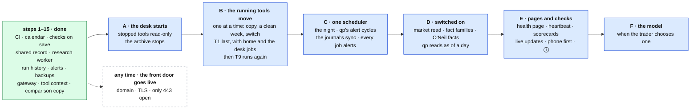

# From today's desk to the design

**Above:** [ARCHITECTURE.md](../ARCHITECTURE.md) §9 (where the build stands,
and the way there).

**Talks to:** every block's document. Each step below names the blocks it
changes, and each block's status table names the step that finishes it. The
commands on the box are in the code repository's `docs/SETUP-NOW.md`.

---

## 1. What it is

**How the desk that runs today becomes the design, without a rewrite and
without stopping the desk.**

It has two halves:
- **The data half, steps 1–15, is done.** It gave the desk its shared record,
  the research worker, run history and alerts, the backups, the one address,
  the way one program holds many tools, and the side-by-side comparison of a
  tool. Most of it runs in shadow: written and compared, not yet used.
- **The program half, steps A–F, is next.** It moves every tool into the one
  desk program, gives the desk the only scheduler, switches on what the
  comparisons have earned, and adds the pages.

**What it never does:**
- stops the desk to move a part;
- switches a part off before what replaces it has matched it;
- loses a row of any tool's research record.

---

## 2. The diagram

---

## 3. Its parts

### 3.1 The rules

1. **The old part keeps running** until the new one has matched it for a set
   period: a week of trading days, unless a step says otherwise.
2. **Compare, then switch.** Every step has a check against what it replaces.
   Each difference is explained (a fault the new part fixes) or fixed.
3. **One step at a time**, each a pull request through CI.
4. **Reversible.** Each step says how to go back.
5. **The research record is sacred.** No R1, R3 or shortlist row of any tool,
   running or stopped, is lost. Every import is checked by row counts.
6. **Room first.** Nothing starts on the box without the memory for it.
7. **Something visible.** Each step ends with something the trader can see.

### 3.2 The order, and why

**The box has no memory to spare.** On 2026-10-06 the programs used about
724 MB beside the system: five tool programs at about 90 MB each, qp, the
archive and the journal. The gateway has been added since. A comparison copy
run as its own program (step 15b) costs about as much as the tool itself, and
there is no room for it.

So the desk starts where it frees, or at least costs, nothing:
- **A.** The desk takes the archive's job: the stopped tools, read-only. It
  costs about what the archive costs, and it proves the desk's web layer,
  contexts and read-only files on tools whose data cannot change.
- **B.** Each running tool is then compared as a **context** inside the desk,
  tens of megabytes rather than a program. Each tool that moves frees its
  program's 90 MB, which makes room for the next comparison.
- **C** comes after B, because the desk jobs live in the desk only once T1 has
  moved.
- **D's switches** can each start as soon as its comparison is clean; most will
  come after C, once the whole O'Neil chain runs in the research worker.
- **E** comes after C, so the health page shows every job, and every job
  already alerts.
- **F** waits for the trader.
- **The front door** can go live at any time; it changes nothing else.

### 3.3 What is done: steps 1–15

Merged in the code repository (pull requests #5 to #24) and, up to step 14,
deployed to the box on 2026-10-08.

| # | Step | Status | What is left, and where it goes |
|---|---|---|---|
| 1 | CI: every test on every pull request, against a real Postgres | **done** | — |
| 2 | one front door: the gateway, one login | **built** | the domain, TLS, closing the ports: any time (§3.10) |
| 3 | checks on save; start-up repairs run once | **done** | T6's photo time: the trader's decision (§3.13) |
| 4 | one trading calendar; real New York instants | **done** | — |
| 5 | the fact store: short interest, borrow, news | **in shadow** | switched on per family (D) |
| 6 | one market read per scan; hot sectors kept | **in shadow** | switched on (D) |
| 7 | the research worker: O'Neil facts with their dates; new tickers within minutes | **in shadow** | the whole chain in the worker (C); switched on (D) |
| 8 | run history; alerts on failed, missed, hung runs; the night | **partly** | one scheduler (B, C) |
| 9 | the registers copied to the shared record, all eleven tools imported with 0 differences; the discovery engine | **done**; the engine **off** | the engine retires with B ([ARCHITECTURE §10](../ARCHITECTURE.md#10-decisions)) |
| 10 | the scorecard, the training set, an empty model slot | **prepared** | the scorecard page (E); the model (F) |
| 11 | the journal: one pairing engine for every source | **done, in part** | stops, the entry snapshot (D), the tables ([JOURNAL.md](journal/JOURNAL.md)) |
| 12 | qp: alerts on the strategy's own fill model, alert history; registers from the shared record (off) | **partly** | alert cycles from the desk (C); reads as of a day (D) |
| 13 | the verified backup, one-command restore, monthly rehearsal | **done** | the backup before every deploy (C); the analysis files as Parquet |
| 14 | one origin through the gateway | **partly** | phone first, ⓘ on every label (E) |
| 15a | the tool context: one program can hold several tools, kept apart | **done** | — |
| 15b | the comparison copy and its daily photo check, in its own program | **done**, not yet started on the box | becomes a context of the desk (B) |

### 3.4 Step A: the desk starts, with the stopped tools

**Changes:**
- the **desk program** (`desk` under pm2): the web layer, the contexts, the
  desk's own port ([DESK.md](desk/DESK.md));
- each **stopped tool** opened read-only in its own context, its pages and its
  read routes served as the archive serves them today; a write is refused with
  the reason ([STOPPED-TOOLS.md](desk/STOPPED-TOOLS.md));
- the **photo-window guard** on the deploy, before the desk holds a running
  tool ([BOX.md](box/BOX.md) §4.2);
- the backup's **analysis files** read through the desk, each file opened
  read-only ([BACKUPS.md](outside/BACKUPS.md)).

**The check.** While the archive still runs, the desk serves each stopped tool
under `/tools/T<n>/` on its own port. Every read route of every stopped tool is
asked of both, over every register day, and must answer the same.

**The switch.** The archive stops. The desk listens on the stopped tools'
ports, so every old address keeps working, and the gateway sends
`/tools/T<n>/` to the desk.

**Undo.** Start the archive again.

**Seen:** the archive is gone; the stopped tools' pages are unchanged.

### 3.5 Step B: the desk takes the running tools

**One tool at a time:** T2, then T7, T11, T6, and **T1 last**. For each tool:

1. **Copy.** The tool is listed in `workerShadow`. The desk opens a **copy**
   context ([DESK.md](desk/DESK.md) §3):
   - it follows the tool's screeners, settings, stars and today's shortlist,
     read-only from the tool's file every minute, and its schedules;
   - it starts from the tool's checkpoint when it starts mid-day;
   - it writes only `data/worker/<id>.db`: no shared-record rows, no alert, no
     desk job, no training.

   It starts only when the box has room. The first copy measures what a
   context costs, and the room needed is set from that.
2. **Compare the photo, daily.** Five minutes after the tool's photo, the two
   photos are compared:
   - the names: none missing, none extra;
   - the screeners: each name found by the same screeners;
   - every field, each put in one class:

     | Class | Means |
     |---|---|
     | `same` | equal |
     | `market` | a number within 1 % (two reads of a quote seconds apart) |
     | `time` | an instant within 2 minutes |
     | `trader` | set by hand: `bias`, `inShortlist` |
     | `different` | anything else |

   **A clean day:** the names and screeners match, and no field is
   `different`. The result goes to the phone as one line and is kept.
3. **Compare the routes.** Every read route of the tool is asked of the tool's
   own program and of the desk:
   - the routes that read the file must answer the same;
   - the routes that read the live list are compared with the photo's classes.
4. **Switch,** after **five clean trading days in a row**, on an evening, never
   within 15 minutes of a capture:
   - the tool is added to `deskTools`, and removed from `workerShadow`;
   - the deploy stops the tool's own program;
   - the desk opens the tool's file as its only writer, brings back today's
     list, registers its jobs and listens on its port;
   - the gateway sends `/tools/T<n>/` to the desk.
5. **Watch the next trading day:** the scans on their schedule, the photo at its
   minute, the outcomes at 16:05, every run record clean.

**Undo, for one tool.** Remove it from `deskTools` and deploy: the desk closes
the tool's context, and its own program starts again on the same file. Nothing
is lost, because the file is the same file.

**T1, last, takes three things with it:**
- **home:** the landing page, the lists across all tools and Manage tools move
  into the desk's own context ([HOME.md](desk/HOME.md));
- **the desk jobs** move into the desk's own context and its own file,
  `data/desk.db` ([JOBS.md](desk/JOBS.md)). Their past runs stay in T1's file,
  as history;
- **T1 becomes a tool like the others,** so it can be stopped. Home keeps
  port 3000, where the landing page has always been, and T1 takes port 3090
  ([WEB.md](desk/WEB.md) §3.1).

**After the last tool:**
- `deskTools` and `workerShadow` retire: the desk runs every running tool;
- the comparison programs and code (`desk-worker`, `src/worker/`), the
  discovery engine (off) and `deploy/tool-ctl.sh` retire;
- **T9, the benchmark,** stopped for lack of memory, runs again as a context.
  It is the screener every other must beat.

**Seen:** each move frees about 90 MB; one program to restart instead of five;
T1 can be stopped; the benchmark is back.

### 3.6 Step C: one scheduler

| Change | The check | Undo |
|---|---|---|
| **The night.** `scripts/retire-old-schedulers.sh` removes qp's systemd timer and the pm2 backup cron; the desk's night job runs the research, then the backup ([JOBS.md](desk/JOBS.md)) | the first week's nights recorded, each step ok, each backup clean | re-enable the timer and the cron |
| **The whole O'Neil chain in the research worker** (its steps 1–12); qp's nightly job no longer computes it ([RESEARCH-WORKER.md](research/RESEARCH-WORKER.md)) | for a week the night runs both, one after the other: the worker's facts must equal qp's outputs | qp's nightly chain again |
| **qp's alert cycles started by the desk** (`POST /api/alerts/cycle`), each minute 09:25–16:05 while alerts are on; qp's watcher thread not started ([SIGNAL-ALERTS.md](quant/SIGNAL-ALERTS.md)) | for a week the desk's cycles run beside the thread without writing history or notifying; their signals, per strategy, symbol and bar, must equal the thread's | qp's thread again |
| **Signals on the phone,** on their own topic ([ALERTS.md](outside/ALERTS.md) §3.6) | a test signal reaches the phone | the page only |
| **The journal's sync started by the desk** (`POST /api/journal/sync`); the journal's own timer off ([JOURNAL.md](journal/JOURNAL.md)) | for a week both run; fills are keyed by their broker id, so the same fills arrive once | the journal's timer again |
| **Every job alerts**, frequent jobs after three failed runs in a row ([ALERTS.md](outside/ALERTS.md) §3.1) | each kind of job made to fail once, on purpose, and seen to alert | — |
| **The deploy backs up first** ([BACKUPS.md](outside/BACKUPS.md)) | a deploy's backup in the bucket, before its restarts | — |

**Seen:** qp's signals on the phone; one place for every job's runs.

### 3.7 Step D: switched on

Each switch alone, each when its check is clean, each undone by setting it
back to shadow ([SHARED-RECORD.md](outside/SHARED-RECORD.md) §3.6).

| Switch | The check before | Then |
|---|---|---|
| `marketMode on` | a week of each tool's own read equal to the one read (`market_parity`); each tool's own hot-sector and bias thresholds equal to the desk's, or listed | every card is stamped from the one read; the R2 jobs retire, and R2 is read from the market history; then the corrections of [MARKET.md](desk/MARKET.md) |
| `factsMode on`, family by family | `fact_parity` clean for a week, and `source_calls` showing the tools share enough tickers for sharing to pay | the family is read from the store |
| `researchMode on` | the worker's facts equal qp's values, field by field, for a week; with qp stopped, the cards and the Market tab unchanged | the cards read the worker's facts; qp's O'Neil routes retire |
| `quantRegistersMode on` | past backtests re-run against the shared record give identical trades | qp reads every tool's registers from the shared record |
| qp reads facts and market states as of a day (to build) | the old days imported (§3.11); a sample of backtests with the CANSLIM gate compared | the CANSLIM control on qp's page ([BACKTEST.md](quant/BACKTEST.md)) |
| the journal's entry snapshot (to build) | facts as of a day available | each trade's snapshot ([REVIEW.md](journal/REVIEW.md)) |

**Seen:** fewer source calls; backtests gated on the market and CANSLIM for any
day; each trade's snapshot.

### 3.8 Step E: pages and checks

| Change | The check |
|---|---|
| the health page, `/api/status`, and its checks: sources, fact freshness, programs, the box, sign-ins ([ALERTS.md](outside/ALERTS.md)) | each check made to fail once, on purpose (a wrong key, a stopped program), and seen on the page and the phone |
| the outside heartbeat | the desk stopped for 20 minutes outside the session: the alert arrives |
| the scorecard page per tool and screener ([LEARNING.md](desk/tool/LEARNING.md)) | each number against its API |
| live updates on open pages ([PAGES.md](desk/tool/PAGES.md)) | a page left open follows the scans without a reload |
| phone first: every page readable at 430 px wide | every page at 430 px |
| ⓘ on every label, by tap ([CARD.md](desk/tool/CARD.md)) | every label has one |

**Undo.** All of it is additive.

### 3.9 Step F: the model

When the trader chooses one ([LEARNING.md](desk/tool/LEARNING.md)):
- trained by the research worker, one per tool, from that tool's own history;
- **the check:** a walk-forward Brier score better than the tool's base rate;
- **undo:** the empty slot again.

### 3.10 Any time: the front door goes live

1. Fix `scripts/setup-domain.sh` for the box's system: it uses `apt-get`, and
   the box runs Amazon Linux 2023 ([FRONT-DOOR.md](front-door/FRONT-DOOR.md)).
2. The trader makes a free DuckDNS name and runs the script; Caddy takes a
   certificate.
3. In AWS, open 80 and 443, and close 3000–3120, 8765 and 8080 to the internet.

**The check:** a scan from outside finds only 80 (redirecting) and 443, and
every page works through the one address. **Undo:** open the ports again.

### 3.11 The old data

| What | Into | Status |
|---|---|---|
| every tool's R1, R3, shortlist, tool row and screeners, running and stopped | the shared record's copies | **done** (step 9a), 0 differences |
| the screeners' versions | each tool's file (`screener_versions`) | **to do** in B, from the shared record's versions, kept since step 9a |
| the old R2 market snapshots of every tool | `market_states`, marked imported, for the days before step 6 | **to do** before qp reads market states as of a day (D) |
| the O'Neil files of each night, kept in the backups | facts as of that night | **to do** before qp's CANSLIM gate reads facts as of a day (D) |
| qp's strategies | `strategy_versions` in qp's file, each current strategy as version 1 | **to do**, with strategy versions |
| the journal's trades | `fills`, `trades`, `trade_fills` in the journal's file | **to do**, with those tables; the Alpaca trades re-derived and compared |

An old row that lacks a field the new tables record (a screener version, a
market state, an O'Neil status frozen at the time) is imported with that field
marked **unknown**, never guessed.

### 3.12 What stays exactly as it is

- **The research method:** one photo a day per tool; entries A and B; outcomes
  in ATR; the 1.3 good-move line; the benchmark; the mirrors.
- **The card:** every field, every Market-tab section, every source and its
  fallback order. Their home changes, their content does not.
- **Isolation:** each tool's results, model and history kept from every other.
- **A label, never a filter,** for every shared fact.
- **The O'Neil method as built;** qp's verified library and engine.
- **The one password and the nightly backup,** until what replaces each has
  proven itself.

### 3.13 Decisions still open

| Decision | Needed by | Where |
|---|---|---|
| where the shared record lives: Railway, the box or AWS RDS | before D; to be taken up again on 2026-10-22 | [SHARED-RECORD.md](outside/SHARED-RECORD.md) §3.7 |
| T6's photo (D-S9): after 11:30 with its entries, or its window opened earlier | any time; it does not block T6's move, which changes nothing T6 does | [SCREENERS.md](desk/tool/SCREENERS.md) |
| the model | F | [LEARNING.md](desk/tool/LEARNING.md) |

---

## 4. Contracts

| Setting (`data/keys.json`) | Used in | Means |
|---|---|---|
| `workerShadow` | B | the tools run as comparison copies |
| `deskTools` (to build) | B | the tools the desk runs for real. The deploy starts no program of their own, and the gateway sends them to the desk. Retired after B |
| `factsMode`, `marketMode`, `researchMode`, `quantRegistersMode` | D | off, shadow or on, per area ([SHARED-RECORD.md](outside/SHARED-RECORD.md) §3.6) |
| `discoveryMode` | — | off; retired in B |

| Comparison record | Where | Step |
|---|---|---|
| the photo comparison of each copy | `worker_parity`, in `data/worker/<id>.db`; `scripts/worker-report.js` | B |
| the register copies against each tool's file | the daily comparison; `GET /api/registers/parity` | done |
| the facts against the tools' own | `fact_parity`; `scripts/facts-report.js` | D |
| the market read against each tool's own | `market_parity` | D |

---

## 5. When it fails

| Event | What happens |
|---|---|
| a comparison is not clean | the step waits. The difference is explained (a fault the new part fixes) or fixed, and the clean week starts again |
| a moved tool misbehaves | its undo: its own program again, on the same file |
| the box runs short of memory | the copy does not start, and says why. The next move frees the room |
| a step's change reaches a page the trader uses | it is undone first, then fixed |

---

## 6. Built on

- the first migration plan, steps 1–20, which this replaces from step 15 on:
  its steps 15 and 16 (two programs, desk-worker and desk-web) became A and B
  (one program), its 17 became D, its 18 and 19 became E, its 20 became F;
- [the earlier rebuild draft](../legacy/architecture/REBUILD-ARCHITECTURE.md);
- the known issues of the old desk:
  [screeners](../legacy/screeners/KNOWN-ISSUES.md),
  [qp](../legacy/qp/KNOWN-ISSUES.md),
  [journal](../legacy/journal/KNOWN-ISSUES.md);
- the code repository's `docs/WORKER.md` (the comparison copy) and
  `docs/SETUP-NOW.md` (the commands on the box).

**What steps 1–15 taught:**
1. **Measure a saving before building for it.** The discovery engine merges
   only identical requests. Every tool's screeners differ, so it saves no call,
   and while it compares it doubles them.
2. **Fact sharing depends on overlap.** `source_calls` counts the requests
   against the real calls, family by family, and decides each switch.
3. **Shadow first was right.** The import found no difference, and the first
   deploy changed nothing the trader uses. But it showed the trader little, so
   each step of the program half ends with something visible.
4. **Two programs were the hardest part of the earlier plan.** Everything a
   page shows from the scans would have had to be copied into the database all
   day. One program removes that ([DESK.md](desk/DESK.md#why-one-program-not-two)).

---

## 7. Status

| Step | Status |
|---|---|
| 1–15 | **done** or in shadow (§3.3) |
| A | **to build**: the desk program is the next build |
| B | **to build**; the comparison copy exists as its own program |
| C | **to build**; the night job and its handover script exist |
| D | **to do**, switch by switch |
| E | **to build** |
| F | **waiting** for the trader |
| the front door live | **ready**, once `setup-domain.sh` is fixed |
