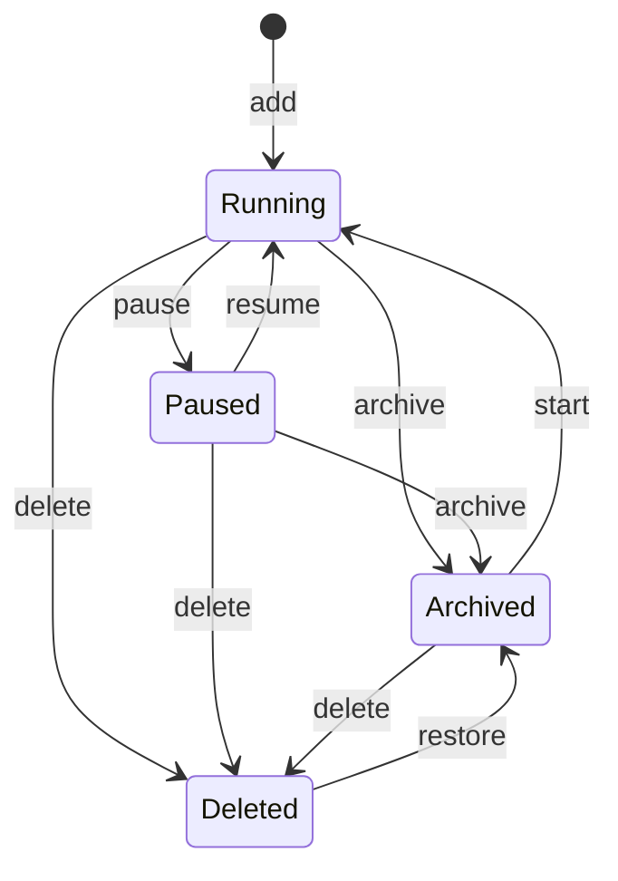

# Tools and screeners

**Trunk section:** [§6.2 Tools and screeners](../ARCHITECTURE.md#62-tools-and-screeners).

**Talks to:** Sources (§6.1: the TradingView scanner, and Alpaca and news for
post-scan tests); the Card (§6.3), which receives every candidate; Registers
(§6.6), which freeze each tool's photo and record the screener versions;
Learning (§6.7), which judges every screener; Platform (§6.10), whose
scheduler runs discovery.

**Built on:** [METHODOLOGY](../legacy/screeners/METHODOLOGY.md) (every tool, every
screener and why), [SCREENER-BUILDER](../legacy/screeners/SCREENER-BUILDER.md) (the
definition, editor, validation, mirrors, how a scan is sent),
[TOOL-LIFECYCLE](../legacy/screeners/TOOL-LIFECYCLE.md) (adding, starting, pausing,
stopping, deleting, the archive), [IDEAS](../legacy/screeners/IDEAS.md) part 2 (the
intent for the builder), [MONITOR](../legacy/screeners/MONITOR.md) (the discovery
schedule), [PAGES](../legacy/screeners/PAGES.md) (the suite and Manage tools pages).

---

## Contents

1. [What a tool and a screener are](#1-what-a-tool-and-a-screener-are)
2. [Rules every tool keeps](#2-rules-every-tool-keeps)
3. [The tools, one by one](#3-the-tools-one-by-one)
4. [The legacy builder](#4-the-legacy-builder)
5. [Legacy discovery](#5-legacy-discovery)
6. [Legacy lifecycle](#6-legacy-lifecycle)
7. [What failed](#7-what-failed)
8. [The new design](#8-the-new-design)
9. [Contracts](#9-contracts)
10. [How the rebuild is proven](#10-how-the-rebuild-is-proven)

---

## 1. What a tool and a screener are

- **A tool** is one trading method, run as an experiment: its own screeners,
  its own photo minute and entries, its own history and model. Tools never
  share results, so one tool's outcome can never contaminate another's.
- **A screener** is one question put to TradingView's scanner: a set of rules,
  an order, a size, the minutes it may add cards, and usually a **mirror** (the
  same setup facing the other way).
- **Discovery** runs each due screener and turns its matches into candidates
  for the card engine.

---

## 2. Rules every tool keeps

### 2.1 The tradability floor

Added to **every screener on every tool** at the moment a scan is sent, not
written into any screener, so one setting changes every screener of the tool.
(Today each tool keeps its own copy of the setting, though the page says
"every screener, every tool": D-T5. In the new design it is one desk setting,
with a per-tool override shown as one.)

| Rule | Why |
|---|---|
| price ≥ $1 | below it the spread eats the trade |
| average volume ≥ 1M shares a day | below it you cannot get out at a price you chose |
| ATR ≥ $1 | not enough movement to pay for the risk |
| ATR ≥ 3 % of price | the same question relative to the stock (TradingView cannot compare two columns, so this leg runs locally after the scan) |

Settings `minPrice`, `minAvgVolume`, `minAtr`, `minAtrPct`; 0 switches a leg
off. **Two named exceptions:** the neglected-name screeners (T6 Unexplained
Move and its mirror) keep only the price floor; a **list-only** screener takes
no floor and its matches never become cards.

### 2.2 How success is measured

No stop, no target, no exit: the question is whether a screener finds stocks
that move. From each entry minute to the close, `upR = (hh − entry) ÷ ATR14`
and `downR = (entry − ll) ÷ ATR14`; a good move is `upR ≥ 1.3`; ATR14 from
daily bars strictly before today; regular session only. The opening range
(09:30–09:35), the minutes from the open at discovery, and whether another tool
shortlisted the card are recorded for every card
([REGISTERS.md](REGISTERS.md)).

### 2.3 The photo

Each tool takes **one photo a day** (R1) of every card on screen, one minute
after one of its discovery scans, so it freezes a fresh list. A card found
after the photo can be traded but teaches nothing.

### 2.4 Discovery and refresh

A screener's run window gates **discovery only**. Cards already on screen are
re-quoted every 5 minutes, 04:00–16:00, whatever the windows.

### 2.5 Mirrors are made, not flipped

| Rule kind | Mirrors to |
|---|---|
| directional field (change, change from open, gap, pre-market change and gap, performance W/1M/3M/6M/Y) above a number | operator flips **and** the number changes sign: `change > 5` → `change < −5` |
| a range on a directional field | negated: `3…10` → `−10…−3` |
| RSI (0–100) | reflected around 50: `RSI > 70` → `RSI < 30` |
| two columns compared | operator flips and each side swaps to its counterpart: `close > 1-month high` → `close < 1-month low` (also 3-month, 52-week, day high/low) |
| quality guards (price, volume, cap, float, …), equals, has, non-directional between | unchanged |

The sort flips when it is on a directional field. A mirror keeps the same
windows, because the pair must be measured over the same minutes.

### 2.6 The benchmark

**Stocks in Play** (T9): `close > 5`, the floor, sorted by relative volume, top
20. No pattern, no direction, no mirror, and nothing structural may ever be
added to it (a test enforces this). Every screener must beat it by a clear
margin (5 points). In the one strong published day-trading result, the edge
came almost entirely from the relative-volume ranking (Sharpe 2.81 with it,
0.48 without), so it is a hard benchmark.

### 2.7 Order of work

1. **Collect** for about a month. 2. **Cut** the screeners that do not find
movers. 3. **Then setups**: entries, stops and targets, only for the
survivors.

---

## 3. The tools, one by one

Eleven tools registered; five running today. Windows are New York time.

| Tool | Name | Status | Photo · entry A · entry B |
|---|---|---|---|
| T1 | Swing trades after huge volume (the control) | running | 09:36 · 09:37 · 09:40 |
| T2 | Momentum | running | 09:46 · 09:47 · 09:51 |
| T3 | Gappers | archived | 09:36 · 09:37 · 09:40 |
| T4 | VWAP Reclaim | archived | 10:01 · 10:02 · 10:06 |
| T5 | 20-Day Break | archived | 09:46 · 09:47 · 09:51 |
| T6 | Unexplained Move | running | 10:16 · 10:17 · 10:21 (D-S9) |
| T7 | Liquid Movers | running | 09:36 · 09:37 · 09:40 |
| T8 | CANSLIM (split into T10 and T11 on 2026-09-04) | archived | 09:46 · 09:47 · 09:51 |
| T9 | Stocks in Play (the benchmark) | archived (D-S14) | 09:36 · 09:37 · 09:40 |
| T10 | Growth Stock Breakout (stopped 2026-09-21) | archived | 09:46 · 09:47 · 09:51 |
| T11 | Growth Stock Pullback | running | 09:46 · 09:47 · 09:51 |

### T1 · Swing trades after huge volume: the control

The only tool with real history, and the one measured edge so far. All three
screeners run all day, on purpose.

```
Trend       close ≥ 20 · close ≥ SMA5 · close ≥ VWAP · close|1W > VWAP|1W ·
            close|1M > VWAP|1M · EMA50|1 > EMA120|1 · close|1 ≥ EMA50|1 ·
            VWAP ≥ SMA75|5 · relative_volume_intraday|5 > 3 ·
            relative_volume_10d_calc > 1.5 · average_volume_90d_calc > 1M
Pre-Mkt     premarket_volume > 1.5M · relative_volume_10d_calc > 3 ·
            average_volume_10d_calc > 2M · close ≥ 1
Big Move    relative_volume_10d_calc > 10 · close ≥ 2 · average_volume_10d_calc > 2M
```

**The measured edge:** the overlap of Big Move and Pre-Mkt made a good move on
54 % of cards against 13 % for everything else (Fisher p = 0.0015, over 11
days, surviving the removal of the two biggest winners). It is read off the
09:36 photo; giving Pre-Mkt the window its filters suggest would strip the tag
from every frozen row and delete the measurement. **T1 stays exactly as it
is**, so the other tools have something to be compared with.

### T2 · Momentum

A clean daily uptrend breaking to a new monthly high.

```
Breakout    SMA5|1 > EMA9|1 > EMA13|1 > EMA20|1 · close ≥ High.1M · close ≥ 1 ·
            average_volume_10d_calc > 500K
Mirror      the stack inverted · close ≤ Low.1M
Window      09:00–10:00
```

The stack says the trend; the break makes it an event. Positions are closed by
10:30, so anything found after 10:00 is a candidate nobody can take. The photo
at 09:46 lets a one-spike opening break fail first.

### T3 · Gappers (archived)

```
Gap up      premarket_change > 5 · premarket_volume > 500K ·
            relative_volume_10d_calc > 2 · close ≥ 1 · float_shares_outstanding < 50M
Mirror      premarket_change < −5
Window      04:00–10:30
```

A gap with no pre-market volume is a quote; the small float lets a gap extend.
Pre-market columns freeze at the bell, hence the window.

### T4 · VWAP Reclaim (archived): the reversal tool

```
Reclaim     close crosses_above VWAP · relative_volume_10d_calc > 2 · close ≥ 1 ·
            average_volume_10d_calc > 1M
Mirror      crosses_below
Window      09:45–15:30
```

Reversals come late. **Known limit:** a cross is a moment, and discovery runs
every 15 minutes after 10:00, so some crosses are missed between scans.

### T5 · 20-Day Break (archived)

```
Break       close ≥ High.1M · relative_volume_10d_calc > 1.5 · close ≥ 1 ·
            average_volume_10d_calc > 500K
Mirror      close ≤ Low.1M
Window      09:30–16:00
Kept, off   52-Week Break: close ≥ price_52_week_high · market_cap_basic > $1B ·
            relative_volume_10d_calc > 1.5 · average_volume_10d_calc > 1M
```

It replaced the 52-week break, which produced one frozen day in the whole
archive. "With supporting news" is a card filter, not a screener column.

### T6 · Unexplained Move: the only mean-reversion tool

```
Net         change > 10 · close ≥ 1        (a wide net, not the rule)
Mirror      change < −10
Window      11:30–16:00
Kept, off   Overextended: RSI > 70 · close ≥ EMA20 · relative_volume_10d_calc > 3 ·
            close ≥ 1 · average_volume_10d_calc > 1M (mirror RSI < 30, close ≤ EMA20),
            window 10:00–16:00
```

**The real rules run after the scan**, because the scanner cannot express them:

| Test | Data | Rule |
|---|---|---|
| Move rate | Alpaca 1-minute bars today | ≥ +15 % (mirror ≤ −15 %) over the last **120 minutes**, close to close; no full window = dropped. (TradingView's `change\|120` is a fixed candle and splits moves across its boundary) |
| No news | the full news stack | any catalyst = dropped; a failed lookup = dropped |
| Six-month trend | Alpaca daily closes **before today**, 126 sessions | base: dropped if the six months rose more than 20 %; mirror: dropped if they fell more than 20 %; under 126 sessions = dropped |

Survivors carry `move2hPct` and `trend6mPct`. Every drop is counted with its
reason; if the gate itself throws, candidates pass untouched (an empty scan
would look like a quiet market). Floor: price only (neglected names). **Blind
spot:** a stock down 10 % in the morning and up 15 % since lunch is flat on the
day and never reaches the net.

### T7 · Liquid Movers

Two screeners for two sessions, **not** a mirror pair. Both take the top 25.

```
Pre-Market Gap    gap not between −3 % and +3 % · ATR ≥ $1 ·
   04:00–09:30    average_volume_90d_calc ≥ 2M · premarket_volume > 1M · close > 5
After Open Volume average_volume_10d_calc > 5M · relative_volume_intraday|5 > 3 ·
   09:30–16:00    volume > 10M · change not between −3 % and +3 % · close > 5
```

History: it once returned 75 names a day because both volume rules grew
through the session, the floor was $1, the gap screener did not require any
pre-market trade, and each took the top 50. All four were fixed.
`relative_volume_10d_calc` was removed (day-to-date volume over a full-day
average means a different thing each hour). The pre-market screener feeds
training; the after-open one finds names after the photo.

### T8 · CANSLIM (archived) → T10 and T11

```
Breakout    earnings_per_share_diluted_yoy_growth_fq ≥ 25 ·
(T8, T10)   earnings_per_share_diluted_yoy_growth_fy ≥ 25 ·
            total_revenue_yoy_growth_fq ≥ 15 · close ≥ price_52_week_high ·
            Perf.6M > 30 · relative_volume_10d_calc > 1.5 ·
            total_shares_outstanding_fundamental < 1B · market_cap_basic > $300M
Pullback    the same company quality · close ≥ SMA50 · close ≤ EMA20
(T8, T11)   (T11: without the revenue, relative-volume and share-count rules;
            window 09:30–16:00, top 50)
```

Split because T8 ran all three screeners in one database, so no register could
say which one produced a result. **What a screener cannot be, honestly:** I
(no dependable column: left out), M (describes the market, not a stock: not a
filter, on purpose), L (Perf.6M is a threshold, not a percentile: strength, not
leadership). The full O'Neil reading is on every card instead
([ONEIL.md](ONEIL.md)). T8's shared ★ CANSLIM list (90-day membership) was
retired on 2026-10-02.

### T9 · Stocks in Play: the benchmark (archived)

`close > 5`, the floor, sorted by relative volume, top 20 (§2.6).

### The unified shortlist

Each tool keeps its own shortlist; anything shortlisted on any tool shows on
every other tool's card as `★ also T1 T7`, never touching that tool's own star
or model ([REGISTERS.md](REGISTERS.md)).

---

## 4. The legacy builder

### 4.1 A screener is a row

| Field | Meaning |
|---|---|
| `key` | stable id from the name at creation; stamped on every matched card; never changes, even on rename |
| `name` | shown; renamed freely |
| `filters` | rules `{ left, operation, right }`, TradingView's own shape |
| `sort`, `limit` | default change % high to low, 50 |
| `runFrom`, `runTo` | the run window; empty = every scan |
| `checkFrom`, `checkTo` | when it is worth opening the tool; empty = the run window |
| `mirrorOf` | the screener it mirrors |
| `labelOnly` | a list screener: matches never become cards |
| `enabled`, `pausedAt`, `pausedReason` | on/off and why |

`right` is a number, a pair, or **another column** (that makes "close above
EMA 20" expressible). A column may carry a timeframe after `|`: `EMA50|1`
daily, `close|1W` weekly, `relative_volume_intraday|5` five-minute.

**15 operators:** above, above or equal, below, below or equal, equals, not
equal, between, not between, crosses, crosses above, crosses below, above by %,
below by %, has, has none of.

**52 columns offered:**

| Group | Columns |
|---|---|
| Price | close, open, day high, day low, change %, change from open %, gap %, VWAP |
| Averages | SMA 5, 20, 50, 200; EMA 9, 13, 20, 50, 120, 200 |
| Ranges | 1-month high/low, 3-month high/low, all-time high, 52-week high/low |
| Volume | relative volume (10-day), relative volume (5-minute), volume, average volume 10-day and 90-day, pre-market volume, pre-market change %, pre-market gap % |
| Size and short | market cap, float shares, short % of float, shares outstanding |
| Movement | ATR, performance week / month / 3-month / 6-month / year, RSI |
| Fundamentals | EPS growth (quarter, year, TTM), revenue growth (quarter, TTM), ROE |
| Labels | sector, exchange |

TradingView **silently ignores a column it does not know**, which widens the
screener instead of failing; `scripts/verify-tv-fields.js` checks every offered
column.

### 4.2 The editor and the list

The list shows each screener's rules in words, its window on a timeline with
the tool's capture minute and why it was chosen, the floor as one shared line,
and badges (Paused, List only, Mirror of …). Each has Rename, Mirror, Pause /
Resume, Delete. The editor has name, rules (field · condition · number or
column), the floor shown read-only, sort, max results, run window, and **Test
on TradingView**. The check window, list-only and the mirror link are not in
the editor.

### 4.3 Validation and test

Refused on save, with every reason: no name or rules; unknown column, operator
or missing value; between without exactly two values; unknown sort column; a
window with one end, a time not `HH:MM`, or a start not before its end.
Strict, because a malformed rule returns an empty list that looks like "nothing
matched today".

**Test** runs the definition as it would really run, floor included, without
saving: `count` (capped at the limit), **`totalCount`** (how many matched in
all: the real measure of selectivity), time taken, a sample of 10. **Preview
mirror** shows a mirror without saving.

### 4.4 Rename, pause, delete, seeding

Rename keeps the key (and re-points any mirror). Pause stops new matches and
touches nothing found; the pause time is set when paused. Delete removes the
row; cards keep a key nothing explains (pausing is safer). A new tool gets its
seed set from `seedScreeners.js`, or nothing. **Startup repairs** run keyed,
one-time fixes on every start (D-S10). `screenerSummary.js` turns the live
rules into words, so a description cannot drift from what runs.

---

## 5. Legacy discovery

**Schedule** (New York, weekdays): every 30 minutes 04:00–09:00, every 5
09:00–10:00, every 15 10:00–16:00, once at 16:00. A scan is skipped when the
tool is paused or another run is going.

**Each due screener** (enabled, window containing the minute) is one request,
in parallel, to `POST scanner.tradingview.com/america/scan`:

| Part | Value |
|---|---|
| `filter` | the screener's rules **plus the floor** (added at the server, so the top N slots are not spent on ineligible stocks) |
| `filter2` | the base universe: common stock, preferred stock, depositary receipts, funds that are not ETFs, mutual or closed-end; never pre-IPO |
| `columns` | the 32 card columns ([CARD.md](CARD.md) §2.4) |
| `sort`, `range` | the screener's sort; `[0, limit]` |
| headers | a browser User-Agent, Origin and Referer of tradingview.com; 15 s timeout |

**Checks on the answer:** misaligned columns → that screener returns nothing
this scan; week = month (or month = quarter) range on every one of at least 20
rows → logged once; the ATR % leg applied locally; a failed screener is logged
and the rest continue. Then the T6 gate (§3), then **merge**: one row per
ticker per tool, `screenerKeys` listing every screener that matched, a field
empty in one match filled from another, never overwritten.

---

## 6. Legacy lifecycle

**Each tool is its own program**: pm2 process `tool-Tn`, its scorer
`scorer-Tn` on port + 1 when switched on (it is off on every tool: D-D1), database `data/tn.db` (T1: `data/tradedesk.db`), model
folder, temp folder, memory cap (T1 280M; T2, T6 240M; T11 200M; T7 180M;
others 140M; scorer 180M; archive 120M). T1 also serves the landing page and
Manage tools, so it can be neither stopped nor deleted.

**The registry** merges `tools.config.json` (built-in tools) and
`data/tools.local.json` (tools added from the page, and overrides of name,
description, colour, capture times, enabled, deleted, pendingRestart). Flags:
`enabled`, `archive` (served read-only when stopped), `scorer`.

**Adding a tool:** at most 6 added tools; id one past the highest ever used
(never reused); port the next free multiple of ten; no scorer; capture 09:36 /
09:37 / 09:40 by default; started at once if at least **180 MB** is free.
Capture times must run `r1 < entryA < entryB`, `r1 ≥ 09:30`, `entryB ≤ 15:50`.

**States and buttons:** Running ⇄ Paused (the program stays up, stops
scanning; stored in the tool's database, survives a restart); Stop (process
deleted, the **archive** serves its registers on its port); Start; Delete
(hidden, history still served); Restore (back as stopped). **The session
rule:** a capture-time change on a running tool between 04:00 and 16:30 is
applied at 16:50, because a restart empties the list built since 04:00.

**The archive:** one read-only process serving each stopped tool's
`/api/warehouse/*` on that tool's own port, so qp sees no difference.

---

## 7. What failed

| ID | Fault | Root cause | Prevented by |
|---|---|---|---|
| D-S9 | T6 photographs at 10:16 a screener whose window opens at 11:30: its photo holds nothing T6's real screener found, so it trains on nothing | capture time inherited from the screener it replaced; times and windows never checked together | checked on save ([§8.3](#83-checked-on-save)) |
| D-S10 | startup repairs guarded by "the field is empty" put back a window the trader cleared or a rule they removed, silently | one-time fixes run as start-up code | versioned migrations that run once, ever |
| D-S14 | with T9 stopped, the comparison page has no benchmark | the benchmark is a whole process costing ~90 MB | tools as rows: the benchmark costs a few MB and always runs |
| — | editing a rule changes what a key means for every past card | no versions | screener versions; R1 records them |
| — | each tool is a whole program (~90 MB); tools stopped for lack of memory, and every per-tool scorer is off | one process per tool | one discovery engine for all tools |
| — | the check window, list-only and mirror link cannot be set in the editor | editor incomplete | every field editable |
| — | post-scan tests are a hidden gate keyed on two screener keys | tests outside the definition | tests are named steps of the screener |
| — | a rule that can never match, or matches everything, is saved without warning | no selectivity check | Test runs on save and shows `totalCount` |
| — | T4 misses crosses between 15-minute scans | a cross is a moment | a "crossed since the last scan" test from bars, when wanted |
| — | T6 cannot see a morning drop followed by an afternoon rise | the net is the day's change | a net on the 2-hour move itself (from bars), when wanted |

---

## 8. The new design

### 8.1 Tools are rows

| Column | Meaning |
|---|---|
| `id` | T1, T2, …; never reused |
| `name`, `description`, `accent` | shown |
| `status` | `running`, `paused` (with when and why), `archived`, `deleted` |
| `capture_r1`, `entry_a`, `entry_b` | New York `HH:MM`, with a `why` note |
| `role` | `method`, `control` (T1), or `benchmark` (T9) |
| `created_at` | — |

One discovery engine runs every **running** tool. An archived tool keeps its
history in the same database and is readable everywhere; there is no archive
process and no port per tool. A paused tool keeps its cards on screen and
finds nothing new. **The benchmark always runs**, because it now costs a few
MB.

### 8.2 Screeners are versioned

| Table | Holds |
|---|---|
| `screeners` | `tool`, `key` (stable), `name`, `status`, `mirror_of`, `purpose` (`cards` or `list`) |
| `screener_versions` | `screener`, `version`, `rules`, `sort`, `limit`, `run_window`, `check_window`, `floor` (`standard`, `price_only`, `none`), `post_tests`, `created_at`, `note` |

Saving a change creates a new version; the old one is kept. Each tool card
records the version of every screener that matched, and R1 freezes it, so
two definitions are never mixed under one name. Pausing and resuming do not
create versions; renaming does not either (the key is stable).

**Post-scan tests** are part of the version, each with its parameters:

| Test | Parameters | Data |
|---|---|---|
| `move_rate` | minutes (120), threshold (+15 %, or −15 % for a mirror) | 1-minute bars |
| `no_news` | days | the card's news facts |
| `trend_guard` | sessions (126), limit (20 %), side | daily closes before today |

The builder shows them as rules under the scanner rules, labelled "applied
after the scan", so what the scanner cannot express is said, not faked.

### 8.3 Checked on save

Refused, with every reason:

- everything §4.3 checks;
- an unknown column, checked against the adapter's live column list (not a
  hand-kept list);
- **the capture minute is before every running screener's run window has
  opened** (the D-S9 case);
- `r1 < entryA < entryB`, `r1 ≥ 09:30`, `entryB ≤ 15:50`;
- a mirror whose windows differ from its pair.

Warned (saved, with the warning shown): Test returns `totalCount` 0, or more
than 2,000.

### 8.4 Discovery

Run by the platform scheduler on the legacy cadence. For each due screener
version of each running tool:

1. one request through the TradingView adapter (§5), floor added at the
   server, 32 columns;
2. the adapter's checks (alignment, identical ranges);
3. the ATR % leg applied locally (unless the floor says otherwise);
4. post-scan tests, each drop counted with its reason;
5. merge into candidates: tool, ticker, screener key and version, match time;
6. hand new tickers to the card engine; update tool cards.

**One request per screener per scan, whatever the number of tools.** Two
tools with an identical screener version share the request.

A **scan report** is stored per tool per scan: screeners asked, rows returned,
drops by reason, candidates, new cards, time taken, errors.

### 8.5 Lifecycle



Every state change is a row change, logged with who and when. A capture-time
change takes effect at the next trading day (or at once outside 04:00–16:30),
because the photo of a day must use one time; no restart is involved.

### 8.6 The pages

| Page | Shows |
|---|---|
| **Suite** | every tool: status, today's counts, photo time, last scan |
| **A tool's Screeners tab** | each screener with its rules in words, versions, window timeline with the capture minute, floor, post-scan tests, badges; the full editor (every field, including check window, purpose, mirror link) |
| **Manage tools** | add, edit (with the checks of §8.3), pause, resume, archive, start, delete, restore |
| **Comparison** | every screener against the benchmark and its mirror ([LEARNING.md](LEARNING.md)) |

### 8.7 Seeds and migrations

Seed screener sets become **versioned migrations**: each runs once, ever, and
is recorded. A migration never overwrites a field the trader changed after the
seed.

---

## 9. Contracts

### Owns

| Table | Key |
|---|---|
| `tools` | id |
| `screeners` | tool, key |
| `screener_versions` | screener, version |
| `scan_reports` | tool, scan instant |

### Writes to others

| To | What |
|---|---|
| card | candidates: tool, ticker, screener key and version, match time, test results (`move2hPct`, `trend6mPct`) |

### Read by

| Domain | What |
|---|---|
| registers | capture and entry times; screener versions for R1 |
| learning | screeners, mirrors, benchmark role |
| platform | the discovery schedule |
| quant | tools and their history (backtest universes) |

### Routes (desk-web)

| Route | Does |
|---|---|
| `GET /api/tools`, `POST /api/tools`, `PATCH /api/tools/:id` | list, add, edit (checked) |
| `POST /api/tools/:id/{pause,resume,archive,start,delete,restore}` | lifecycle |
| `GET /api/tools/:id/screeners`, `POST …`, `PATCH …/:key` | list, add, edit (a new version) |
| `POST /api/screeners/test`, `POST /api/screeners/preview-mirror` | test without saving |
| `GET /api/screeners/meta` | columns (from the adapter), operators, post-scan tests |
| `GET /api/tools/:id/scans?day=` | scan reports |

---

## 10. How the rebuild is proven

1. **Request parity.** For one day, the new discovery engine sends exactly the
   same request bodies as each old tool (recorded and compared).
2. **Candidate parity.** For a week, each tool's candidates and tool cards
   match the old tool's R0, screener keys and first-seen times included.
3. **Mirror tests.** Every row of §2.5 has a fixture, including the
   high/low counterpart swap.
4. **The D-S9 check.** Saving T6's current capture time with its 11:30 window
   is refused, with the reason.
5. **Benchmark guard.** Adding a structural rule to the benchmark tool is
   refused (the test carried over).
