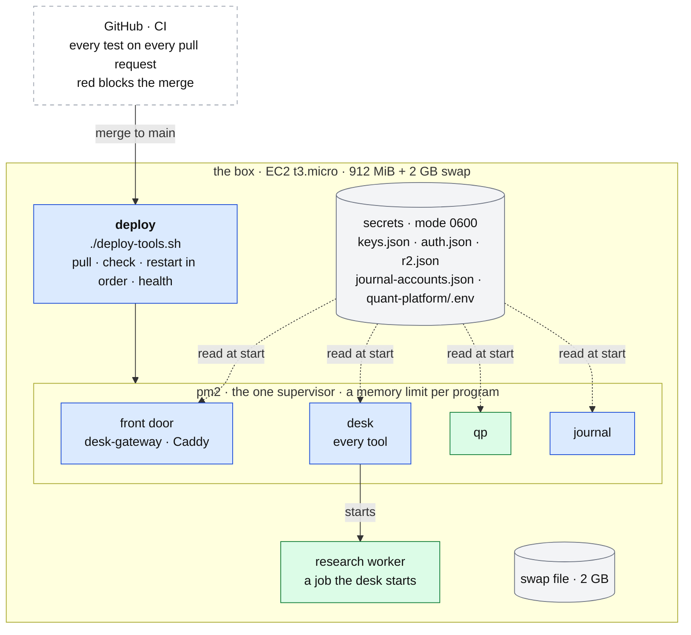

# The box

**Above:** [ARCHITECTURE.md](../../ARCHITECTURE.md), §2 (the box around every
program) and §6 (running it).
**Talks to:** every program on it. The [front door](../front-door/FRONT-DOOR.md)
is its only open port; the [backups](../outside/BACKUPS.md) carry its files off it.

---

## 1. What it is

The one server the desk runs on.

| | |
|---|---|
| Machine | AWS EC2 **t3.micro**: 2 vCPU, **912 MiB** of memory |
| Swap | a **2 GB swap file**, made once by `deploy/add-swap.sh`; the deploy requires it |
| System | Amazon Linux 2023. Its `python3` is 3.9: the Python programs are tested on 3.9 |
| User and folder | `ec2-user`, `~/Tade-desk-server` (one checkout of the code repository) |

**What it does:**
- runs every program of the desk under **one supervisor**, pm2, each program
  with a memory limit;
- deploys the code with **one command**;
- keeps the secrets in files of mode 0600 that never leave the box.

**What it never does:**
- run a program under two supervisors;
- keep a secret in git, in a log or in a backup;
- accept a deploy in the minutes around a photo (once built, §4.4).

---

## 2. The diagram

---

## 3. The programs and their memory

**Measured on 2026-10-06, today's arrangement:** about 724 MB of programs,
beside the system.

| Program | Memory |
|---|---|
| five tool programs | 89–91 MB each |
| qp | 129 MB |
| the archive | 78 MB |
| the journal | 66 MB |

| Program | pm2 name | Port (local) | Memory budget | pm2 limit |
|---|---|---|---|---|
| desk (every tool) | `desk` | 3000 (home), and one per tool: 3010 … 3120; T1 on 3090 once it moves ([WEB.md](../desk/WEB.md) §3.1) | about 150–250 MB (estimate; measured as tools move in) | to set from the measurement |
| qp | `qp` | 8765 | 70–150 MB (129 measured) | `deploy/qp.config.js` |
| journal | `journal` | 3100 | about 66 MB | 160 MB |
| front door | `desk-gateway`, Caddy | 8080; 443 outside | 40–80 MB | 80 MB (gateway) |
| research worker | — (a job) | — | 100–150 MB for new tickers; 200–400 MB at night | — |
| system | — | — | about 150 MB | — |

About 500–650 MB in all. The night's research run happens at 18:30, when no
scan is due, and may use swap. A 2 GB instance removes the squeeze; that is the
trader's decision ([ARCHITECTURE §8](../../ARCHITECTURE.md#8-decisions)).

**Today's limits, until the tools move into the desk:**

| Program | pm2 limit |
|---|---|
| T1 | 280 MB |
| T2, T6 | 240 MB |
| T11 | 200 MB |
| T7 | 180 MB |
| any other tool | 140 MB |
| the archive | 120 MB |
| the desk's comparison copy | 300 MB |

pm2 restarts a program that passes its limit. Nothing is started by Manage
tools with less than 180 MB available, because on a 912 MiB box the alternative
is the kernel choosing what to kill, and it may choose `sshd`.

---

## 4. Its parts

### 4.1 The supervisor

**pm2 for every program of the desk.**
- Every program of the desk is a pm2 process with a memory limit and timestamps
  in its log.
- `pm2 save` and `pm2 startup` bring them back after a reboot.

**Each program has exactly one supervisor, never two.** Two supervisors once
restarted one program 113,854 times (2026-09-23). The box's own services (sshd;
Caddy and the DuckDNS updater, [FRONT-DOOR.md](../front-door/FRONT-DOOR.md))
stay under systemd and cron as system services, never also under pm2.

**The one exception, to be retired:** a systemd timer, `qp-daily.timer`, still
runs qp's nightly O'Neil chain. `scripts/retire-old-schedulers.sh` removes it
and the pm2 backup cron. The desk's night job then runs the chain and the backup
([JOBS.md](../desk/JOBS.md)).

### 4.2 The deploy

One command on the box: `./deploy-tools.sh`.

| It | Why |
|---|---|
| **pulls itself first**, and runs itself again if the script changed (guarded against looping) | bash keeps reading the old file, so a change used to take effect one deploy late |
| reads the tool registry **after** the pull | or it starts the previous deploy's tools |
| **refuses to reset** when the branch would take `quant-platform/` back to an older state | a deploy from an older branch once silently reverted qp |
| installs what each program needs (`npm ci`; `psycopg2-binary` for the research worker when missing) | |
| **backs up** every file and the shared record before it restarts anything (to build, [BACKUPS.md](../outside/BACKUPS.md)) | a restart is when migrations run, so there is always a copy from just before a schema changed |
| restarts in order: the desk (today: each tool through `deploy/tool-ctl.sh`), the comparison copy when one is listed, the archive (until it retires), the journal, the front door, qp (through `deploy/qp-restart.sh`, only if qp is running older code) | |
| copies the Alpaca pair into `quant-platform/.env` (`scripts/sync-qp-env.js`) | so qp and the desk never hold different keys |
| checks every program's `/health`, and what each data feed actually returned (`/api/feedcheck`, fetched, not inventoried) | a key that is present is not proof that it works |

**To build.** The deploy refuses to run within 15 minutes of any tool's capture
minute on a trading day, unless forced. A deploy at a photo minute costs that
tool a day of research.

**CI, before the deploy.** Every pull request runs every test: Node (Jest) and
Python (qp's `run_all`, the research worker), against a real Postgres. Red
blocks the merge.

### 4.3 The secrets

| File | Holds | Set with |
|---|---|---|
| `data/keys.json` | the shared keys and settings of the desk: `databaseUrl`, `alertNtfyTopic`, the area switches (`factsMode`, `marketMode`, …), `workerShadow` | `node scripts/set-setting.js <name>`: asks with echo off, checks a database address before saving |
| `data/auth.json` | the password hash and the cookie's signing secret | `scripts/set-password.sh` |
| `data/r2.json` | the backup bucket's keys | `scripts/set-r2-keys.sh` |
| `data/journal/journal-accounts.json` | the journal's Alpaca accounts | the journal's Accounts page |
| `quant-platform/.env` | qp's feed keys | copied by the deploy from the desk's keys |

**The rules:**
- **Mode 0600**, gitignored, never printed, never logged, never backed up.
- The trader keeps a copy off the box; a restore puts the secrets back from that
  copy ([BACKUPS.md](../outside/BACKUPS.md)).
- Secrets are entered on the box, never pasted into a chat or a log.

**To build.** One secret store, written by one command (`desk secret set
<name>`) and read by every program, so that no key is copied between files.

### 4.4 Ports

| Inside the box | Outside |
|---|---|
| each program keeps its own local port; programs call each other on `127.0.0.1` | **today:** the programs' ports are still open to the internet. **The design:** only 443 (the front door) is open |

The login treats a call from the box itself as local only when it did not pass
through the front door ([FRONT-DOOR.md](../front-door/FRONT-DOOR.md)).

### 4.5 Logs

pm2 keeps each program's output, with timestamps. A pm2 restart count is the
only trace a memory-limit kill leaves, so the deploy prints each program's
restart count.

**To build:**
- rotated logs;
- the last errors of every program, shown on the health page
  ([ALERTS.md](../outside/ALERTS.md)).

### 4.6 The old helper scripts, and where each goes

| Script today | Where it goes |
|---|---|
| `scripts/set-password.sh`, `set-r2-keys.sh`, `set-alpaca-keys.js`, `set-setting.js`, `sync-qp-env.js` | one secret store and `desk secret set` (§4.3) |
| `deploy-tools.sh`, `deploy/qp-restart.sh`, `deploy/add-swap.sh` | kept: the one deploy; swap is made once |
| `deploy/tool-ctl.sh` | retired as the tools move into the desk: a tool is a context, not a process. Manage tools adds it to the desk instead ([HOME.md](../desk/HOME.md)) |
| `show-screeners`, `check-screeners`, `why-empty`, `try-filter`, `field-values`, `verify-tv-fields`, `probe-*` | the screener builder's Test, the adapters' live column list, and the scheduled health checks ([SCREENERS.md](../desk/tool/SCREENERS.md), [SOURCES.md](../outside/SOURCES.md)) |
| `audit-floor`, `purge-sub-floor`, `backfill_signals`, `rebuild_training`, `convert_legacy_to_r4.py`, `split-tool-history`, `rebuild-tool-db` | one-time repairs, kept as scripts until the import of the old data is complete ([MIGRATION.md](../MIGRATION.md)) |
| `analyse-bias`, `analyse-news-chain`, `card_lookup.py`, `verify_irdm_score.py`, `export-training.js`, `archive-values.js` | the register exports and the API: a card as of a day, the R1 register, the score's breakdown |
| `scripts/desk.js` (restore), `backup-r2.js`, `restore-r2.js`, `import-registers.js`, `facts-report.js`, `worker-report.js` | kept ([BACKUPS.md](../outside/BACKUPS.md), [SHARED-RECORD.md](../outside/SHARED-RECORD.md), [MIGRATION.md](../MIGRATION.md)) |
| qp's `run_daily.py`, `run_backfill.py`, `run_edgar.py`, `run_13f.py`, `run_sic.py`, `run_status.py`, `run_fields.py` | the research worker's steps, started by the desk's scheduler; their checks on the health page ([RESEARCH-WORKER.md](../research/RESEARCH-WORKER.md)) |
| qp's `tools/` (compare server, catalogue, strategy checks, recovery, rank sweep), `exec-compare.js`, `fill-compare.js`, `check-feeds.js` | kept with qp as they are ([QUANT.md](../quant/QUANT.md)) |

---

## 5. Contracts

| It provides | To |
|---|---|
| a supervised process with a memory limit, restarted after a crash or a reboot | every program |
| one deploy command with health checks | the trader |
| the secret files, mode 0600 | every program (read at start) |
| `127.0.0.1` between programs | every program |
| the 2 GB swap file | the night's research run |

---

## 6. When it fails

| Event | What happens |
|---|---|
| a program passes its memory limit | pm2 restarts it. The desk brings every tool's list back from its file; the restart count shows it |
| memory runs short | swap absorbs a peak. Manage tools refuses to add a tool with less than 180 MB available |
| a deploy fails midway | it stops at the failing step and says which. The programs already restarted keep running; the rest keep their previous code |
| the box reboots | pm2 brings every program back; jobs whose slot passed are recorded as missed and alert ([JOBS.md](../desk/JOBS.md)) |
| the box is lost | a new box: install, put back the secrets from the trader's copy, then `node scripts/desk.js restore <date>` ([BACKUPS.md](../outside/BACKUPS.md)). The shared record still holds the copy of every photo taken since the last backup |

---

## 7. Built on

**The old desk:**
- [today's architecture](../../legacy/architecture/ARCHITECTURE.md);
- the deploy script's own recorded lessons (§4.2);
- the code repository's `deploy/README.md`;
- the qp [operations](../../legacy/qp/OPERATIONS.md);
- the journal [operations](../../legacy/journal/OPERATIONS.md).

**What failed there:**
- **Two supervisors:** 113,854 restarts on 2026-09-23.
- **A qp restart took 3 min 20 s:** the port check refused the port while old
  connections lingered. Fixed on 2026-10-06.
- **Keys pushed to GitHub** by an old backup (S-2).
- **Tools stopped for lack of memory:** five tool programs at about 90 MB each.
- **No CI** until step 1.

---

## 8. Status

| Part | Status |
|---|---|
| the machine, swap, pm2, the deploy | **built** |
| CI | **built** (step 1) |
| the night handed to the desk's scheduler | **built, not switched**: `scripts/retire-old-schedulers.sh` is ready; the old timer still runs |
| the photo-window guard on the deploy | **to build** (migration step A) |
| one secret store | **to build** |
| only 443 open | **to do by the trader** once the domain is set ([FRONT-DOOR.md](../front-door/FRONT-DOOR.md)) |
| the desk as one pm2 process for every tool | **being built** ([DESK.md](../desk/DESK.md), [MIGRATION.md](../MIGRATION.md) steps A and B) |
