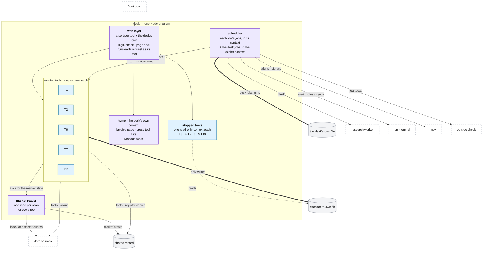

# The desk

**Above:** [ARCHITECTURE.md](../../ARCHITECTURE.md) §2.2 (the desk) and §2.3
(why one program).

**Talks to:**
- the [front door](../front-door/FRONT-DOOR.md), which brings it every page and
  API call;
- the [files on the box](../files/FILES.md): it is the only writer of each
  tool's file;
- the [data sources](../outside/SOURCES.md) and the
  [shared record](../outside/SHARED-RECORD.md);
- the [research worker](../research/RESEARCH-WORKER.md),
  [qp](../quant/QUANT.md) and the [journal](../journal/JOURNAL.md), whose timed
  work it starts;
- the [backups](../outside/BACKUPS.md) and the [alerts](../outside/ALERTS.md).

---

## 1. What it is

**One Node program that runs every tool.** For each running tool it does what a
tool's own program does today:
- serves its pages and its API;
- runs its screeners on schedule;
- builds and refreshes its cards;
- keeps its live list and its shortlist;
- takes its photo and measures its outcomes;
- scores its cards.

For each stopped tool it serves the history, read-only. It is also the desk's
only scheduler.

**What it owns:**
- each tool's own file, of which it is the only writer;
- its own file, for the desk jobs' runs and alerts;
- the live state of every tool, in memory and saved to each tool's file after
  every change.

**What it never does:**
- **compute O'Neil data:** the research worker does;
- **evaluate a trading strategy:** qp does;
- **place an order;**
- **let one tool see another's results.**

---

## 2. The diagram

---

## 3. The tool context: how one program holds many tools

The desk keeps tools apart with **contexts**. A context is everything that used
to be one tool's program-wide state:

| A context holds | Today, in a tool's own program, this was |
|---|---|
| the tool's identity: id, name, port, capture times, scorer | the environment the program was started with (`TOOL_ID`, `PORT`, …) |
| its file: the open database handle | the one database opened at start-up |
| its live list (R0) | a map in the program's memory |
| its scan status, market snapshot, hot sectors, scorer state | module variables |
| its jobs | the program's own scheduler |
| its role: running, stopped (read-only), or a comparison copy | — |

**How code finds its tool.**
- Every piece of work runs inside one context: a page request, a job, a scan.
- Every request runs as its tool, and every job as the tool that registered it.
- Code asks "which tool am I working for?" and gets the context's answer,
  across every `await` and every timer.

**Why two tools cannot mix.** A database query made outside every context is an
error in the desk, not a quiet write into T1's file. So a tool's results can
only ever reach its own file.

**The desk's own context.** Home and the desk jobs run as the desk itself, with
its own file. That is why every tool, T1 included, can be stopped.

**The comparison copy.** A context can also be a **copy** of a tool that still
runs as its own program. A copy:
- follows the tool's screeners, settings and stars, read-only from the tool's
  file;
- writes only its own file;
- sends no alert and writes nothing shared;
- is compared with the tool's own photo every day.

This is how each tool proves it takes the same photo in the desk before it moves
([MIGRATION.md](../MIGRATION.md) step B).

Built: `src/toolContext.js` (migration step 15a). The copy and its daily
comparison: `src/worker/` (step 15b).

---

## 4. Its parts

| Part | Job | Detail |
|---|---|---|
| **web layer** | brings every page and API call to its tool: one listener per tool port (so today's addresses keep working) and the desk's own; the login check; the page shell; live updates to open pages | [WEB.md](WEB.md) |
| **home** | the landing page; the lists across all tools (the unified shortlist, the screener report, the comparison); Manage tools (add, start, stop, pause, edit, delete, restore) | [HOME.md](HOME.md) |
| **running tools** | one tool end to end: its screeners and discovery, the card, the live list, the shortlist, the photo, the outcomes, the score, its pages and API | [TOOL.md](TOOL.md) |
| **stopped tools** | a stopped tool's stored registers and history, read-only, on its own address | [STOPPED-TOOLS.md](STOPPED-TOOLS.md) |
| **market reader** | the indexes, the regime, the short-, mid- and long-term reads, the 15 sectors and hot sectors: read once per scan for every tool, kept with its history, stamped on every card | [MARKET.md](MARKET.md) |
| **scheduler and desk jobs** | the only scheduler: every tool's jobs in its context, and the desk jobs (research runs, the night, the restore test, schedule changes, journal sync, qp's alert cycles with their signals pushed to the phone, the health checks, the heartbeat); every run recorded; failed, missed and hung runs alerted ([ALERTS.md](../outside/ALERTS.md)) | [JOBS.md](JOBS.md) |

### 4.1 Start-up

When the desk starts, it does the following in order. Every step is per tool,
and none of them waits on the network.

1. **Read the tool registry.**
   - For each **running tool**:
     1. open its file;
     2. bring its schema up to date;
     3. seed its screeners if it has none (only for the built-in tools);
     4. bring back today's live list from the file;
     5. register its jobs.
   - For each **stopped tool**: open its file **read-only**.
   - **During the move** ([MIGRATION.md](../MIGRATION.md) steps A and B), the
     running tools are those listed in `deskTools`, and each tool listed in
     `workerShadow` opens as a copy.
2. **Open the desk's own context.** Register the desk jobs.
3. **Record missed jobs.** A job whose slot passed while the desk was down is
   recorded as missed and alerts. A photo is never taken late as if on time.
4. **Scan at once, if the session is open.** If it is between 04:00 and the
   close on a trading day, each running tool scans now, so a restart does not
   leave a list empty until the next scheduled scan.
5. **Listen on every tool's port** and the desk's own.

### 4.2 Containment: one tool cannot take another down

- **Every job of every tool runs wrapped:**
  - an error is recorded in that tool's run history, with its stack;
  - it alerts if the job is one that alerts;
  - it never ends the program.
- **Errors outside every job** are logged with their stack, and the program goes
  on.
- **Heavy work stays out of page requests.** Exports and long checks run as
  jobs or in pieces, so one page cannot hold up every tool's scans.
- **Bad configuration is refused on save** ([HOME.md](HOME.md),
  [SCREENERS.md](tool/SCREENERS.md)), so a broken screener cannot reach the
  scans.

### 4.3 Memory

**Budget.** One copy of the code serves every tool: about 150–250 MB for the
desk with five running tools (an estimate, to be measured as tools move in).
Today the same work takes five programs at about 90 MB each, plus the archive.

**What each tool costs** is its live list and its caches: a few megabytes.

**What is shared in memory across tools:**
- the facts that do not depend on a tool (short interest, borrow, the O'Neil
  readings), cached once;
- the market read, made once per scan.

### 4.4 What changes for each tool's code

Almost nothing: the screener, card, register and page code is the code that runs
today. What changed is where each tool's state is kept (§3), so the same code
runs once per tool, in that tool's context.

---

## 5. Contracts

| It owns | Form |
|---|---|
| each tool's own file | SQLite, one per tool; the only writer ([FILES.md](../files/FILES.md)) |
| the desk's own file | SQLite: the desk jobs, their runs, the desk's alert state |
| the live state of every tool | memory, saved to each tool's file after every change |
| the routes of every tool and of home | [PAGES.md](tool/PAGES.md), [HOME.md](HOME.md), [WEB.md](WEB.md) |

| It reads | From |
|---|---|
| the tool registry | `tools.config.json` and `data/tools.local.json` ([FILES.md](../files/FILES.md)) |
| facts, O'Neil facts, market states | the shared record ([SHARED-RECORD.md](../outside/SHARED-RECORD.md)) |
| candidates, quotes, news, short interest, borrow, bars | the data sources, through their adapters ([SOURCES.md](../outside/SOURCES.md)) |
| the secrets | the secret files ([BOX.md](../box/BOX.md) §4.3) |

| It starts | When |
|---|---|
| the research worker | the research jobs ([JOBS.md](JOBS.md)) |
| qp's alert cycle | every minute in the session while alerts are on |
| the journal's sync | on each account's schedule |
| the backup | after the night's research run |

---

## 6. When it fails

| Event | What happens |
|---|---|
| the desk crashes | pm2 restarts it in seconds. Each tool's list comes back from its file; every run is in its file. A slot that passed while it was down is recorded as missed and alerts; a missed photo is never taken late |
| a tool's job throws | recorded in that tool's run history with its stack; alerts if it is a job that alerts; the other tools are unaffected |
| it passes its memory limit | pm2 restarts it, as a crash |
| the shared record is down | each tool works from its own file and fetches its facts itself; the copies wait; the health page says so |
| a data source fails | that source's facts show `unavailable` with the reason; the cards still build ([SOURCES.md](../outside/SOURCES.md)) |
| the front door is down | the desk keeps scanning and photographing; only the pages are out of reach |

---

## 7. Built on

**The old desk.** Every tool was its own program: five running tools at about
90 MB each, plus the archive serving the six stopped tools. Each program had:
- its own scheduler;
- its own copy of the pipeline;
- its own market read;
- its own caches.

The detail:
- [today's architecture](../../legacy/architecture/ARCHITECTURE.md);
- [TOOL-LIFECYCLE](../../legacy/screeners/TOOL-LIFECYCLE.md);
- [MONITOR](../../legacy/screeners/MONITOR.md).

**What failed there:**
- **Memory.** Tools were stopped for lack of memory: each was a whole copy of
  the program.
- **The live list was lost on restart.** It lived only in memory, until a
  checkpoint and a scan at start-up were added.
- **T1 could not be stopped.** It carried the landing page, Manage tools and
  every desk-wide job.
- **A capture-time change needed a restart.** It waited until 16:50, because a
  restart in the session emptied the list.
- **The archive.** It served stopped tools by loading a separate copy of the
  modules for each one ("require-cache surgery").
- **The market was read five times a scan.** Five tools read the same ETFs
  minutes apart, and the hot sectors were forgotten on every restart.

---

## 8. Status

| Part | Status |
|---|---|
| the tool context | **built** (step 15a): one program can hold several tools, each kept apart; tested with two tools in one program |
| the comparison copy and its daily photo check | **built** (step 15b), in a separate program (`desk-worker`) that starts when a tool is listed in `workerShadow`. As a context of the desk: **to build** (migration step B) |
| stopped tools served by the desk | **to build** (migration step A): the desk's first job, in place of the archive |
| the desk running tools for real: pages, API and scans | **to build** (step B): tool by tool, after a clean week of photos |
| home and the desk jobs in the desk's own context | **to build** (step B, with T1, last) |
| the market reader | **in shadow** (step 6): one read stored per scan; each tool still reads its own ([MARKET.md](MARKET.md)) |
| the scheduler | **partly**: run history and alerts built; one scheduler per tool until step B ([JOBS.md](JOBS.md)) |
