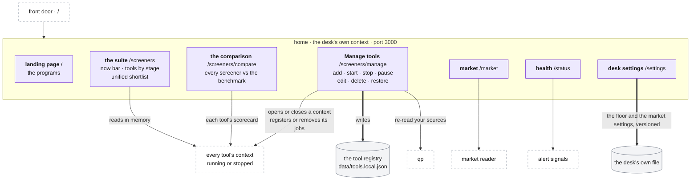
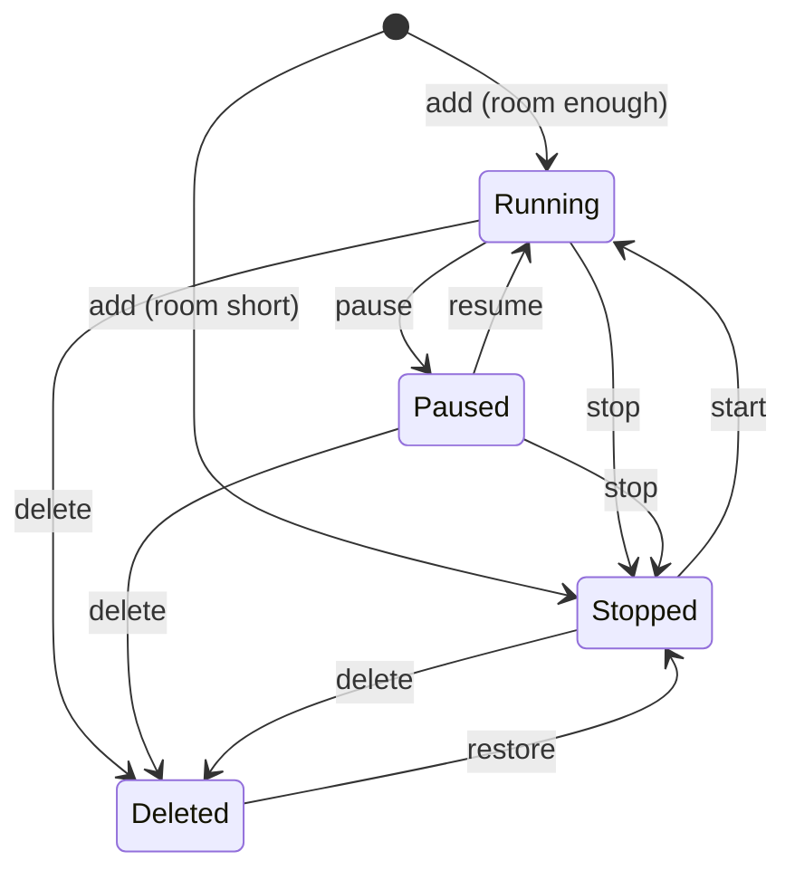

# Home

**Above:** [DESK.md](DESK.md) §4 (the desk's parts).

**Talks to:**
- the [web layer](WEB.md): home is served on the desk's own port, 3000, and at
  `/` through the front door;
- every tool's context, running or stopped, which it reads in memory;
- the [scheduler](JOBS.md): a tool added, started or stopped opens or closes its
  context and its jobs;
- the tool registry ([FILES.md](../files/FILES.md) §3.3), which Manage tools
  writes;
- the [market reader](MARKET.md), the [alerts](../outside/ALERTS.md) and the
  [scorecards](tool/LEARNING.md), whose pages it serves.

---

## 1. What it is

**The pages that belong to the desk rather than to any tool,** run in the
desk's own context:
- **the landing page:** which program to open;
- **the suite:** which tool to open now, and the lists across tools;
- **Manage tools:** add, start, stop, pause, edit, delete, restore;
- **the market, the health page and the desk's settings.**

Because home is the desk's own, **every tool, T1 included, can be stopped.**

**What it never does:**
- changes a tool's results: the lists across tools are views, never filters;
- erases a tool: delete hides it, and its history stays readable;
- starts a tool without the room for it;
- takes a capture-time change in the middle of a tool's day.

---

## 2. The diagram



---

## 3. Its parts

### 3.1 How the trader moves

```
/                      which program: the screener suite, qp, the journal
/screeners             which screener tool             ← the suite
/tools/T<n>/scanner    one tool, its tabs              ← the tool's pages
/screeners/compare     every screener judged side by side
/screeners/manage      add, stop, delete tools
/market                the market, outside any tool
/status                the health page
/settings              the desk's settings
```

Every page carries the same top bar ([WEB.md](WEB.md) §3.3).

### 3.2 The landing page (`/`)

Names the programs, each with whether it is up: the screener suite, qp, the
journal, the market, the health page. The first question of the day is "which
program", so nothing else is on it.

### 3.3 The suite (`/screeners`)

Answers one question: **which tool should I open now?**

| Part | Shows |
|---|---|
| **the now bar** | which tools are worth opening now; when none is, which one opens next and at what time, on the market's clock |
| **the tools, grouped by stage** | validated, under study, collecting data; an empty group says it is empty |
| **on each tool** | name and purpose; its check window ("check 08:00–09:30") and whether it is live; its cards today; its screeners in words, generated from the live rules; the tradability floor once, with list-only screeners tagged; paused, since when and why; stopped |
| **sleeping tools** | tools outside their windows |
| **the unified shortlist** | every tool's shortlist of the day, together, with an export as a TradingView list |
| Manage tools → | `/screeners/manage` |

**Read in memory.** In one program home reads each tool's live list, status and
counts from its context, with no request to another port. Today it asks every
tool's `/health` and two more routes every 30 seconds, across ports.

**Stages:**

| Stage | When |
|---|---|
| collecting data | fewer than **15** photographed days |
| under study | 15 days or more |
| validated | **only by hand**: time does not make a screener good |

A tool's committed stage is in the registry; the trader's override is kept in
`data/tool-stages.json`, and `auto` removes it. Each stage says why it is what
it is: the override, the registry, or the day count. In one program every
tool's day count is at hand, so no tool falls back to its recorded verdict.

### 3.4 The unified shortlist

**A view across tools, never a filter.** Nothing on one tool changes because of
another tool's stars.
- It is every tool's shortlist of the day, read from each tool's file.
- It shows on each card as **★ also T2 T7** ([CARD.md](tool/CARD.md)).
- `GET /api/shortlist/all-tools`, and `/export` as a TradingView list.

Today each tool publishes its list to a shared file, `data/shortlist-all.json`,
read and written by every tool program; two tools publishing at the same instant
can drop one change (D-S13). In one program the file retires: home reads every
tool's list directly.

### 3.5 The comparison (`/screeners/compare`)

Every screener of every tool in one table, from each tool's scorecard
([LEARNING.md](tool/LEARNING.md)), with entry A or B:
- **against the benchmark,** T9's *Stocks in Play*: a screener **beats** it
  when its good-move rate is at least **5 points** higher, **loses** when 5
  points lower; between is a draw;
- **mirror pairs** side by side: directional (one side ahead by 5 points or
  more); both sides work (both beat the benchmark: it finds movers, not a
  direction); neither beats the plain list;
- judged screeners first, then by good-move rate; a screener with too little
  data is listed but never ranked above one that has earned its place.

The suite links to it. While T9 is stopped the page has no benchmark (D-S14);
T9 runs again after the move ([MIGRATION.md](../MIGRATION.md) step B).

### 3.6 Manage tools (`/screeners/manage`)

**A tool's life:**



| Action | What happens in the desk |
|---|---|
| **add** | name, and optionally description, colour, capture times. At most **6** added tools alive. The id is one past the highest ever used, deleted tools included, so an id and its history are never reused. The port is the next free multiple of ten. Capture times default to 09:36, 09:37, 09:40. It opens as a running context at once if the box has the room, otherwise it is created stopped and says why. It starts with **no screeners**: they are built on its own page |
| **start** | refused if deleted (restore first) or if the room is short. The tool's context turns running: its file opened for writing, today's list brought back, its jobs registered |
| **stop** | the context turns read-only: its jobs removed, its file reopened read-only, its pages and history still served on its port ([STOPPED-TOOLS.md](STOPPED-TOOLS.md)) |
| **pause / resume** | the tool keeps its context and its cards, and its scans and refreshes return at once saying it is paused. The pause is kept in the tool's file with when and why, so it survives a restart. The registers are not touched |
| **scan now** | the tool's full scan, at once; says it is paused when it is |
| **edit** | name, description, colour, capture times, each checked on save (§3.7). A new name shows at once everywhere |
| **delete** | stops the tool and marks it deleted: off every list, its history still readable on its port. **Nothing is erased** |
| **restore** | takes the mark off; the tool comes back stopped |

After any change, qp is told to re-read its list of tools.

**The room a tool needs.** A tool is a context of the desk, not a program: it
costs its live list and its caches, measured when the first tool moves in
([MIGRATION.md](../MIGRATION.md) step B). A tool is not started with less than
that room available, plus a margin. Today, with a program per tool, the
threshold is **180 MB**: on a 912 MiB box the alternative is the kernel
choosing what to kill, and it may choose `sshd`.

**No restart, ever.** Start, stop, pause and edit act on the tool's context in
the running desk. Before, each was a program started or stopped by
`deploy/tool-ctl.sh`, and the archive had to be restarted to take or release a
stopped tool's port.

### 3.7 Checked on save

Refused, with every reason:
- capture times out of order: they must run `r1 < entryA < entryB`, with
  `r1 ≥ 09:30` and `entryB ≤ 15:50`;
- **a photo minute before every running screener's run window has opened**: the
  photo would hold nothing the tool's screeners found (D-S9)
  ([SCREENERS.md](tool/SCREENERS.md)).

**A capture-time change on a running tool** made between 04:00 and 16:30 on a
trading day is saved as pending and applied at 16:50, after the day's last
capture; at any other time it applies at once ([JOBS.md](JOBS.md) §3.6). A
day's photo always uses one time.

### 3.8 The market, the health page, the desk's settings

| Page | Shows | Detail |
|---|---|---|
| `/market` | the Market tab, outside any tool | [MARKET.md](MARKET.md) §3.19 |
| `/status` | every signal of the desk, its state, since when and its fix | [ALERTS.md](../outside/ALERTS.md) §3.7 |
| `/settings` | the tradability floor and the market settings, editable and versioned; the switches and the alert delivery, shown with how each is changed | [TOOL.md](TOOL.md) §3.1, [MARKET.md](MARKET.md) §3.14 |

The switches (the area modes, the shared record's address, the alert topics)
are changed on the box with `scripts/set-setting.js`, never from a page:
switching an area on is a migration step with its own check
([MIGRATION.md](../MIGRATION.md)).

---

## 4. Contracts

| It writes | Where |
|---|---|
| tools added, and overrides of any tool: name, description, colour, capture times, enabled, deleted, pending change | `data/tools.local.json`, written to a temporary file and renamed, so a crash never leaves half a file |
| a tool's stage override | `data/tool-stages.json` |
| the floor and the market settings | the desk's own file |

**Overrides may change only** the name, description, colour, capture times and
enabled, with the marks deleted and pending. Ids and ports belong to the
registry.

| Route (the desk's own port) | Does |
|---|---|
| `GET /api/tools` | every tool, with its stage |
| `POST /api/tools/:id/stage` | set a stage, or `auto` |
| `GET /api/tools/manage` | the tools as Manage tools shows them |
| `POST /api/tools/manage` | add |
| `PUT /api/tools/manage/:id` | edit, checked |
| `POST /api/tools/manage/:id/{start,stop,pause,resume,scan,restore}` | the actions of §3.6 |
| `DELETE /api/tools/manage/:id` | delete |
| `GET /api/shortlist/all-tools`, `/all-tools/export` | the unified shortlist |
| `GET /api/analysis/screener-report?tool=` | a tool's scorecard, for the comparison |
| `GET /api/status`, `/api/monitor…` | the health signals and the desk jobs ([ALERTS.md](../outside/ALERTS.md), [JOBS.md](JOBS.md)) |
| `GET /api/market/…` | the market ([MARKET.md](MARKET.md) §4) |
| `GET/PATCH /api/settings` | the floor and the market settings, checked, a new version on each change |

Each answers `{ ok, message, … }`, or `400 { ok: false, error }` with the
reason.

---

## 5. When it fails

| Event | What happens |
|---|---|
| a tool's context fails to open (its file damaged, its port taken) | the tool shows as down, with the reason; every other tool and home work |
| the room is short on add or start | the tool is created stopped, or not started, and the message says why |
| a change is refused | nothing is saved; every reason is shown |
| qp does not answer the "re-read" | qp reads the registry again at its next start; the change is saved |

---

## 6. Built on

**The old desk:**
- [legacy/screeners/TOOL-LIFECYCLE.md](../../legacy/screeners/TOOL-LIFECYCLE.md):
  the registry, adding a tool, the buttons, the two guards, pause, the archive;
- [legacy/screeners/PAGES.md](../../legacy/screeners/PAGES.md): the suite, the
  stages, the comparison, the unified shortlist;
- the code: `src/toolsManager.js`, `src/routes/toolsManage.js`,
  `src/stages.js`, `src/sideF/globalShortlist.js`, `public/home.html`,
  `screeners.html`, `compare.html`, `manage.html`.

**What failed there:**

| ID | Fault | Prevented by |
|---|---|---|
| — | T1 carried home and Manage tools, so it could not be stopped or deleted | home is the desk's own |
| D-S14 | with T9 stopped for memory, the comparison has no benchmark | a tool is a context; T9 runs again |
| D-S13 | the unified shortlist was a shared file written by many programs, and could drop a change | home reads every tool's list directly |
| D-S9 | T6's photo minute fell before its screener's window | checked on save |
| — | a capture-time change needed a restart, so it waited until 16:50 | no restart; the 16:50 rule kept only so a day's photo uses one time |
| — | the suite page could count only its own tool's days | every tool's count at hand |
| — | the landing page asked every tool's port every 30 seconds | read in memory; live updates ([WEB.md](WEB.md) §3.5) |

---

## 7. Status

| Part | Status |
|---|---|
| the landing page, the suite, the stages, the comparison, Manage tools, the checks on save | **built**, served by T1 |
| home in the desk's own context, on port 3000 | **to build** (step B, with T1) |
| actions on contexts, without programs or restarts | **to build** (step B) |
| the unified shortlist read from every tool's file | **to build** (step B) |
| `/market`, `/status`, `/settings` | **to build** (step E) |
| the room a context needs, measured | **to do** (step B) |
