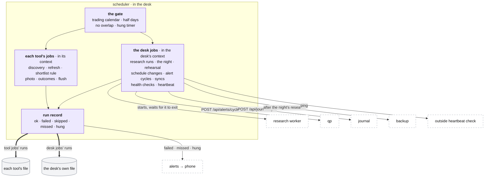

# The scheduler and the desk jobs

**Above:** [DESK.md](DESK.md) §4 (the desk's parts) and
[ARCHITECTURE.md](../../ARCHITECTURE.md) §2.2 and §4 (a trading day).

**Talks to:**
- every running [tool](TOOL.md): its jobs run in its context;
- the desk's own context: the desk jobs;
- the [research worker](../research/RESEARCH-WORKER.md), [qp](../quant/QUANT.md),
  the [journal](../journal/JOURNAL.md) and the [backups](../outside/BACKUPS.md),
  whose timed work it starts;
- the [files](../files/FILES.md): each job and each run is a row in the file of
  the context it belongs to;
- the [alerts](../outside/ALERTS.md): a failed, missed or hung run.

---

## 1. What it is

**The only scheduler on the box.** Every timed thing the desk does is a job
here:
- **each tool's jobs,** run in that tool's context: discovery, the refresh, the
  shortlist rule, the photo, the outcomes, the midnight flush;
- **the desk jobs,** run in the desk's own context: the research runs, the
  night and its backup, the restore rehearsal, schedule changes, qp's alert
  cycles, the journal's sync, the health checks, the heartbeat.

**Every run is recorded.** A failed, missed or hung run alerts. The trading
calendar decides which days a job runs.

**What it never does:**
- runs one job twice at once: a run still going when its next slot comes skips
  that slot, and says so;
- takes a photo late as if on time: a slot that passed while the desk was down
  is recorded as **missed**, never run late;
- lets any program keep a timer of its own: qp, the journal and the research
  worker are started from here;
- runs a market job on a closed day.

---

## 2. The diagram

---

## 3. Its parts

### 3.1 A job

| Field | Means |
|---|---|
| **id** | stable: never made from the job's name or its time. A job whose id changed carries its settings over from its former ids (D-T6) |
| **name** | what the pages show |
| **schedule** | cron, in New York time |
| **default** | the schedule the code gives it. A schedule never edited follows a new default (a photo moved to 10:01); an edited one is kept |
| **calendar** | `day`: trading days only. `session`: trading days, and on a half day it stops five minutes after the 13:00 close. None: every day |
| **enabled** | on or off, kept across restarts |
| **alert** | whether its failures reach the phone ([ALERTS.md](../outside/ALERTS.md) §3.1) |
| **hung after** | the minutes after which a run still going is hung, and alerts while it goes on |
| **missed after** | the minutes after its slot by which a run must have started, or it is recorded as missed |

A job's definition lives in the file of its context: a tool's jobs in that
tool's file, the desk jobs in the desk's own file.

### 3.2 A run

Each run is a row: start, end, result, detail, and the error with its stack.

| Result | Means |
|---|---|
| `ok` | it ran and finished |
| `failed` | it threw; the error and stack are kept |
| `skipped` | not run, with the reason: a closed market (recorded once a day), or the previous run still going |
| `missed` | its slot passed while the desk was down |
| `hung` | it ran past its limit |

Runs are kept 30 days. A tool fires up to about 300 runs on a trading day.

### 3.3 The rules

- **The calendar.** One trading calendar (`src/calendar.js`): weekends,
  holidays, half days. A weekday is not a trading day: before the calendar,
  Good Friday and Christmas ran the whole day, and R1 froze yesterday's quotes
  as today's photo.
- **No overlap.** A job never runs twice at once. A slot that comes while the
  previous run is going is skipped and recorded (the old scan guard, made
  general).
- **Hung.** A run past its limit alerts while it is still going.
- **Missed.** At start-up, each job with a "missed after" limit whose slot
  passed without a run is recorded as missed and alerts. It is not run late: a
  photo taken at 09:45 is not the 09:36 one. A tool that has never run the job
  on its file missed nothing.
- **Dependencies, not clock guesses.** Work that needs other work runs after it,
  in one job: the night runs the research, then the backup, whatever the
  research's result. When a model is chosen, training runs after the outcomes
  are written.
- **Wrapped.** Every run is wrapped: an error is recorded in its context's
  history and alerts if the job alerts. It never ends the program, and never
  reaches another tool ([DESK.md](DESK.md) §4.2).
- **Every job alerts.** A job that runs more often than every 15 minutes alerts
  after three failed runs in a row; any other job after one
  ([ALERTS.md](../outside/ALERTS.md) §3.1).

### 3.4 Each tool's jobs

New York time; each runs in its tool's context.

| Job | Schedule | Calendar | Alerts | Hung after | Missed after |
|---|---|---|---|---|---|
| discovery: pre-market | every 30 min, 04:00–08:30 | session | 3 in a row | — | — |
| discovery: the open | every 5 min, 09:00–09:55 | session | 3 in a row | — | — |
| discovery: the session | every 15 min, 10:00–15:45 | session | 3 in a row | — | — |
| discovery: the close | 16:00 | session | yes | — | — |
| refresh: re-quote and re-score every card | every 5 min, 04:00–16:55 | session | 3 in a row | — | — |
| shortlist auto-rule | one minute before the photo | day | yes | — | — |
| **R1, the photo** | the tool's capture minute | day | yes | 15 min | 10 min |
| R2 snapshots | 09:26, 09:31 … 09:56, 10:01 | day | — | — | — |
| **R3, the outcomes** | 16:05 | day | yes | 30 min | 30 min |
| midnight flush of the live list | 00:00 | every day | yes | — | — |

**Discovery says how often a tool looks, not what it looks for.** Each screener
only runs inside its own window, so the cadence is the same for every tool
while each tool's day differs ([SCREENERS.md](tool/SCREENERS.md)). The 5-minute
cadence from 09:00 to 10:00 carries the photo: only what is in the live list by
the capture minute reaches R1.

**R2 snapshots retire** when the one market read is switched on: R2 is then the
market history at those minutes ([MARKET.md](MARKET.md) §3.16).

**Training is not a tool job.** Today each tool also has a 16:20 job that
posts the day's rows to the legacy scorer. The scorer is off on every tool
(D-D1), so the job does nothing; it retires in step B. When a model is chosen,
training is a desk job (§3.5) ([LEARNING.md](tool/LEARNING.md)).

**A comparison copy** runs the same jobs, with no alerts, and adds its daily
photo comparison five minutes after the photo
([MIGRATION.md](../MIGRATION.md) step B).

### 3.5 The desk jobs

In the desk's own context, recorded in its own file.

| Job | Schedule | Calendar | Alerts | Starts |
|---|---|---|---|---|
| research: new tickers | every 5 min, 04:00–15:55, only while a ticker carded today waits | day | 3 in a row | the research worker, for those tickers |
| research: provisional M | 09:00, 09:30 … 15:30 | session | 3 in a row | the research worker's market model, provisional |
| **the night** | 18:30 | day | yes; hung after 6 h; missed after 60 min | the research worker's night run, then the backup |
| training, when a model is chosen | after the outcomes | day | yes | the research worker's training run |
| apply tool schedule changes | 16:50 | day | yes | — (§3.6) |
| qp's alert cycle | every minute, 09:25–16:05, while alerts are on | session | 3 in a row | `POST /api/alerts/cycle` on qp |
| the journal's sync | every minute; each account on its own interval | every day | 3 in a row | `POST /api/journal/sync` on the journal |
| source checks | 03:45, and at each adapter's cadence | day | via the signal | — ([SOURCES.md](../outside/SOURCES.md) §3.5) |
| fact freshness | every 15 min | every day | via the signal | — |
| programs' health | every minute | every day | via the signal | — |
| the box: memory, disk, restarts | every 5 min | every day | via the signal | — |
| the heartbeat | every 5 min | every day | — | a ping to the outside check |
| restore rehearsal | the 1st of each month, 09:10 | every day | yes; hung after 2 h | the restore into the scratch schema |

**"Via the signal"** means the check itself alerts through its signal's own
rule ([ALERTS.md](../outside/ALERTS.md) §3.1), not as a failed job. A check
that throws is a failed job.

### 3.6 Schedule changes

A change to a running tool's capture times made **between 04:00 and 16:30 on a
trading day** is saved as pending and applied by the 16:50 job, after the day's
last capture. Made at any other time, it applies at once.
- So a day's photo always uses one time: no day gets two photos, or none.
- In one program no restart is needed: the job re-registers the tool's jobs in
  its context. Before, a change needed a restart, and a restart in the session
  emptied the list.

A tool added, started or stopped from Manage tools opens or closes its context
at once, and registers or removes its jobs ([HOME.md](HOME.md)).

### 3.7 Starting work in another program

| Work | How | Its run's result |
|---|---|---|
| a research run | starts `quant-platform/research/worker.py <run>` and waits for it to exit | the exit code, and the worker's own run record ([RESEARCH-WORKER.md](../research/RESEARCH-WORKER.md)) |
| an alert cycle | `POST http://127.0.0.1:8765/api/alerts/cycle`, with a timeout | the cycle's answer: strategies and symbols evaluated, new signals, errors. The new signals are pushed ([ALERTS.md](../outside/ALERTS.md) §3.6) |
| a journal sync | `POST http://127.0.0.1:3100/api/journal/sync`, with a timeout | each account fetched or failed, with the reason |
| the backup | starts `scripts/backup-r2.js` and waits for it to exit | the exit code and the night's manifest ([BACKUPS.md](../outside/BACKUPS.md)) |

Calls from the box to itself on `127.0.0.1` need no login, and are never
mistaken for outside calls ([FRONT-DOOR.md](../front-door/FRONT-DOOR.md) §3.3).

### 3.8 The pages

- **Each tool's Monitor tab:** its jobs, each with its schedule, on or off, its
  last run and its next slot; edit the schedule, reset it, switch it off; the
  run history ([PAGES.md](tool/PAGES.md)).
- **The health page:** every job of every tool and of the desk, with its last
  result ([ALERTS.md](../outside/ALERTS.md) §3.7).
- **Run now:** a button on a job, for the jobs that may be run by hand (the
  research runs, the backup, the rehearsal, a check). It asks the scheduler to
  start the job; no page waits for it. The photo is never run by hand as if on
  time ([REGISTERS.md](tool/REGISTERS.md)).

---

## 4. Contracts

| It owns | Where |
|---|---|
| `scheduler_jobs` (id, schedule, enabled, default) | each tool's file; the desk's own file |
| `job_runs` (id, job, start, end, result, error, stack, detail), kept 30 days | the same |

| Route | Does |
|---|---|
| `GET /api/monitor` | the jobs of this context, and the scan status |
| `GET /api/monitor/jobs/:job/runs` | a job's run history, newest first |
| `POST /api/monitor/jobs/:job/toggle` | on or off |
| `POST /api/monitor/jobs/:job/schedule` | a new schedule, checked |
| `POST /api/monitor/jobs/:job/reset` | back to the default |
| `POST /api/monitor/jobs/:job/run` (to build) | run now, where allowed |

Under each tool's address these act on that tool's jobs; at the desk's own
address, on the desk jobs.

---

## 5. When it fails

| Event | What happens |
|---|---|
| a job throws | recorded with its stack; alerts by its rule; the next slot runs as usual |
| a run outlasts its slot | the next slot is skipped and recorded; two runs of one job never overlap |
| a run hangs | it alerts while still going; the slot after it is skipped |
| the desk is down at a slot | at start-up the slot is recorded as missed and alerts; it is not run late |
| a started program fails (the worker exits non-zero, qp or the journal does not answer) | the run fails with the reason and alerts by its rule; nothing is retried inside the run |
| the desk is down for long | the outside heartbeat alerts ([ALERTS.md](../outside/ALERTS.md) §3.5) |

---

## 6. Built on

**The old desk:**
- jobs spread over five tool programs (each with its own `node-cron`), a pm2
  cron (the backup, 23:20 UTC), a hand-installed systemd timer (qp's nightly
  chain, 22:30 UTC), the journal's own minute timer, and qp's own watcher
  thread;
- each tool's Monitor tab: toggle, edit, reset; the run history in memory, lost
  at every restart; nothing alerted
  ([legacy/screeners/MONITOR.md](../../legacy/screeners/MONITOR.md)).

The design that made it: the old PLATFORM §2, now carried here.

**What failed there:**

| ID | Fault | Prevented by |
|---|---|---|
| Q-N5 | the O'Neil chain ran from a hand-installed timer; without it the data went stale with no alarm | one scheduler; every job alerts |
| J-4 | the journal's fetch could fail silently | the sync started and recorded here |
| D-T6 | a job's id was its name, so changing a photo time dropped its custom schedule | stable ids, carried over from former ids |
| — | the backup ran at a fixed 23:20 UTC, fifty minutes after the chain started, finished or not | the night: research, then backup |
| — | the run history lived in memory | every run a row |
| — | holidays ran like trading days | the trading calendar |
| — | a restart during the session left the lists empty for up to 15 minutes | a scan at start-up ([DESK.md](DESK.md) §4.1) |
| — | two supervisors once restarted one program 113,854 times | one supervisor per program ([BOX.md](../box/BOX.md) §4.1) |

**The code:** `src/scheduler.js`, `src/jobs/history.js`, `src/jobs/night.js`,
`src/routes/monitor.js`, `src/calendar.js`.

---

## 7. Status

| Part | Status |
|---|---|
| stable ids, followed defaults, the calendar, no overlap, run history, hung and missed, the night (research then backup) | **built** (steps 4 and 8), in each tool's program |
| alerts | **built** for the photo, the outcomes, the night and the rehearsal; every job with the three-in-a-row rule: **to build** (step C) |
| one scheduler in the desk; the desk jobs in its own context and file | **to build** (step B, with T1). Today the desk jobs run in T1's program |
| qp's alert cycle and the journal's sync started here | **to build** (step C) |
| the night handed over from the old timer and cron | **built**; it stands down while they exist, until `scripts/retire-old-schedulers.sh` runs (step C) |
| schedule changes without a restart | **to build** (step B) |
| the health checks and the heartbeat | **to build** (step E) |
| run now | **to build** (step E) |

**How it is proven:**
1. **Missed run.** Switch the night's job off for one night: an alert arrives
   in the morning.
2. **Overlap.** A scan made to outlast its slot skips the next slot and records
   it; two scans never run at once.
3. **Restart across a photo.** Stop the desk across a tool's capture minute: the
   photo is recorded as missed and alerts, and is not taken late.
4. **Holiday.** On a market holiday every market job is skipped, recorded once,
   with the reason.
