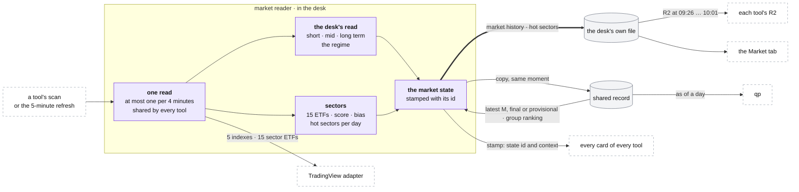

# The market reader

**Above:** [DESK.md](DESK.md) §4 (the desk's parts) and
[ARCHITECTURE.md](../../ARCHITECTURE.md) §2.2.

**Talks to:**
- the TradingView adapter ([SOURCES.md](../outside/SOURCES.md)): the indexes and
  the sector ETFs;
- the [shared record](../outside/SHARED-RECORD.md): O'Neil's M and L, written by
  the [research worker](../research/RESEARCH-WORKER.md); and the copy of the
  market history;
- every running [tool](TOOL.md): each card is stamped from the current state
  ([CARD.md](tool/CARD.md));
- the desk's own [file](../files/FILES.md) §3.2: the market history and the
  market settings;
- the [registers](tool/REGISTERS.md): R2 is this history at fixed minutes;
- the Market tab ([PAGES.md](tool/PAGES.md)) and [qp](../quant/QUANT.md),
  which read the history as of any day.

---

## 1. What it is

**The desk's one read of the market, made once per scan for every tool.**

Two different questions, kept apart on purpose:

| Read | Answers | Clock | Made by |
|---|---|---|---|
| **the desk's read** | what is the tape doing right now, and which sectors lead? | every scan | this reader, from TradingView quotes |
| **O'Neil's method** | should I be buying at all, and where is the leadership? | after each close; M also every 30 minutes in the session, provisional | the research worker, from index bars and whole-market RS |

They use different words, so the trader can never mistake one for the other.
Both are stamped on every card and frozen into every photo.

**What it owns:**
- the market history: one **market state** per read, with its instant;
- the **hot-sector state**, one row per sector per trading day;
- the desk's **market settings**: the thresholds of the sector bias and of hot
  sectors, versioned.

**What it never does:**
- computes M or L: it reads the research worker's facts;
- lets a tool keep thresholds of its own: the read is a fact about the market,
  the same for every tool;
- serves a regime when the index data is incomplete: no regime, said plainly;
- computes anything inside a page request.

---

## 2. The diagram

---

## 3. Its parts

### 3.1 When it reads

- **At every discovery scan,** and at least every 5 minutes from 04:00 to
  16:00 with the refresh.
- **One read serves every tool.** A state younger than 4 minutes is reused; a
  tool scanning a minute after another gets the same state.
- **One reader.** In the one program the read is made once, in memory, so no
  lock between programs is needed.

### 3.2 The inputs

**TradingView's scanner,** for **SPY, QQQ, IWM, DIA, VIX** and **15 sector
ETFs**, with the columns `close`, `change`, `change_from_open`, `change|1W`,
`SMA5`, `SMA20`, `SMA50`, `SMA200`, `BB.upper`, `BB.lower`, `ADX`, `VWAP`,
`relative_volume_10d_calc`.

| Sector | ETF | | Sector | ETF |
|---|---|---|---|---|
| Technology | XLK | | Real Estate | XLRE |
| Financial | XLF | | Consumer Staples | XLP |
| Industrial | XLI | | Semiconductors | SMH |
| Consumer Discretionary | XLY | | Biotechnology | IBB |
| Energy | XLE | | Retail | XRT |
| Health Care | XLV | | Transportation | XTN |
| Communication Services | XLC | | Utilities | XLU |
| Materials | XLB | | | |

**From the research worker,** through the shared record: the latest `oneil_m`
(final or provisional) and `group_ranking` ([RESEARCH-WORKER.md](../research/RESEARCH-WORKER.md)).

**No regime rather than a wrong one** (D-S2). If SPY and QQQ are both missing
any of close, SMA5, SMA20, SMA50 or SMA200, the state is recorded as
`no_regime` with the reason, and cards carry no market context.

### 3.3 The indexes

Five tiles, in the order SPY, QQQ, DIA, IWM, VIX: price, change today, change
over the week. Tapping one opens its chart in qp.

### 3.4 Short-term bias

From the index quotes:

| Signal | +1 | −1 |
|---|---|---|
| SPY day | > +0.3 % | < −0.3 % |
| QQQ day | > +0.3 % | < −0.3 % |
| IWM day | > +0.3 % | < −0.3 % |
| VIX day | < −2 % (+1) | > +1 % (−1); > +3 % (−2) |
| SPY week | > +1 % | < −1 % |
| QQQ week | > +1 % | < −1 % |

A sum of **+3** or more is BULLISH, **−3** or less BEARISH, otherwise NEUTRAL.
The tab shows the score and each signal.

### 3.5 Mid-term stage

From SPY (QQQ when SPY is incomplete). Today six checks are counted as bull
signals:

1. close > SMA5
2. close > SMA20
3. SMA5 > SMA20
4. SMA20 > SMA50
5. "1-hour close > 20-hour MA": the code uses close > SMA20, check 2 again
6. "1-hour 5MA > 20-hour MA": the code uses SMA5 > SMA20, check 3 again

| Stage | Rule |
|---|---|
| UPTREND | 5 or more bull, or 4 with close > SMA5 |
| PULLBACK | 3–4 bull, close < SMA5, SMA5 > SMA20 |
| REBOUND | 2–3 bull, close > SMA5, SMA5 < SMA20 |
| SIDEWAYS | 2–3 bull otherwise |
| DOWNTREND | fewer |

**Bollinger position** (where the close sits between the bands): 75 % or more
`UPPER`, 25 % or less `LOWER`, otherwise `MID`.

Checks 5 and 6 count two facts twice (D-D5). The correction is in §3.13.

### 3.6 Long-term bias

| | SMA50 > SMA200 | SMA50 < SMA200 |
|---|---|---|
| **close > SMA200** | BULLISH | RECOVERING |
| **close < SMA200** | WEAKENING | BEARISH |

Also shown: the distance from the 200-day, in %.

### 3.7 The regime

Long term against mid term, then a Bollinger overlay:

| Long \ Mid | UPTREND | PULLBACK | REBOUND | SIDEWAYS | DOWNTREND |
|---|---|---|---|---|---|
| **BULLISH** | STRONG_UP | PULLBACK_BULL | UP | CHOP_BULL | CORRECTION |
| **RECOVERING** | WEAK_UP | RECOVERY | RECOVERY | BASING | DOWN |
| **WEAKENING** | RECOVERY | TOPPING | BEAR_RALLY | CHOP_BEAR | DOWN |
| **BEARISH** | BEAR_RALLY | DOWN | BEAR_RALLY | BASING | STRONG_DOWN |

STRONG_UP at the upper band becomes **EXTENDED_UP**. STRONG_DOWN at the lower
band becomes **CAPITULATION**.

| Regime | Stance | Guidance shown |
|---|---|---|
| Extended Up | LONG | Market extended. Momentum strong. Pullbacks are buying opportunities. |
| Strong Uptrend | LONG | Strong bullish conditions. Favor long setups with momentum. |
| Uptrend | LONG | Bullish but recovering. Favor long setups selectively. |
| Weak Uptrend | LONG | Recovering from weakness. Light long bias. |
| Pullback (bull intact) | LONG | Short-term pullback in a bull market. Watch for long re-entries. |
| Recovery | NEUTRAL | Recovering structure. Be selective. Wait for confirmation. |
| Basing | NEUTRAL | Market is basing. No clear direction. Reduce exposure. |
| Chop (bull bias) | NEUTRAL | Choppy but leaning bullish. Trade small and be selective. |
| Chop (bear bias) | NEUTRAL | Choppy with bear undertone. Reduce position size. |
| Correction (bull intact) | NEUTRAL | Correction in a bull market. Monitor for stabilization before re-entering. |
| Topping | SHORT | Signs of topping. Reduce longs. Hedge or go short on weakness. |
| Bear Rally | NEUTRAL | Counter-trend rally in bear market. Fade strength cautiously. |
| Downtrend | SHORT | Bearish conditions. Avoid longs. Short on rallies. |
| Strong Downtrend | SHORT | Strongly bearish. Reduce all risk. Short only. |
| Capitulation | SHORT | Market in capitulation. Extreme caution. Watch for reversal signals. |

**Confidence:** high when the long and mid term agree in side, medium otherwise
(shown as Aligned or Diverging).

On the tab this block is titled **"Desk regime"**, so it can never be read as
O'Neil's status.

### 3.8 The sectors: heatmap and score

Columns: sector, ETF, day %, week %, **RS day** (ETF day − SPY day), **RS week**
(ETF week − SPY week), bias, score, ADX, status (🔥 HOT). Sorted by score.

**The score:**
1. Five checks: close > SMA20 · SMA20 > SMA50 · close > VWAP · RS day > 0 ·
   week > 0.
2. `base = checks / 5 × 100`.
3. `RS influence = RS day × 5`, clamped to ±30.
4. ADX factor: **1.3** if ADX > 25; **1.1** from 20 to 25; **0.8** below 20.
5. `score = round((base + RS influence) × ADX factor)`, clamped to ±100.
6. Bias: above **+20** BULLISH, below **−20** BEARISH, otherwise NEUTRAL.

Today the score runs from about −39 to +100, so BULLISH is far easier to reach
than BEARISH (F-16). The correction is in §3.13.

### 3.9 Hot sectors

Counted **per New York trading day**, not per scan (F-17):
- **hot at once** when the day's best score reaches **60**;
- **hot after 3 trading days** whose best score reached **40**;
- **stays hot** while the day's best score is at least **20**;
- **cools off** after **2** trading days below 20.

**Kept, not remembered.** One row per sector per trading day: the day's best
score, the run of days at 40 or more, the run of days under 20, hot or not,
hot since. A restart reads the rows back.

**A reset** is an explicit action from the Market settings, logged with who and
when.

### 3.10 Each card's sector

A card's TradingView sector is mapped to one of the 15:

| TradingView sector (as the stock scanner sends it) | Market sector |
|---|---|
| Electronic Technology, Technology Services | Technology |
| Finance | Financial |
| Finance/Real Estate | Real Estate |
| Producer Manufacturing, Process Industries | Industrial |
| Consumer Services, Consumer Durables | Consumer Discretionary |
| Consumer Non-Durables | Consumer Staples |
| Energy Minerals | Energy |
| Health Technology, Health Services | Health Care |
| Communications | Communication Services |
| Non-Energy Minerals | Materials |
| Retail Trade | Retail |
| Transportation, Utilities | themselves |

GICS-style names (Healthcare, Consumer Cyclical, Basic Materials, Consumer
Defensive, …) are mapped too, for the index scanner. The card then carries its
sector's bias, score and hot badge.

**Four labels have no mapping today:** Commercial Services, Distribution
Services, Industrial Services, Miscellaneous. Their cards get no sector bias,
score or badge. The correction is in §3.13.

### 3.11 M: O'Neil's market model, as read

The rules are the research worker's, and live once, in
[ONEIL.md](../research/ONEIL.md) §M: distribution and stalling days, the
25-session window, follow-through days, the worse of the two indexes. The reader
**copies the latest M into each state**, labelled provisional until the close,
so every state is complete on its own and a past day shows M **as it was**
(D-D3).

**The tab's M block shows:**
- the status, its date and a *because* line;
- the live distribution days per index;
- the follow-through: date, day number, gain, timing; sessions since it, with a
  band;
- the rally attempt: day N off a dated low;
- the guidance for the status;
- a dated distribution-day table: date, index, kind, move %, volume ratio,
  sessions until it expires;
- the rules in use, the caveat that about one follow-through in four fails, the
  model note;
- **the index RS line,** Nasdaq ÷ S&P 500: the earliest read on whether growth
  or defensives are being bought.

| Status | What O'Neil does (shown) |
|---|---|
| Confirmed uptrend | Buy breakouts. This is the state the method is designed for. |
| Uptrend under pressure | Stop initiating new positions; tighten stops. A name holding up through distribution is a leader candidate for the next follow-through. |
| Market in correction (including a rally attempt with no follow-through yet) | No new buying. Three out of four stocks follow the market. |

**On each card** (the CANSLIM M section and the market context): the status,
the live distribution days, what this stock did on those days ("up on 4 of 5,
avg +0.9 % vs index −0.8 %"), the verdict HOLDING UP, IN LINE or GIVING WAY,
the sessions since the follow-through, and the exposure note
([CARD.md](tool/CARD.md)).

### 3.12 L: industry groups, as read

Ranked by the research worker across the whole market
([ONEIL.md](../research/ONEIL.md) §L): membership by SIC code, the median
member RS, thin groups rolled up a rung, every rank stored as "rank of N" so a
change of scheme never rewrites the past.

**The tab's L block shows:**
- **the sector rank,** 1 of 33, from the SIC major groups: a coarse level
  between the 15 ETFs and the groups;
- the top 20 and the weakest 10 groups, each with: rank X of N, the group
  (marked *rolled up* at either rung), percentile and letter, members, median
  RS, the share over RS 80, the three-month rank change, the four leaders with
  their RS, and the group's new highs and lows;
- a note: how many symbols and industries are mapped, how many groups ranked.

### 3.13 The corrections

Three corrections of the desk's read, each behind a **new version** of the
definition, so history records which one made each state:

| Correction | Change | Re-tune before it is used |
|---|---|---|
| **sector score centred on 0** (F-16) | `base = (checks − 2.5) / 2.5 × 100`, from −100 to +100, before the RS influence and the ADX factor | the hot thresholds (60, 40, 20) and the bias thresholds (±20), checked against a month of history |
| **mid-term stage on four distinct checks** (D-D5) | close > SMA5, close > SMA20, SMA5 > SMA20, SMA20 > SMA50; or hourly bars when an adapter provides them | the stage rules, cut again for four checks |
| **every sector label mapped** | the four unmapped labels mapped; an unknown label is reported on the health page, never silently dropped | — |

They are switched on only after the one read is on, and each is compared over a
month of history first ([MIGRATION.md](../MIGRATION.md) step D).

### 3.14 The market settings

The desk's settings, kept in its own file, each change a new version:

| Setting | Default | Range |
|---|---|---|
| hot at once | 60 | 0–100 |
| hot after a run of days at | 40 | 0–100 |
| the run's length | 3 trading days | 1–20 |
| stays hot while at least | 20 | 0–100 |
| cools off after | 2 trading days | 0–30 |
| sector bullish above | +20 | 0–100 |
| sector bearish below | −20 | −100–0 |

A 0 is a value, not "use the default". Until the one read is switched on, each
tool keeps its own copy of these settings, and the switch lists any tool whose
values differ.

### 3.15 The market state

| Field group | Holds |
|---|---|
| `at`, `day` | the instant (UTC); the trading day (New York) |
| `indexes` | SPY, QQQ, IWM, DIA, VIX: every column of §3.2 |
| `sectors` | for each of the 15 ETFs: its columns, RS day, RS week, checks, score, bias, ADX factor, hot |
| `short_term` | the six signals, the sum, the bias |
| `mid_term` | the checks, the stage, the Bollinger position |
| `long_term` | the bias; the distance from the 200-day |
| `regime` | slug, label, stance, guidance, confidence |
| `oneil_m` | copied from the latest M fact: status, why, the live counts per index, the follow-through, the rally attempt, the distribution days, the rules in use, provisional or final |
| `oneil_l_ref` | the id of the group ranking current at that instant |
| `versions` | the version of each definition and of the market settings that made it |
| `status` | `ok`, or `no_regime` with the reason |

**Kept:** every state for 60 days. After that: every state a photo points to,
the states R2 reads, one state per 30 minutes, and the close. So the history
stays small, and every photo can still be traced to its state.

### 3.16 R2: the history at fixed minutes

R2 is not written by any job. For each trading day it is the market state
nearest to each of the slots 09:26, 09:31 … 10:01, with M as it was in that
state ([REGISTERS.md](tool/REGISTERS.md)). It is the same for every tool.

### 3.17 What the card receives

`market_state_id`, `regime`, `regimeLabel`, `longTerm`, `midTerm`, `shortTerm`,
`broadResolved` (its market sector), `secBias`, `secScore`, `secHot`, and from
M the reflection on the card (§3.11). The card's fields:
[CARD.md](tool/CARD.md).

### 3.18 Who uses what

| Number | Card | R1 | R2 | Model features |
|---|---|---|---|---|
| regime; long, mid, short term | market context | ✓ | ✓ | ✓ |
| sector bias, score, hot | market context, 🔥 HOT | ✓ | ✓ (all 15) | bias and score |
| index prices | — | — | ✓ | — |
| O'Neil status | CANSLIM M | ✓ | ✓, as it was | — |
| group rank | CANSLIM L | ✓ | — | — |

### 3.19 The Market tab

From top to bottom:
1. **M · O'Neil market model,** first, because it decides whether to buy at
   all, with the index RS line;
2. **the indexes;**
3. **the desk's read:** short, mid and long term, and the regime, titled "Desk
   regime";
4. **the sector heatmap,** with the sector rank above it;
5. **L · industry groups.**

Every number has its ⓘ: what it means, how it is calculated, what it is not,
its source and its as-of time, as on the card. The tab only reads: a missing M
or L says "not built yet · last run DATE" ([PAGES.md](tool/PAGES.md)).

---

## 4. Contracts

| It owns (the desk's own file) | Key | Written |
|---|---|---|
| `market_states` | id; instant | each read |
| `hot_sector_days` | sector, trading day | each read |
| the market settings and their versions | setting, version | the Market settings |

**Copied to the shared record** at the same moment, and compared every day
([SHARED-RECORD.md](../outside/SHARED-RECORD.md) §3.2).

| It reads | From |
|---|---|
| index and sector-ETF quotes | the TradingView adapter |
| the latest `oneil_m`, the group ranking, group members and leaders | the shared record |

| Read by | What |
|---|---|
| each running tool | the current state, at each scan and refresh |
| the registers | R2, as the history at the slot minutes |
| the scorer | regime and sector features ([LEARNING.md](tool/LEARNING.md)) |
| qp | the state as of any day, from the copy |

| Route (the desk's own, and under each tool) | Does |
|---|---|
| `GET /api/market/state?at=` | the state at an instant (default: now) |
| `GET /api/market/history?day=` | every state of a trading day |
| `GET /api/market/oneil` | the M block, from the latest M fact |
| `GET /api/market/groups?day=` | the L block, from the group ranking |
| `GET /api/market/parity?days=` | the shadow comparison, while it runs |
| `POST /api/market/hot/reset` | reset the hot state (logged) |

**Retired with the move:** the routes that ask qp to build a missing O'Neil
file inside a page request, and `POST /api/market/oneil/seed-industries`, which
wrote the industry map from the registers (the SIC map is the research worker's
now). The O'Neil reads per symbol (`/api/market/oneil/stocks`, `ratings`,
`canslim`, `13f`) are card reads and move to [PAGES.md](tool/PAGES.md).

---

## 5. When it fails

| Event | What happens |
|---|---|
| TradingView fails or answers incomplete index data | the state is `no_regime`, with the reason. Cards carry no market context. The source check turns red ([ALERTS.md](../outside/ALERTS.md)) |
| one sector ETF is missing | that sector has no score that read, marked missing; the others are scored |
| M or L is missing or stale | the state carries the last M with its date; the tab says "last run DATE"; the freshness signal turns amber, then red |
| the desk restarts | the hot state and the day's history are read back from the desk's file |
| the shared record is down | the history is kept in the desk's file; the copy catches up; M and L stay at their last values, with their dates |
| a card's sector label is unknown | the card has no sector context; the label is reported on the health page |

---

## 6. Built on

**The old desk:**
- [legacy/screeners/MARKET-TAB.md](../../legacy/screeners/MARKET-TAB.md):
  every block, formula and threshold of the tab;
- [legacy/qp/CANSLIM.md](../../legacy/qp/CANSLIM.md) §2 (the market model's
  rules), §8 (the tab's O'Neil block), §9 (the four levels of strength), §14
  (the market on each card);
- the code: `src/sideD/` (the desk's read), `src/market/store.js` (the shared
  state, step 6), `src/routes/market.js`.

**What failed there:**

| ID | Fault | Prevented by |
|---|---|---|
| — | five tools computed the same read from the same ETFs, minutes apart, and could disagree | one reader |
| F-17 | the hot state was once counted per scan, and was lost on every restart | per trading day, kept in a file |
| F-16 | the sector score runs from about −39 to +100 | the score centred on 0 (§3.13) |
| D-D5 | the mid-term stage counts two facts twice | four distinct checks (§3.13) |
| D-D3 | R2's O'Neil columns were read at export, so an old day showed today's status | M copied into each state |
| D-D6 | the group table marked only a two-rung roll-up | one rule for both rungs, as on the card |
| D-S2 (fixed) | missing index data once read as a bearish market | no regime, said plainly |
| — | four TradingView sector labels have no mapping | a complete, tested map; unknown labels reported |
| — | a missing O'Neil file made the tab ask qp to build it inside a page request | the tab only reads |
| — | the shared read was kept only in the remote database | the history in the desk's own file, with a copy |

---

## 7. Status

| Part | Status |
|---|---|
| the desk's read, the sectors, hot sectors, the card's sector: the formulas | **built** (legacy, kept), computed today by each tool |
| one read per scan for every tool, its history, hot sectors kept per day | **built, in shadow** (step 6), in the shared record only, compared in `market_parity` |
| the history and the hot state in the desk's own file, with the copy | **to build**, at the end of step B, when no tool program is left to share the read with |
| the one read switched on; R2 as its view; the market settings as the desk's | **to do** (step D) |
| the three corrections | **to do**, after the switch, each compared over a month (step D) |
| M and L read from the worker's facts | **built, in shadow**. The tab still reads qp's files (step D) |
| the index RS line, the sector rank, group new highs and lows | **to build** ([ONEIL.md](../research/ONEIL.md)) |
| the retention rule | **to build** |

**How it is proven:**
1. **Parity.** For a week the one read runs beside each tool's own, compared
   each scan before any correction is switched on.
2. **Fixtures.** Recorded TradingView answers drive every formula in CI,
   including incomplete SPY and QQQ (no regime).
3. **Restart.** Restart the desk: the hot state and the day's history are
   intact.
4. **M against the charts.** The dated distribution-day table is checked by
   hand against index charts for one month.
5. **The sector map.** The health page lists any card sector with no mapping.
