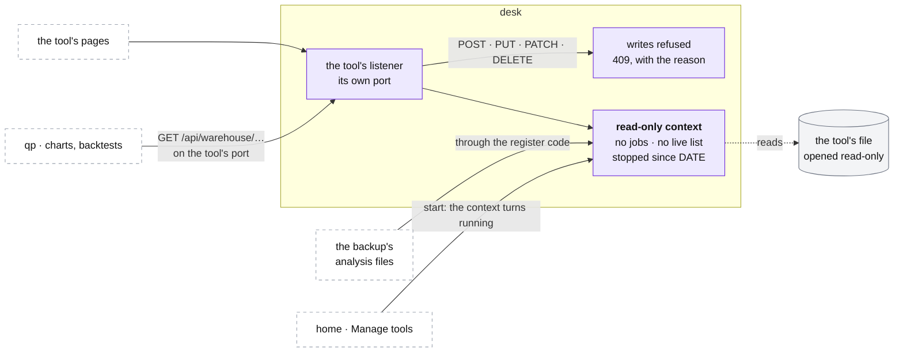

# Stopped tools

**Above:** [DESK.md](DESK.md) §4 (the desk's parts).

**Talks to:**
- the [web layer](WEB.md): each stopped tool keeps its own port;
- its own [file](../files/FILES.md), opened read-only;
- [qp](../quant/QUANT.md), which charts and backtests its history;
- the [backups](../outside/BACKUPS.md), whose analysis files include it;
- [home](HOME.md), which lists it and starts it again.

---

## 1. What it is

**A stopped tool's history, served read-only, in its own context, on its own
address.** Everything it ever collected stays readable: its photos, outcomes,
shortlists, screeners and their versions, its scorecard. Charts and backtests of
its history keep working, and its pages show what it found.

A tool is stopped from Manage tools ([HOME.md](HOME.md)). A **deleted** tool is
served the same way: hidden from the lists, still readable on its port.

**What it never does:**
- scans, refreshes, takes a photo or runs any job;
- writes its file: the file is open read-only, so no write is possible;
- changes its file's schema;
- shows an empty history when its file cannot be read: it says so.

---

## 2. The diagram

---

## 3. Its parts

### 3.1 The read-only context

| | A running tool | A stopped tool |
|---|---|---|
| its file | open for writing; the desk its only writer | **open read-only** |
| its schema | brought up to date at start-up | **never changed**: a stopped tool's file is read as it was left |
| its jobs | registered | **none** |
| its live list | in memory, saved to the file | **none**: its pages say "stopped since DATE" |
| its port | its listener | **its listener**, the same address |
| its cost | its live list and caches | its open file, nothing more |

**Every stopped tool is served.** The registry's `archive` flag, which said
whether the archive program served a stopped tool, retires: in the desk every
stopped or deleted tool keeps a read-only context.

**Start** from Manage tools turns the context running: the file reopened for
writing, its schema brought up to date, its jobs registered. **Stop** turns it
back. No program starts or stops.

### 3.2 What it serves

Every read the tool served when it ran, from its file:

| Read | Routes |
|---|---|
| the registers: R1, R2 (for its own past days), R3, R4, by day, with CSV | `GET /api/warehouse/…` ([REGISTERS.md](tool/REGISTERS.md)) |
| a card as of a day | `GET /api/card/:ticker?date=` ([CARD.md](tool/CARD.md)) |
| its screeners, with every version | `GET /api/screeners…` ([SCREENERS.md](tool/SCREENERS.md)) |
| its settings | `GET /api/settings` |
| its shortlists, day by day | `GET /api/shortlist/…` |
| its scorecard | `GET /api/analysis/screener-report`, `GET /api/learning/…` ([LEARNING.md](tool/LEARNING.md)) |
| its identity and state | `GET /health`, `GET /api/tool`: stopped, since when |
| the market | the desk's, as for every tool ([MARKET.md](MARKET.md)) |

**Its pages** open in read-only mode: the warehouse, the analysis, the
screeners and the shortlists, with no scan button, no star and no editor
([PAGES.md](tool/PAGES.md)).

**The same answers as when it ran.** The routes are the running tool's own
code, run in a read-only context, so an answer cannot drift from a live tool's.

### 3.3 What it refuses

Every write: `POST`, `PUT`, `PATCH`, `DELETE` on the tool's routes is answered
**409** with the reason: "T4 is stopped: its history is read-only. Start it
from Manage tools." Nothing is ever written to a stopped tool's file, by habit
or by mistake.

### 3.4 Who reads it

| Reader | How |
|---|---|
| qp | over HTTP on the tool's port, unchanged from today, until qp reads the registers from the shared record ([QUANT.md](../quant/QUANT.md)) |
| the backup | the analysis files, through the register code with the file opened read-only ([BACKUPS.md](../outside/BACKUPS.md) §3.5) |
| home | the tool's state, stage and day count; its scorecard for the comparison |
| the shared record | already holds a copy of its R1, R3 and shortlist, imported with 0 differences |

---

## 4. Contracts

| It owns | Form |
|---|---|
| nothing | it only reads the tool's file |

| It reads | From |
|---|---|
| the tool's file | `data/t<n>.db` (T1: `data/tradedesk.db`), opened read-only |
| that the tool is stopped or deleted | the tool registry |

---

## 5. When it fails

| Event | What happens |
|---|---|
| the tool's file is missing or damaged | the tool shows as unreadable, with the reason, on home and the health page. It never answers as an empty history, which would read as a tool that found nothing |
| its port is taken | that tool's listener fails, said in the log and on the health page; the others are served |
| a write arrives | refused, 409, with the reason |

---

## 6. Built on

**The old desk:** the **archive** program (`src/archive/server.js`, about 45 MB):
- one read-only program serving each stopped tool's `GET /api/warehouse/*` and
  `/health` on that tool's own port, so qp saw no difference;
- no pages: a stopped tool's own pages could not be opened;
- a separate copy of the code loaded for each tool, by clearing Node's module
  cache ("require-cache surgery");
- restarted whenever the set of stopped tools changed, so that it took or
  released a port.

The detail: [legacy/screeners/TOOL-LIFECYCLE.md](../../legacy/screeners/TOOL-LIFECYCLE.md)
§The archive.

**What it taught:** a stopped tool must stay readable, or stopping it for memory
takes its history with it. The desk keeps that, without a second program, a
second copy of the code, or a restart.

---

## 7. Status

| Part | Status |
|---|---|
| the archive program, serving the six stopped tools' registers | **built, running** (legacy) |
| a read-only context: the file opened read-only, its schema never changed | **built** (step 15a) |
| stopped tools served by the desk, every read route and the pages | **to build** (step A); the archive then stops |
| writes refused with 409 | **to build** (step A) |
