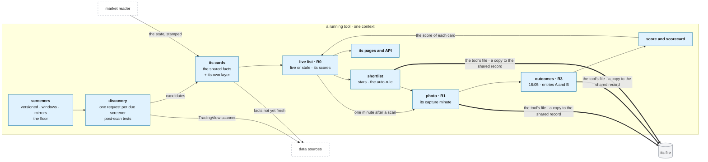

# A running tool

**Above:** [DESK.md](DESK.md) §4 (the desk's parts) and
[ARCHITECTURE.md](../../ARCHITECTURE.md) §1 (the research method).

**Talks to:**
- the [scheduler](JOBS.md), which runs its jobs in its context;
- the [web layer](WEB.md), which brings it its page and API calls;
- the [market reader](MARKET.md), whose state is stamped on every card;
- the [data sources](../outside/SOURCES.md) and the
  [shared record](../outside/SHARED-RECORD.md): the facts of its cards, and the
  copies of its registers;
- its own [file](../files/FILES.md) §3.1, of which the desk is the only writer.

**Below it:** [SCREENERS](tool/SCREENERS.md) · [CARD](tool/CARD.md) ·
[REGISTERS](tool/REGISTERS.md) · [LEARNING](tool/LEARNING.md) ·
[PAGES](tool/PAGES.md).

---

## 1. What it is

**One trading method, run as an experiment.** A tool has its own screeners, its
own photo minute and entries, its own history and its own score. It runs in its
own context in the desk, so its results never reach another tool and no other
tool's results reach it.

**What it asks:** do the stocks these screeners find, at this minute, move
enough to trade? It is answered day by day, by the tool's own photos and their
outcomes.

**What it owns:**
- its screeners and their versions;
- its live list of the day (R0);
- its shortlist;
- its photos (R1) and their outcomes (R3);
- its settings;
- its jobs and their runs.

**What it never does:**
- shares a result with another tool: facts are shared, results never;
- trades, or sizes a trade;
- changes a photo once taken;
- lets a fact change which cards it finds: a fact is a label, never a filter.

---

## 2. The diagram

---

## 3. Its parts

### 3.1 The rules every tool keeps

| Rule | Means | Detail |
|---|---|---|
| **the tradability floor** | added to every screener of the tool when a scan is sent, not written into any screener: price ≥ $1, average volume ≥ 1M a day, ATR ≥ $1, ATR ≥ 3 % of price. A 0 switches a leg off. Two named exceptions: the neglected-name screeners keep the price leg only; a list-only screener takes no floor | [SCREENERS.md](tool/SCREENERS.md) |
| **success is a move, measured** | no stop, no target, no exit: from each entry minute to the close, `upR = (high − entry) ÷ ATR14`, `downR = (entry − low) ÷ ATR14`; a good move is `upR ≥ 1.3`; ATR14 from daily bars strictly before the day; the regular session only | [REGISTERS.md](tool/REGISTERS.md), [LEARNING.md](tool/LEARNING.md) |
| **one photo a day** | R1 freezes every card on screen at the tool's capture minute, one minute after one of its scans, so it freezes a fresh list. A card found after the photo can be traded, but teaches nothing | [REGISTERS.md](tool/REGISTERS.md) |
| **windows gate discovery only** | a screener adds cards only inside its run window; the cards already found are re-quoted every 5 minutes, 04:00–16:00, whatever the windows | [SCREENERS.md](tool/SCREENERS.md) |
| **mirrors are made, not flipped** | the same setup facing the other way, built rule by rule, over the same windows | [SCREENERS.md](tool/SCREENERS.md) |
| **the benchmark** | T9, *Stocks in Play*: no pattern, no direction, nothing structural may be added. Every screener must beat it by 5 points | [LEARNING.md](tool/LEARNING.md) |
| **the order of work** | collect for about a month; cut the screeners that do not find movers; only then work on entries, stops and targets for the survivors | — |

**The floor is the desk's default, and a tool may override it.** One value
applies to every tool unless a tool sets its own, which its pages show as an
override, and the comparison against the benchmark names any tool whose floor
differs from it. Today each tool keeps its own floor, while the page says
"every screener, every tool" (D-T5).

### 3.2 A tool's day

New York time, on a trading day.

| When | What | Writes |
|---|---|---|
| 04:00–16:00 | discovery at its cadence: each due screener asked, the post-scan tests, new candidates carded | its live list |
| every 5 min, 04:00–16:00 | every card re-quoted and re-scored | its live list |
| one minute before the photo | the shortlist auto-rule | its shortlist |
| **the capture minute** | **R1, the photo** | its file, with a copy in the shared record |
| 09:26 … 10:01 | R2: the market history at those minutes, the same for every tool | — (the market reader's) |
| 16:05 | R3, the outcomes of entries A and B | its file, with a copy |
| 00:00 | the live list closes for the day | its file |

The live list is saved to the tool's file after every change, so a restart
loses nothing ([REGISTERS.md](tool/REGISTERS.md)).

### 3.3 Its cards: shared facts, its own layer

| Layer | Holds | One per |
|---|---|---|
| **the facts** | everything known about the ticker: the quote, the derived numbers, short interest, borrow, Reg SHO, news, catalyst, the market context, the O'Neil reading | ticker and day, **shared by every tool**: fetched once, whichever tool found it first, kept in the desk's memory and the fact store |
| **the tool's layer** | which of its screeners matched and when (with each screener's version), first seen, live or stale, its star, its score, the trader's bias | tool, ticker and day: **this tool's alone** |

The tool's page draws its cards from its own layer joined to the shared facts.
Detail: [CARD.md](tool/CARD.md).

### 3.4 Its parts, and where each is described

| Part | Job | Detail |
|---|---|---|
| **screeners and discovery** | the definition of a screener and its versions; the builder and its checks; the floor; mirrors; the post-scan tests; discovery and the scan report; each tool's screeners | [SCREENERS.md](tool/SCREENERS.md) |
| **the card** | every field, its source, formula and honesty; the fact families; the card builder; the card's day | [CARD.md](tool/CARD.md) |
| **the registers** | R0 the live list, R1 the photo, R2 the market at fixed minutes, R3 the outcomes, R4 the training rows, the shortlist; exports | [REGISTERS.md](tool/REGISTERS.md) |
| **the score and the scorecard** | what the score predicts, its model when one is chosen, the auto-rule; the scorecard, the verdicts, the comparisons | [LEARNING.md](tool/LEARNING.md) |
| **its pages and API** | the tool's page and its tabs; its settings; every route | [PAGES.md](tool/PAGES.md) |

### 3.5 The tools today

Eleven tools registered, five running. Photo · entry A · entry B, New York time.

| Tool | Name | State | Role | Photo · A · B |
|---|---|---|---|---|
| T1 | Swing trades after huge volume | running | the control: the one measured edge so far, kept exactly as it is | 09:36 · 09:37 · 09:40 |
| T2 | Momentum | running | method | 09:46 · 09:47 · 09:51 |
| T3 | Gappers | stopped | method | 09:36 · 09:37 · 09:40 |
| T4 | VWAP Reclaim | stopped | method (the reversal tool) | 10:01 · 10:02 · 10:06 |
| T5 | 20-Day Break | stopped | method | 09:46 · 09:47 · 09:51 |
| T6 | Unexplained Move | running | method (the only mean-reversion tool) | 10:16 · 10:17 · 10:21 (D-S9: open decision) |
| T7 | Liquid Movers | running | method | 09:36 · 09:37 · 09:40 |
| T8 | CANSLIM (split into T10 and T11 on 2026-09-04) | stopped | method | 09:46 · 09:47 · 09:51 |
| T9 | Stocks in Play | stopped, to run again after the move | **the benchmark** | 09:36 · 09:37 · 09:40 |
| T10 | Growth Stock Breakout | stopped (2026-09-21) | method | 09:46 · 09:47 · 09:51 |
| T11 | Growth Stock Pullback | running | method | 09:46 · 09:47 · 09:51 |

Each tool's screeners, and why: [SCREENERS.md](tool/SCREENERS.md) §the tools.

### 3.6 What it keeps in memory

Its context holds, for the day:
- its live list: the cards with their tool layer;
- its scan status: last scan, counts, the scan report;
- its schedule and its jobs;
- its settings, as last read.

The live list is saved to its file after every change. Everything else is in
its file already, or rebuilt at start-up.

---

## 4. Contracts

| It owns (its file) | Detail |
|---|---|
| `screeners`, `screener_versions`, `settings` | [SCREENERS.md](tool/SCREENERS.md), [PAGES.md](tool/PAGES.md) |
| `r0_checkpoint`, `r1_frozen`, `r3a`, `r3b`, `shortlist`, `r2_market_snapshots` (until the one market read), `r4a_train`, `r4b_train` | [REGISTERS.md](tool/REGISTERS.md) |
| `scheduler_jobs`, `job_runs`, `alert_state` | [JOBS.md](JOBS.md), [ALERTS.md](../outside/ALERTS.md) |

The full table list: [FILES.md](../files/FILES.md) §3.1.

| It reads | From |
|---|---|
| candidates and quotes | the TradingView adapter |
| facts | the desk's memory, the fact store, the adapters ([CARD.md](tool/CARD.md)) |
| the market state | the market reader |
| the O'Neil facts | the shared record |

| It writes outside its file | |
|---|---|
| a copy of R1, R3, the shortlist, its tool row and its screener versions | the shared record, at the same moment, compared daily |
| the facts it fetched | the fact store, through the adapters |
| each ticker it carded | `research_wanted`, so the research worker covers it |

Its routes: [PAGES.md](tool/PAGES.md).

---

## 5. When it fails

| Event | What happens |
|---|---|
| one of its screeners fails | that screener adds nothing this scan, with the reason in the scan report; the others run |
| TradingView fails | no new candidates; the cards keep their last quote, marked with its age; the source check turns red |
| a fact source fails | that family shows `unavailable` with the reason; the card still builds |
| its photo minute passes with the desk down | the photo is recorded as missed and alerts; it is never taken late as if on time |
| its job throws | recorded in its run history; the other tools are unaffected ([DESK.md](DESK.md) §4.2) |
| it is paused | its scans return at once, saying so; its cards stay; its photo and outcomes still run |

---

## 6. Built on

**The old desk:**
- [legacy/screeners/METHODOLOGY.md](../../legacy/screeners/METHODOLOGY.md):
  every tool, every screener and why;
- [legacy/screeners/DATA-PIPELINE.md](../../legacy/screeners/DATA-PIPELINE.md):
  how a card is built, stage by stage;
- [legacy/screeners/README.md](../../legacy/screeners/README.md): the rules a
  rebuild must keep.

**What failed there:**
- **each tool was a whole program,** about 90 MB, so tools were stopped for
  memory and the benchmark went with them (D-S14);
- **each tool fetched the same facts** for a ticker another tool had already
  carded;
- **the floor was each tool's,** while the page said it was every tool's
  (D-T5).

---

## 7. Status

| Part | Status |
|---|---|
| the method, the screeners, the card, the registers, the pages | **built** (legacy, kept), in each tool's own program |
| the tool as a context of the desk | **built** (step 15a); running there: **to build** (step B) |
| the facts fetched once for every tool | **partly**: in shadow through the fact store (step 5); in one program, the shared memory (step B) |
| the floor as the desk's default, with a tool's override shown | **to build** |
