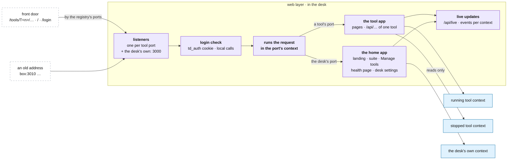

# The web layer

**Above:** [DESK.md](DESK.md) §4 (the desk's parts).

**Talks to:**
- the [front door](../front-door/FRONT-DOOR.md), which forwards every page and
  API call to the desk by path;
- each [running tool](TOOL.md) and each [stopped tool](STOPPED-TOOLS.md): every
  request runs in its tool's context;
- [home](HOME.md): the desk's own pages;
- the login ([FRONT-DOOR.md](../front-door/FRONT-DOOR.md) §3.3).

---

## 1. What it is

**How a page or an API call reaches its tool.** The desk listens on one port
per tool and on its own port. Each port belongs to one context: a request that
arrives on T2's port runs, from its first line to its last, as T2.

It also carries what every page shares:
- the login check;
- the page shell: the top bar, the styles, the theme;
- live updates to open pages;
- the rules every answer follows: HTML always revalidated, an unknown API path
  a 404, an error a JSON answer with its reason.

**What it never does:**
- lets a request run outside a context, or in another tool's;
- lets a write reach a stopped tool;
- does heavy work inside a request: exports stream, long checks run as jobs;
- answers an API call with a page of HTML.

---

## 2. The diagram

---

## 3. Its parts

### 3.1 The listeners

| Port | Belongs to | Serves |
|---|---|---|
| **3000** | the desk's own context | home: the landing page, the suite, Manage tools, the health page, the desk's settings ([HOME.md](HOME.md)) |
| each tool's port, from the registry (T2 3010, T3 3020 … T11 3120) | that tool, running or stopped | the tool's pages and API ([PAGES.md](tool/PAGES.md)) |
| **3090** | T1 | T1's pages and API, once T1 is a tool like the others |

**Why home keeps 3000.** The landing page has always been at port 3000, and
through the front door at `/`. T1 shared that port only because it carried
home. When T1 moves into the desk (step B), home keeps the port and T1 takes
the free port 3090. A navigation to T1's old pages on port 3000 (`/scanner…`)
is redirected to T1's address, so old bookmarks keep working.

**One context per listener.** The context is chosen by the port the request
arrived on, before any route runs. Through the front door, the gateway already
sends `/tools/T<n>/…` to that tool's port and `/` to 3000
([FRONT-DOOR.md](../front-door/FRONT-DOOR.md) §3.2), so no path is parsed to
find a tool.

**Opened and closed with the tool.** A tool added or started from Manage tools
gets its listener at once; a tool deleted loses it. A tool stopped keeps its
listener and its context turns read-only.

### 3.2 The two apps

The routes are the routes the tool programs serve today, mounted in two apps:

| App | Mounted on | Holds |
|---|---|---|
| **the tool app** | every tool's port | the tool's pages (`/scanner`, the tabs) and its API: registry, scan, screeners, shortlist, market, news, warehouse, settings, monitor, analysis, card, facts, registers, learning, version ([PAGES.md](tool/PAGES.md)) |
| **the home app** | the desk's port | the landing page, `/screeners` (the suite), `/screeners/compare`, `/screeners/manage`, `/market` (the Market tab on its own), `/status` (the health page), `/settings` (the desk's settings), `/login`, `/logout`; the API of the cross-tool lists, Manage tools, the market, the desk's jobs and the health signals ([HOME.md](HOME.md)) |

**One copy of the code serves every tool.** The tool app is one app; the
context makes it T2's or T7's for the length of a request.

**The desk's own paths.** `/`, `/login`, `/logout`, `/screeners…`, `/market`,
`/status` and `/settings` always belong to home, through the front door and on
any tool's port: a navigation to one of them from a tool's page goes to home.

### 3.3 The page shell

Every page of every program carries the same top bar and style sheet
(`public/desk.js`, `public/desk.css`):
- **the bar** names the programs: Home, the screener suite, Market, Journal,
  Quant, Health;
- **its links** go by path when the page came through the front door
  (`/tools/T2/`, `/journal/`, `/quant/`), and by port when it did not. The
  gateway sets the cookie `desk_shell` to the address the browser used, and the
  bar compares it with the page's own address;
- **sunlight mode** is on by default: high contrast, readable outdoors; the
  dark palette is the opt-out;
- **signed out mid-session**, a page whose own API answers 401 goes to the
  sign-in page and comes back after it.

**Retiring with the move:** the cross-port cookie wrapper in `desk.js` and the
credentialed CORS of the landing page's probes. In one program, home reads every
tool in memory and asks no other port.

### 3.4 The rules every answer follows

| Rule | Why |
|---|---|
| **HTML is revalidated every time** (`no-cache, must-revalidate`); `desk.js` and `desk.css` too | a deploy once left every phone showing the old page on all nine tools at once |
| **an unknown `/api/…` path is a 404 JSON answer**, never the landing page | a call to a server not yet restarted once got 200 and a page of HTML, which ended up on the clipboard |
| **an error is a JSON answer** with `ok: false` and the reason; its stack goes to the log | a page shows why; nothing crashes |
| **a write to a stopped tool is refused** with 409 and the reason ([STOPPED-TOOLS.md](STOPPED-TOOLS.md)) | its file is open read-only |
| **heavy work never runs inside a request** | one program serves every tool: a two-minute check in a request would hold every page. Exports stream; the data check and long reports run as jobs |
| **the login before every route** but `/login` and `/logout`; calls from the box itself pass, never a forwarded one ([FRONT-DOOR.md](../front-door/FRONT-DOOR.md) §3.3) | one password for the whole desk |

### 3.5 Live updates

**Open pages follow the desk without polling.** Each listener serves
`GET /api/live`, a stream of server-sent events for its context:

| Event | When | Carries |
|---|---|---|
| `list` | a card is added, updated or removed | the changed cards |
| `scan` | a scan starts or ends | its counts and status |
| `photo` | the photo is taken or missed | the day and its count |
| `market` | a new market state | its id and summary |
| `job` | a run ends | the job, its result |

- On the desk's port the stream carries every tool's events, for home.
- A page that reconnects reloads its full state once, then follows the events.
- Pages poll today: the landing page asks every tool's `/health` every 30
  seconds, and a tool's page re-reads its list on a timer.

---

## 4. Contracts

| It owns | Form |
|---|---|
| the listeners | one per tool port from the registry, and 3000 |
| the routing of a request to its context | by the port it arrived on |
| `GET /api/live` | server-sent events, per context |
| the page shell | `public/desk.js`, `public/desk.css` |

| It reads | From |
|---|---|
| the tools and their ports | the tool registry ([FILES.md](../files/FILES.md) §3.3) |
| the login's secret | `data/auth.json` |

---

## 5. When it fails

| Event | What happens |
|---|---|
| a route throws | that request gets a JSON error with the reason; the stack is logged; every other request goes on |
| a tool's port is taken by another program | that tool's listener fails to open, said in the log and on the health page; the other tools are served |
| a page's live stream drops | the page reconnects and reloads its state once |
| a slow request | it holds only itself: heavy work is never in a request |
| the cookie runs out mid-session | the page goes to sign in, and back |

---

## 6. Built on

**The old desk:**
- each tool its own Express program on its own port (`src/index.js`), serving
  the landing page from T1 at 3000, the suite and Manage tools, and the tool
  pages at `/scanner`;
- the landing page reading every tool across ports, with credentialed CORS and
  a cookie wrapper in `desk.js`;
- the gateway (step 14) putting every program behind one port by path.

The detail: [legacy/screeners/PAGES.md](../../legacy/screeners/PAGES.md),
[legacy/screeners/API.md](../../legacy/screeners/API.md).

**What failed there:**
- **stale pages after a deploy,** until HTML was revalidated;
- **HTML answers to API calls,** until an unknown API path became a 404;
- **every cross-program read was cross-origin,** needing CORS and a cookie
  wrapper;
- **pages polled every tool every 30 seconds** to know what changed.

**The code to reuse:** the split of `src/index.js` into the app, the pages and
the work (`createApp`, `startPages`, `startWork`), kept from the two-program
attempt.

---

## 7. Status

| Part | Status |
|---|---|
| the routes, the page shell, the rules of §3.4 | **built**, in each tool's program |
| one program listening on many ports, each in its context | **to build** (step A for the stopped tools, step B for the running ones) |
| home on 3000 as the desk's own; T1 on 3090 | **to build** (step B, with T1) |
| the desk's own paths in the gateway (`/screeners…`, `/market`, `/status`, `/settings`) | **to build** (step B) |
| live updates | **to build** (step E) |
| the cross-port wrapper and CORS retired | **to do** after step B |
