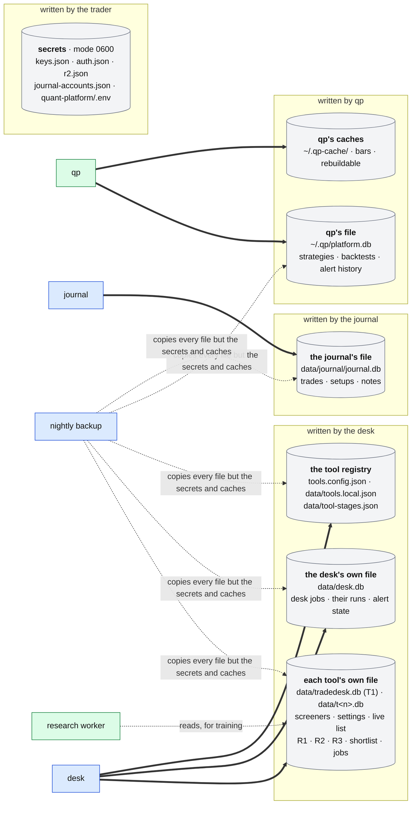

# Files on the box

**Above:** [ARCHITECTURE.md](../../ARCHITECTURE.md) §4.3 (files on the box) and
§5.2 (where each kind of data lives).

**Talks to:**
- **its writers:** the [desk](../desk/DESK.md), [qp](../quant/QUANT.md) and the
  [journal](../journal/JOURNAL.md), each writing only its own files;
- **readers:** the [research worker](../research/RESEARCH-WORKER.md), which
  reads the tools' files read-only;
- the [backups](../outside/BACKUPS.md), which copy every file every night.

---

## 1. What it is

Every file the desk keeps on the box: what each one holds, and the **one
program that writes it**.

**Each tool's own file is the record of that tool's results.**
- It works without the network.
- It keeps each tool's results apart by construction, because no tool can open
  another's file.
- A copy of its registers goes to the [shared record](../outside/SHARED-RECORD.md)
  at the moment it is written, and the copy is compared with it every day.

**The rules for every file:**
- **one writer;**
- each change is saved whole, or not at all;
- reading never blocks writing (SQLite's WAL mode);
- its layout changes only through numbered steps, each recorded in the file;
- no secret is ever kept in a data file.

---

## 2. The diagram

---

## 3. The files

### 3.1 Each tool's own file

T1's file is `data/tradedesk.db`. Every other tool's is `data/t<n>.db`.
- It is SQLite, written only by the desk, in that tool's context.
- A stopped tool's file is opened read-only.

| Table | Holds | Detail |
|---|---|---|
| `screeners` | the tool's screeners: key, name, rules, sort, size, run and check windows, mirror, list-only, paused | [SCREENERS.md](../desk/tool/SCREENERS.md) |
| `screener_versions` | every saved version of every screener, so each photo can be read from this file alone (**to build**; today the versions are kept only in the shared record) | [SCREENERS.md](../desk/tool/SCREENERS.md) |
| `settings` | the tool's settings: its floor override (today: its own floor), shortlist auto-rule, its name and pause; each change a new version (**versions: to build**). Until the one market read is switched on, also its own hot-sector and sector-bias thresholds, which then become the desk's | [PAGES.md](../desk/tool/PAGES.md) §Settings |
| `r0_checkpoint` | the live list of the day, saved after every change (today: after every full scan), so a restart loses nothing | [REGISTERS.md](../desk/tool/REGISTERS.md) |
| `r1_frozen` | R1: every card of the day, frozen at the capture minute, one row per ticker | [REGISTERS.md](../desk/tool/REGISTERS.md) |
| `r2_market_snapshots` | R2 as each tool wrote it until the one market read is switched on; kept as history. After that, R2 is read from the market history in the desk's own file | [REGISTERS.md](../desk/tool/REGISTERS.md) |
| `r3a`, `r3b` | R3: the outcomes from entry A and from entry B | [REGISTERS.md](../desk/tool/REGISTERS.md) |
| `shortlist` | the day's picks, starred or chosen by the auto-rule | [REGISTERS.md](../desk/tool/REGISTERS.md) |
| `r4a_train`, `r4b_train` | training rows uploaded by hand (`source = upload`). R4 itself is R1 joined to R3, computed on request | [LEARNING.md](../desk/tool/LEARNING.md) |
| `scheduler_jobs` | the tool's jobs: schedule, on/off, the default it was saved with | [JOBS.md](../desk/JOBS.md) |
| `job_runs` | every run of every job: start, end, result, error with stack (kept 30 days) | [JOBS.md](../desk/JOBS.md) |
| `alert_state` | which causes are alerting now, so an alert is sent once | [ALERTS.md](../outside/ALERTS.md) |
| `migrations` | one-time repairs that have run | — |
| `analysis_model` | dead: left from an older app; not read, dropped by a migration | — |

**Copied to the shared record** at the moment they are written, and compared
every day:
- `r1_frozen`;
- `r3a` and `r3b`;
- `shortlist`;
- the screeners and their versions.

### 3.2 The desk's own file

`data/desk.db` (**to build**). It holds what belongs to the desk rather than to
any tool, written only by the desk in its own context:

| Table | Holds | Detail |
|---|---|---|
| `scheduler_jobs`, `job_runs`, `alert_state` | the desk jobs, their runs, the desk's alert state | [JOBS.md](../desk/JOBS.md), [ALERTS.md](../outside/ALERTS.md) |
| `market_states` | the market history: one state per market read, with its instant | [MARKET.md](../desk/MARKET.md) |
| `hot_sector_days` | each sector's hot state per trading day | [MARKET.md](../desk/MARKET.md) |
| `settings`, `setting_versions` | the desk's settings (the tradability floor, the market thresholds), each change a new version | [TOOL.md](../desk/TOOL.md) §3.1, [MARKET.md](../desk/MARKET.md) §3.14 |

**Copied to the shared record** at the moment they are written, and compared
every day: `market_states` and `hot_sector_days`.

Today the desk jobs run in T1's program and are recorded in T1's file, and the
market history is kept only in the shared record. That is one of the reasons
T1 cannot be stopped.

### 3.3 The tool registry

| File | Holds | Written by |
|---|---|---|
| `tools.config.json` (in the code repository) | the built-in tools: id, name, port, flags (`enabled`, `archive`, `scorer`), accent, description, capture times and why | a code change |
| `data/tools.local.json` (on the box) | tools added from the page, and overrides of any tool: name, description, accent, capture times, enabled, deleted, pending restart | Manage tools ([HOME.md](../desk/HOME.md)) |
| `data/tool-stages.json` | each tool's stage override (validated, watch, retired …) | the landing page's stage control |

Everything that lists tools reads the **merged** registry
(`src/toolsRegistry.js`), so the pages, the deploy, qp and the desk cannot
disagree. A tool added from the page gets:
- an id one past the highest ever used, so an id and its history are never
  reused;
- the next free port.

### 3.4 qp's files

| File | Holds | Detail |
|---|---|---|
| `~/.qp/platform.db` | `strategies`, `backtests`, `backtest_trades`; `alert_seen` and `alert_history` (since step 12, so a restart never repeats an alert) | [QUANT.md](../quant/QUANT.md) |
| `~/.qp/strategies/*.json` | strategies exported as files | [STRATEGIES.md](../quant/STRATEGIES.md) |
| `~/.qp-cache/` | bars and the O'Neil caches: **rebuildable**, not backed up | [FEEDS.md](../quant/FEEDS.md) |
| qp's operations log | what qp did; rebuildable | [QUANT.md](../quant/QUANT.md) |

### 3.5 The journal's file

`data/journal/journal.db`. It holds:
- the trades (`journal_trades`), setups, day notes and fee profiles;
- the leftover tables of an older app, which are not read.

Detail: [JOURNAL.md](../journal/JOURNAL.md).

### 3.6 Shared files being retired

These files are read and written by several programs today. Each has a
replacement in the design:

| File | Written today by | Replaced by |
|---|---|---|
| `data/industry-map.json` | qp's nightly SIC step (first), and each tool from TradingView's labels for gaps | the `sic` facts in the shared record, written only by the research worker |
| `data/oneil-market.json`, `oneil-groups.json`, `oneil-13f.json`, `data/oneil/` | qp's nightly chain | the O'Neil facts in the shared record, written only by the research worker ([RESEARCH-WORKER.md](../research/RESEARCH-WORKER.md)) |
| `data/shortlist-all.json` | each tool, when its shortlist changes | home reads every tool's shortlist directly: in one program, every tool's file is at hand ([HOME.md](../desk/HOME.md)) |

### 3.7 Secrets

| File | Holds |
|---|---|
| `data/keys.json` | shared keys and the desk's switches: the shared record's address, the ntfy topics, the heartbeat address, the area modes, `workerShadow`, `deskTools` |
| `data/auth.json` | the password hash and the cookie's signing secret |
| `data/r2.json` | the backup bucket's keys |
| `data/journal/journal-accounts.json` | the journal's Alpaca accounts |
| `quant-platform/.env` | qp's feed keys, copied from the desk's by the deploy |

**The rules:**
- mode 0600, gitignored;
- never in a backup, a log or a reply;
- set on the box with the commands in [BOX.md](../box/BOX.md) §4.3.

### 3.8 Working files

| Folder | Holds |
|---|---|
| `tmp/`, `tmp-t<n>/` | each tool's training CSV files and register exports; rebuildable |
| `data/worker/` | the comparison copies of tools being moved into the desk (`t<n>.db`), with their daily photo checks; deleted after the move |
| `src/scoring/outputs*` | the old scorer's model tables; no scorer runs; not carried ([LEARNING.md](../desk/tool/LEARNING.md)) |

---

## 4. Contracts

| Writer | Writes only |
|---|---|
| the desk | each tool's own file (in that tool's context), the desk's own file, `data/tools.local.json`, `data/tool-stages.json`, the working files |
| qp | its own files and caches |
| the journal | its own file |
| the trader | the secrets, through the setting commands |
| the research worker | nothing on the box: its facts go to the shared record |

---

## 5. When it fails

| Event | What happens |
|---|---|
| a write fails half-way | the transaction is rolled back; nothing half-written is ever read |
| a file is damaged | the monthly rehearsal checks every SQLite file's integrity, and the restore puts back the last good night ([BACKUPS.md](../outside/BACKUPS.md)) |
| the disk fills | writes fail loudly. The health page shows the free disk (to build); caches and working files are the first to go |
| a file is missing at start | the desk creates an empty one for a running tool, and says so. A stopped tool with no file is not served, and the health page says why: an empty history must never look like a tool that found nothing |

---

## 6. Built on

**The old desk.**
- **The legacy data models:**
  [screeners](../../legacy/screeners/DATA-MODEL.md),
  [qp](../../legacy/qp/DATA-MODEL.md) and
  [journal](../../legacy/journal/DATA-MODEL.md).
- **The code:** `src/db/index.js`, `src/toolsRegistry.js`,
  `quant-platform/chart/store.py`, `quant-platform/chart/alerts.py`.

**What failed there:**
- **The industry map had two writers and flipped every morning (F-21).** Fixed
  by letting SIC win; retired in the design.
- **Start-up repairs that silently did nothing (J-4).** Repairs now run once,
  recorded in `migrations`.
- **A capture-time change gave a job a new id and dropped its custom schedule
  (D-T6).** Jobs now have stable ids.

---

## 7. Status

| Part | Status |
|---|---|
| each tool's own file, its tables and the registry | **built** |
| copies to the shared record, compared | **built** (step 9a; all eleven tools imported, 0 differences) |
| the live list saved after every change | **partly**: saved after every full scan; after every change with the move into the desk (step B) |
| `screener_versions` in each tool's file | **to build** |
| the desk's own file | **to build** (step B, with home and the desk jobs) |
| retiring the shared JSON files | **to build**, with the research worker switched on (step D) and home in the desk (step B) |
| dropping `analysis_model` and the dead settings | **to build** (a migration) |
