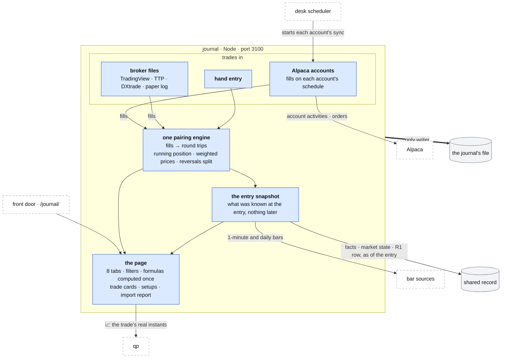

# The journal

**Above:** [ARCHITECTURE.md](../../ARCHITECTURE.md) §2.7.

**Talks to:**
- the [front door](../front-door/FRONT-DOOR.md) (`/journal/`);
- the [desk](../desk/DESK.md), whose scheduler starts each account's sync;
- the [data sources](../outside/SOURCES.md): Alpaca fills and orders, and bars;
- the [shared record](../outside/SHARED-RECORD.md): the facts, the market state
  and the R1 row known at a trade's entry;
- [qp](../quant/QUANT.md): the chart of a trade;
- its own [file](../files/FILES.md).

---

## 1. What it is

Every real trade, after the fact: what was bought and sold, at what prices, in
what size, against what stop, under what market, for what result. Then the
patterns across trades: by hour, weekday, price, size, side and setup.

It answers the question the registers do not: **how do my actual trades go?**
The registers measure what the screeners find; the journal measures what the
trader did with it.

It is its own Node program (`journal/server.js`, port 3100) with its own file,
because it shares nothing live with the tools.

**What it owns:**
- the accounts;
- the fills;
- the trades, with their fills, stops, fees, setups and notes;
- each trade's snapshot at its entry;
- the day notes.

**What it never does:**
- place an order: the desk places none;
- grade or size a trade for execution;
- keep a timer of its own: each sync is started by the desk.

---

## 2. The diagram

---

## 3. Its parts

| Part | Job | Detail |
|---|---|---|
| **trades in** | the three ways a trade arrives: Alpaca accounts synced on a schedule; broker files uploaded by the trader; hand entry. Each produces **fills** | [IMPORT.md](IMPORT.md) |
| **the pairing engine** | one engine, for every source, turns fills into round trips. It handles scale-ins, scale-outs, reversals and open positions once, with stable ids, so a second import updates and never duplicates | [IMPORT.md](IMPORT.md) |
| **stops and fees** | the stop from the broker's stop order, the strategy's exit plan, or the trader; fees from the broker, or from the account's fee rule (labelled estimated) | [IMPORT.md](IMPORT.md) |
| **the entry snapshot** | the price structure from bars up to the entry minute; the facts, the market state and the R1 row as known at the entry; MAE and MFE between the entry and the exit | [REVIEW.md](REVIEW.md) |
| **the page** | eight tabs (Overview, Calendar, Time, Risk, Stats, Setups, Trades, Import) and three filters; every number computed in one place; the trade cards; the setup statistics; the 📈 chart link | [REVIEW.md](REVIEW.md) |

---

## 4. Contracts

**It owns the journal's file, `data/journal/journal.db`.** The target tables
are below. Today the trades live in `journal_trades`, with the setups, day
notes and fee profiles; the old app's leftover tables are not carried
([FILES.md](../files/FILES.md) §3.5).

| Table | Key |
|---|---|
| `accounts` (keys in the secret file `data/journal/journal-accounts.json`) | id |
| `fills` | account, external id |
| `trades` | id (stable) |
| `trade_fills` | trade, fill, portion |
| `setups` | id |
| `trade_snapshots` | trade |
| `day_notes` | day |

| It reads | From |
|---|---|
| account activities (fills) and orders | Alpaca, per account |
| 1-minute and daily bars | the bar sources ([SOURCES.md](../outside/SOURCES.md)) |
| facts, the market state and the R1 row, as of the entry | the shared record |

| Routes, behind `/journal/` | Do |
|---|---|
| `GET /api/journal/trades` (filters); `GET /api/journal/trades/:id` | trades; one trade with its fills and its snapshot |
| `PATCH /api/journal/trades/:id`; `POST /api/journal/trades` | stop, target, fees, setup, notes, tags; hand entry |
| `POST /api/journal/import` | a file in, an import report back |
| `GET/POST/DELETE /api/journal/accounts…`, `…/test`, `…/fetch` | accounts; no secret is ever returned |
| `POST /api/journal/sync` (to build) | one sync of the due accounts, started by the desk's scheduler |
| `GET/POST/PATCH /api/journal/setups` | setups |
| `GET /api/journal/stats` (filters) | every number of the page, computed in one place |

---

## 5. When it fails

| Event | What happens |
|---|---|
| an account's fetch fails | recorded with its reason; the account waits for its next turn; the sync's run record says which account failed |
| the journal is down | the desk is unaffected; the scheduler records the failed sync and alerts |
| a file has rows the parser cannot read | the import report lists every skipped row with its reason; nothing is dropped silently |
| the shared record is down | the snapshot waits and says so; trades still import |

---

## 6. Built on

**The old desk.** [legacy/journal/](../../legacy/journal/README.md), documented
from the code with every import format run on a scratch database:
- [PAGE](../../legacy/journal/PAGE.md): every tab and formula;
- [ACCOUNTS](../../legacy/journal/ACCOUNTS.md): the Alpaca accounts and their
  pairing;
- [IMPORT](../../legacy/journal/IMPORT.md): the file formats, and what was
  tested;
- [ANALYSIS](../../legacy/journal/ANALYSIS.md): the technical snapshot,
  conditions, grading;
- [DATA-MODEL](../../legacy/journal/DATA-MODEL.md);
- [OPERATIONS](../../legacy/journal/OPERATIONS.md): start-up, the fetch timer,
  the tests;
- [KNOWN-ISSUES](../../legacy/journal/KNOWN-ISSUES.md): D-J1 to D-J20.

**What failed there:**
- **File imports mispaired scale-ins and scale-outs, lost TradingView shorts,
  and duplicated on re-import** (D-J1 to D-J7). Fixed by one engine (step 11).
- **No trade has a stop,** so every R is empty (D-J9).
- **Times were clock strings,** with a fixed −05:00 offset and one date per
  trade (D-J8, D-J10, D-J12). Fixed by real instants (step 4).
- **The snapshot and the grading half never worked** (D-J13, D-J14).
- **No fees for most sources** (D-J15).
- **The server's numbers differed from the page's** (D-J17).
- **None of the 84 journal tests covered the file importer.**

---

## 7. Status

| Part | Status |
|---|---|
| the page and its formulas; Alpaca accounts on a schedule | **built** (legacy, kept) |
| real New York instants | **built** (step 4) |
| every broker file read as fills and paired by the one engine, with fees and a report of every row not read | **built** (step 11; D-J1 to D-J7) |
| stops; the entry snapshot from the shared record; MAE and MFE | **to build** |
| `accounts`, `fills`, `trade_fills` as tables; stable ids for files | **to build** |
| the sync started by the desk's scheduler | **to build** (step C). Today the journal runs its own minute timer |
| one condition system over the snapshot; setup statistics | **to build** ([REVIEW.md](REVIEW.md)) |
