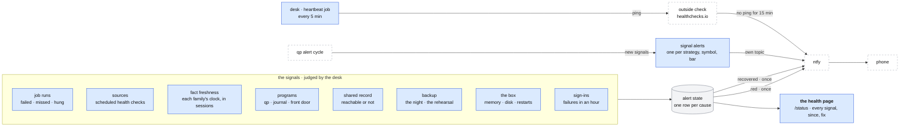

# Alerts and the health page

**Above:** [ARCHITECTURE.md](../../ARCHITECTURE.md) §4.7 (outside the box),
§6.1 (when something goes wrong) and §7 (the rule "failures are loud").

**Talks to:**
- the [desk's jobs](../desk/JOBS.md): every run's result, and the jobs that
  check sources, facts, programs and the box;
- the [data sources](SOURCES.md) §3.5: the scheduled health checks;
- the [shared record](SHARED-RECORD.md): fact freshness, and whether it can be
  reached;
- the [backups](BACKUPS.md): a night that is not clean, a failed rehearsal;
- [qp](../quant/QUANT.md): the signals its alert cycles find
  ([SIGNAL-ALERTS.md](../quant/SIGNAL-ALERTS.md));
- the [box](../box/BOX.md): memory, disk, restarts;
- ntfy, which delivers to the phone, and an outside heartbeat check;
- the desk's [home](../desk/HOME.md), which serves the health page.

---

## 1. What it is

**How the desk says something is wrong, and what is right.**
- **The signals:** every way the desk can fail, each judged in one place, with
  its state (green, amber, red), since when, and the fix.
- **The phone:** a red signal is pushed once, through ntfy, and its recovery is
  announced once.
- **The health page:** every signal on one page, with its fix.
- **The heartbeat:** an outside check that alerts when the desk itself stops
  reporting, because a desk that is down cannot say so.

**It also carries qp's signal alerts to the phone:** a saved strategy firing on
one of today's stocks. Those are trading signals, not faults, so they arrive on
their own channel.

**What it never does:**
- repeats an alert while its cause stands;
- stays silent when a job fails or does not run: a silent no-op is a bug;
- sends a secret, a key or a stack trace to the phone;
- lets qp or the journal push on their own: the desk is the only sender.

---

## 2. The diagram

---

## 3. Its parts

### 3.1 The signals

Each signal has one judge, and amber and red mean the same everywhere:
- **green:** as it should be;
- **amber:** shown on the health page, not pushed. Something to look at;
- **red:** pushed to the phone once, and shown on the health page until it
  clears.

| Signal | Judged by | Amber | Red |
|---|---|---|---|
| **a job's run** | the scheduler, on every run ([JOBS.md](../desk/JOBS.md)) | one failed run of a job that runs more often than every 15 minutes (a scan, a re-quote, the new-ticker run, an alert cycle, a journal sync) | any other job failed, missed or hung; a frequent job failed three runs in a row |
| **a source** | the scheduled health checks ([SOURCES.md](SOURCES.md) §3.5), before the day's first scan and at each source's cadence | degraded: some of it failed, or a free tier's limit was reached | down: rejected, empty where it cannot be, or no answer |
| **a fact family's freshness** | the desk's freshness job, over `facts_latest`, against each family's clock ([CARD.md](../desk/tool/CARD.md), [RESEARCH-WORKER.md](../research/RESEARCH-WORKER.md)) | older than its clock | older than twice its clock |
| **a program** | the desk, asking each program's `/health` every minute | — | qp, the journal or the front door not answering for 3 minutes |
| **the shared record** | every program that uses it | unreachable: the tools work from their own files, and the copies wait | unreachable for an hour, or the daily comparison of the copies finds differences |
| **the backup** | the night job and the monthly job ([BACKUPS.md](BACKUPS.md)) | the backup is off (no `data/r2.json`) | a night not clean; the dump did not verify; the rehearsal failed |
| **the box** | the desk, every 5 minutes | memory available under 100 MB for 5 minutes; disk under 20 % free | disk under 10 % free; a program restarted by its supervisor (a crash or its memory limit) |
| **sign-ins** | the front door ([FRONT-DOOR.md](../front-door/FRONT-DOOR.md)) | — | 10 failed sign-ins within an hour |
| **the desk itself** | the outside heartbeat check (§3.5) | — | no heartbeat for 15 minutes |

**Counted in trading sessions.** A clock that spans a weekend or a holiday is
counted on the trading calendar, so Monday morning never reads as stale. The
proof: on a Monday before the open, and on the morning after a holiday, no
freshness signal is amber.

**While a tool moves into the desk** ([MIGRATION.md](../MIGRATION.md) step B),
the comparison copy also sends one line a day: that day's photo comparison,
clean or not.

### 3.2 The alert state

**One row per cause**, keyed by what failed (`job:<job>`, `source:<adapter>`,
`fact:<family>`, `program:<name>`, `box:disk`, …).

| Column | Holds |
|---|---|
| `key` | the cause |
| `failing` | 1 while it stands |
| `since` | when it started, or when it recovered |
| `message` | what failed, and the fix |
| `sent` | whether the phone was reached (to build) |

**The rules:**
- **Raised once.** The first red raises it and pushes. While it stands, nothing
  more is sent.
- **Recovered once.** The first good result after it clears it and announces
  the recovery.
- **Delivered, or tried again.** A push that did not arrive (ntfy unreachable)
  is tried again at the next judgement while the cause stands (to build: today
  it is recorded and not tried again).

**Where it is kept.** A tool's causes are kept in that tool's file; the desk's
own causes in the desk's file ([FILES.md](../files/FILES.md)). The health page
reads them all.

### 3.3 The message

| Part | Holds |
|---|---|
| title | who and what: `T4 · R1 Capture 09:36 failed`, `desk · Polygon down`, `desk · recovered · the night` |
| body | what failed; since when, in New York time; **the fix**, or where to look (the run's record) |
| priority | red: high. A recovery or a test: default |

Never in a message: a key, a password, an address with credentials, or a stack
trace. The stack stays in the log and in the run's record.

### 3.4 Delivery: ntfy

| Setting (`data/keys.json`) | Holds |
|---|---|
| `alertNtfyTopic` | the topic for faults: a long name only the trader knows |
| `signalNtfyTopic` | the topic for qp's signal alerts (to build) |
| `alertNtfyServer` | the ntfy server; `https://ntfy.sh` when not set |

**The topic is a secret.** Anyone who knows it can read the alerts, so it is
set with `scripts/set-setting.js` and kept like a key.

**Two topics, two channels.** Faults and trading signals arrive on different
topics, so the trader can silence one without missing the other.

**Without a topic,** an alert is still written to the log, the alert state and
the health page, and the health page says that nothing reaches the phone.

**A test:** `POST /api/monitor/alerts/test` sends one test alert.

### 3.5 The heartbeat

**The one alert that does not come from the desk,** because it is about the
desk.
- Every 5 minutes, a desk job pings an outside check (healthchecks.io, free).
- When no ping arrives for 15 minutes, the outside check alerts the phone
  through its ntfy integration, on the faults topic.
- When the pings resume, it announces the recovery.

**What it catches:** the desk down or restarting in a loop; the desk's
scheduler stuck (the ping is itself a job); the box down; the box's network
down.

**Its address** (`heartbeatUrl` in `data/keys.json`) is a secret like the
topic.

### 3.6 Signal alerts to the phone

When the desk starts one of qp's alert cycles, qp answers with the signals that
are new in that cycle ([SIGNAL-ALERTS.md](../quant/SIGNAL-ALERTS.md)).
- The desk pushes each one to the signals topic: the strategy, the symbol, the
  bar, the price.
- qp's alert history already holds one row per strategy, symbol and bar, so a
  signal is never pushed twice, even across a restart.
- The page still sounds and notifies, as today.

### 3.7 The health page

**One page, served by the desk's home** at `/status`, phone first. It shows
every signal of §3.1, grouped:

| Group | Shows |
|---|---|
| the desk | up since; the heartbeat; the last scan of each running tool |
| jobs | each job of each tool and of the desk: its last run, its result, its next slot, a link to its run history |
| sources | each adapter's last check and its result, with the fix |
| facts | each family's age against its clock |
| programs | qp, the journal, the front door: answering or not, and their version |
| shared record | reachable or not; how far the copies are behind; the last comparison |
| backup | the last night, its check, the last rehearsal |
| box | memory, swap, disk, restarts |
| delivery | whether alerts reach the phone; a button that sends a test |

Each red or amber line says **since when** and **the fix**. The page asks the
desk every 30 seconds.

---

## 4. Contracts

| It owns | Where |
|---|---|
| `alert_state` | each tool's file (its causes); the desk's file (the desk's causes) |
| `health_checks`, each check's result over time | the shared record ([SOURCES.md](SOURCES.md)) |
| `alertNtfyTopic`, `signalNtfyTopic`, `alertNtfyServer`, `heartbeatUrl` | `data/keys.json`, mode 0600 |

| It reads | From |
|---|---|
| every job's runs | `job_runs`, in each tool's file and the desk's file ([JOBS.md](../desk/JOBS.md)) |
| fact ages | `facts_latest`, in the shared record |
| each program's health | its `GET /health` |
| new signals | the answer of each alert cycle |

| Route (served by the desk) | Does |
|---|---|
| `GET /status` | the health page |
| `GET /api/status` | every signal, with its state, since when and its fix |
| `GET /api/monitor/alerts` | the causes failing now, and whether alerts reach the phone |
| `POST /api/monitor/alerts/test` | one test alert |

**Only the desk pushes.** qp and the journal never send an alert; their faults
are seen by the desk's jobs that start them and ask their health.

---

## 5. When it fails

| Event | What happens |
|---|---|
| ntfy is unreachable | the alert is in the log, the alert state and the health page; the push is tried again while the cause stands |
| no topic is set | nothing is pushed; the health page says so in red |
| the desk is down | no alert can come from it. The heartbeat check alerts within 15 minutes |
| a check itself fails (an error in the judge) | that signal turns amber with the error, never green |
| a cause flaps (fails, recovers, fails) | each change is one push. A job that flaps is itself the fault to fix |

---

## 6. Built on

**The old desk** had no alerts:
- the data check was one button, up to two minutes, judging each source's
  content only when pressed ([legacy/screeners/DATACHECK.md](../../legacy/screeners/DATACHECK.md));
- qp's `feedcheck` ran at deploy, and qp's run scripts from a shell;
- a nightly job could fail every night unseen (Q-N5), and the journal's fetch
  could fail silently (J-4);
- "alpaca ok" was printed daily while the key was being refused.

The design that made it: the old PLATFORM §4, now carried here. qp's signal
alert to the phone comes from the old QUANT design ("a push to the phone as
well as the page").

**The code:**
- `src/alerts/push.js`: ntfy, raise once, recover once, the alert state;
- `src/scheduler.js`: failed, missed and hung runs;
- `src/routes/monitor.js`: the alert routes;
- `src/worker/parity.js`: the comparison copy's daily line.

---

## 7. Status

| Part | Status |
|---|---|
| ntfy to the phone; raised once, recovered once; the alert state; the test route | **built**, tested on the phone 2026-10-08 |
| failed, missed and hung runs alert | **built** for R1, R3, the night and the rehearsal. **To build:** every job, with the frequent jobs' three-in-a-row rule (step C) |
| the comparison copy's daily line | **built** (step 15b) |
| the scheduled source checks, fact freshness, program health, the box, sign-ins | **to build** (step E) |
| the health page, `/api/status` | **to build** (step E) |
| the heartbeat | **to build** (step E) |
| signal alerts to the phone, on their own topic | **to build** (step C, with the alert cycles started by the desk) |
| a failed push tried again | **to build** (step E) |
