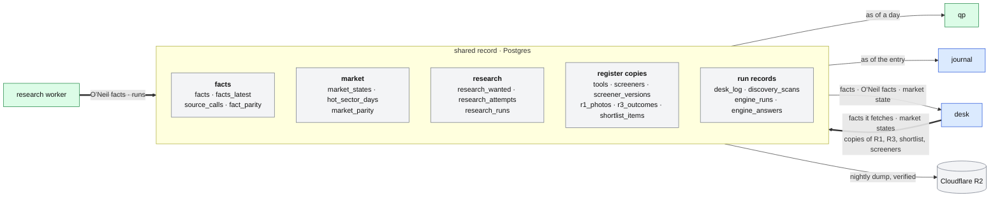

# The shared record

**Above:** [ARCHITECTURE.md](../../ARCHITECTURE.md) §2.8 (outside the box) and
§3 (how the blocks share data).

**Talks to:**

| Program | What it does here |
|---|---|
| the [desk](../desk/DESK.md) | writes the facts it fetches, the market states and the copies of the registers |
| the [research worker](../research/RESEARCH-WORKER.md) | writes the O'Neil facts |
| [qp](../quant/QUANT.md) | reads registers, market states and facts, as of a day |
| the [journal](../journal/JOURNAL.md) | reads what was known at a trade's entry |

The [backups](BACKUPS.md) dump and verify it every night.

---

## 1. What it is

**One Postgres database** for what more than one program, or more than one
tool, needs:

| It holds | Why it is shared |
|---|---|
| **facts about the world**, each with its time and source | short interest, news, the CANSLIM letters and the rest are the same whichever tool asks. Stored once, with the instant they became known, they give every reader the same answer "as of" any instant |
| **the market states** and the hot sectors | one market read per scan serves every tool, and its history serves R2 and qp |
| **the O'Neil facts** | written by the research worker, read by the desk, qp and the journal |
| **a copy of every register** (R1, R3, the shortlist) and of the tools and screener versions | the copy keeps the research record safe if the box is lost between two nightly backups, and lets qp read any tool's history as of any day |

**It is not the record of a tool's results.** Each tool's own file on the box
is ([FILES.md](../files/FILES.md)). So the desk keeps working when the shared
record is down: the tools work from their own files and fetch their own facts,
and the copies catch up.

**What it never does:**
- holds a secret;
- is written by a page directly;
- has two writers for one fact family or one table.

---

## 2. The diagram

---

## 3. Its parts

### 3.1 Facts

| Table | Key | Holds |
|---|---|---|
| `facts` | subject, family, `known_at` | every fact: `value` (jsonb), `status` (`ok`, `none`, `unavailable`), `reason`, `source`, `as_of`, `provisional`, `tool` |
| `facts_latest` | subject, family | the newest fact of each subject and family (the same columns) |
| `source_calls` | family, day | requests received, calls actually made, failures, the last error |
| `fact_parity` | day, family, subject, tool | while a family is in shadow: the store's answer against the tool's own, and the fields that differ |

**What is kept.**
- **`facts_latest`:** every fetch updates it.
- **`facts`:** keeps every fetch, except for the fast families: the quote, the
  numbers derived from it, and the market context stamped from each state.
  Those enter the history only at discovery, at each tool's photo and at the
  close.

So the history stays small. Every photo holds its whole card anyway, and the
market states keep their own history.

**The families, their writers and their clocks:**
- the card's families: [CARD.md](../desk/tool/CARD.md);
- the O'Neil families:
  [RESEARCH-WORKER.md](../research/RESEARCH-WORKER.md).

### 3.2 The market

| Table | Key | Holds |
|---|---|---|
| `market_states` | id | `at`, `day`, `status` (`ok`, `no_regime`), `reason`, `state` (jsonb): the indexes, the three reads, the regime, the 15 sectors, the hot sectors, the rules in use |
| `hot_sector_days` | sector, day | each sector's best score of the day, its counts toward hot and toward cooling, hot or not, hot since |
| `market_parity` | tool, `at` | while the market reader is in shadow: each tool's own read against the shared one |

Detail: [MARKET.md](../desk/MARKET.md).

### 3.3 Research

| Table | Key | Holds |
|---|---|---|
| `research_wanted` | ticker, day | each ticker a tool carded, with when and by which tool (written by the desk) |
| `research_attempts` | ticker, day | each attempt of the research worker for a ticker, ok or not, with detail |
| `research_runs` | id | each run: kind, start, end, ok, each step's result, counts |

### 3.4 The register copies

| Table | Key | Holds |
|---|---|---|
| `tools` | id | name, status, role, capture times and why, the tradability floor |
| `screeners` | tool, key | name, status, mirror, purpose, current version |
| `screener_versions` | tool, key, version | the definition (jsonb), its hash, when, a note |
| `r1_photos` | tool, day, ticker | `captured_at`, the card (jsonb, with the versions of the screeners that matched), `late`, `source` |
| `r3_outcomes` | tool, day, ticker, entry | entry price, highest high, lowest low, ATR14, upR, downR, opening range high and low, `captured_at` |
| `shortlist_items` | tool, day, ticker | when added, by which method, the item (jsonb), when exported |

**How they are written and checked:**
- The desk writes each copy at the moment it writes the tool's own file.
- The two are compared every day.
- The old history of all eleven tools was imported once, with 0 differences.

qp reads them as of a day ([BACKTEST.md](../quant/BACKTEST.md)).

### 3.5 Run records

| Table | Holds |
|---|---|
| `desk_log` | notable events, such as a hot-sector reset |
| `discovery_scans`, `engine_runs`, `engine_answers` | the discovery engine's comparison record. The engine is off and retires with the move into the desk ([ARCHITECTURE §8](../../ARCHITECTURE.md#8-decisions)) |
| `schema_migrations` | the migrations that have run |

### 3.6 Its switches

Each area has a switch in `data/keys.json`:

| Setting | Means |
|---|---|
| **off** | not used: each tool works as before |
| **shadow** | written and compared beside the tool's own way; nothing depends on it |
| **on** | used |

| Switch | Area | Today |
|---|---|---|
| `factsMode` | short interest, borrow, news from the fact store | shadow |
| `marketMode` | the one market read | shadow |
| `researchMode` | the O'Neil facts on the cards | shadow |
| `registersMode` | the register copies | shadow: written and compared, and it stays there |
| `discoveryMode` | the discovery engine | off |
| `quantRegistersMode` | qp reading registers from here | off |

A family or an area is switched **on** only when its comparison is clean.
- **For a fact family**, also when its call counts show the tools share enough
  tickers for sharing to pay ([MIGRATION.md](../MIGRATION.md) step D).
- **The register copies have no "on".** They stay copies, and each tool's own
  file stays the record ([ARCHITECTURE §8](../../ARCHITECTURE.md#8-decisions)).
  What is switched on is qp reading them (`quantRegistersMode`).

### 3.7 Where it lives

**On Railway today:** a Postgres reached over TLS, its address kept in
`data/keys.json` as `databaseUrl`.

**The other places it could live:**
- on the box, at 60–100 MB of its 912 MiB;
- on AWS RDS.

**This is an open decision for the trader** ([ARCHITECTURE §8](../../ARCHITECTURE.md#8-decisions)).
Moving it is one dump and one restore.

**What guards it:**
- **Saving the address.** It is checked before it is saved: it must be a
  Postgres address, reachable from the box (not Railway's private address), and
  it must connect.
- **Its own database only.** Migrations refuse a database that already holds
  another project's tables.
- **One TLS rule** for every program that connects.

---

## 4. Contracts

| Writer | Writes only |
|---|---|
| the desk | the card fact families, `source_calls`, `fact_parity`, the market tables, `research_wanted`, the register copies, `desk_log`, the discovery tables |
| the research worker | the O'Neil fact families, `research_attempts`, `research_runs`, the models (when chosen) |
| the backup | nothing: it reads, dumps and verifies |

| Reader | Reads |
|---|---|
| the desk | facts and O'Neil facts for its cards; the market state |
| qp | registers, market states and facts, as of a day |
| the journal | facts, the market state and R1 rows, as of a trade's entry |

**Migrations.** They are numbered, run once and recorded, under an advisory
lock so that two programs starting together cannot both migrate. Today they are
`001_facts`, `002_market`, `003_research`, `004_registers`, `005_discovery` and
`006_engine_answers`, in `src/facts/index.js`.

---

## 5. When it fails

| Event | What happens |
|---|---|
| it is unreachable | every program stays off it for a minute, then tries again. Tools work from their own files and fetch their own facts. The copies and the shared facts wait, and the gap is shown on the health page |
| a write fails | the tool's own file already holds the row, so nothing is lost; the daily comparison finds the gap and the copy is written again |
| it is lost | restore last night's dump. The register copies can also be rebuilt from the tools' files (`scripts/import-registers.js`), with 0 differences proven once |
| the address saved is wrong | refused before saving, with the reason ([BOX.md](../box/BOX.md) §4.3) |

---

## 6. Built on

**The old desk** had no shared database:
- facts lived in each tool's memory, fetched once per tool;
- the O'Neil facts in JSON files written by qp;
- the market read was made five times a scan.

The design that made it: [ARCHITECTURE](../../ARCHITECTURE.md) §3.

**The code:**
- `src/facts/index.js` (the store, the migrations, the switches);
- `src/market/store.js`;
- `src/registers/store.js`;
- `quant-platform/research/worker.py`;
- the code repository's `docs/FACT-STORE.md` and `docs/REGISTERS-DB.md`.

**What it learned:**
- **Sharing a fact pays only when tools hold the same tickers.** The call
  counts decide each family.
- **The discovery engine saves nothing.** With every tool's screeners
  different, there is no identical scan to merge.

---

## 7. Status

| Part | Status |
|---|---|
| the store, its migrations, its switches, the TLS rule, the foreign-database guard | **built**, on Railway (2026-10-08) |
| facts, market states, research facts | **built, in shadow** |
| register copies, with the history of all eleven tools imported (0 differences) | **built**, written and compared |
| each area switched on | **to do**, area by area, when its comparison is clean (step D) |
| `health_checks`, models | **to build** |
| where it lives | **open**: the trader's decision |
